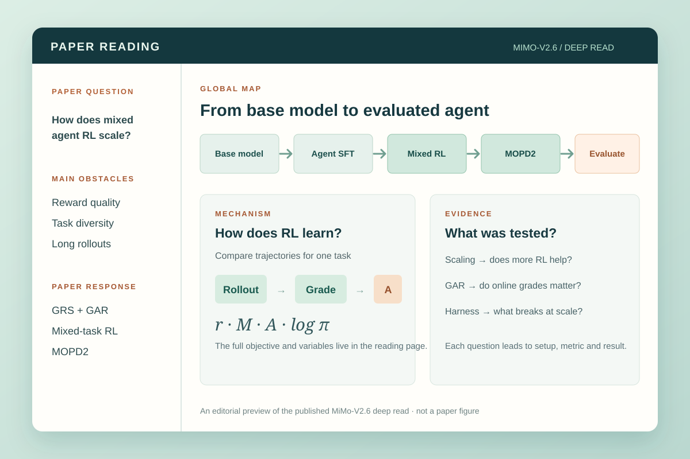

<p align="center"></p>
<h1 align="center">Paper Reading Skill</h1>
<p align="center"><strong>一页读懂整篇论文。</strong> 提供 PDF 或论文链接，获得串起全局论证、机制、原图、公式与实验的自包含 HTML 深读图谱。</p>
<p align="center"><a href="https://xiaofengshi.github.io/paper-reading-skill/zh.html">项目主页 ↗</a> · <a href="https://xiaofengshi.github.io/paper-reading-skill/mimo-v2.6-deep-read.html">阅读完整样例 ↗</a> · <a href="#开始使用">开始使用</a> · <a href="README.md">English</a></p>



## 阅读完整样例

选一篇论文，就能在一个页面里沿全局图、机制说明、原论文图、公式和实验证据读完整篇。图示与重要数字均有相邻解释，原文定位按需显示。

- **Attention Is All You Need** · English — 沿编码器与解码器追踪 token，算清注意力公式，再读翻译实验、消融和句法分析。[打开完整深读 →](https://xiaofengshi.github.io/paper-reading-skill/attention-is-all-you-need-deep-read.html)
- **DeepSeek-V4.1-Flash** · English — 分清预填充计算、运行时全局 KV 和持久化 KV，结合原论文图读 CED、CSA2 和 Agent 评测。[打开完整深读 →](https://xiaofengshi.github.io/paper-reading-skill/deepseek-v4.1-flash-deep-read.html)
- **MiMo-V2.6** · 中文 — 从训练主线读到 RL 目标、GRS/GAR、运行系统、MOPD2 与实验。[打开完整深读 →](https://xiaofengshi.github.io/paper-reading-skill/mimo-v2.6-deep-read.html)
- **RAFT** · 中文 · Kimi Code — 沿数据精炼与答案条件在线蒸馏的耦合路径，读懂领域能力和通用能力的实验权衡。使用安装后的本 skill 在 Kimi Code 中制作，依据 [arXiv:2606.00147v1](https://arxiv.org/abs/2606.00147v1)。[打开完整深读 →](https://xiaofengshi.github.io/paper-reading-skill/raft-deep-read.html)
- **MechVQA** · English · Kimi Code — 沿专家核验的机械图纸到十类任务的基准构建流程，理解 MechVL 的 SFT 与 RL 训练阶梯及消融。依据 [arXiv:2605.30794v2](https://arxiv.org/abs/2605.30794v2)。[打开完整深读 →](https://xiaofengshi.github.io/paper-reading-skill/mechvqa-deep-read.html)
- **IAR** · 中文 · Kimi Code — 沿 Inject → Align → Recover 读懂文档知识注入、无检索问答与通用能力恢复，再对照八种设置下的证据。依据 [arXiv:2608.20281v1](https://arxiv.org/abs/2608.20281v1)。[打开完整深读 →](https://xiaofengshi.github.io/paper-reading-skill/iar-deep-read.html)
- **VISTA** · 中文 · Kimi Code — 沿无损视觉记忆与主动检视读懂视觉外骨架，再读 ARC-AGI-3 满分、harness 消融阶梯与跨基准证据。依据 [arXiv:2610.02200v1](https://arxiv.org/abs/2610.02200v1)。[打开完整深读 →](https://xiaofengshi.github.io/paper-reading-skill/vista-deep-read.html)

MiMo 样例基于一份 44 页的本地 PDF 编写，仓库不分发该 PDF。作者后来[更新了在线报告](https://huggingface.co/XiaomiMiMo/MiMo-V2.6-Pro-RL/commit/73875d00b30a89ef8cc353a0b60b0e9f9561952d)；样例已采用修正后的 Pro 激活参数数值，其他版本差异尚未逐页核对。

## 你会得到什么

先用简短导读和全局概念图定位论文，再沿以下正文逻辑完整深读：

1. **研究问题与价值** 问题到底是什么、怎样算解决、为什么值得解决。
2. **已有方案与缺口** 在首次发表时的背景下，解释具体前作做成了什么、为何仍不足。与上一项共同组成第一个可导航的背景章节。
3. **思路重建** 只从论文之前的知识、失败模式和观察出发，解释一种可能想到该方向的路径；明确这是教学性重建，不冒充作者真实发现过程，也不用本文答案倒推动机。
4. **核心直觉** 用易懂、简洁的语言讲清思路本质，再对应到论文术语。
5. **具体方法与贯穿实例** 沿同一个实例追踪输入、处理和输出，说明关键选择的理由、代价及假设；区分真实来源、教学示例和未经计算的示意中间值。
6. **数学理解** 补足必要基础，逐步解释核心推导及其直觉；没有理论推导就明确说明，不强行编造证明，必要的实现或指标公式仍须解释。
7. **实验问答** 按“提出什么问题 → 如何设计实验验证 → 答案及边界是什么”组织，只保留决定性的数值和条件，避免堆砌排行榜。
8. **Takeaways** 提炼由机制和证据共同支持的具体启示、适用条件及未解问题。
9. **最脆弱的假设** 找到对机制或结论有实质影响的脆弱假设，解释依据、不确定性与失效后果。
10. **一周最小复现** 选择一个可行的窄问题，说明资源与数据、对照、指标、判据、七天安排及备选方案。
11. **反例设计** 针对明确主张提出公平的具体挑战，区分适用范围内的反证与范围外的压力测试。
12. **后续研究检索** 实际调用搜索工具，核实扩展、复现、批评与认知变化，注明检索日期和访问限制。
13. **有实质新意的 follow-up** 从具体局限与未满足需求出发提出研究假设，对照已检索的近邻工作，给出可证伪实验；不保证首创。

图负责引导阅读；正文、公式、表格和原论文图承载细节。原文位置默认不显示，但需要核对时可以展开。最终交付是一份包含丰富可视化与有效交互、离线可读的 HTML，另附作为审计源的 Markdown。使用自然、准确、有信息量的表达，避免大空话与套式转折；明确区分论文原文、已有文献、合理推断和不确定猜测。

以上是当前本地增强版的要求，详见[用户完整 Prompt](references/user-prompt.md)、[正文逻辑协议](references/narrative-logic.md)、[研究延展协议](references/research-extension.md)和[本地变更记录](LOCAL_CHANGES.md)。先写通正文，再选择可视化；交付前进行“暂时忽略图示，正文是否仍能讲通”的语义自查。上方链接的上游公开样例未因此自动重写，也不能作为已经通过新增要求的证明。

## 论文阅读方法

这套流程把已有的论文阅读和知识组织方法，与针对单篇论文的编辑设计结合起来。三个检查分别回答不同问题：

1. **能否先重建论文，再向读者解释** [Keshav 的三遍阅读法](https://systems.cs.columbia.edu/ds2-class/papers/keshav-paper.pdf)从全局认识，逐步走到内容理解和细节重建。本 skill 先画暂定全局图，再追踪方法与结果，最后推演决定性的公式、假设、证明或实验。普通深读请求会完成整条路径；只有用户要求快筛时才停在概览。
2. **图里的关系是否有明确含义** [Novak 与 Cañas 的概念图方法](https://cmap.ihmc.us/docs/theory-of-concept-maps)从焦点问题出发，用带说明的连线和跨区关联组织概念。本项目的每张图都回答一个与论文有关的问题，例如“机制如何影响结果”；箭头须说明是数据流、过程顺序还是证据关系，正文解释这些连接。
3. **解读能否回到论文核查** [SciDoc2Diagrammer-MAF](https://aclanthology.org/2024.findings-emnlp.780/)指出生成的科学图示可能遗漏信息或偏离原文。本项目据此要求核对关键图、公式、数字和箭头，并把每项实验的设置、对照、指标与结果放在一起。本项目并未实现该论文的图示生成算法。

这三项原则支持上文的阅读主线：从问题和前作缺口走向思路、方法与证据，再形成有依据的启示。衡量深读是否有用，要看读者能否讲清“为什么提出、怎么想到、怎样实现、如何验证”，而不必为补全关键解释反复查 PDF。这是本项目的方法设计；现有样例尚未经独立读者研究验证。

[公开的深读质量检查](evals/reading-quality.md)将来源覆盖、科学事实、主张与证据的对应、独立可读性和离线交付变成交付门槛。[各样例的读者题目与答案](evals/reader-tasks.md)可供未参与编写的人测试理解效果。渲染器测试通过或作者自查，都不等于完成了独立读者研究。

## 开始使用

**在 Codex 项目里快速试用：** 在项目目录运行 [skills CLI](https://github.com/vercel-labs/skills)，然后检查内置渲染器。安装结果位于项目内的 `.agents/skills/paper-reading`。

```bash
npx --yes skills add xiaofengShi/paper-reading-skill --skill paper-reading --agent codex --copy --yes
(cd .agents/skills/paper-reading && npm ci && npm run doctor)
```

**Codex 与 Kimi Code：** 把仓库安装为个人 skill，再安装渲染依赖。仓库附带的 HTML 渲染器需要 Node.js 20 或更新版本。

```bash
mkdir -p "$HOME/.agents/skills"
git clone https://github.com/xiaofengShi/paper-reading-skill.git "$HOME/.agents/skills/paper-reading"
(cd "$HOME/.agents/skills/paper-reading" && npm ci)
```

运行 `(cd "$HOME/.agents/skills/paper-reading" && npm run doctor)` 检查安装。它会在临时目录生成一份完整的 Transformer 样例，并检查语种、公式、导航和内嵌图。

**Claude Code：** 改用它的个人 skill 目录。

```bash
mkdir -p "$HOME/.claude/skills"
git clone https://github.com/xiaofengShi/paper-reading-skill.git "$HOME/.claude/skills/paper-reading"
(cd "$HOME/.claude/skills/paper-reading" && npm ci)
```

此安装路径运行 `(cd "$HOME/.claude/skills/paper-reading" && npm run doctor)`，然后再打开新的 agent 会话。

如果已经安装，直接更新已有目录及依赖，不要在同名目录上再次 `git clone`。Codex 或 Kimi Code 运行 `git -C "$HOME/.agents/skills/paper-reading" pull --ff-only`，再运行 `(cd "$HOME/.agents/skills/paper-reading" && npm ci)`；Claude Code 把路径换成 `$HOME/.claude/skills/paper-reading`。

重新打开 agent 会话，附上 PDF 或给出可访问的论文链接，然后说：**“用中文深入阅读这篇论文，给我一份可视化 HTML 文档，讲清主线、重要公式和实验。”** 也可以明确要求英文。Skill 默认遵循用户请求的语种；没有任何语种线索时使用英文。Skill 名称是 `paper-reading`；也可以在 Codex 输入 `$paper-reading`，在 Claude Code 输入 `/paper-reading`，在 Kimi Code 输入 `/skill:paper-reading`。Agent 必须能访问论文并完成科学阅读；本项目提供阅读流程与渲染器，并非把任意 PDF 自动转换成已核实解读的服务。

只有需要快筛时才要求概览。普通深读默认覆盖全部 13 项，先理解论文，再做批判分析与研究延展；审稿或与自身研究比较的请求会进一步扩展或定制这些内容。也可以明确要求缩小范围。

## 工作方式

[Skill 指令](SKILL.md)引导 agent 依次建立全局认知、重建全文、编写解释并核对来源。[论文类型协议](references/paper-types.md)为实证、系统、基准、数据集、理论和综述论文选择合适图形；[可视化阅读规则](references/visual-reading.md)要求图示与解释、证据对应。[阅读模式](references/reading-modes.md)定义可选的快筛、审稿和研究视角。

仓库附带的[渲染器](scripts/render-reading.cjs)把 Markdown 审计源与本地图形生成单文件 HTML，内嵌图片、图示、KaTeX 数学排版和字体。每份源文档都必须在首行写明 `<!-- paper-reading-lang: en -->` 或 `<!-- paper-reading-lang: zh-CN -->`，导航和图表标签也据此选择语种。可在第二行选择四种内置视觉主题之一：`<!-- paper-reading-theme: forest -->`、`cobalt`、`plum`、`saffron`；省略时使用 `forest`。作者按论文内容选择主题，渲染器不猜测主题。默认交付必须包含有助于理解具体论文的有效交互，例如追踪贯穿实例或比较实验证据；更适合静态表达的单个视图仍保留静态。交互图可用 Archify 或自包含的 HTML/SVG 制作，关键解释仍须在无脚本时可读。构建不依赖 Archify 或其他本地 skill。[渲染器输入格式](references/renderer-format.md)给出 Markdown 的精确契约，[从 PDF 抽取插图](references/figure-extraction.md)说明原图裁切与数值核实方法。[Transformer](examples/attention-is-all-you-need-deep-read.md)、[DeepSeek](examples/deepseek-v4.1-flash-deep-read.md)、[MiMo](examples/mimo-v2.6-deep-read.md)、[RAFT](examples/raft-deep-read.md)、[MechVQA](examples/mechvqa-deep-read.md)、[IAR](examples/iar-deep-read.md)和[VISTA](examples/vista-deep-read.md)的 Markdown 与图形输入都是构建材料，不要求读者分别打开。

本地重建所有已发布样例：

```bash
npm ci
npm run doctor
npm run build:examples
npm test
```

## 验证与适用范围

已发布的样例覆盖经典架构论文、技术报告、领域微调方法、工程基准、文档知识内化和交互式视觉环境的智能体外骨架。渲染测试覆盖语言和主题声明、行内与独立公式、原文位置开关、原图上下文和数值图行为。这些检查验证排版与生成契约，不等于独立核证每一条科学解读。理论、综述和独立读者测试仍不在当前样例范围内。

[Archify](https://github.com/tt-a1i/archify)是可选的交互结构图呈现工具。科学内容仍须对照论文核查。

欢迎在 [GitHub Issues](https://github.com/xiaofengShi/paper-reading-skill/issues)提交问题、缺陷或其他论文类型的样例。项目使用 [MIT 许可证](LICENSE)。

## 维护说明

本文是[中文主页](https://xiaofengshi.github.io/paper-reading-skill/zh.html)的内容源；[README.md](README.md)是默认[英文主页](https://xiaofengshi.github.io/paper-reading-skill/)的内容源。修改任一语言后运行 `npm run build:docs`，将生成的 HTML 与 Markdown 一同提交。主页生成器见 [scripts/build-docs.cjs](scripts/build-docs.cjs)。
