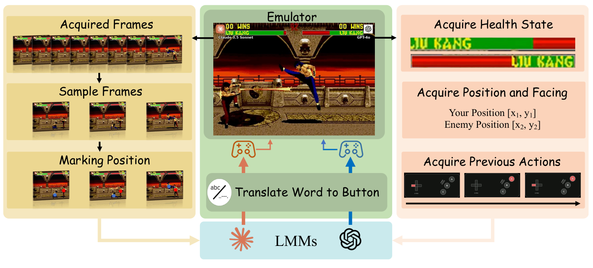
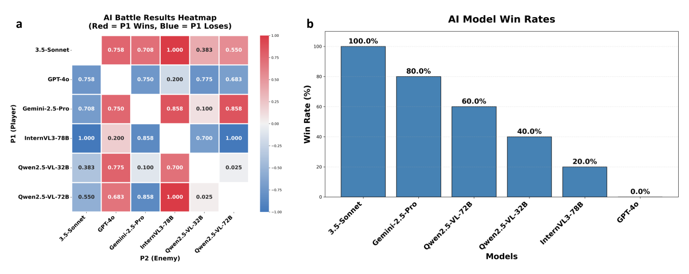
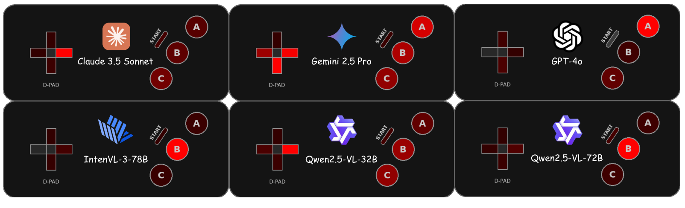

<!-- paper-reading-lang: zh-CN -->
<!-- paper-reading-theme: cobalt -->
# LM Fight Arena：从看懂画面到及时出招

**论文类型：基准与智能体系统。** 这篇论文让六个通用多模态模型在《Mortal Kombat II》中互相对打，用比赛结果考察持续的观察、决策与执行。它提供了一条容易理解的评测闭环，但只有 15 场比赛，而且缺少足以分离模型判断力、接口偏差与响应速度的控制实验。因此，最值得带走的是评测设计和它暴露的测量问题；模型名次应当作为一次特定配置下的结果来读。

阅读依据为本地英文 PDF **arXiv:2510.08928v2，2026-09-16，9 页**，已覆盖正文、四幅图与参考文献，无附录。首发为 **2025-10-10**。另下载 v1 PDF 对照了提取文本：主要变化是作者与单位信息及由此引起的分页移动，方法与结果段落未发现实质文本改动。中文对照附件不作为独立论文，也不作为数据核验依据。<span class="source-ref">Zotero 主条目 MDUVDNU2；英文附件 IVFR4GPN；[版本历史](https://arxiv.org/abs/2510.08928)；原文定位默认隐藏，可用页面来源开关显示。</span>

```paper-map
{
  "thesis":"让模型用画面与状态控制同一个格斗角色，比较它们能否把判断及时变成有效动作",
  "outcome":"实测范围：6 个模型、1 个游戏、1 个角色、每对 1 场，共 15 场；没有训练新模型",
  "outcomeSource":"PDF v2 pp. 3–4 §3",
  "items":[
    {"number":"01","label":"问题","signal":"闭环能力","text":"静态答题分数不能直接回答：对手也在行动时，模型能否持续做出有效控制。","source":"PDF pp. 2–3 §§1–2"},
    {"number":"02","label":"方法","signal":"双路观察 → 语言动作","text":"10 帧画面加角色标记，与内存读取的血量、位置、朝向、最近 5 次动作，一起送入模型，再把文本翻译为按键。","source":"PDF pp. 3–4 §3, Fig. 2"},
    {"number":"03","label":"证据","signal":"单循环比赛","text":"作者报告 Claude 5 胜、Gemini 4 胜；这些是整套模型与控制系统的比赛结果，没有独立机制消融。","source":"PDF p. 4 §4, Fig. 3b"},
    {"number":"04","label":"边界","signal":"胜率 ≠ 推理诊断","text":"相同角色削弱角色差异，但延迟、解析和观察辅助仍影响名次；图文数值冲突需保留。","source":"PDF pp. 5–6 §§4.1–5.3；本文证据分析"}
  ]
}
```

<!-- paper-reading-context:start -->
## 00 / 发表时的研究背景
<!-- context-cutoff: 2025-10-10; basis: first-publication -->

### 研究问题与价值

模型看到一张格斗截图，说出“对手正在接近”，并不代表它能赢。打赢还需要认清自己控制谁，判断距离与运动趋势，把意图写成可执行指令，并在局势改变前完成操作。一次输出又会改变下一次观察，错误会累积，对手还会主动利用它。本文要测的具体问题是：**不给游戏专门微调，通用多模态模型在统一控制框架中，能否通过视觉与状态反馈完成对抗性的连续决策；不同模型的比赛表现有何差异。** 输入是画面序列和结构化状态，输出是控制器动作，直接成功标准是击败对手，辅助指标是胜者剩余血量。（PDF pp. 2–4 §§1–3）

这里的“零样本”只表示本次没有游戏专门微调或少样本示范，不表示模型预训练时从未接触《Mortal Kombat》的攻略。**论文原文**把应用价值延伸到具身助手和遥操作；这些是希望迁移的方向，没有机器人或现实部署实验。已经展示的价值更窄：用规则明确的环境自动产生输赢反馈，并把部分行为可视化。（PDF pp. 6–7 §§5.3–6）

### 当时的领域状态

时间边界固定在 **2025-10-10**，不能把 2026 年的工作当成当初的动机。彼时静态多模态测评、视觉网页操作、游戏控制与实时 LLM 对打均已有先例。本文引言描述的缺口是相对静态题库的缺口；如果扩展为“此前没有动态游戏评测”或“此前没有 LLM 格斗”，会与可核实的前作冲突。

先解释三个必要概念。**闭环控制**是观察、行动、再观察，而非一次生成整段攻略。**镜像对局**指双方使用相同角色，减少招式和属性差异；它不能自动消除左右站位、模型接口和时延差异。**基准的构念效度**是分数是否真在测声称的能力：输赢很客观，但“输了是因为推理差”仍需要额外证据。这三个区别决定了后面应该怎样读名次。

### 关键前作与尚存缺口

下表前四项及 Chatbot Arena 构成技术背景；VideoGameBench 与 Win Fast or Lose Slow 是首发前已经公开、但目标论文未充分讨论的近邻。前作贡献的核验范围也列明，避免把摘要核验写成完整复现。

| 工作与时间 | 已有贡献 | 当时未解问题及与本文的关系 | 来源 |
|---|---|---|---|
| MMBench，首发 2023-07-12 | 双语多能力选择题；用 CircularEval 和答案映射降低选项偏差与格式影响 | 系统评估图文理解，但动作不会反过来改变题目，也不引入实时对手 | [原始论文摘要及版本页，核验到 2024 年 v5](https://arxiv.org/abs/2307.06281)；目标 PDF §2 |
| VisualWebArena，首发 2024-01-24 | 让多模态智能体处理图文网页任务，执行动作完成用户目标 | 已解决“视觉输入参与多步交互”的评测形式；网页任务不等同于双方持续施压的格斗 | [作者论文摘要与历史](https://arxiv.org/abs/2401.13649)；目标 PDF §2 |
| FightLadder，2024-06-04，ICML 2024 | 开源竞争性多智能体强化学习平台，提供性能与可利用性指标；训练单人模式通用角色代理 | 已有实时格斗和竞技评测；核心对象是经过游戏训练的 RL 策略，并非通用多模态模型零样本控制 | [作者论文摘要](https://arxiv.org/abs/2406.02081) |
| LLM Colosseum，项目自述起于 2024 年 Mistral Hackathon | Street Fighter III 中的 LLM 实时对打，包含文本与视觉控制模式、动作转换和 Elo 排名 | “LLM 互相格斗”本身已有公开项目；本文的 MK II、双路观察和具体赛制是实现取舍，不能由此推出宽泛首次 | [官方 README，已读控制模式和示例代码](https://github.com/OpenGenerativeAI/llm-colosseum)；精确首提交日期本次未核实 |
| VideoGameBench，2025-05-23 v1 | 原始像素输入的真实游戏评测，并用 Lite 暂停推理期间的游戏，研究反应速度与决策的区别 | 已有实时／暂停对照，但主要是完整游戏进度，非本文的同角色模型对抗赛 | [原始全文 §§2.2、2.5、4.1](https://arxiv.org/html/2505.18134v1) |
| Win Fast or Lose Slow，2025-05-26 v1 | Street Fighter 与交易任务研究速度—质量权衡，FPX 混合精度调整时延；格斗每对进行 40 场 | 已有 LLM 竞技格斗及延迟研究，主要用紧凑状态提示和特定模型族；未替本文建立六种多模态系统的同配置测量 | [原始全文 §§3.1、3.3、5](https://arxiv.org/html/2505.19481v1) |

**论文原文的来源归属：** 作者明确称 Chatbot Arena 的成对人类偏好评测启发了竞技评测思路。这里能继承的是“相对比较”的形式；Chatbot Arena 的人类偏好投票与本论文按游戏输赢判定的测量对象不同，也不能混用它的排名统计依据。[原始论文摘要](https://arxiv.org/abs/2306.05685)；（PDF p. 2 §2）。本文没有采用 Elo，也没有必要为了 Arena 这个名字补造 Elo 公式。

### 本文为何在此时提出

合理的历史判断是：到首发时，相关问题**已被部分解决，且条件各异**。静态测评有覆盖面，网页代理有视觉闭环，RL 有格斗技术，LLM 项目有对打，近邻研究甚至已讨论延迟。仍值得做的事是把“通用多模态系统 + 双路观察 + 同角色直接对抗”固定成可检查的测量协议，并检验它能否稳定、可解释地比较系统。

**合理推断：** 这要求至少同时固定信息权限、动作语义、时间调度和对手分布。只换成格斗游戏不足以保证公平。本文给出一个轻量实例，但没有完全完成这些有效性验证。因此本文的贡献应定位为一种具体评测组合与小规模实测，而非首次建立整个研究方向。（PDF §3；上述近邻原始来源）
<!-- paper-reading-context:end -->

## 01 / 从已有知识推到设计假设

**以下是一种基于当时知识的教学性重建，并非作者真实发现过程的记录。** 暂时不使用本论文的模型名次或具体模块，只问：如果要把会答题的视觉模型变成可检验的行动者，怎样设计测试才合理。

第一步，静态图文测评已经能比较识别与问答，但一次答对无法保证下一次行动正确。VisualWebArena 说明，可以让模型实际执行操作、按任务结果评分，把部分语言判断放回反馈循环。第二步，若环境会等待模型，慢但正确的动作仍可能成功；VideoGameBench Lite 与 Win Fast or Lose Slow 已揭示，允许世界继续变化会改变测量目标。第三步，格斗环境有可程序化读取的终局与资源状态，而且双方行动会相互影响，适合检验持续决策。（来源见背景表中原始文献）

由此可以提出一个**尚待验证的设计假设**：选用规则明确、可重置的对抗环境，限制双方角色和信息权限，再用真实执行后的结果比较通用模型，可以获得静态题库之外的系统能力信号。它预测的首先是“测试会区分系统行为”，还不能预测哪个模型更强，也不能保证信号只来自推理。这条推导即使隐去本文最终方法和实验仍然成立；本文的实际实现是这个方向中的一个选择。

## 02 / 核心直觉与方法改动

把理解能力放进会产生后果的循环：模型每次看见局势，发出语言动作，游戏执行，模型再面对自己动作和对手动作共同造成的新局势。胜负把许多局部决策汇总成可自动判定的结果。**必要条件**是模型看到的信息和执行动作的机会足够可比，否则分数会把能力、辅助工具与服务速度一起混合。（PDF §3）

| 此前常见操作 | 本文实际选择 | 想解决的瓶颈与归属 |
|---|---|---|
| 静态图文输入，生成答案 | 带反馈的模型对抗赛 | 本文的具体评测整合；闭环与竞技思想已有前作 |
| 一张截图、角色不易区分 | 每隔 4 帧抽样，共 10 帧，并加玩家位置标记 | 为本文场景配置的观察辅助；没有单独验证优于单帧 |
| 从画面自行估计全部状态 | 同时读取内存状态，附上最近 5 次已执行动作 | 显著改变信息权限与记忆；状态辅助是已有范式，本文采用并适配 |
| 模型生成语义，游戏接收按键 | 文本动作转换器处理组合与序列 | 必需的适配层；通用原创性未建立，具体解析规范未公开 |
| 角色与对手不统一 | 全部使用 Liu Kang，六模型单循环 | 控制角色因素；每对一场的代价是高统计不确定性 |

没有模型预训练方法、额外损失或新参数更新。下面的方法都是**评测时的信息组织、推理调用和动作执行设计**，不能读成一套新训练算法。

## 03 / 跟着一次决策走完整闭环

先看原论文 **Fig. 2**。左侧回答“图像如何进入模型”，右侧回答“模型额外获知什么”，中间向上的箭头回答“文本怎样变回按键”。尤其注意右侧位置和血量来自状态读取，因而这套评测并非纯像素视觉控制。



*原论文 Fig. 2，英文原图，PDF p. 3；中间控制回路连接画面与结构化状态两条观察支路。*

### 同角色镜像对局与零样本调用

**论文原文：** 游戏采用 Sega Genesis 版《Mortal Kombat II》（1994），双方均控制 Liu Kang，使用相同的系统提示介绍目标、观察格式和动作。六模型为 InternVL3-78B-Instruct、Qwen2.5-VL-32B-Instruct、Qwen2.5-VL-72B-Instruct、Claude 3.5 Sonnet、Gemini 2.5 Pro、GPT-4o。没有游戏专门微调，也没有少样本示范。（PDF pp. 3–4 §3）

这项控制减少角色招式差异，但角色相同也让视觉身份更容易混淆，于是需要下一步的玩家标记。确定性模拟器和固定种子是作者给出的复现措施；具体模拟器版本、种子值、完整提示、API 日期快照和交换左右站位的方案没有在这份九页论文中给全。模型家族名称不等于不可变的 API 快照。它控制了一部分比较条件，未隔离纯模型能力。

### 10 帧时间窗口与玩家位置标记

**论文原文：** 连续取得画面，每隔 4 个游戏帧取一帧，共 10 帧，叠加玩家专属位置标记，再以 base64 编码提交。base64 是传输编码，不会产生新的时间理解能力。标记的直接作用是帮助模型把屏幕中的两个同角色实例对应到“我／对手”。（PDF p. 3 §3、Fig. 2）

**运行例子：** 论文没有公开逐请求轨迹，因此下面是**构造的教学实例，未执行**：某次观察里，我方位于左侧，对手正向我方接近。10 帧序列原则上能显示“正在接近”，而末帧只给出“此刻距离”。实例不填造坐标、速度或模型内部表征；抽样是否足以分辨攻击起手与动画阶段，原文没有验证。

代价是每次要传入和处理多张图，可能增加视觉 token 与延迟；本文没有报告相应成本。还要保留一个时间核验问题：作者称这相当于“约 1 秒”，但若游戏以 **60 帧／秒**运行，首末样本相距 $9\times4=36$ 帧，即 **0.6 秒**。60 帧／秒是本段用于检查的条件假设，不是已核实的实测速度。原文未提供运行帧率或缓冲规则，故不把“约 1 秒”改写成精确实现事实。（PDF p. 3 §3）

### 内存状态与最近 5 次已执行动作

与画面并行，框架读取游戏内存，提取当前血量、绝对坐标、朝向，并取得最近 5 次已执行动作，把它们变成自然语言状态描述交给模型。这里的动作历史是先前真实执行的控制记录，不是模型生成的五步未来计划，也没有证据表明它是可学习记忆模块。（PDF pp. 3–4 §3）

在同一个教学实例中，坐标提供双方位置与间距依据，朝向帮助解释相对方向，动作历史提示“我刚才做过什么”。它们降低感知和短期记忆负担，但不能证明模型真在使用画面：模型可能主要依赖文本坐标。也无法从“最近五次”推出保存了对手全部动作或完整对话。论文未给出完整字段样例、坐标归一化、动作历史归属和跨模态时间戳对齐规范；不在这里补造。状态辅助和五步历史均无独立消融。

### 自然语言到按键组合与时序序列

模型收到双路观察和共同提示后返回动作字符串。原文明确举了 **`Left + A`** 和 **`Down, Forward, A`**。转换器（Translate Word to Button）负责解析、处理时序敏感序列，并注入模拟器。（PDF p. 4 §3）

为延续实例，假设模型选择原文允许的字符串 `Left + A`。这是**构造输出，并非某模型实测响应**。“+”表达组合输入的意图；转换器仍须定义按多久、何时释放。若输出 `Down, Forward, A`，还须定义每步持续时间、间隔，以及 Forward 按当前朝向还是生成时朝向解析。这些选择会直接改变连招是否成功。论文没有公布该模块的语法、非法输出回退和按键时序，所以本解读只能追踪到“字符串 → 控制事件”，不能声称某个实例必然触发哪项游戏招式。作者称动作空间覆盖控制器组合，但未给出足以枚举合法动作的完整定义。

### 时间调度与反馈更新

模拟器执行后，双方血量与位置可能变化，新的画面、内存状态和已执行动作进入下一次请求。**没有轨迹数据，所以本例下一步是否命中、掉多少血均未知。** 训练阶段在此流程之外：模型权重固定，反馈用于下一次推理，而非在线梯度更新。评价阶段在比赛结束后汇总输赢和胜者血量。（PDF §3）

本论文同时声称实时控制、每帧控制和固定种子复现，却未说明等待 API 时游戏是否暂停、旧按键是否保持、双方请求怎样并发、过期响应怎样处理。**合理推断：** 逐游戏帧执行控制事件，与每个游戏帧重新发起并完成一次大模型调用是不同操作。不能把这句话扩写成已证实的 60 Hz 模型推理。这个缺口阻止精确重建运行时，但不妨碍理解公开的概念闭环。

下面是**本文据 Fig. 2 重绘的概念流程**。箭头表示交付给下一阶段的信息，最后一步回到观察；它不额外规定原文没有披露的并发与暂停规则。

```paper-path
{
  "title":"一次观察怎样变成下一次局势",
  "intro":"同一教学实例：左侧我方看到对手接近；中间动作和后果均未实际执行。两条观察支路并行汇入模型。",
  "stages":[
    {"title":"镜像环境","role":"评价条件","action":"Sega Genesis 版 MK II；双方使用 Liu Kang，固定模型权重与共同提示。","why":"削弱角色差异，比较零样本控制系统。","cost":"单一游戏角色；站位与 API 时延未充分控制。","output":"当前画面与可读内存状态","source":"PDF pp. 3–4 §3"},
    {"title":"支路 A：10 帧与角色标记","role":"视觉观察适配","action":"每 4 帧抽样，共 10 帧；叠加玩家位置标记并编码。","why":"展示运动趋势，区分同角色的我方与对手。","cost":"图像处理成本未报告；约 1 秒的说法缺少帧率说明。","output":"带身份标记的画面序列","source":"PDF p. 3 §3, Fig. 2"},
    {"title":"支路 B：内存与 5 次动作","role":"状态观察适配","action":"血量、坐标、朝向与最近 5 次已执行动作写成文本，与支路 A 汇合。","why":"提供精确状态和短期执行记录。","cost":"弱化纯视觉测量；时间对齐细节未披露。","output":"画面序列 + 状态文本 → 模型","source":"PDF pp. 3–4 §3, Fig. 2"},
    {"title":"通用模型选择文本动作","role":"固定权重推理","action":"收到共同提示与双路观察；教学示例假设返回 Left + A。","why":"把观察转成控制意图，没有游戏专门训练。","cost":"响应耗时与输出格式可能因模型不同而变化。","output":"自然语言动作字符串","source":"PDF p. 4 §3；动作选择为未执行教学示意"},
    {"title":"文本转按键与时序","role":"控制器适配","action":"解析组合／序列，注入模拟器；原文未给出持键、释放与回退规范。","why":"让语言真正改变游戏状态。","cost":"转换器可能决定动作是否有效，未单独消融。","output":"按键事件 → 环境执行","source":"PDF p. 4 §3, Fig. 2"},
    {"title":"执行后回到双路观察","role":"反馈与计分","action":"新局势更新画面、内存与动作历史；终局后记录胜负和胜者血量。","why":"局部选择累积为整场结果。","cost":"API 等待期间如何推进环境仍未知。","output":"下一次输入；或终局统计","source":"PDF p. 4 §3；调度缺口为本文核验"}
  ]
}
```

## 04 / 数学只讲真正需要的部分

**本文未给出核心理论推导、学习目标或胜率保证。** 下列公式是本解读为说明协议而写的定义与算术，不是论文中的定理，也不是其原创算法。

### 为什么六个模型只有十五场

单循环让每个无序模型对比赛一次。先选一个模型有 $N$ 种选择，再选不同对手有 $N-1$ 种；这样每对被正反数了两次，除以二即可：

$$
M=\frac{N(N-1)}{2}=\frac{6\times5}{2}=15.
$$

每个模型只面对另外五个模型，因此若没有平局，模型 $i$ 的实测胜率定义为

$$
\widehat p_i=\frac{1}{5}\sum_{j\ne i}\mathbf{1}\{i\text{ 在这次对局击败 }j\}.
$$

$\mathbf{1}$ 表示条件成立记 1，否则记 0。Claude 的五次胜利对应 100%，Gemini 的四次胜利对应 80%。只翻转一场，涉及的两个模型各变化 **20 个百分点**。这解释了榜单的粗粒度；它不是每个模型对同一总体重复五次抽样得到的成功率，更不是未来任意对手上的胜率。（PDF p. 4 §3、Fig. 3b）

### 剩余血量怎样读

用 $H_{\text{win,end}}$ 表示胜者结束时血量，$H_{\max}$ 表示满血，归一化血量可写为

$$
h=\frac{H_{\text{win,end}}}{H_{\max}},\qquad 0\le h\le1.
$$

这是对作者指标的教学性形式化，原文未给出血量读取实现和归一化代码。Fig. 3a 的 0.025 表示胜者约剩满血的 **2.5%**，并非“获胜概率 2.5%”，也不表示两个角色血量相减。Fig. 3 中颜色编码胜负，格子数字给胜者血量；对称的两个格子记录同一场，不能当成两次独立实验。

### 为什么延迟必须成为协议的一部分

设 $t_o$ 是观察时刻，$t_a$ 是动作实际应用时刻。为了说明风险，可定义动作年龄 $A=t_a-t_o$。模型根据旧观察 $o_{t_o}$ 选出的动作，最终要在状态 $s_{t_a}$ 中生效：

$$
a=\pi(o_{t_o}),\qquad s_{\text{next}}=F(s_{t_a},a,a_{\text{opponent}}).
$$

$\pi$ 代表固定模型及其提示下的决策过程，$F$ 代表游戏更新。第二式是概念性单步描述，没有假装复原本文的异步实现。即使模型对 $o_{t_o}$ 判断正确，对手也可能在等待期间移动，令动作过期。这个解释来自已有延迟决策思想；目标论文没有提供足以估计 $A$ 的日志或独立干预。后文的 2026 年工作会明确区分响应耗时与动作年龄，但不能把它们倒置为本文已有的测量。（已有文献：Win Fast or Lose Slow v1 §3.1；目标 PDF §5.3）

## 05 / 实验究竟回答了什么

### 问题一：统一框架能否产生可区分的整场表现

**问题 →** 在作者的模型、提示与控制框架中，六个模型的比赛结果是否相同。**实验 →** 每对一次、角色相同，主指标为胜负，辅助指标为胜者剩余血量。**答案 →** 作者报告了完全分层的 5、4、3、2、1、0 胜。这说明这次比赛有区分度；没有重复对局、随机动作、简单规则、专门 RL 或人类基线，不能回答模型是否达到熟练玩家水平，或这种区分是否稳定。（PDF §3、§4）

下面的胜率重绘与原图使用同一 0–100% 尺度；每根条的分母均为 **5 个不同对手、每对 1 场**。没有置信区间是因为论文未提供重复试验，不能用平滑图形制造精度。

```paper-chart
{
  "type":"bars","title":"这次比赛的胜率，不是通用能力分数","origin":"本文重绘 · 原论文 Fig. 3b","unit":"%","domainMax":100,
  "source":"PDF v2 p. 4 Fig. 3b；§4 及 p. 7 §6 交叉核验",
  "note":"每个模型 5 场；15 场总计。无同一配对重复，无跨游戏泛化证据。",
  "rows":[{"label":"Claude 3.5 Sonnet · 5/5","value":100},{"label":"Gemini 2.5 Pro · 4/5","value":80},{"label":"Qwen2.5-VL-72B · 3/5","value":60},{"label":"Qwen2.5-VL-32B · 2/5","value":40},{"label":"InternVL3-78B · 1/5","value":20},{"label":"GPT-4o · 0/5","value":0}]
}
```

原论文 **Fig. 3** 让我们进一步区分“赢了”与“赢得多险”。看左图 Qwen 两个尺寸的交叉格子：72B 胜者仅剩 0.025；看右图，同一场仍然只计 1 胜。**注意左图实际标题写红色为行玩家赢、蓝色为输，图注却写绿色赢、红色输。这里按图内标题和与 Fig. 3b 相容的读法解释，不按冲突图注重新着色。**



*原论文 Fig. 3，英文原图，PDF p. 4；颜色图注与实际红蓝图例冲突，数字代表胜者剩余血量比例。*

#### 对照图与正文后必须保留的冲突

矩阵嵌在 PDF 中的图像里，文本层无法提取单元格。本次以 4 倍裁图视觉核验行列标签、格子数字和颜色，并与 §4、§6 的胜率交叉核对。**下列“图读数”只是可核实的论文图像读数，不等于拿到了原始比赛日志。**

| 项目 | 正文说法 | 原图或算术核验 | 本解读处理 |
|---|---|---|---|
| Claude 全部胜局血量范围 | §4.1 为 0.758–1.000 | Fig. 3a 的五格为 0.758、0.708、1.000、0.383、0.550，即图示范围 0.383–1.000 | 两种来源并存，拒绝复述“所有胜局均大幅满血” |
| Gemini 输给 Claude | §4.1 为 0.200 | 二者交叉格为 0.708；0.200 出现在 InternVL 与 GPT-4o 配对 | 不混用正文数值与图像单元格 |
| Claude 胜 GPT-4o | §4.1 后句为 0.775 | Claude/GPT-4o 格为 0.758；0.775 是 Qwen32B/GPT-4o | 显示来源冲突 |
| Claude 与 Gemini 合计胜场 | §4.2 为 11/15 | 各 5 胜和 4 胜，加和应为 9/15 | 11 不作为有效统计；按图像九个胜局求均值约 0.663，与原文 0.66 大致相容 |
| Fig. 3a 胜负色 | 图注称绿赢红输 | 图内标题为红赢蓝输，后者与条形榜相容 | 原图保留，中文说明中明确编码 |

### 问题二：动作使用能解释名次吗

**实验 →** 作者汇总所有比赛的按键频率，绘制控制器热图。原论文 **Fig. 4** 应先看同一面板的方向键与 A/B/C 的相对亮度；GPT-4o 面板中 A 较亮，方向键较暗，描述的是输入分布偏置，而非“已证明看不懂威胁”。原图没有可供重绘的计数、统一色标数值或时间序列，所以本解读保留原图，不编造百分比。



*原论文 Fig. 4，英文原图，PDF p. 5；亮度表示作者汇总的按键频率，未提供原始计数或完整时序。*

**论文原文的解释：** Claude 和 Gemini 动作丰富，GPT-4o 更偏单键，模型重复序列后适应有限。**证据边界：** 频率图把事件顺序丢掉。两组动作即使顺序完全不同，也能有相同频率；因此它不能单独证明“先冲刺再防御”、观察对手后成功反制、或模型利用短历史预测逆转。正文中的连招、训练偏好、上下文能力与时延归因是作者的定性解释，本文没有找到可独立核验的日志与消融。（PDF p. 5 §§4.3–5、p. 6 §5.1）

### 问题三：这是视觉推理、时间控制还是接口兼容性的差异

这个问题直接关系基准能测什么，但原论文**没有**对应的隔离实验。若要回答视觉贡献，应保持调用条件一致，移除画面或移除结构化状态；若要回答延迟贡献，应给同一模型施加受控延迟或比较暂停条件；若要回答解析偏差，应核对原始输出和实际注入的按键。镜像角色不能替代这些控制。GPT-4o 在这里 0 胜也不能推出它在所有实时游戏中最弱，或一般视觉感知能力为零。（PDF §3、§5.3；合理推断）

```paper-experiments
{
  "title":"结论强度由对照设计决定",
  "rows":[
    {"question":"同一系统配置下，六模型比赛表现能否区分","setup":"MK II 同角色，六模型单循环，每对一次，共 15 场；胜负与胜者血量。","observation":"作者报告胜场 5/4/3/2/1/0；血量矩阵存在图文冲突。","conclusion":"支持一次小规模系统比较，不支持稳定能力总排名。","source":"PDF pp. 3–5 §§3–4, Fig. 3"},
    {"question":"输入行为是否有差别","setup":"跨模型与比赛汇总控制器按键频率；无原始计数与序列。","observation":"作者展示方向键与 A/B/C 不同亮度，描述 GPT-4o 偏 A 等行为。","conclusion":"可作行为线索，不能凭频率证明时序策略或威胁感知失败。","source":"PDF p. 5 §4.3, Fig. 4"},
    {"question":"10 帧、状态辅助、历史和解析各贡献多少","setup":"所需对照是观察通道／历史／解析消融，论文未提供。","observation":"未测；没有可报告的独立效应量。","conclusion":"这些机制很重要，但整体胜负不能证明它们分别有效。","source":"PDF §3、§5.3；本解读实验设计分析"},
    {"question":"延迟是否导致某模型失败","setup":"所需对照是同模型延迟干预与执行时间日志，论文未提供。","observation":"作者承认 API 延迟变化，也提出延迟相关解释。","conclusion":"归因未建立；目前只能把时延当重要混杂或系统能力的一部分。","source":"PDF pp. 5–6 §§5–5.3"}
  ]
}
```

### 交互：把每个名次拆回具体对局

展开下方视图，选择模型和对手，检查**谁赢、胜者剩多少血、它为总胜率贡献什么，以及是否涉及正文冲突**。另一个控件可以逐步追踪前面的构造动作。这里只浏览已核验的图像数据和方法说明，不模拟比赛，也不推算未公开的动作结果。即使不展开，核心流程和结果已在上文完整呈现。

<!-- archify:assets/explorer.html|对局证据与闭环步骤探索 -->

## 06 / 应当带走的结论

1. **把回答接回环境，是这类评测最有用的改变。** 一次好解释不保证多步控制；比赛把动作效果累积为客观终局。但不能由客观终局自动得到客观的失败原因。
2. **观察辅助定义了能力边界。** 10 帧、角色标记、内存状态与五次动作历史共同决定任务难度。这个榜单评估的是有辅助的闭环系统，不能当作纯视觉排行榜。
3. **控制器和时钟属于方法本体。** 模型正确输出组合意图之后，持键、释放、朝向解析与实际执行时刻仍会决定成功。任何复用必须先把这些接口规则补全。
4. **同角色和固定种子有用，但覆盖面有限。** 它们不等于统计稳定，也不等于剥离服务速度。一对只打一场，尤其剩血 2.5% 的险胜，不足以支撑长期高下判断。
5. **论文提供了可讨论的评测实例，证据仍是探索性的。** 六模型排序可以如实记录，行为解释和现实应用则应保持条件性；原图与正文冲突进一步限制精细数值结论。

## 07 / 最脆弱的假设

**合理推断，且“最脆弱”排序并非原论文结论：** 最值得优先检查的是“相同角色和提示下，胜率差异足以代表模型的战略推理差异”。它把可观察的整场输赢连到不可直接观察的认知能力。这个桥梁需要延迟、解析、观察辅助和比赛随机性不会主导排序。

脆弱性的来源是具体的：作者承认 API 延迟不可完全控制、提示和解析可能偏置 GPT-4o，每对仅一场；同时正文仍用训练先验、视觉 grounding 和快速意图生成解释赢家。没有时间日志、格式有效率和多模态消融，就无法排除“动作到达更快”“输出更容易被解析”“依靠坐标文本”这些竞争解释。（PDF §§5–5.3）

如果假设失败，基准仍能评价**某套完整系统在某个实际时间配置下的表现**，只是不能把分数命名为剥离部署条件的推理能力。诊断应同时报告模型版本、动作年龄分布、非法输出率与解析失败率，再检查暂停／统一延迟后排序是否改变。不先承诺排序必然反转；目前缺的是测量，不是已经有反证。

## 08 / 一周最小复现方案

**计划，未执行。** 不尝试七天复刻六个旧 API 的完整榜单。选择一个窄问题：**同一个模型在相同观察与动作规则下，额外等待是否降低其格斗表现？** 这是检验论文“时延影响控制”的机制性诊断，不是精确复现 Claude 100% 或 GPT-4o 0%。

### 访问条件与预算

本次已查论文、arXiv 页面与标题代码检索，**未定位可确认属于本文作者且可运行的官方仓库**。因此原论文的精确重建尚有访问缺口。可访问的近邻是 [LatencySensitiveBench](https://github.com/HaoKang-Timmy/LatencySensitiveBench) 和 [LLM Colosseum](https://github.com/OpenGenerativeAI/llm-colosseum)，本次只核验公开来源和后者示例，未安装运行，不保证今天一键可用。第 1 天冻结可运行代码 commit、依赖、合法取得的游戏 ROM 校验和、模型快照与共同提示；没有合法 ROM 时不得把“搜一个 ROM”当作步骤。

资源**估算**为 8 核 CPU、16–32 GB 内存和一个可访问的小型多模态 API，无需自有 GPU；可选单张 16–24 GB GPU 运行 3B–7B 量化模型，但需实测显存与视觉支持。人工约 20–30 小时，机器运行预算 8–16 小时、磁盘 10 GB，API 设 **30 美元硬上限**并先用 10 次调用测单价。费用和耗时未实测，旧模型若停服需明确标记替代模型，不能把替代结果称原榜单复现。

### 对照、指标与判据

固定一个小模型、共同提示、身份标记、观察历史、解析器和固定规则对手。对手用可响应当前局面的确定性规则，不用同一组预录按键强行重放整个分支。分别运行**无额外延迟**和**额外 500 ms**条件；每个条件每次观察只调用一次模型，额外延迟加在收到响应后、执行之前，原生推理耗时仍须记录。配对单位是相同的初始存档和站位；两场演化分叉后各自重新观察、决策，不声称两场后续状态或动作完全相同。等待期间保持上一控制输入、环境不停，这是**新实验明确声明的协议**，并非声称原文如此实现。

先做 4 对预实验校验时钟与解析，随后冻结方案，取 20 个初始种子／存档，每个交换左右站位，形成 **40 个配对单元、80 场**。动作上限每场 100 次，预计最多 8000 次模型调用，达到费用上限立即停止并报告实际样本量。若单价或时长不允许，应预先缩到 10 个种子、20 个配对单元，接受更宽区间。模型输出有随机性时固定可用采样设置并保存响应，不能用固定游戏种子宣称模型也确定。

主指标是相同种子、相同站位下两条件的**胜负差**；次指标是胜者归一化血量、动作年龄中位数／90 分位数、非法输出率。以种子为簇做配对重采样区间，避免把左右两场当作完全独立。成功判据预先定为：延迟条件胜率下降且配对差的 95% 区间低于 0；若只是血量变差或区间跨 0，报告趋势或无定论，不宣称验证。若方向相反则本设置不支持该假说。500 ms 是可操作的强干预档位，不是假定论文已测得的临界值；无显著差异也不能推出延迟普遍无害。

| 时间 | 可交付检查点 |
|---|---|
| 第 1 天 | 确认代码与游戏许可，冻结版本，若官方代码拿不到则声明代理环境 |
| 第 2 天 | 用脚本动作验证血量、站位、按键释放、单调时钟；生成与执行日志逐项匹配 |
| 第 3 天 | 小样本预算预检与 4 对预实验；冻结延迟处理、模型、对手和指标 |
| 第 4–5 天 | 运行两条件配对比赛，随机化条件顺序，保存失败和超时，不挑选胜局 |
| 第 6 天 | 计算配对区间，检查非法输出、API 退避、血量读取与时钟异常 |
| 第 7 天 | 报告结果、样本排除、费用和代理任务边界，附可重建的配置与日志 |

**回退：** 若第 2 天无法建立合法可用游戏环境，就停止比赛目标，只做公开图表数据一致性审计及动作解析测试规范；无须 GPU，也不产生新模型比赛结果。若只有文本状态接口可用，可以做延迟的控制机制 sanity check，但必须标成非多模态代理实验，不能声称检验了视觉推理。

## 09 / 一个公平的反例

要挑战的命题是“某模型在该竞技场低胜率，主要反映它战略判断较差”，而非否认那 15 场记录。**构造方案，未执行：** 取一批合法存档，包含相近画面但需要不同反应的局面，例如对手正在接近与对手已在攻击恢复期。每个存档给所有模型同一 10 帧窗口与同一结构化状态，明确动作持续时间；先在暂停条件生成动作，再按统一的执行规则恢复游戏。

与它配对的条件只改变**动作延迟**，包括双方原生实时调用与固定延迟注入；提示、解析与输入不变。增加简单距离阈值规则作基线：远时接近、近时使用预先核实的合法攻击／防御，不为某个模型定制。每类状态与左右站位平衡，至少重复 20 个配对单元，记录模型动作和实际事件。这个反例检验的是本文场景内的归因，不需要搬到完全不同的游戏。

**预期失败机制（不确定猜测）：** 某模型能在共同观测时选出有效动作，但慢响应使动作在实际应用时失效；较简单且及时的规则也可能赢。若它在匹配延迟后明显超过原赢家，或控制器修复后排序大变，会削弱“输赢直接表征战略推理高下”的解释。反之，若原排名在暂停、统一延迟与解析核验后仍稳定，低名次模型在同一存档的选择也持续差，则本反对意见会变弱。改变协议不能抹掉原始系统赛结果，它能反驳的只是对结果的过强归因。

## 10 / 后续研究改变了什么

**实际检索截止：2026-10-29。** 使用标题、arXiv 编号、replication／critique／extension，以及延迟、暂停、动作有效期、反事实回放等关键词检索，并打开下列原始论文。**在本次范围内，没有找到可核实的 LM Fight Arena 原协议独立复现或直接实证反驳。** 这不证明它们不存在。检索发现了引用它的后发研究与解决相邻测量问题的工作，必须分清关系。

### Squid Game：有引用关系，未复验格斗结论

Zijian Chen 等的 *Evaluating from Benign to Dynamic Adversarial: A Squid Game for Large Language Models* 首发 **2025-11-12**，本次核验 **2026-01-30 v2**。其 §3 把 LM Fight Arena 作为游戏式行为评价的例子引用，并构造六关淘汰赛，加入资源限制、信息不对称和动态对抗；v2 报告 52 个模型、20 次完整比赛。作者的 §5 明确当前只包括文本模态，且人类工作仍不可缺少。因此这是**评测思想上的相关后续**，不是视觉格斗系统的扩展实现，也没有重测 Claude 或 GPT-4o 在 MK II 中的胜率。[原文 §3、§4.1、§5](https://arxiv.org/html/2511.10691v2)

它带来的新认识是：动态对抗可以与资源、信息权限一起设计，重复测量也可成为基准本身的一部分。不能把它在别的任务上的模型结果拼到 Fig. 3 榜单。

### STAR：同一类问题需要区分思考与执行

Yang Li 等的 *Beyond Scaling: Assessing Strategic Reasoning and Rapid Decision-Making Capability of LLMs in Zero-sum Environments*，核验 **2026-03-10 v1**，在 1v1 战术环境中支持回合制和实时模式，报告两种模式的名次差异，并提出包含保存资源和执行效率的 PWER 指标。本文只据它已打开的 §§3–4 理解协议与作者观察，未独立复算所有统计；它没有复验 LM Fight Arena 的 MK II 结果。两模式的参赛名单也不完全相同，不能简单把两张榜单当成所有模型的严格一一配对干预。[原文 §§3–4](https://arxiv.org/html/2603.09337v1)

这项相邻工作提示：把“需要更深推理”和“必须来得及执行”拆成条件对照，比用按键热图解释认知更接近问题本身。其宽泛“first”措辞也不能替代前作核验。

### GameWorld：协议和验证器本身也要受检验

Mingyu Ouyang 等的 *GameWorld*，**2026-04-08 v1**，覆盖 34 个浏览器游戏、170 个任务，使用可序列化状态计算结果，统一不同动作接口。默认推理时暂停，另设 GameWorld-RT 环境不停，且明确提醒：相同行动预算下实时运行的环境总推进时间不同，不能把两者分数直接当同等任务量比较。[原文 §§3.4–3.5、4.3、4.5.1](https://arxiv.org/html/2604.07429v1)

它是后发的**相邻基准**，本次没有建立它直接继承 LM Fight Arena 的关系。相对于目标论文，它说明未来可信评测需要把状态验证、动作接口、重复测试与时间协议一起写清楚；它不构成对原榜单的反驳。

### RealtimeBench 与 TORSI：动作年龄比“模型很快”更精确

Ningxin Pan 等的 *The World Won’t Wait: Evaluating and Teaching Agents Under a Live Clock*，本次核验 **2026-10-14 v1**，定义响应耗时和从观察到实际应用的动作年龄，比较暂停、实时与加速时钟，并提出 TORSI：慢教师在离线存档中尝试纠正失败，把可复用指导交给实时快学生。作者报告 180 个任务、六类游戏；其限制明确指出是**结构化文本观察，不是端到端视觉**，离线实践依赖存档／可重置环境。[原文 §§3.1、3.4、4、Limitations](https://arxiv.org/html/2610.20665v1)

这也是相邻后发工作，未发现其直接复验目标论文。它让本文的核心疑问更具体：应该区分“返回响应快”和“在合适状态执行”，并区分离线学到规则与在线临场推理。**这些结果不能倒灌进 2025 年的动机，也不能作为 MK II 已有受控结果。**

### 综合判断与检索边界

后续文献强化了一个协议层面的认识：实时性能是决策、信息、接口与时钟共同作用的结果，单一输赢不够诊断。首发前的 VideoGameBench 和 Win Fast or Lose Slow 已经指出部分问题，所以“后来才发现延迟重要”也不准确。后发研究增加的是更明确的接口、时间与学习安排，没有替本文补上原始日志、代码、重复比赛和机制消融。

本次检索未穷尽引用图谱；搜索命中的 Market-Bench 等仅凭引用未归为扩展，未深入核验的 SpeedrunBench 也不用于技术论证。GitHub API 元数据请求被 403 拒绝，因此 LLM Colosseum 的精确历史提交日期未核实；其官方 README 与代码示例可访问。所有无直接复验证据的关系均保留为相关工作。

## 11 / Follow-up：测出一个动作还能有效多久

**研究提案，未执行；新颖性仅在已核实的检索范围内暂定。** 最重要的需求是：当两个系统输赢不同，我们希望知道差别来自初始动作选择，还是来自动作等待期间的失效。统一加延迟只能给一个总体退化分数，无法告诉我们哪种局面、哪类对手反应使同一动作过期。

### 新问题与机制

提出一个**对手条件化的动作时效图谱**：给定同一观察和同一模型动作，在不同执行延迟、不同可响应的对手策略下，这个动作相对一组合法候选动作的价值如何变化？研究对象从“谁总胜率最高”转为“模型的选择在什么条件下仍然有效”。这可以筛出两种本质不同的错误：观察时就选错，以及观察时合理、执行时失效。

具体做法是冻结一批游戏存档以及模型可见的历史窗口，先只让模型基于当时观察选一次动作。之后由评估器离线分叉存档，延迟取 0、4、8、16 个游戏帧，候选动作集合由核实后的统一接口定义，不能给某个模型额外的连招宏。等待期间双方的旧控制和调度规则显式固定；每个分支的对手策略继续读取分支状态并作反应，不能机械回放来自另一条分支的未来动作。对手可取三类预定义规则，如追近、保持距离和条件防御，并在测试前冻结。

对每个已演化到延迟终点的分支，比较“执行模型原动作”和“在同一终点改为候选动作”的短时后果。短视窗收益取归一化的**敌方掉血减己方掉血**，并同时记录位置与终局，避免把它冒充长期最优值。所有候选的后续策略、随机种子和滚动长度匹配。该分叉只由离线评估器使用；在线参赛模型不访问未来状态。

为了让测量可复算，定义 $Q_{s,\omega,d}(a)$ 为存档 $s$、对手策略 $\omega$、延迟 $d$ 下，按上述固定滚动规则得到的短视窗收益估计；$\mathcal A_c$ 为有限合法候选集，$a_m$ 为模型从原观察选择的动作。于是候选集内的后悔量为

$$
r_{s,\omega,d}(a_m)=\max_{a\in\mathcal A_c}Q_{s,\omega,d}(a)-Q_{s,\omega,d}(a_m).
$$

最大值给该**有限候选集**中最好的估计收益，减去模型动作收益，即它在该分支留下的短期机会损失。它不是 Nash exploitability、CFR 训练量，也不保证候选集覆盖真正最优动作。用同一套估计器可以问：$r$ 在 $d=0$ 已高，还是随等待明显增加？后者才是时效脆弱性的线索。图谱不假定后悔量随延迟单调，动作可能暂时失效后又变好，因此不能无条件压缩成一个“截止时间”。

### 最接近的工作与候选差异

Win Fast or Lose Slow 比较模型配置的总体速度—质量曲线；VideoGameBench 与 GameWorld 对照暂停和实时；RealtimeBench 显式测动作年龄，TORSI 从失败存档离线练习；FightLadder 关心竞争策略可利用性。**候选新意**是对同一观察、同一动作做“延迟 × 反应型对手”的配对分叉，输出可归因的局部机会损失，而非新一张混合能力总榜或一个快慢模型拼接器。反事实回放、有限候选搜索和延迟控制本身都是已有工具，不能称原创。

本次针对 counterfactual replay、action validity／expiration、delay-conditioned game evaluation 等同义表述做过搜索，尚未核实完全同一方案；这不保证首创。特别是 TORSI 已使用存档试替代动作，因此**“从存档练习更好动作”不再列为本提案的新意**。若更深入文献检查发现已有相同因果测量协议，方向应转为复现或修订，不继续声称新方法。

### 最小区分实验与失败标准

先用 **40 个冻结存档 × 4 档延迟 × 3 类对手**，比较两种模型与一个距离规则基线；每个滚动最多 60 帧，候选集先限制到 6 个合法动作，原始模型每状态只请求一次。约 2 万余次短模拟器分支、80 次模型观察调用，是估算的启动规模，不含接口开发。按初始存档和生成轨迹划分开发／测试，避免邻近帧跨集泄漏；把短期后悔量预测与整场胜负分开评价。

**可证伪预测：** 总体实时胜率相近的系统，仍可能在“零延迟选择质量”与“延迟增加后的动作失效”上呈现稳定不同的分布；而对手反应类型能解释超出全局延迟均值的失效差异。用留出存档上的预测误差和配对区间检验，相比仅以延迟或仅以模型名预测后悔量的简单基线应有可重复增益。若加入状态和对手后没有改善，差异全被解析失败或基础动作偏好解释，或局部指标与留出比赛结果无稳定关系，则停止把图谱称为更好的推理诊断。

风险包括：候选动作遗漏、短视窗与长策略冲突、反应型规则不代表强对手、存档分布偏向某模型，以及分叉比较无法代替真实长期对抗。第一周可完成接口可行性筛查或很小的原型，完整效度研究不承诺七天完成。支持后的价值是更准确地区分“想错”与“来不及”，而不是保证得到更高胜率。

## 12 / 来源与复核入口

**目标论文：** [v2 摘要与历史](https://arxiv.org/abs/2510.08928v2) · [v2 PDF](https://arxiv.org/pdf/2510.08928v2) · [v1 全文](https://arxiv.org/html/2510.08928v1)。正文页码统一按本地英文 v2；四类信息的使用方式为“论文原文／已有文献／合理推断／不确定猜测”，原文的观察不自动升级为独立验证结论。所有复现、反例和研究提案均未执行。

**历史来源：** [MMBench](https://arxiv.org/abs/2307.06281) · [VisualWebArena](https://arxiv.org/abs/2401.13649) · [FightLadder](https://arxiv.org/abs/2406.02081) · [Chatbot Arena](https://arxiv.org/abs/2306.05685) · [LLM Colosseum 官方代码](https://github.com/OpenGenerativeAI/llm-colosseum) · [VideoGameBench v1](https://arxiv.org/html/2505.18134v1) · [Win Fast or Lose Slow v1](https://arxiv.org/html/2505.19481v1)。

**后发原始来源：** [Squid Game v2](https://arxiv.org/html/2511.10691v2) · [STAR v1](https://arxiv.org/html/2603.09337v1) · [GameWorld v1](https://arxiv.org/html/2604.07429v1) · [RealtimeBench／TORSI v1](https://arxiv.org/html/2610.20665v1)。这些作品的核验用于本篇阅读，不是对其全部结论作独立复现。

<!--
AUDIT — 2026-10-29
Source identity: English PDF IVFR4GPN, SHA256 5059a68da8fc37bdd3b8857b2977569e411049b6fa578ecc29dbbce1bb69b9de, 9 pages, v2 2026-09-16. Full text from Zotero + local PyMuPDF page extraction. All pages inspected in text; figures 2/3/4 inspected as page renders and 4x crops. No appendices exist. Compare PDF C9Z8X4RV is bilingual derivative, SHA256 246c03ce4da97f5e4881491c9a201c61b0b73bc35470250908eb5b949a49fe62, not independent paper. v1 downloaded to /tmp/opencode/lm-fight-v1.pdf and extracted pagewise diffs; authors/affiliations changed and text shifted pages. No substantive method/result text changes found. No Zotero writes made.

Evidence anchors:
Problem/background: v2 pp2–3 §§1–2. Protocol/observations: p3 §3, p4 continuation. No formal equations, no appendix. Models/tournament/limitations p4 §3. Ranking p4 §4, Fig3b, p7 §6. Matrix Fig3a p4; conflicting claims p5 §4.1–4.2. Frequencies Fig4 p5; qualitative p5 §4.3 and p6 §5.1. Limitations p6 §5.3. Future work pp6–7 §5.5. All numerical redraws preserve conditions.
Figure extraction: local PyMuPDF 4x, Fig2 p3 rect(106,86,507,268), Fig3 p4 rect(106,79,507,239), Fig4 p5 rect(106,83,507,205). Fig3 numeric cells are raster: text-layer coordinate extraction yielded only a/b panel labels, so visual row/column grid verification used. Model order C,GPT,Gemini,I,Q32,Q72. 15 unique winner/loser/health values retained in evidence.json and interactive HTML. Symmetric matrix cells represent one bout. Figure3b ordering C,Gemini,Q72,Q32,I,GPT confirmed in §§4,6. Fig4 is uncalibrated brightness, no invented quantitative redraw. Fig1 crop generated but not embedded because tournament splash adds little explanatory detail.

Method inventory and visibility:
mirror matches / conventional control adapted / p3 §3 / heading 同角色镜像对局 and path step1 / system-level evidence only.
10 samples every4 frames + identity overlay / observation adaptation / p3 §3 Fig2 / heading 10帧时间窗口 and path step2 / no ablation, duration ambiguity preserved.
RAM state + last5 executed actions / adopted assistance / pp3–4 §3 / dedicated state heading and path step3 / no channel/history ablation.
zero-shot fixed models/shared prompt / inherited inference / p4 §3 / first method heading and path step4 / exact prompt and API snapshots missing.
Translate Word to Button combinations/sequences / controller adaptation / p4 §3 Fig2 / dedicated heading and path step5 / grammar/durations/fallback missing.
runtime/feedback/single round robin / benchmark integration / p4 §3 / time heading, path step6, math and evidence chapters / per-frame claim not promoted to verified model call frequency.

Search provenance: functions.websearch, cutoff 2026-10-29, queries:
"LM Fight Arena" replication benchmark github
"2510.08928" criticism extension
real time multimodal fighting game benchmark latency pause evaluation delay 2026
"LM Fight Arena" github code official
FightLadder benchmark competitive multi agent reinforcement learning 2024 arxiv
"Balancing Speed and Accuracy in Latency-Sensitive Decisions" arxiv
game agents counterfactual branch replay action regret latency controlled evaluation fighting benchmark
"latency" "counterfactual" "game" "benchmark" LLM agents
"fighting" "save state" "evaluation" "LLM" counterfactual
"VideoGameBench" "2025" paused arxiv
"counterfactual" "action" "latency" "benchmark" game agent evaluation
"action validity" "latency" "counterfactual" agents games
"action expiration" "LLM" game
"counterfactual" "delay" "fighting games"
Primary pages opened via webfetch: all URLs linked in body; Squid abs confirms v1 2025-11-12/v2 2026-01-30, target abs confirms v1/v2. Squid v2 §3 specifically cites target. GameWorld, STAR, TORSI relationship only related, no direct inheritance verified. Full HTML of these works accessible; focused relevant sections read, not falsely presented as independent deep reads. Target fulltext covered all pages. API github repo metadata access returned403; README reachable, first exact commit unknown. Official LM Fight Arena runnable code not located, no exhaustive nonexistence claim. Search-only SpeedrunBench hit not used substantively. New idea revised to exclude generic save-state practice as novelty because TORSI already does it.

Interaction rationale: reader chooses model pair to recover winner and health and relation to one-of-five aggregate; conflicts flagged on affected pairs. Reader chooses pipeline step to track constructed Left+A through input/parse/feedback with missing implementation stated. Data browsing, no invented gameplay simulation. Static counterpart: Fig3 + table/ranking and method path. All primary explanations remain visible without JS. Self-contained iframe source assets/explorer.html is embedded in final HTML.

13-answer prose check: Q1–2 chapter00; Q3 chapter01 no method/result used as premise; Q4 chapter02; Q5 chapter03 same constructed instance and fixed weights; Q6 chapter04 justified no derivation, formulas explanatory; Q7 chapter05; Q8 chapter06; Q9 chapter07; Q10 chapter08; Q11 chapter09; Q12 chapter10 actual search; Q13 chapter11 explicit conceptual question and closest-work comparison.
Manual semantic gates: identity/coverage pass (all9pages, v1/v2 separated); historical context pass (6 sourced predecessor rows, primary dating, uncertain Colosseum exact date marked); continuity/noncircular reconstruction pass (00–02); core method and salience pass (inventory above and visible path, no missing mechanism hidden in disclosure); mathematical accessibility pass (04, definitions before symbols); scientific fidelity pass with unresolved source conflicts explicitly marked (05); claim–evidence pass (05 question logic and untested controls); information classes pass (local attributions, no fabricated traces); fragile/counterexample/reproduction pass as unexecuted plans with access uncertainty, budgets/decision/fallback; search pass within documented scope, direct replication unknown; novelty unknown (cannot guarantee first priority), disciplined proposal pass; independent reader study unknown/not performed. Rendering and interaction checks recorded in quality-check.md after build, not inferred here from headings.
-->
