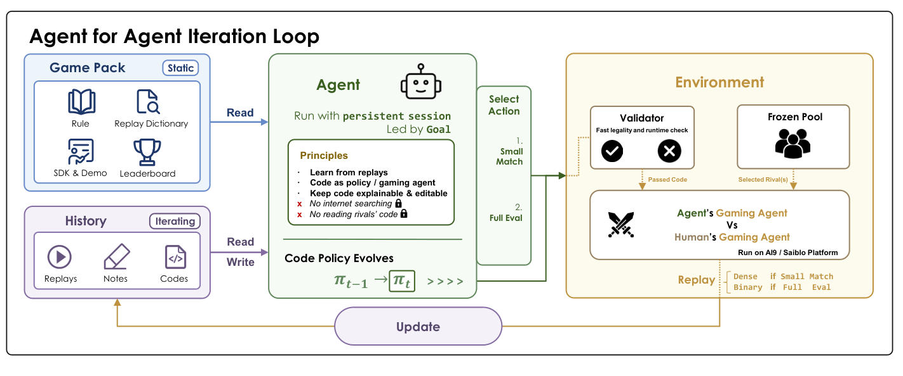
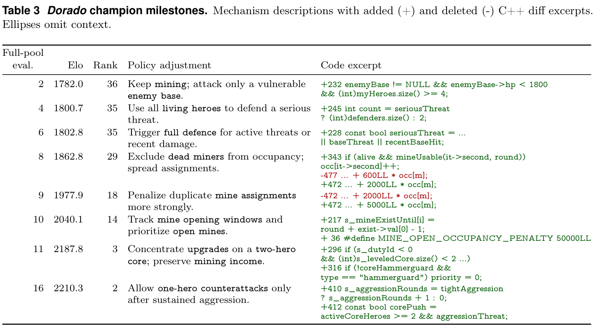
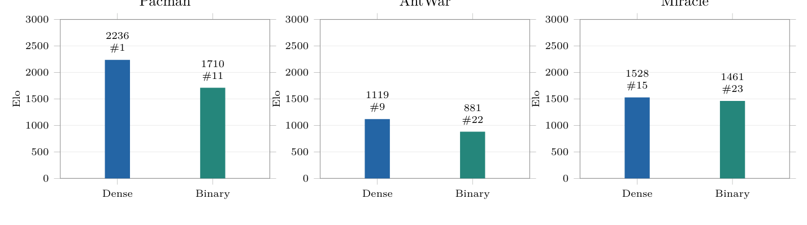

<!-- paper-reading-lang: zh-CN -->
<!-- paper-reading-theme: saffron -->
# 模型不改权重，策略怎样变强：AAArena 深读

这篇论文把写游戏程序的AI agent放进一个长期开发比赛：读规则、选对手、看重放、改代码，再争取更高排名。它的关键设定是：**对手大多数源码不可见，学习发生在软件系统中，模型权重固定。**因此它与“读对手源码后生成最佳响应”的前三篇共享代码产物，却研究不同的信息条件和能力边界。

<span class="source-ref">Yang等，Can AI Agents Learn Their Way to the Top? Evaluating Heuristic Learning in a Long-Running Game Agent Competition；arXiv:2610.12341v1，2026-10-08，本地英文PDF26页；Zotero3UP5TTIW / B4VHEQMK。全文／哈希见assets；论文与官方仓库核实截止2026-11-05。</span>

```paper-map
{"thesis":"用固定模型驱动持续代码修订，以冻结人类程序梯队测量反馈条件下的策略开发能力","outcome":"最强模型–harness配置登顶6/12个冻结梯队；复杂任务与学习平台期仍明显","outcomeSource":"PDF §§3–4，Table2","items":[{"number":"01","label":"学习对象","text":"可执行策略P和开发状态C改变，基础模型参数θ不变","source":"PDF §2、Algorithm1"},{"number":"02","label":"反馈预算","text":"128个对手测试单位与16次全池评分，非128局加16局","source":"PDF §3.3、附录B"},{"number":"03","label":"选择规则","text":"保留运行中官方评分最高的快照，不取最后一次编辑","source":"PDF §3.3"},{"number":"04","label":"证据边界","text":"全池评分参与开发；金牌是冻结Elo梯队第一，不是未见对手泛化","source":"PDF 附录B.2–B.3"}]}
```

<!-- paper-reading-context:start -->
## 01 / 发表时的研究背景
<!-- context-cutoff: 2026-10-08; basis: verified arXiv v1; differently titled project PDF earliest upload not established -->

### 研究问题与价值

在有限反馈预算下，一个通用编程agent能否从真实竞争经验中，把初始游戏程序改成更强的程序？输入是规则、SDK、重放文档、排行榜、一个允许的参考程序和后续反馈；输出是能自主对局的可执行游戏agent。被测对象其实是**模型与harness的组合**：模型负责理解与决策，harness提供工具、持久工作区、上下文管理和评测交互。（PDF §§2–3、4.1、附录B）

这里的价值是量化“从经验改善软件策略”的能力，尤其是规则理解、长期修订与失败诊断。若只测试一次生成，无法判断agent会不会利用新的对局证据；若只和同批AI互打，又缺少长期人类参赛程序这一外部参照。论文给出了这样的参照，但不测实时人类适应，也不证明某模型拥有一般性自我改进能力。

### 当时的领域状态

本次确认的 arXiv首发为 **2026-10-08**，读的是26页v1。搜索还发现同项目不同标题PDF的更早索引记录，未核实其实际首次上传和内容关系，因此不混用版本来补强结论。到这一时间，代码生成、自反思、进化程序搜索和多轮代码竞赛都已有先例；“不更新模型权重但系统越来越强”不是本文首次发现的现象。

**启发式学习（HL）**在这里指通过修改程序、工具、测试和记忆来吸收经验；**对抗启发式学习（AHL）**把它用于竞争游戏。基础LLM权重固定，不代表没有学习：保留下来的代码和开发记录正是改变后的行为载体。它与梯度学习是更新介质不同，不是“有无经验”的区别。（PDF §2）

### 关键前作与尚存缺口

| 工作与时间 | 已有贡献 | 尚存缺口及与本文的关系 | 来源 |
|---|---|---|---|
| 反馈式代码搜索，FunSearch／AlphaEvolve，2024–2025 | 用执行评分指导代码变异，证明程序产物可以不断改进 | 专门系统的优化成绩不能直接度量通用编程agent选择反馈、维护代码的能力 | 本文 PDF §§1、5的定位，未把这些系统的实验移植为AAArena证据 |
| CATArena，2025-10-30首发、2026-01修订 | 用多轮棋类／牌类竞赛评估代码agent持续改进与同伴学习 | 对手构成、游戏广度与固定长期人类梯队协议不同 | [官方arXiv v1](https://arxiv.org/abs/2510.26852v1)；本文 Table5 |
| CodeClash，2025-11-02首发、2026-05修订 | 多轮代码库竞争，把目标导向维护、工具与策略选择纳入评测 | 不能代替在这12款历史游戏、冻结人类池上的双预算测量 | [官方v1摘要与版本史](https://arxiv.org/abs/2511.00839v1)；本文 §5 |
| EvoPolicyGym，2026-07-02 | 固定交互预算下修订策略，隐藏验证选择与held-out评价，分析结构合成与参数调优 | 主要是紧凑交互环境，非长期人类对抗比赛梯队 | [v1全文 §§3–5](https://arxiv.org/html/2607.02440v1) |
| Weng，Learning Beyond Gradients，2026 | 明确讨论固定模型通过持续维护启发式软件吸收经验 | 是范式与实践讨论，不提供本文这套冻结对手基准；精确初次公开日未另行核实 | [作者原始文章](https://trinkle23897.github.io/learning-beyond-gradients/)；本文 §2引用 |

前作已经部分解决“自动修订可执行产物”和“多轮代码竞争”。本文剩余测量问题是：当规则、对手与反馈接口更接近真实游戏开发比赛，agent能否在有代价的取证与多步修订中爬上一个固定人类梯队？其增量主要在AHL形式化、基准资源与测量，不宜包装成所有代码学习的起点。

### 本文为何在此时提出

**合理推断：**编程agent已具备工具使用和长会话能力，历史竞赛又留下可执行人类程序，因此可以把开发过程而非一次动作选择作为被测对象。新的协议还必须管住反馈成本，并记录退化、恢复与平台期；否则一个最后成绩无法解释agent究竟从哪里学到了什么。至于反馈预算如何公平折算模型计算成本，需要独立说明，不能只说“预算相同”就带过。
<!-- paper-reading-context:end -->

## 02 / 从需求走向一个可测假说

这是一种基于当时知识的教学重建，不是作者真实发现过程记录。已有LLM代码竞赛说明策略可以自动产生，反馈式程序搜索说明执行结果可指导后续修订，而长期软件维护研究提示一次改对不等于长期改好。由此可提出假说：**让agent自主选择测试对象、接收动作级证据，并维护可恢复的软件状态，可能比仅给最终胜负更能形成持续改进。**（背景所列前作；PDF §5）

该假说并未预设论文最终的128／16预算、具体模型或6枚金牌。它也不预设更多反馈一定有用：如果agent看不懂规则或把错误归因成错误策略，更多对局只会重复误改。设计因此应同时允许观察“上升”“停滞”和“回退”，而不是只记录成功案例。

## 03 / 核心直觉与改动边界

学习环里有两个agent：**AI agent**是开发者，读材料、调用工具和修改程序；**game agent**是产物，部署到裁判环境中自主行动。一次游戏不会边玩边请求大模型逐步决策。对局结束后，开发者才把反馈转成代码或笔记变化，进入下一次部署。（PDF §§2.1–2.2）

| 原来／可选做法 | 本文采用 | 作用与代价 |
|---|---|---|
| 单次生成、只看结局 | 持久会话和工作区持续修订P与C | 可保留经验，也可能积累错误假说和代码债 |
| 任意多测试 | 小样本对手测试与全池评分分开计预算 | 测取证选择，但不等于统一token／时间／花费 |
| 取最后程序 | 保留官方评分最高快照 | 允许探索退化，同时引入选择噪声风险 |
| 只看AI互打排名 | 使用12个冻结历史人类程序池 | 提供固定参照，但不是未见对手测试 |
| 只从自身对局取样 | 额外比较其他玩家之间的off-policy重放 | 测外部经验利用；本身不等于无监督或无自身评分 |

这是基准和流程组合。Elo、冻结参考池、best-so-far保留与重放分析都是已有思想的具体采用，不能把每一个都称为新算法。

## 04 / 走完一次开发循环

### 资源可见性：读规则，不是偷看整个人类池

AAArena含12款游戏、1920份人类程序；这些是程序版本数，不是1920名独立参赛者。模型获得规则、SDK、重放说明、排行榜与一个允许的rank40参考程序；其他对手源码和评测器内部逻辑不可见。玩家在游戏中的观察受该游戏的规则限制，不能把开发者读规则的权限画成产物能看完整隐藏状态。（PDF §3.1、Table1、附录B）

下面原Fig.2中，左边是开发者可读的材料与保留历史，中间是修改的程序，右边是不可由开发者任意篡改的评测环境。沿“反馈→修订→提交”箭头看，能清楚区分开发循环与一局游戏的动作循环。（PDF p.3）



*原论文 Fig.2 裁剪；模型权重固定，更新对象是软件与开发记录，PDF p.3。*

### 可执行策略与开发状态一起修订

令 $P$ 表示游戏策略代码，$C$ 表示工具、测试、记录与记忆等开发状态。AI agent读取资源和反馈，修改 $(P,C)$，而模型参数 $\theta$ 固定。每个模型–游戏运行用一个持续会话；上下文压缩保留会话但会缩短对话，所以笔记是跨修订保存经验的重要载体。正文并未给“笔记单独贡献多少”的消融，不能把所有提高归因于记忆。（PDF §2、附录B.1）

运行时，游戏程序依合法历史选动作；它可以有搜索、状态估计和参数，却不要求在模型权重上学习。将“固定LLM”误读成“程序只能静态无记忆”会遗漏这篇论文的核心。

### 两种反馈通道与不同计费单位

**小比赛**由agent选对手，返回详细重放，用于诊断。每请求一个对手消耗一个小单位，一次可请求最多8个对手；默认总计128单位。**全池评分**对整个冻结池测量程序，返回Elo、rank与逐对手结果，默认16次。初始化基线另有一次免费评估。源码编辑、模型调用、token和壁钟时间没有额外同等上限。（PDF §§3.2–3.3、附录B）

因此128／16既不是144场对局，也不是每个配置完全一样的算力成本。全池中的底层场次远多于一个“小单位”，且不同游戏人数、裁判成本不同。同一小预算下，批量8个对手只允许16次满批反馈，批量4个允许32次，批量2个允许64次；这是机会数的算术，不是说每次都必然改了一次程序。

### 保留历史冠军，而非要求最后一个补丁更强

每次提交冻结一个不可变快照。官方评分比历史最好高，就更新保留冠军；后续编辑即使退化也不丢弃它。终止时交付这个冠军。达到rank1可以提前停止；主实验每配置重复3次，报告中位结果，不能把一次最佳快照与三次运行取最大混淆。（PDF §3.3、§4.1）

保留最好快照让搜索更安全，但因同一全池也提供开发反馈，成绩是“在这个池上优化到多好”。如果噪声较大，多次选最大还可能高估真实强度，需要独立重评或隐藏对手才能测泛化。作者在附录B.3明确承认原协议不测未见对手泛化。

### 贯穿例子：Dorado怎样从41名升到2名

这是原文真实案例，不是本解读运行的实验。Dorado中双方经营基地、招募英雄、挖矿与升级；摧毁对方基地获胜，时限到则用资源与英雄价值决定。GLM-5.3从rank41出发，逐渐改正“同一矿多人挖不会叠加”“死英雄不应占矿位”“矿有开放时间”等理解和实现错误，到rank14；集中升级两名核心英雄后升至rank3，邻接评分提高147.7 Elo；随后约束单英雄反击条件，到rank2。（PDF §4.2、Table3）

看下方Table3的代码差异，注意每次改的是**规则理解所对应的决策逻辑**，不是只调一个通用学习率。四英雄阵容和无条件Sacrifice曾退到rank46与43，恢复冠军后继续探索。这正好解释保留快照为何是实质机制。（PDF pp.7–8）



*原论文 Table3 裁剪；案例中的代码修改与结果是时间对应关系，不是每个补丁经独立随机试验确立的因果效应，PDF p.8。*

将这个同一案例连起来：输入规则与当前策略→选若干对手获得重放→形成“矿位被错误占用”的诊断→改代码与记录→提交全池→保存更强快照。完整原始重放在本地PDF里未逐条展开，因此不能编造agent的每段内部推理，也不能把相邻排名增益全归于唯一一行改动。

```paper-path
{"title":"Dorado案例贯穿的AHL开发循环","intro":"忠实解释性重绘；案例里具体诊断来自正文，未公开的内部思考不补写","stages":[{"title":"读取允许资源与工作区","role":"固定模型开发者","action":"规则、SDK、rank40参考程序、当前P与开发记录C","why":"先建立游戏理解，不获取其余对手源码","output":"待验证的策略问题或代码修改","source":"PDF §§2–3、附录B"},{"title":"选择小比赛与反馈粒度","role":"128个对手测试单位","action":"选择对手看重放；Dorado可检查矿位分配等行为","why":"获得动作与后果证据，而非仅猜失败原因","cost":"每个对手计费；大批量减少反馈轮数","output":"重放与诊断进入下一次P、C修订","source":"PDF §3.2、§4.2"},{"title":"改策略与保留经验","role":"软件是学习载体","action":"修矿位计数、集中升级、收紧反击条件；模型θ不变","why":"把经验转成可执行规则与跨压缩记录","output":"冻结候选快照，提交全池","source":"PDF §2、Table3、附录B.1"},{"title":"冻结池评分与冠军保留","role":"16次全池评估","action":"拟合固定锚点Elo，返回rank；优于历史则保存，否则仍可探索","why":"区分一次退化与最终交付强度","cost":"评分参与开发，不是隐藏泛化测试","output":"Dorado示例冠军rank2；预算结束或rank1停止","source":"PDF §3.3、§4.2、附录B.2–B.3"}]}
```

## 05 / 数学：Elo与金牌到底算什么

论文没有关于AHL必然收敛或比RL更强的理论推导。核心数学是策略／开发者的分离，以及评分定义。令 $h_i^t$ 为游戏agent允许观察的历史，策略执行是

$$
a_i^t\sim\pi_{P_i}(\cdot\mid h_i^t).
$$

开发者 $A_\theta$ 在局间改程序 $P$ 与状态 $C$。这说明“学到哪里”不能只检查 $\theta$：即使权重没变，$P$ 已把新行为固化。（PDF §2）

### 固定锚点Elo与一个虚拟平局

冻结对手 $j$ 的评分是 $r_j$。候选评分为 $r$ 时，Bradley–Terry／Elo期望得分是

$$
p(r,r_j)=\frac{1}{1+10^{(r_j-r)/400}}.
$$

评分相同，期望0.5；候选高400分，期望约0.909。这是评级模型的约定，不是每场真实胜率已被证明符合的物理规律。比赛得分 $s_m\in\{0,\frac12,1\}$ 对应负／平／胜。令 $H$ 为冻结池，$\bar r_H=|H|^{-1}\sum_{j\in H}r_j$，论文求 $\hat r$ 满足

$$
\sum_m p(\hat r,r_{j(m)})+p(\hat r,\bar r_H)
=\sum_m s_m+\frac12.
$$

左边是所有真实比赛的预测总分，加一个对池平均评分的虚拟比赛；右边是真实得分，加一个虚拟平局。**解释性推导：**全胜时没有这个平局，评分可能趋向正无穷；加它后必须保留一点非胜概率，得到有限估计。原式的平均对象是完整冻结池，不应换成这次小比赛恰好抽中的对手均值。（PDF 附录B.2）

### 从评分到名次与运行成绩

$$
\operatorname{rank}(P)=1+\left|\{j\in H:r_j>\hat r(P)\}\right|,
\qquad
\operatorname{Score}(B_s,B_\ell)=\max_{P\in V}\hat r(P).
$$

$V$ 是正式评过的快照集，含免费初始基线。名次用严格大于比较，评分持平不会被算成有更强对手。金牌数量则为12游戏中rank1的个数：

$$
\operatorname{Gold}(m)=\sum_{g=1}^{12}\mathbf1\{q_{m,g}=1\}.
$$

它不是12款游戏平均Elo，也不是直接击败每款游戏人类冠军的次数；Elo只适合各自游戏内比较。一个新程序登顶这个固定评分梯队，不代表无可利用性或最优游戏策略。（PDF 附录B.2–B.3）

### 离线探索：相同128单位，可以获得多少轮反馈

交互选择小比赛批量1／2／4／8，显示满批请求机会数128／64／32／16，并查看论文三个游戏的批量消融成绩。还可切换密集／二元反馈的原报告比较。机会数是直接算术、成绩是原表数据，两者分开标注；不从机会数推算未报告Elo。

<!-- interaction-design: select batch to compute exact request count and inspect reported Table8 Elo/rank; feedback selector displays exact Table7 values. No interpolation, no trial execution; static prose and tables retain all core facts. -->
<!-- archify:assets/interaction.html|理解预算、批量与反馈的权衡 -->

## 06 / 用问题组织实验

### 通用开发agent能否登顶长期人类梯队

主比较为7种模型–harness配置、12款游戏、默认128小单位／16全池评分、每配置3次运行取中位。所有模型用max推理强度，但Opus5.5配Claude Code，其余配Codex，因此差异包含harness，不是纯模型消融。（PDF §4.1、Table2）

```paper-chart
{"type":"bars","title":"同一反馈预算下的冻结梯队金牌数","origin":"本文重绘 · 原论文 Table2","unit":" / 12款游戏","domainMax":12,"source":"PDF p.5 Table2；三次运行中位结果；模型与harness共同变化","note":"只汇总rank1覆盖率，不将各游戏Elo混为一个平均分；主成绩不测未见对手泛化","rows":[{"label":"Opus5.5 + Claude Code","value":6},{"label":"GPT6-sol + Codex","value":4},{"label":"GLM-5.3 + Codex","value":4},{"label":"Kimi K3 + Codex","value":2},{"label":"DeepSeek V4 Pro + Codex","value":2},{"label":"Qwen3.8 + Codex","value":3},{"label":"LongCat2.0 + Codex","value":1}]}
```

作者报告所有配置合计登顶的也是6款，另外6款没有任何配置登顶。复杂规则描述游戏通常更难，但这是跨游戏相关性：规则AST节点数不是Kolmogorov复杂度的估计，也不是最优下棋难度；不能从棋规则短就推断围棋容易。历史人类程序提交版本互相关联，也不是等量独立人类样本。（PDF §§3.1、4.1）

### 加三倍反馈预算，平台期就会消失吗

GLM-5.3在4个困难游戏延续原工作区，把总预算扩到384／48。Generals仍rank17、LOTA仍rank22；Miracle从26到19，AntWar2从9到6，无一登顶。这支持“这些运行在此范围内仍有平台期”，不能推出任何更多计算都无用，也不能据此证明某类模型有不可逾越上限。（PDF §4.3、Table4）

### 选择更强对手、更多信息和更大批量是否都更好

对手选择消融比较模型自选、从rank30逐步上升的梯队、随机与只挑Top4。前两者在不同游戏各有优势，Top4三个游戏都最差；可操作的解释是“与当前水平相关、能诊断的问题”比每次惨败更有价值，但作者也把机制解释标为假说。（PDF §4.4.1、Table6）

密集重放与二元胜／非胜反馈的比较更直接。看Fig.7，各游戏内两柱同一Elo轴；三个例子密集反馈都更高。它说明动作级证据在这些配置中有用，不能把差异全说成“信息论意义上有效比特数”的测量，因为重放长度、阅读成本和agent选择也可能改变。（PDF §4.4.2、Table7）



*原论文 Fig.7 裁剪；密集与二元对照均128／16预算，不是三种模型之间比较，PDF p.10。*

| 游戏 | 密集Elo／rank | 二元Elo／rank |
|---|---:|---:|
| Pacman | 2236.1／1 | 1710.1／11 |
| AntWar | 1118.7／9 | 880.6／22 |
| Miracle | 1528.2／15 | 1461.1／23 |

上表为附录Table7的精确值，图中是四舍五入标签。批量消融中，Pacman与Miracle的4对手最佳、AntWar的2对手最佳；8对手并不更好，符合广度与修订机会权衡。**这些消融不是主表同一条运行，也未提供足以统一宣称每格3独立种子显著性的证据。**不能将消融中的Pacman2703.9直接替换GLM主表2281.6。（PDF §4.4.3、Table8）

### 不来自自身策略的重放也有用吗

Off-policy条件允许从冻结人类程序相互对局目录中选择128条重放，仍有16次自身策略全池评分，所以不是“完全不和环境互动”。三种游戏从首次评估到冠军都改善；Miracle的独立off-policy运行为rank15，而on-policy例子停在rank26。它表明外部经验有潜力，不证明对任何种子都更优，更不证明off-policy来源单独引起全部差异。（PDF §4.5、Figs.9–10）

## 07 / 值得带走的认识

固定模型的系统可以通过代码和开发记录吸收经验；判断它有没有学习，应该看后续行为载体是否改变。对手选择与反馈粒度是学习问题本身的一部分，而非可随意忽略的评测细节。保留冠军让探索不必单调，却必须和独立重评结合才不被一次幸运评分误导。

Dorado案例给出的可迁移教训是：改善可能来自修正规则理解，再改变策略结构，而非不断调参数；更大预算也不会自动让错误假设消失。论文证明了特定配置在这批人类程序池上的能力，不证明普遍超人、纯模型排名，或对未见对手的稳健性。

## 08 / 最脆弱的假设

**我的诊断：把“同反馈配额”当作可公平解释能力差异的充分条件，是最脆弱的候选假设。**各配置可以消耗不同token、调用和时间，harness又不同；一个配置更强可能同时花了更多推理计算、采用更好的工具恢复或更熟悉游戏。作者在附录D报告token，并明确比较包含harness，这已经限制了结论，不应反过来指控其声称纯模型因果比较。（PDF §4.1、附录B、D）

诊断方法是在固定harness内比较模型，或为每个配置画“反馈单位×推理费用”的二维前沿；若排名随推理预算匹配而明显改变，就说明原单轴比较不足。另一个重要边界是全池既开发又评分，但这属于论文承认的任务定义，不是秘密数据泄漏。若要外推泛化，需要另设隐藏池。

## 09 / 一周最小复现方案

选窄目标：**同模型同harness下，密集重放比只给胜负更有助于改程序。**官方仓库README本次已读到：公开909份人类程序包，按冻结排名只发布top8之外的偶数名次；完整1920程序池留在认证评测服务。正式小／全池评估需要维护者颁发token，公开本地练习不需要。公开子集名次不得冒充完整池名次。（[官方仓库](https://github.com/THU-CST-SAST/AAArena)，本次读取main README）

| 要素 | 拟议方案，均未执行 |
|---|---|
| 范围与访问 | 先选Pacman公开子集；第一天固定commit、资源哈希与许可证。正式池token不可得时只称子集机制验证 |
| 运行前提 | 官方参考是x86-64 Linux、cgroupv2／systemd用户管理、Bubblewrap、GCC14.2与指定Python运行环境；本机是否完全满足尚未测试 |
| 资源估计 | 8–16核CPU、32GB内存，无GPU；部署及比赛预计1–2天，模型调用额外2–3天；例如人民币300元提供商硬限额，非原论文耗费承诺 |
| 对照 | 同模型版本、同harness、同初始程序、相同对手和种子，密集vs二元；先缩为32小单位／4次子集评分，4个独立运行种子 |
| 指标 | 冻结公开开发子集得分、隐藏公开子集胜率、独立重评冠军、合法率、token／费用；不伪造完整池Elo |
| 判据 | 密集组在隐藏子集的配对改善方向及区间；若仅可见池改善，不支持泛化；4种子区间宽则只报探索性结果 |
| 退路 | 沙箱部署或API不通，只核对公开结果与评测合同，不叫完成复现；无正式token不尝试绕过服务限制 |

日程：第1天权限与环境检查；第2天确定对手划分并验证比赛；第3天零修订基线；第4–5天成对开发运行；第6天不再反馈的隐藏子集重评；第7天审计错误与成本。这个计划筛查反馈机制，不足以复现七配置十二游戏全套。阅读任务不会自行启动实验或收费模型调用。

## 10 / 公平的反例与范围检验

针对“保留冠军成绩反映稳定改进”的强读法，**设定内诊断**是对冠军与第一份程序各做多个独立种子全池重评，重评结果不反馈给开发者。若保留成绩显著高于重评，且增加正式评估次数反而放大该差距，则支持选择噪声风险；若重评稳定复现提升，就削弱质疑。它不否定原协议定义的最高已测Elo，只检验该数是否稳定。

针对“学会了游戏规律”的更强外推，可把公开对手按策略家族分折，开发只开放其中若干家族，评估只用隐藏家族，避免同一人的近似版本跨折。若开发池持续上升、隐藏家族下降，说明可能过拟合对手而非学到一般规律；若都改善，则反驳该担忧。**这属于原协议之外的泛化扩展，不是对论文冻结池任务结果的反例。**不应通过给更难地图或改变规则，偷换被验证的原始主张。

## 11 / 检索核实后的研究位置

截至 **2026-11-05**，距arXiv首发不足一个月。实际查询包括标题＋AAArena／replication／critique，`AAArena hypothesis causal`、`code agents replay selection information gain` 和 `agent replay active learning AAArena`。本次范围内**没有可核实的独立直接续作、复现或反驳**；搜到同项目旧标题PDF和官方仓库不是独立后续研究。

可以核实的变化主要在**复现条件**：当前官方发布说明完整人类池为认证服务，公开本地子集可练习；off-policy完整托管目录尚未配置，用户可以用公开子集生成目录，但那是子集数据实验。该信息来自当前README，不倒写为论文首发时所有资源均已可用，也不把维护者的验证声明当作我们实际运行通过。

更早的 [EvoPolicyGym](https://arxiv.org/html/2607.02440v1) 隐藏验证协议、[CATArena](https://arxiv.org/abs/2510.26852)、[CodeClash](https://arxiv.org/abs/2511.00839) 是前作／邻近评测，不是因AAArena而出现的后续。[Learning Beyond Gradients](https://trinkle23897.github.io/learning-beyond-gradients/) 是作者引用的范式背景，不是第三方独立确认本论文成绩。

## 12 / 后续想法：为可证伪假说购买比赛

**不确定猜测：把对手选择改成可审计的“假说区分试验”，并检验知识能否迁移。**作者未来工作已明确提出从外部重放到active learning，因此“让agent主动选重放”本身没有新意。更具体的未满足需求是：agent为什么要花这一个小单位，它观察后究竟排除了哪个解释，修订是否真基于证据？

拟议机制要求每次购买比赛前登记至少两个可区分假说，例如Dorado中“多人同矿收益叠加”与“不叠加”；写出在某一合法局面或对手下会不同的可观察预测。比赛后把实际观察、被排除假说与关联代码差异写进可核验账本。没有区分力的比赛不奖励“看了很多日志”，只以证据驱动的假说更新与隐藏家族收益评价。若规则已经明文给出答案，允许优先读取规则而非浪费对局，以避免人为制造“必须试验”的需求。

最近工作限制了新颖性：[Value of Information，ACL2026](https://aclanthology.org/2026.acl-long.1987/) 已用预期效用权衡提问成本，本次核实官方摘要而非完整实验；[Contextual Experience Replay，ACL2025](https://aclanthology.org/2025.acl-long.694.pdf) 与 [Uncertainty Prioritized Experience Replay，2025](https://rlj.cs.umass.edu/2025/papers/RLJ_RLC_2025_45.pdf) 已讨论选有用经验／信息增益，本次搜索命中但PDF未在webfetch成功解析，细节未作全文核实。不能把信息增益或经验筛选宣称为首创。候选差异是**在代码修订竞赛中，强制记录可被实际对局否证的竞争假说，评价其证据校准与跨对手族迁移**；最近工作的更全面重叠仍待文献检索。

最小区分实验在Pacman或Dorado公开子集上比较：原agent自选、梯队课程、等长自由反思、假说账本选试验；全部匹配模型、token、反馈单位与记录长度。主要指标为隐藏家族胜率、错误假说存活时间和每有效修订的测试成本；另让盲审检查预测是否真能区分假说。预测是账本减少重复误改并提升隐藏收益。若只有记录更长、没有更少错误假说，或等长反思同样好，就撤回“可证伪账本”特有价值。风险是假说事后改写、重放本身不能支持因果区分，以及基准过小；一周只能筛查，不能声称已建立因果学习能力。方向新颖性与有效性均未保证。

<!-- audit: Q1–2=01, Q3=02, Q4=03, Q5=04, Q6=05, Q7=06, Q8=07, Q9=08, Q10=09, Q11=10, Q12=11, Q13=12. Inventory: AI/game-agent split & P,C updates->04.1–2/path1,3; visibility/reference program->04.1/path1; small/full interfaces/accounting->04.3/path2,4; retained champion->04.4/path4; frozen Elo+virtual draw->05/path4; feedback/opponent/batch interventions and offpolicy->06 + interaction. Original Fig2/Table3/Fig7 and exact appendix tables inspected. Rules AST is description-dependent, not optimal-play complexity. Source version/coverage includes pp1–14 and relevant A–E appendices; trajectories and policy algorithm family appendix used as descriptive, not causal proof. Semantic/prose self-check only; no independent reader study. Official repository current access constraints verified via README, not executed installation. Hosted token, exact computational parity and novelty remain unknown. -->
