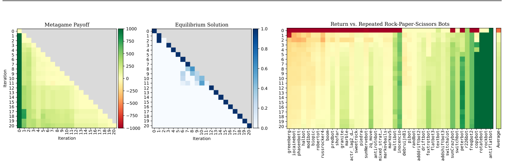
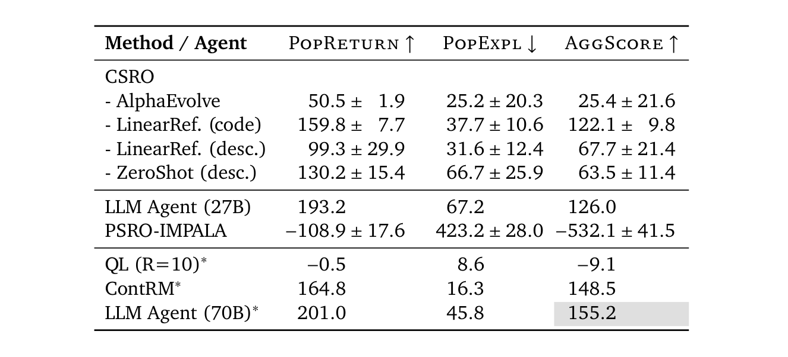
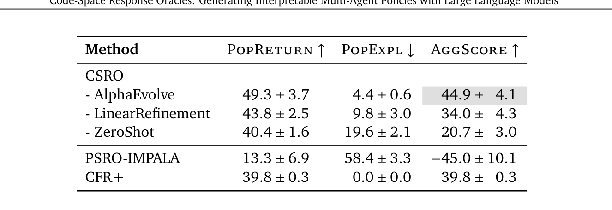

<!-- paper-reading-lang: zh-CN -->
<!-- paper-reading-theme: cobalt -->
# 不只战胜眼前对手：Code-Space Response Oracles 深读

石头剪刀布里，战胜总出石头的程序很容易；难的是既利用弱对手，又不被另一个程序轻易利用。CSRO 把“针对历史策略池的混合分布训练神经响应器”改成“让语言模型生成响应代码”，并比较一次生成、线性修订和进化搜索。理解这篇论文的钥匙是分开三个对象：训练策略池、池上的均衡混合，以及外部评测对手。

<span class="source-ref">Hennes、Li、Schultz、Lanctot；arXiv:2603.10098v1，提交于2026-03-10；本地PDF34页，首页另印2026-3-12，该排印日不视为独立v2。Zotero KD862EQK / UXYRIZJ8；来源哈希见 assets/source-identity.json。核实截止2026-11-05。</span>

```paper-map
{"thesis":"保留PSRO的策略池与均衡求解，把昂贵且不透明的响应器替换成可读代码搜索","outcome":"能生成有竞争力的可审查策略，但有限群体可利用性不是全局均衡证书","outcomeSource":"PDF §§2–4，Tables1–2","items":[{"number":"01","label":"外循环","text":"策略池两两对局 → 收益矩阵 → 均衡混合 → 新响应加入池","source":"PDF §2.3、Algorithm1"},{"number":"02","label":"上下文","text":"对手源码或自然语言摘要；用支持集阈值或Top-k控制长度","source":"PDF §2.4.1"},{"number":"03","label":"内循环","text":"一次生成、条件线性细化或AlphaEvolve进化搜索","source":"PDF §2.4.2"},{"number":"04","label":"评测","text":"平均回报、群体内最差损失和二者的权衡","source":"PDF §3.2"}]}
```

<!-- paper-reading-context:start -->
## 01 / 发表时的研究背景
<!-- context-cutoff: 2026-03-10; basis: verified arXiv v1; earlier indexed AAMAS posting date not independently established -->

### 研究问题与价值

输入是一款两人对称零和游戏、已有策略池及其均衡分布；输出是能对该分布取得高回报的可执行策略，以及扩充后的策略池。论文希望在不牺牲竞争力的前提下，让策略能被人直接检查和调试。其主要实验是每局1000次出拳的重复石头剪刀布（RRPS），和每局100手的重复 Leduc 扑克。（PDF §§2.1、3.1）

“可读”是有意义的需求：当扑克策略突然频繁加注时，代码能显示它究竟估计了对手弃牌概率，还是只写错了规则。但有注释的程序不自动等于人类真正理解它；论文主要提供案例分析，没有读者实验来度量可解释性的实际增益。

### 当时的领域状态

可核实的 arXiv 首发为 **2026-03-10**，本地为34页长文。官方 [AAMAS 2026 同名扩展摘要](https://ifaamas.csc.liv.ac.uk/Proceedings/aamas2026/pdfs/IKJF6607.pdf) 是相关发表版本，不应把短摘要与长文的全部实验混读；搜索引擎给出的更早索引日未独立确认，本文以可核实的 arXiv 日期划定背景，不声称绝对最早流通日。

对称零和意味着交换玩家位置后，收益变号。“均衡混合”是对完整策略的概率分布：例如一局开始随机抽一个程序，按它玩整局。它不等同于每一步把多个程序的动作概率平均。PSRO 的思想是不断增加能击败当前混合的策略，而不是只保存最近一个胜者；这样可应对石头→布→剪刀式的循环克制。（PDF §2.1）

### 关键前作与尚存缺口

| 工作与时间 | 已有贡献 | 尚存缺口及与本文的关系 | 来源 |
|---|---|---|---|
| PSRO，Lanctot等，2017 | 用经验收益矩阵求元策略，再向混合分布求响应，维护历史策略池 | 响应器通常是强化学习，代价与可审查性仍是问题 | [原始论文](https://arxiv.org/abs/1711.00832)；本文 §2.1 |
| Lanctot等，2023，预训练LLM序列预测 | 从动作历史预测对手下一步并选克制动作，建立外部RRPS群体评测指标 | 模型直接参与行动预测，不是生成独立代码产物 | 本文 PDF §§3.2–3.3、Table1 引用行 |
| FunSearch，2024；AlphaEvolve，2025 | 用LLM变异程序、执行评分、保留与进化候选，把代码搜索变成闭环 | 评分目标如何与多智能体混合策略、外部稳健性相接仍需具体设计 | 本文 PDF §§2.4.2、5；相应原始引用 |
| Bachrach等，LLM-PSRO，2025 | 已把代码生成接入PSRO，让新bot对抗已有bot的纳什混合 | 本文指出其偏重完整源码输入和开环best-of-N，缺少当前这样的闭环细化与标准外部验证 | [IJCAI官方论文](https://www.ijcai.org/proceedings/2025/1249)；本文 p.2 |

因此“LLM写代码玩游戏”并非本文首次提出，“代码版PSRO”也已有非常接近的工作。本文自己强调的增量是闭环策略细化、上下文抽象／过滤，以及更认真地用外部群体与传统求解器比较。PCP 与 Open-Source Games 是同时代相关方向，但本文主线是零和种群响应，不应借它们的合作结果来证明这里的可利用性。（PDF pp.2、10–11）

### 本文为何在此时提出

已有代码生成和进化搜索使“可执行程序能否成为响应器”不再只是理论愿景；PSRO 又提供一个明确的更新目标。剩下的实际障碍是：策略池增长后，全文源码塞不进提示；一次生成也未必能取得正回报。**合理推断：**新方法需要同时控制输入规模、用执行结果修正错误，并在训练池之外检查策略，而不是把代码能运行视为学习已成功。
<!-- paper-reading-context:end -->

## 02 / 从既有知识走向假说

这是一种教学性思路重建，不是作者私人发现史。先不使用本文的结果：PSRO 已告诉我们，对最近一个对手获胜不足以代表稳健；代码生成自博弈已经能产生竞争程序；程序进化又能利用实际评分改善候选。由此可提出假说：**保持博弈论外循环，把响应计算变成可执行代码的受反馈搜索，也许能在保持竞争力的同时提高可审查性。**（上述 PSRO、LLM-PSRO；PDF §5）

这还不能推出“给源码一定优于摘要”。长源码保留细节，也增加理解负担；摘要降低长度，也会丢失关键分支。二者应被看作可比较的设计选择。更不能从“进化搜索通常有用”推出它在任何指标上都最好：其内层评分偏向击败当前混合，外部弱对手的平均收益可能不是同一个目标。

## 03 / 核心直觉与改动边界

CSRO 每轮先问“当前这池程序，怎样混合才不容易互相利用”，再让 LLM 看这一混合的组成，写一个新对手。执行结果决定是否修订代码；新代码加入池后，原来的混合也需重新计算。策略越多不必然越强，关键是新策略是否补上原有混合的弱点。（PDF §§2.1–2.4）

| 继承／原来 | 新增或改变 | 意义 |
|---|---|---|
| PSRO收益矩阵、元均衡和策略池 | 保留，不是本文重新发明 | 把非传递竞争纳入优化目标 |
| 深度RL响应器 | Gemini 2.5 Pro生成Python策略 | 搜索对象从权重变成可执行文本 |
| 全部对手完整源码 | 允许摘要、Min support、Top 5等过滤 | 控制上下文，可能牺牲被过滤对手的信息 |
| 开环候选采样 | 单线程反馈细化或AlphaEvolve分布式进化 | 把评价结果变为下一次修改条件；计算预算并不自动相等 |

生成时，LLM 可以看到对手代码；运行时，生成的程序通常接收游戏观察和自己的记忆，并不必读取对手源码。这与开放源码程序博弈的运行时接口不同，也与仅对单个固定对手做PIBR不同。

## 04 / 把一轮CSRO拆开

### 持有策略池，先解一个较小的经验博弈

设已有策略池 $P$。让池内程序两两对局，形成收益矩阵 $U$，再求这个有限矩阵游戏的均衡分布 $\sigma$。这一步是继承 PSRO 的元求解器：只在已收集策略之间均衡，不等于在所有可能程序中已均衡。随池扩大，两两评估成本也会增长。（PDF §2.1、Algorithm1）

贯穿下面的**构造教学例子**是RRPS：池里暂时只有“总出石头”程序。此时混合全部权重给它，生成器容易提出“总出布”。布加入后，均衡质量发生变化，还需要寻找剪刀或更复杂的响应。这里没有声称论文真的按这条轨迹运行；原论文 Fig.1 的真实运行远比这个三程序例子复杂。

看 Fig.1 的左图收益矩阵、中央混合分布和右图外部群体收益：左／中是训练池内部关系，右图回答池外对手是否也能应付。不要把三幅图都读成同一条“训练回报”。（PDF p.3 Fig.1）



*原论文 Fig.1 裁剪；包含内部收益、均衡混合和外部对手三类对象，PDF p.3。*

### 用摘要和过滤，让对手混合装得进提示

提示包含规则、API、对手策略及其混合权重。可以放源代码，也可以让另一个LLM调用先总结行为。**Min support** 根据支持概率阈值保留策略；**Top 5** 保留权重最高的五个。它们不是“只测试五个对手”的同义词：过滤的是传给生成器的上下文，优化与评估仍由相应混合目标定义。（PDF §2.4.1）

在总石头例子中，摘要“每轮都出石头”足够；如果对手第501轮突然改出剪刀，摘要漏掉这条分支就会影响响应。过滤也有同类风险：若均衡质量集中在一个程序，仅保留非零支持可能失去更多竞争背景。作者以此解释Top 5往往更稳，但并没有从单个结果证明该解释是唯一原因。（PDF p.8）

### 三种响应器的计算过程不同

**一次生成（ZeroShot）**：给一次完整提示，直接获得候选，不进入内层修订。它省调用，但一次读错对手也缺少纠正机会。

**条件线性细化（LinearRefinement）**：先执行评估候选对 $\sigma$ 的效用；若负收益，才触发修订。把分数与候选回传给LLM，只有分数提高才更新，直到非负或耗尽预算 $M$。一条单线程链不能保证探索所有程序；零收益也不一定是精确最佳响应。（PDF p.4 §2.4.2）

**进化式响应（AlphaEvolve）**：采用已有的分布式程序进化系统，多线程抽取历史程序、让LLM变异、按对当前混合的期望收益评分，并用多个子种群维护多样性。这里进化的是同一外循环内的响应候选，不要和外层PSRO策略池混为一个种群。主要代价是更多执行与生成计算，内部系统访问也使完全复现更困难。（PDF pp.4–5）

论文默认 $K=20$ 个外循环，线性细化 $M=10$，LLM为Gemini 2.5 Pro；不训练该模型权重。策略运行过程中仍可以更新自己的计数器、预测器等状态，模型权重固定不意味着执行程序“不会适应”。（PDF §3.4）

### 加入候选，再重算混合，而非只交付一段冠军代码

新程序加入 $P$，之后重新评估和求混合。论文的主要表格比较第20轮元均衡策略，而定性分析还挑出了单个高分程序。Algorithm1 的返回处对扩充后的最后一个池应重新求解或对齐 $\sigma$ 的支持；照抄伪代码时需检查该边界，不能把上轮分布当成新池已求好的均衡。（PDF Algorithm1、§4.1）

```paper-path
{"title":"两个池、两种时间尺度、一个外部检查","intro":"解释性流程图；训练池和响应器内部进化种群不同，外部评测不参与这里的元均衡定义","stages":[{"title":"训练策略池两两对局","role":"继承PSRO","action":"构造U，再求有限策略集合上的混合σ","why":"避免只盯最近一个对手而遗忘旧弱点","output":"策略池与权重进入上下文构建","source":"PDF §2.1、Algorithm1"},{"title":"摘要与Top-k／支持集过滤","role":"跨轮战略适应","action":"选入对手代码或行为摘要，并附权重与游戏API","why":"控制上下文长度；保留与当前响应有关的信息","cost":"摘要或过滤可能隐藏关键分支","output":"传给代码生成器的动态提示","source":"PDF §2.4.1"},{"title":"生成并评价候选程序","role":"轮内战术细化","action":"ZeroShot直接输出；线性版负收益才修订；进化版多子种群变异评分","why":"一次生成并不保证击败当前混合","cost":"三者计算预算不同，不能归因于单一模块","output":"一个新响应程序加入外层池","source":"PDF §2.4.2"},{"title":"重算混合并检查外部群体","role":"输出与独立对象","action":"输出池上元均衡；另对43个RRPS bot或3个扑克策略统计指标","why":"训练池内部稳健不代表能应付池外程序","output":"PopReturn、PopExpl、AggScore","source":"PDF §§3.2、4.1–4.2"}]}
```

### 生成出来的程序如何适应具体游戏

RRPS 附录 Listing1 的高分程序有 **32个预测专家**：1–8阶Markov、反应模型、周期模型以及推测对手如何预测自己的元模型。每次观察真实出拳，专家得分先乘衰减率0.985，再奖励预测正确者；投票权重用分数的五次方，使最近可靠专家快速占主导，平票则随机化。它不是LLM每一拳现场推理，而是生成出来的代码持续更新统计状态。（PDF §§4.3.1、附录 Listing1）

扑克 Listing2 则估计牌力和对手倾向，计算合法动作的期望收益。面对AlwaysCall，弃牌概率低，诈唬不划算、强牌价值下注更有利；面对AlwaysFold，弃牌收益使加注吸引人。代码可见这些假设，也可见其中手工式加权启发式。这些是**所选实例的机制**，并非CSRO保证每次生成都包含32专家或相同的EV公式；论文没有逐项移除模块来证明各自贡献。（PDF §§4.3.1–4.3.2、Listing2）

## 05 / 数学：响应目标与评测目标为何不同

记 $u(\pi,\rho)$ 为我方完整策略 $\pi$ 对对手 $\rho$ 的整局收益。零和性给出 $u(\rho,\pi)=-u(\pi,\rho)$。对混合 $\sigma$ 的最佳响应目标是

$$
\pi^*\in\arg\max_{\pi}\mathbb E_{\rho\sim\sigma}[u(\pi,\rho)]
=\arg\max_{\pi}\sum_{\rho\in P}\sigma(\rho)u(\pi,\rho).
$$

等号只是把有限分布的期望展开：每个对手下的收益乘上被抽中的概率再相加。构造例子里，若 $\sigma$ 全在总石头上，总布确实最优；若三种恒定策略各占三分之一，各纯动作期望都为0。**这仍然是有限池结论**，不会自动覆盖能看历史的任意程序。（PDF §2.1 Eq.1）

训练池记 $P$，外部评测群体另记 $\mathcal B$，避免同一个字母混淆用途。论文指标为

$$
\operatorname{PopReturn}(\pi)=\mathbb E_{\rho\sim\mathcal B}u(\pi,\rho),\qquad
\operatorname{PopExpl}(\pi)=-\min_{\rho\in\mathcal B}u(\pi,\rho),
$$

$$
\operatorname{AggScore}(\pi)=\operatorname{PopReturn}(\pi)-\operatorname{PopExpl}(\pi).
$$

平均分奖励利用弱者；第二项惩罚最不利对手；第三项人为地平衡二者，并非博弈论唯一正确的目标。**补充推导：**因评测群体是全部可能对手的子集，$\max_{\rho\in\mathcal B}[-u]\leq\sup_{\rho\in\Pi}[-u]$。所以小的PopExpl只说明这些对手没找出很大的弱点，不是全局可利用性上界。（PDF §3.2）

扑克实例可用教学性的两分支期望理解：若对手弃牌概率为 $f$，弃牌时净收益为 $V_f$，跟注时净收益期望为 $V_c$，则

$$
\operatorname{EV}(\mathrm{raise})=fV_f+(1-f)V_c.
$$

这是解释正文的通用期望展开，不冒充Listing2的完整实现：真实代码还处理合法动作、筹码、牌型概率与启发式权重。论文没有CSRO通用收敛证明；“最佳响应器”是目标名称，不是LLM每次都准确求解的定理。

### 离线交互：改变指标，谁看起来更强

交互直接使用下表RRPS报告值，选择平均收益、最差损失或综合分后排序；可看到AlphaEvolve的低最差损失和线性细化的高综合分不是同一个胜负判据。不生成额外实验数字，负综合分也保留。静态表和原始表已经提供全部数据。

<!-- interaction-design: sort exact reported RRPS metrics, switch objective and inspect interpretation; no synthetic experiment. Data from PDF Table1; uncertainty remains in static table, widget is a mean-only view. -->
<!-- archify:assets/interaction.html|切换评价目标，比较同一组策略 -->

## 06 / 实验证据与解释

### 是否兼顾外部收益与稳健性

先看 Table1：在RRPS中，CSRO线性细化代码版的综合分与Gemma 3 27B动作预测agent接近，而AlphaEvolve的群体内可利用性更低。表中带星号的是2023年文献报告值，不是本实验同一环境下的重新训练；不能据此宣称超越全部既有方法。（PDF p.7 Table1）



*原论文 Table1 裁剪，含文献引用行；原文±符号保留，不改称95%置信区间，PDF p.7。*

| RRPS方法 | PopReturn ↑ | PopExpl ↓ | AggScore ↑ |
|---|---:|---:|---:|
| CSRO AlphaEvolve | 50.5 ± 1.9 | 25.2 ± 20.3 | 25.4 ± 21.6 |
| CSRO线性细化，代码／Top5 | 159.8 ± 7.7 | 37.7 ± 10.6 | 122.1 ± 9.8 |
| CSRO一次生成，摘要 | 130.2 ± 15.4 | 66.7 ± 25.9 | 63.5 ± 11.4 |
| Gemma 3 27B动作预测agent | 193.2 | 67.2 | 126.0 |
| PSRO-IMPALA | −108.9 ± 17.6 | 423.2 ± 28.0 | −532.1 ± 41.5 |

数字是1000次出拳构成的整局收益指标，不是单拳胜率。Table1笼统写5种子，补充Table7明确AlphaEvolve为3种子、其他变体5种子，应以更细说明限制解读，不能把所有误差条当成同样规模的证据。（PDF §3.1、Table1、附录Table7）

### 对手上下文与内循环真有作用吗

**问题→对照：**固定生成框架，改变是否提供对手信息、源码还是摘要、支持过滤方式与修订机制。一次生成不给对手信息时，PopReturn为135.3、PopExpl高达614.2，综合分−478.9；说明“能赢很多弱bot”可以与“非常容易被一个强bot打穿”并存。一次生成的摘要综合分63.5优于全代码的−54.3，而代码输入的收益在有迭代细化时更明显。结论应是**输入表示与优化流程交互**，不是“源码永远最好”。（PDF p.8、Table7）

Top5通常优于仅按最小支持过滤，作者解释为避免只看当前高权重反制者的过拟合。这是带机制解释的消融证据，但不能排除提示长度、信息多样性等其他因素。AlphaEvolve、线性细化与ZeroShot调用和执行计算不同，整体比较没有把这些差异全部隔离。

### 扑克中能否同时守住强对手、利用弱对手

看 Table2，AlphaEvolve对三策略外部群体的平均回报49.3高于CFR+的39.8，但其最差损失4.4不如CFR+的0。**它更会利用这个群体中的弱对手，不等于更接近全局均衡。**外部群体只有CFR+、AlwaysCall、AlwaysFold，覆盖相当有限。（PDF §§3.2、4.2）



*原论文 Table2 裁剪，平均3个种子；每局100手，PDF p.9。*

| 扑克方法 | PopReturn | PopExpl | AggScore |
|---|---:|---:|---:|
| CSRO AlphaEvolve | 49.3 ± 3.7 | 4.4 ± 0.6 | 44.9 ± 4.1 |
| CSRO线性细化 | 43.8 ± 2.5 | 9.8 ± 3.0 | 34.0 ± 4.3 |
| CSRO一次生成 | 40.4 ± 1.6 | 19.6 ± 2.1 | 20.7 ± 3.0 |
| PSRO-IMPALA | 13.3 ± 6.9 | 58.4 ± 3.3 | −45.0 ± 10.1 |
| CFR+ | 39.8 ± 0.3 | 0.0 ± 0.0 | 39.8 ± 0.3 |

正文§4.3.2又谈到高分实例77.8／69.1；这不是Table2跨种子元均衡的49.3／44.9。RRPS案例238.3也不能替换主表的159.8。定性案例是为了分析策略内容，不能把挑出的最佳实例伪装成方法平均成绩。对局时无LLM调用有明确结构依据，但总体成本更低、样本效率更优需要统一预算核算，不能靠这些分数直接推出。

## 07 / 可以迁移的认识

可解释代码最有价值的地方，是能检查程序究竟如何产生响应：是专家投票、牌力期望还是错误的行为假设。PSRO的可迁移原则则是对混合而非最近一位对手优化，避免把循环胜负误当单调进步。

实验揭示了两个重要条件：摘要在一次生成时可能比全代码更好，说明信息量和可利用信息量不同；更强内层响应器有时减少最差损失，却降低利用弱对手的平均分。最后，任何有限bot群体都只是探针集合，稳健性结论必须连着探针覆盖范围一起读。

## 08 / 最脆弱的假设

**我的诊断：有限外部群体足以代表危险对手，是稳健性解释中最脆弱的候选假设。**尤其扑克只测三个策略，针对性地利用一个历史阈值的程序可能全都漏过。作者明确定义指标为“within population”，因此应批评的是把指标外推为普适均衡的强读法，而非说论文隐瞒了它。（PDF §3.2）

失败的可观测后果是：已发表群体内PopExpl很低，但一个从未进入训练或筛选的新对手获得较高收益。另一个脆弱点是摘要必须保留关键逻辑；它影响生成质量，但相对于外部覆盖哪一个更重要，本文没有实验作唯一排序。

## 09 / 一周最小复现方案

目标选择**线性细化是否比一次生成减少新对手下的最差损失**，不用复现闭源分布式AlphaEvolve。公开原文和提示可用，但完整作者运行代码未核实到；OpenSpiel作为环境基底已被论文说明，拟使用前仍需固定版本并测试其RRPS接口。这是独立缩小版实现。

| 项目 | 拟议设计，尚未执行 |
|---|---|
| 环境与划分 | 1000拳RRPS；手写固定、循环、频率、Markov等12个可审计bot，6个供开发、6个隐藏评测；不声称等同原43bot池 |
| 模型和控制 | 同一可用模型与版本，5个种子；K=5、M最多3；一次生成与线性版另做等总候选预算对照，区分反馈与多采样 |
| 资源估计 | 8核CPU／16GB，无GPU；约300–600次小调用，硬费用上限由用户批准，例如人民币300元；不是实测报价 |
| 指标 | 隐藏bot的PopReturn／PopExpl、合法率、实际调用数和执行次数；误差按完整训练种子而非出拳次数估计 |
| 判据 | 预注册线性版在隐藏群体的PopExpl下降且配对区间支持方向；若仅原可见bot改善，不支持外部稳健性；若等预算采样同好，不支持反馈特有效果 |
| 退路 | 模型或代码访问不足，只交付环境与提示适配测试；3种子只能作探索，不宣称复制主表 |

日程：第1天核对计分与bot；第2天验证元均衡求解器；第3天一次生成；第4天线性反馈；第5天补等候选预算对照；第6天解封隐藏bot、做独立重评；第7天审查代码并报告全部种子。实际运行、付费和大数据下载均不在本次阅读任务内。

## 10 / 一个公平的反例

针对“低PopExpl可代表一般稳健”的外推，构造**有变化点的Markov对手**：前500拳按固定频率出招，后500拳转为克制我方最近高置信专家的反应式策略。它仍只看合法历史，不偷读私有随机数；因此在RRPS任务内。对照用无变化点同复杂度bot、均匀随机策略和原评测bot，控制总拳数与种子。

预期风险是得分五次方投票过早压住其他专家，变化后适应慢；但这是对特定生成实例的机制猜测，不保证适用于所有CSRO策略。若新对手显著抬高最差损失而均匀随机基线稳定，则说明原群体漏了一个风险模式。若重测后混合策略仍迅速适应、损失不大于原群体置信范围，就削弱该反例。它不会推翻原43bot上的结果，也不是对全框架必败的证明。

## 11 / 实际检索到的后续与近邻

检索截止 **2026-11-05**。查询包括完整标题、`"2603.10098" follow-up benchmark exploitability`、标题加replication／criticism，及 `"code-space" "oracle" "counterexample" game`。在已核实范围，**未找到独立直接复现、正式反驳或可确认的直接算法续作**。AAMAS扩展摘要是同一工作的发表载体，不是别人复现。

较晚的 [EvoPolicyGym v1，2026-07-02](https://arxiv.org/html/2607.02440v1) 把程序修订置于隐藏验证与held-out协议，属于相关评测路线，不是CSRO的博弈论保证。其价值是提示：代码优化的可见反馈与最终泛化必须隔开。[AAArena v1，2026-10-08](https://arxiv.org/abs/2610.12341) 则研究不公开对手源码、靠重放反馈修订代码的长程人类程序竞赛；本专题已核实其英文全文，它既不复现CSRO，也不直接比较同一指标。

检索还核实了 [AAAI 2025 反例引导程序修补](https://ojs.aaai.org/index.php/AAAI/article/view/32046) 的摘要：程序候选失败时回传测试反例的思想已有成熟前作。它早于本文，不能写成“后续研究”，但对下面的新颖性判断很重要。

## 12 / 后续想法：区分策略改进与探针变强

**不确定猜测：为代码策略池建立“双层可利用性证据协议”。**现在训练池和外部群体都可能随着研究者的选择而变化，低分究竟来自策略变强，还是恰好没被探到，难以分清。需求是使每次“更稳健”的主张，都附带独立攻击预算和覆盖范围。

机制分成两条隔离的信息流：开发端仍按CSRO写响应；审计端只拿冻结策略与隐藏对手模板，在固定预算下生成并验证反制程序。审计产生的失败可以进入下一阶段开发，但该阶段不能再用同一批攻击作为最终独立证据；最终评价交给全新隐藏模板族。输出的是“给定探针族与攻击预算下最坏已发现损失”的证据前沿，不冒充全策略空间上界。

**与最近工作比较：**PSRO本来就会增长反制策略池，不能把“加一个对手”当新贡献；CEGIS早就用反例修程序；隐藏测试也不是新发明。候选新问题是：**当生成器与审计器共同进步时，如何把策略质量变化和审计覆盖变化拆开测量**。检索了counterexample-guided program equilibrium、code-space oracle counterexample等近义表述，未核实到完全相同协议，但搜索远非完备。

最小实验冻结3个训练代次与3档攻击预算，交叉形成矩阵；与“固定43bot评分”“直接把所有新攻击并回训练再测同池”两种方案比较。预测是一些原本单调改善的PopExpl曲线在独立攻击前沿下不再单调，且后续能针对新模板改善。若独立审计从不发现额外弱点，或提升完全被简单随机bot扩充解释，则撤回更强机制主张。主要风险是审计LLM本身不够强、模板泄漏和预算不公平；因此结论只能是受限证据，而不是均衡证明。该方向的新意仍属检索范围内的候选，不保证首创。

<!-- audit: Q1–2=01; Q3=02; Q4=03; Q5=04; Q6=05; Q7=06; Q8=07; Q9=08; Q10=09; Q11=10; Q12=11; Q13=12. Inventory: PSRO inherited->04.1/path1; context abstraction and filtering->04.2/path2; conditional linear refinement and borrowed AlphaEvolve->04.3/path3; final mixed-policy output/external population->04.4/path4; example-specific 32 predictors/fifth-power weights and EV->04.5, not universal CSRO modules. Manual numeric check with original Tables1–2; alpha seeds conflict noted, best-instance versus mean separated. Full method/experiments/captions and relevant code/prompt appendices accessible. Prose-only logic and source fidelity self-check, not independent reader testing. Source identity hash in assets. Exact author implementation, complete AlphaEvolve access, earliest AAMAS upload chronology, and novelty remain qualified unknowns. -->
