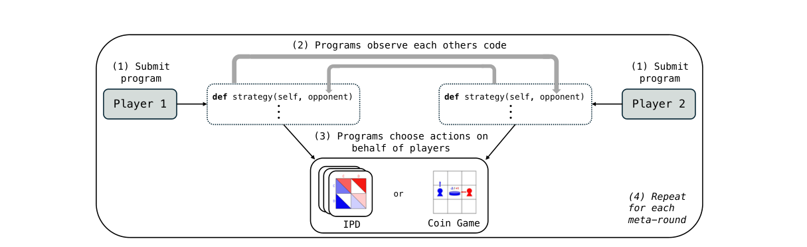
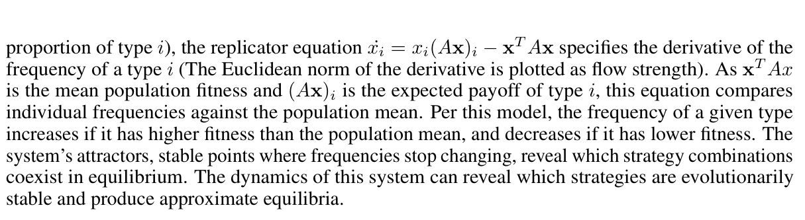
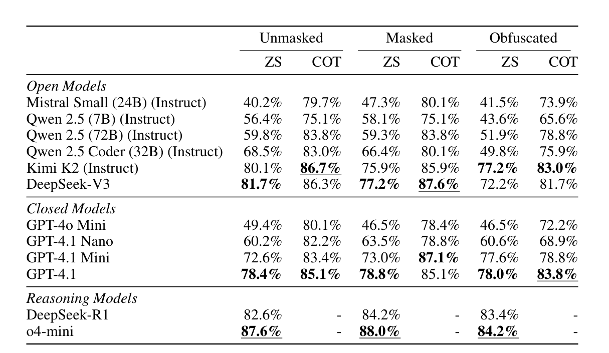
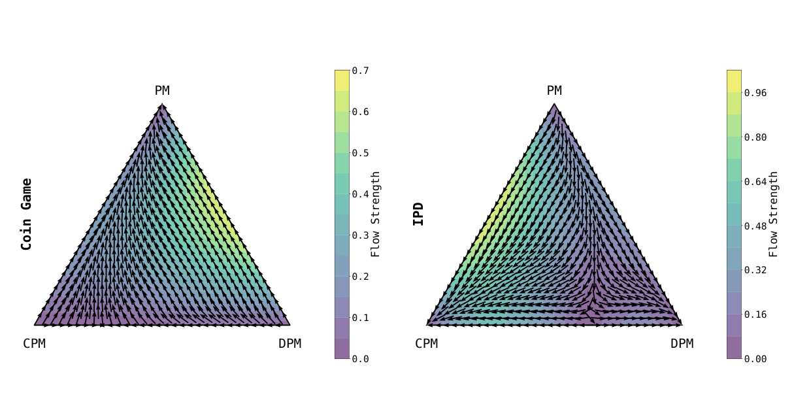

<!-- paper-reading-lang: zh-CN -->
<!-- paper-reading-theme: plum -->
# 代码透明能带来合作吗：Open-Source Games 深读

当玩家提交的是一段能查看对手源码的程序，“我会不会合作”不再只取决于历史动作，也可能取决于我如何解读你的承诺。这篇论文连做三个层次的实验：LLM能否判断战略代码、会写出怎样的合作／欺骗程序，以及几类目标在有限种群博弈中怎样竞争。三个层次相互启发，但不能合并成“已证明安全合作均衡”。

<span class="source-ref">Sistla 与 Kleiman-Weiner，Evaluating LLMs in Open-Source Games；NeurIPS2025，arXiv:2512.00371v1，2025-11-29。本地英文PDF32页；Zotero HSDVNEPH / 7XVCIG4J，哈希及全文见assets。核实截止2026-11-05；OpenReview评审页受浏览器验证限制。</span>

```paper-map
{"thesis":"把代码理解、策略生成和有限种群演化分开测量，观察透明条件下的合作与利用","outcome":"强模型能较好分类战略代码；目标提示影响程序行为，但合作能否存续依任务而变","outcomeSource":"PDF §§4–6，Tables1、Fig.4–7","items":[{"number":"01","label":"先测理解","text":"SPARC：239个IPD程序，判断对总合作对手是否连续10轮合作","source":"PDF §4"},{"number":"02","label":"再测生成","text":"Kimi-K2根据上轮源码与历史，先写战略再写可执行程序","source":"PDF §5、附录A.2"},{"number":"03","label":"运行时透明","text":"当前两份程序可读取彼此源码，与生成时读旧代码不同","source":"PDF Fig.1、附录A.2"},{"number":"04","label":"最后看演化","text":"用三类目标的经验收益矩阵模拟类型比例变化","source":"PDF §6、Fig.7"}]}
```

<!-- paper-reading-context:start -->
## 01 / 发表时的研究背景
<!-- context-cutoff: 2025-11-29; basis: earliest public arXiv release verified here; earlier OpenReview circulation unknown -->

### 研究问题与价值

研究对象是两人社会困境：每个人都想得分，但短期占便宜可能破坏共同收益。普通囚徒困境只提交动作；开放源码博弈则提交能读取对手程序的程序。本文问：当程序作者由LLM担任时，模型能否理解对手、生成有效的条件策略；合作目标会不会总被欺骗目标淘汰？成功标准不是单个竞赛冠军，而是可测的代码理解、程序行为与受限演化结果。（PDF §§1–2、4–6）

潜在价值是研究透明智能体的承诺与治理。但可见源码只能让意图可检查，不保证检查正确，更不保证代码满足形式安全证明。作者在局限中明确承认没有引入形式验证。（PDF p.10 §7）

### 当时的领域状态

本次可核实的 arXiv 首次公开日期是 **2025-11-29**，页面标注NeurIPS2025；本地为v1。会议审稿过程可能更早，OpenReview实际公开时间未核实，故不把arXiv日期说成一切场合的绝对首发日。后来的PCP、CSRO与2026年排行榜不用于重建这个背景。

需要先懂一个差别：在普通一次囚徒困境中，“背叛”无论对方怎样都比合作多赚；但若对方的程序会因读到我的背叛逻辑而立即背叛，那么改变我提交的程序也改变了对方的反应。程序承诺因此改变了战略空间。另一方面，本文还使用重复互动；重复本身就可产生互惠，必须避免把所有合作归功于源码透明。（PDF §2、Fig.1）

### 关键前作与尚存缺口

| 工作与时间 | 已有贡献 | 尚存缺口及与本文的关系 | 来源 |
|---|---|---|---|
| Tennenholtz，2004，Program Equilibrium | 用互相可检查的程序定义策略和均衡，使条件承诺成为可能 | 理论构造不等于当前语言模型能读对、写对 | 本文 PDF §§2–3、参考文献[42] |
| Barasz等，2014／2021版 | 用可证明性逻辑构建不依赖源码完全一致的稳健条件合作 | 理想化证明能力与有限程序构造之间仍有距离 | [原始文献及修订说明](https://arxiv.org/abs/1401.5577) |
| Hutter，2020首发／2021修订 | 研究透明强化学习对手，加入避免无限递归的机制，展示收益依博弈与学习规则而变 | 透明性本身不保证所有游戏都收敛到互利状态；其模型也不同于LLM代码生成 | [原始摘要与日期](https://arxiv.org/abs/2012.02671) |
| Axelrod-Python，2016及后续库 | 提供大量可执行IPD策略，便于构造有真实行为标签的程序理解任务 | 识别公开经典策略可能受到训练语料记忆影响 | 本文 PDF §4、附录A.1；[官方库](https://github.com/Axelrod-Python/Axelrod) |
| 既有LLM游戏代码工作，至2025 | 已能生成玩游戏的代码；MLGym等包含固定对手游戏任务 | 尚不能回答“对方也读我的代码并改写程序时，合作与欺骗怎样适应” | 本文 PDF §3，对Eberhardinger、Nathani等工作的定位；此行以本文综述为来源 |

这些工作部分解决了逻辑可能性、模拟基底和代码生成能力，却没有直接给出当前LLM在双向透明、连续修订程序环境中的经验画像。本文对“所有MARL都不透明”一类概括应限于其讨论的主流神经策略，不能当作否认透明RL前作的普遍定理。

### 本文为何在此时提出

**合理推断：**代码生成模型让研究者有机会把“人手设计特定程序的理论分析”扩展到“自动生成、执行并测量很多程序”。但这要求先测一个前置能力：模型究竟能否仅凭源码识别合作。若连这一步都不可靠，透明代码未必是协调的好基底；即使这一步较好，也仍需测生成行为与演化后果。
<!-- paper-reading-context:end -->

## 02 / 一条不循环的思路重建

以下是教学重建，并非作者私下发现史。已知程序承诺能让对手的选择依赖我的代码；已知LLM可生成和阅读Python；也已有含大量互惠策略的可执行库。连接观察是：可以先把“理解对手”缩小成一个有执行标签的分类问题，再把“如何回应”放回双边互动。由此提出的假说是：**足够好的代码理解可能支持条件合作，但合作能否稳定还取决于目标和任务结构。**（PDF §§2–4；前作见背景）

这个假说不要求先知道SPARC的准确率，也不依赖之后观察到的欺骗策略。它甚至预留了失败可能：模型也许只识别熟悉策略名，或生成的程序后来根本不再读取代码。实际方法因此需要语义线索控制和程序信息流测量，而不能只统计总得分。

## 03 / 核心直觉与实验对象的变化

论文把LLM当作程序作者，把可执行程序当作动作选择者。作者之间的适应发生在“元轮次”；程序之间的对局发生在一个元轮次内部。不同目标提示引导出不同的代码，再通过执行与有限种群分析看其效果。它是一个经验研究框架，不是单一的最优策略训练算法。（PDF §§4–6）

| 常见做法 | 本文改变 | 要回答的疑问 |
|---|---|---|
| LLM直接给动作 | LLM先给战略说明、再实现程序 | 能否形成可追踪的决策机制 |
| 只看原始策略名与代码 | SPARC加入遮蔽和混淆版本 | 准确率是否依赖语义提示线索 |
| 仅看玩家得分 | 加入源码访问污点分析、代码复杂度和LLM战略判别 | 程序到底在读源码还是只读历史 |
| 一次双边比赛 | 从三类目标的收益矩阵分析复制子动力学 | 局部合作是否具有受限演化适应性 |

这里的两阶段生成和测量组合是研究设计，不宜全部宣称为原创算法；程序博弈、代码混淆、污点分析和复制子动力学均有前作。

## 04 / 三层方法与同一个运行例子

### SPARC：把“合作”定义成可执行的有限时域标签

SPARC含239个Axelrod策略，其中154个确定性、85个随机策略，代码长度23–278行。输入是一个策略的Python源码，问题限定为：**假设我每轮都合作，对手是否在前10轮每一轮都返回C？**运行该策略对总合作策略得到标签，再将模型预测与标签比对。它不测“对任何对手都合作”，也不直接测“是否可安全信任”。（PDF §4、附录A.1 Table2）

贯穿解释的**构造教学例子**是一段“前10轮合作，第11轮开始背叛”的程序：在SPARC的10轮问题下标签应为合作，但在20轮问题下不是。这个例子不是论文中的实际样本或一次模型输出；它只帮助理解标签的量词与时间边界。

### 遮蔽与混淆：保留逻辑，移走容易记住的名字

作者先处理注释、docstring和类名线索，得到masked版本；再用Carbon把变量、函数、参数等标识符重命名，得到obfuscated版本。目标是保持控制流、继承关系和行为，降低“TftStrategy”之类名字泄露答案的可能。附录说明约2%的程序仍残留初始策略名字符串，且需要后处理动作表示；因此不能声称所有语义线索已被完美消除。（PDF §4.1、附录A.1.3）

在教学例子里，把函数名改成无意义字母，不该改变第11轮背叛的分支；模型必须读条件而非记住名字。处理只发生在基准输入构造中，不是在模型权重上训练。随机策略的“总会合作”又涉及概率量词；原文没有提供足够细节说明所有随机标签是否穷尽随机路径，复现时必须另报随机种子与概率判据，不能把一条采样轨迹当全称证明。

### 元轮次读旧源码，游戏运行时读当前源码

在策略生成实验中，每个元轮次先给LLM上一轮对手代码和完整交互历史，生成自然语言战略，再生成Python程序。两个当前程序随后对局10个基本回合；程序的函数参数包含自己的源码与**对手当前源码**。新一轮生成再使用这些结果。主实验用Kimi-K2，10个独立种子，每种设置10个元轮次。（PDF §5、附录A.2）

真实信息流可在原Fig.1核对：先看上方程序接收对方源码的横向箭头，再看程序输出动作进入底层游戏的箭头。不要把“当前代码传给执行程序”误画成“LLM在本轮生成前已看到对方同步生成的新代码”。（PDF p.2 Fig.1）



*原论文 Fig.1 裁剪；图中的程序层与底层游戏必须分开，PDF p.2。*

给教学例子配置一个对手：对方程序前10轮合作、之后背叛。我方LLM在下一元轮看到旧代码，可以写出“提早防御”的程序；也可写一个运行时解析对手当前代码的分支。但论文的真实程序并不保证选择了其中任一种，不能把这条示意链当成观察结果。运行时双方仍只能使用允许的环境观察，不能读取私有随机状态。

### 三种目标提示改变的是偏好，不是模型架构

**PM**只要求最大化自身回报；**CPM**要求尽可能合作、避免欺骗和伤害，但允许自卫；**DPM**允许为了获益误导对手，并可让战略描述告诉实现器如何隐藏欺骗。模型权重不变，差别来自目标提示。战略说明用于两阶段生成；另一玩家在游戏中只看到程序，不会拿到对手的自然语言说明。（PDF §5、附录A.2.1）

因此“DPM产生欺骗”是在研究者明确诱导的目标下观察到的现象，不能推成未经诱导的部署模型都会自发欺骗；“CPM受益”也不等于某种全新安全训练已经完成。

### 分开测源码访问、战略特征与得分

**OSAS源码访问分数**用AST污点分析追踪`opponent_program_code`参数是否流入赋值、调用与条件，衡量运行时对源码数据的使用。它不证明语义理解正确：字符串搜索可得分，LLM在生成阶段已经理解而输出一段简单互惠代码也可能得分低。（PDF §5.1）

**复杂度**用Cyclomatic Complexity和Halstead Effort，反映分支结构与符号负担，不应直接叫“战略智能”。**战略类别**由GPT-4o判别，包括独立开发、直接模仿、防御、利用尝试、佯攻。评审器看到本轮我方战略与代码、上一轮对方战略与代码；它的信息比玩家运行时更丰富。分类是模型判定，不是形式证明的意图标签，原文也没有充分人工一致性验证。（PDF §§5.1、A.2.2）

```paper-path
{"title":"代码理解、双边生成、有限演化是三层证据","intro":"解释性重绘；SPARC标签不直接成为后两层训练标签，三种分析不能互相替代","stages":[{"title":"239策略与10轮执行标签","role":"SPARC基准构造","action":"原始／遮蔽／混淆源码 → LLM合作分类 → 对执行标签计准确率","why":"先检查理解能力，控制名字线索","cost":"有限时域与随机标签不能解释为普适可信性","output":"分类准确率与错误类型","source":"PDF §4、A.1"},{"title":"旧源码与历史 → 战略 → 代码","role":"元轮次适应","action":"同一Kimi-K2分别按PM、CPM、DPM目标生成","why":"把目标偏好和适应行为放到可执行对象上","output":"本轮两个程序；10元轮×10种子","source":"PDF §5、A.2"},{"title":"当前源码 → 程序 → 动作","role":"轮内运行","action":"运行时接口可读对手当前代码，执行10个基本回合","why":"程序承诺允许对本轮程序进行条件反应","output":"回报与历史用于下一元轮","source":"PDF Fig.1、A.2"},{"title":"污点分析与战略判别","role":"机制测量","action":"OSAS测运行时源码访问；复杂度与GPT-4o标签补充解释","why":"区分读源码、读历史与仅仅声称读懂","cost":"代理指标与LLM判别可能有偏差","output":"程序特征随元轮次变化","source":"PDF §5.1、Fig.5–6"},{"title":"三类收益 → 复制子动力学","role":"受限演化分析","action":"经验矩阵描述PM、CPM、DPM类型比例变化；附录另列IPD50-shot","why":"比较有限类型的演化适应性","cost":"未搜索任意新程序的有利偏离","output":"Fig.7流场，不是全程序空间均衡证书","source":"PDF §6、A.5.2"}]}
```

## 05 / 数学与一个必须保留的公式疑点

### 囚徒困境中的两个策略空间

论文采用诱惑收益 $T=5$、互惠收益 $R=3$、共同背叛收益 $P=1$、被占便宜收益 $S=0$。在普通单回合中，若对方合作，我背叛得5比合作得3高；若对方背叛，我背叛得1比合作得0高。因此背叛是占优动作。（PDF §2）

开放源码时，一个程序 $p_i$ 接收对方程序表示 $\ulcorner p_j\urcorner$，动作是 $a_i=p_i(\ulcorner p_j\urcorner)$。程序层均衡要求对任意可提交程序 $p'_i$ 都没有改进：

$$
u_i(p_i^*,p_{-i}^*)\ge u_i(p_i',p_{-i}^*)\quad\text{对所有允许的 }p_i'.
$$

注意这不是只让三类提示互相打平；程序替代空间巨大。读到“approximate program equilibria”时，必须问允许哪些偏离、近似误差怎么测；本文演化实验并未穷尽这些程序。（PDF §§2、6）

### 从收益矩阵到类型比例变化

令三类目标的比例为 $x=(x_1,x_2,x_3)$、$x_i\ge0$、$\sum_i x_i=1$，经验收益矩阵为 $A$。类型 $i$ 的平均收益是 $(Ax)_i$；整个种群平均收益是 $\bar f=x^\top Ax$。标准复制子方程为

$$
\dot x_i=x_i\big[(Ax)_i-x^\top Ax\big].
$$

它说：某类比平均收益高，就按其当前比例增长；低则缩小。**补充教学推导：**把三类导数相加，$\sum_i x_i(Ax)_i-(\sum_i x_i)x^\top Ax=0$，所以总比例保持1。这是标准方程应满足的基本检查，不是本文新证明。

**原文疑点，经PDF图像核验：**p.10印刷为

$$
\dot x_i=x_i(Ax)_i-x^\top Ax.
$$

若字面照用，平均项前少一个 $x_i$，比例总和通常不会保持1，与同段文字及附录“standard replicator equation”不一致。下方是原始公式段，可直接看到该差异。本文解读采用标准形式讲概念，**没有把它静默冒充原文，也没有证据断定Fig.7使用了错误代码**。仓库代码本次未成功取得，绘图实现仍待核实。（PDF p.10 §6；p.31 A.5.2）



*原PDF公式段裁剪，非文字提取造成的猜测；印刷疑点与实现正确性分开，PDF p.10。*

### 离线探索：把10轮改成20轮，合作标签会变吗

交互展示三个**构造的确定性程序**对总合作对手的精确轨迹：总合作、Tit-for-Tat、前10轮合作后背叛。调节检查时域，看看有限标签为何不能代表无条件可信。它不运行LLM、不复刻SPARC样本；所有中间动作都由明确规则计算。静态例子：第三种在10轮标签为“是”，20轮为“否”；Tit-for-Tat对总合作对手在两种时域都是“是”。

<!-- interaction-design: reader switches horizon and deterministic rule, sees exact action trace and finite-horizon label. Constructed teaching programs; no claimed model outputs. Native select/range keyboard support. -->
<!-- archify:assets/interaction.html|改变时域，检验合作标签的含义 -->

## 06 / 实验分三问来读

### 去掉名字线索后，代码理解还有效吗

看原Table1，列按Unmasked、Masked、Obfuscated分组，每组区分ZS与COT。先比较同一模型同一输入组的提示效果，再比较同提示下的混淆影响，避免把两种因素同时改动后的差异当作单一效果。（PDF p.5）



*原论文 Table1 裁剪，所有准确率对应239个策略的有限合作标签，PDF p.5。*

| 关键比较 | 原始报告 | 可支持的答案 |
|---|---|---|
| o4-mini，Masked vs Obfuscated，ZS | 88.0% vs 84.2% | 强模型去除大量标识符含义后仍有较高准确率，但不是完美理解 |
| Mistral Small24B，原始输入，ZS vs COT | 40.2% vs 79.7% | 提示过程显著影响该任务表现；额外推理调用也有成本 |
| 随机 vs 确定性策略 | 原文报告随机策略更难，t-test p<0.001 | 随机行为预测是困难来源；不说明每个随机标签都被完备定义 |

这些是有限样本识别结果，不是对任意程序的语义判定能力。公开Axelrod策略仍有训练污染可能；约2%残留名字也意味着“无任何线索”的强说法不成立。（PDF §§4.1–4.2、A.1）

### 三种目标会生成哪些策略

在IPD和Coin Game中，比较PM／CPM／DPM组合的回报与程序特征。作者报告CPM更偏防御，DPM更多利用尝试且显著佯攻主要出现在DPM；双方与CPM配对时通常收益较好，而CPM对自利或欺骗者仍遭一定利用。这里类别由GPT-4o判别，不能把“利用尝试”全部算作真实成功利用。（PDF Fig.4–5、§5.2）

OSAS在最初元轮后下降；第2–10元轮只有9.9%的战略响应被判为独立开发。作者据此解释：程序逐渐减少轮内源码解析，却仍在生成阶段或历史层面回应对手。**合理推断：**这说明“观察到合作”不足以证明合作的因果来源是当前源码访问；还需要关闭某条信息通道的对照。（PDF Fig.6、§5.2）

Coin Game代码复杂度上升而IPD下降，反映空间规划和简单互惠的不同任务需求；复杂度不是质量分数。真实案例是seed5、元轮9的DPM对PM：用一步前瞻近似对手贪心移动，选对自己有利的位置。这是一个案例，不是所有DPM策略都会做minimax。（PDF 附录A.3）

### 合作会在种群中存活吗

先看Fig.7两个三角形：角代表三种目标的纯种群，箭头代表比例变化，不是单个程序在训练中的移动。作者报告Coin Game趋向PM；IPD中CPM与DPM均可出现稳定状态。因此任务结构影响类型的演化竞争，不能把“合作提示有效”外推为任何社会困境中都能存续。（PDF pp.9–10）



*原论文 Fig.7 裁剪；这是经验收益矩阵上的有限类型分析，PDF p.9。*

附录A.5.2对演化收益矩阵另列IPD **50-shot**，不要与SPARC的10轮和双边生成实验每元轮10回合混同。稳定点只是这个经验矩阵和动力学下的结果，不意味着任意新程序无法侵入；也受前述公式与未核实实现的限制。

## 07 / 主要启示

战略代码理解可以被执行标签测量，而不必只问模型“你理解了吗”；但标签的时域、对手和随机性决定了它到底在测什么。生成器与运行程序分离后，“模型看了源码”和“程序执行时看了源码”必须分别追踪，OSAS的下降正暴露了这一点。

合作目标在部分受控环境中并非注定被淘汰，但这个结论依赖游戏、允许的程序、演化类型集合和评测方式。最可迁移的研究习惯是将理解能力、生成行为与演化稳定性拆开求证，避免一个层次的成功替另一个层次担保。

## 08 / 最脆弱的假设

**我的诊断：有限行为代理足以支持“可信条件合作”的强解释，是最脆弱的候选假设。**SPARC只问对Cooperator前10轮的行为，程序博弈却需要判断对不同对手、不同历史乃至不同源码的反应；三类提示的稳定点也只覆盖极小一部分策略。作者承认训练污染、完全透明、缺少形式验证，这些是原文局限；把“代理指标到强结论的跨越”列为首要风险是本解读的推断。（PDF §§4、6–7）

失效表现包括：10轮标签正确但第11轮被利用；OSAS高但判断源码条件错误；三类中稳定的程序被一个新条件策略侵入。没有做这些实验不等于已经失败，只意味着不能把强结论当作已证实。

## 09 / 一周最小复现方案

选一个可负担的窄结论：**遮蔽名字后仍能识别确定性策略对总合作对手的有限行为。**原文链接仓库在本次访问中，raw的main与master README均404、API403；这不证明仓库永久不存在，但意味着不能承诺直接复用原数据管线。可从官方Axelrod库独立构造子集，明确属于缩小复现。

| 项目 | 拟议方案，未执行 |
|---|---|
| 数据 | 固定Axelrod版本，选择40个确定性、可独立运行的策略；按简单／复杂分层，执行10轮得到标签，保留许可与源码版本 |
| 处理／对照 | 原始、类名遮蔽、标识符一致重命名；逐样本验证转换前后动作轨迹一致，不用可能破坏语义的文本替换 |
| 模型与预算 | 同一API模型ZS与COT，各3次重复；最多720个分类请求；4核CPU、8GB、无需GPU；预计1–2天等待，预先设置例如人民币150元硬额度 |
| 指标与判据 | 每样本准确率、配对变化、置信区间；若遮蔽后仍高于多数类基线，支持该子集的结构理解；若COT仅原始有利，则不能复现原解释 |
| 退路 | 无API权限时只完成标签与等价转换审计；无法取得40策略则公布实际纳入／排除，不补造样本 |

第1–2天安装与标签验证；第3天语义保持变换；第4天固定提示并做基线；第5天完成配对请求；第6天错误分析与重复；第7天报告。若扩展到随机策略，需另行定义“概率1合作”还是“固定种子采样合作”，不可混入同一标签后再解释为普适语义判断。

## 10 / 公平反例与否证条件

教学例子“第11轮开始背叛”不是对SPARC准确率的反例：正确回答10轮合作本来就符合任务。它是对“SPARC高分意味着长期可安全信任”这一**跨范围推论**的反例候选。公平的设定内测试则是构造10轮内会触发背叛的分支，加入未见过但语义清晰的重构实现，检验模型能否识别，而非塞入任意难解程序。

针对源码透明是否因果促进合作，拟做另一项对照：保持两阶段生成、提示、历史与预算相同，分别开放／遮蔽运行时当前源码，并再独立开放／遮蔽生成时旧源码。若只靠历史的条件已达到相同回报与合作率，则削弱“当前源码是主要原因”的解释；若开放源码稳定提高新对手下的条件响应，且不依赖欺骗名字，则反驳这一质疑。尚未执行，不能声称论文已经被推翻。

## 11 / 检索核实后的后续研究

检索截止 **2026-11-05**；实际查询完整标题加2026／follow up，`LLM program equilibrium verification cooperation`，以及代码语义、评审偏差等近义词。

**可核实的直接相关发展：**[PCP，2025-12-24](https://arxiv.org/abs/2512.21024) 在§1.1明确承认本文时间更早，将两者称为同期工作，并将重点转向协作Markov任务中的代码响应优化。本专题已读其全文；这是一项明确讨论本文的相关方法工作，但不是独立复制SPARC或演化结果。[CSRO，2026-03-10](https://arxiv.org/abs/2603.10098) 把代码响应接入PSRO种群与外部评测，是相邻方法路线，不能确认它复现了本文的合作结论。

**相关但非直接反驳：**[Don’t Judge Code by Its Cover，EACL2026，3月](https://aclanthology.org/2026.findings-eacl.70/) 的官方摘要报告LLM代码评审会受名字、注释等表面变化影响。本次核实到摘要与发表元数据，未据此移植其具体效应大小到GPT-4o战略判别；评程序正确性与判战略意图本身也不同。[Jagged Frontier，2026-08-18](https://arxiv.org/html/2608.18389v1) 则在仓库修复中发现语义保持改写下的可靠性变化，同样不是SPARC复现。

在本次范围内，**未找到可核实的独立SPARC全流程复现、Fig.7重分析或正式直接反驳**；OpenReview评审受验证阻挡，代码访问也受限。这里的核心更新是对代理测量与源码语义稳健性的警惕增强，而不是给论文补上一场并未发生的争论。

## 12 / 一个后续想法：有证据的条件合作合同

**不确定猜测：把“你会不会合作”的二分类，改成“在哪些可验证条件下合作”的合同学习。**有限时域标签遗漏触发条件，而任意Python完备验证不可行。可以先在有限历史、受限策略语言中研究：程序公开一份条件合同，例如“对手上轮合作且当前代码满足某可检查条件时，我本轮合作”，同时提供可执行的行为证据或反例。

拟议机制让生成器交付程序与合同，检查器枚举受限状态／历史，找出合同不成立的最小反例；匹配双方合同后再决定合作。评价同时计算合同真实性、协作收益、对恶意程序的最差损失与拒绝率。一个总背叛程序可以很“诚实”，但协作收益低；一个总合作程序收益可能高，却容易被利用。必须多目标检查，不能只优化“合同一致”。

最近工作已很接近：FairBot有证明式条件合作；SPARC已有混淆控制；[SInQ，2025首发、2026-08-12 v3](https://arxiv.org/abs/2505.03818) 用行为分歧输入构造程序语义学习任务，本次只核实最新版摘要与版本史，不能把v3所有实验倒写为2025已知；[Semantic Invariance in Agentic AI，2026-03](https://arxiv.org/abs/2603.13173) 研究语义保持输入下稳定性，主要对象是自然语言推理。搜索 `"program game" "semantic invariance" cooperation LLM` 和反例引导程序博弈等词后，候选差异被收窄为**合同真实性与合作／剥削权衡的联合、受限可验证评价**，不是宣称首次让模型看代码或用反例。

最小实验：在20种有限记忆IPD策略、10／20／50轮与未见触发条件上，比较原二分类、无检查合同、枚举检查合同及简单Tit-for-Tat。预测是检查合同能减少错误合作，同时保留对可验证互惠者的收益；若只靠拒绝合作降低风险，或不优于Tit-for-Tat，则不支持新机制价值。风险是受限语言过于简单、合同覆盖不全和生成器投机。该方向尚未执行；一周只能检查最小原型，新颖性不能保证。

<!-- audit: 13 obligations locations:01(Q1–2),02(Q3),03(Q4),04(Q5),05(Q6),06(Q7),07(Q8),08(Q9),09(Q10),10(Q11),11(Q12),12(Q13). Inventory: SPARC finite-label + masking/obfuscation->04.1–2/path1; two-stage generation and current-vs-old source->04.3/path2–3; PM/CPM/DPM preferences->04.4/path2; OSAS/complexity/judge->04.5/path4; finite replicator analysis->05/06.3/path5. Exact PDF formula visually checked; printed inconsistency retained and code correctness marked unknown. Source coverage includes methods, results, captions, A.1–A.5 key protocols/code cases; conference checklist/administrative appendices inspected for scope not treated as method evidence. Source identity retained. Semantic/prose self-review only; no independent reader study. Direct replication status and code availability unknown, access failures not evidence of nonexistence. -->
