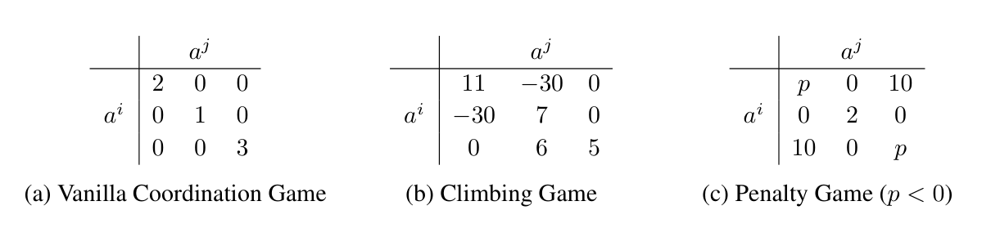
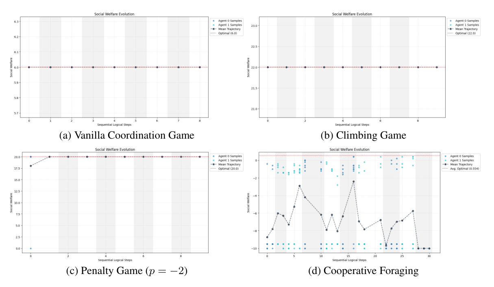

<!-- paper-reading-lang: zh-CN -->
<!-- paper-reading-theme: forest -->
# 让策略读懂策略：Policy-Conditioned Policies 深读

两个人共同搬东西时，困难常常不在于各自不会走路，而在于不知道对方将怎么走。这篇论文把多智能体中的这种信息问题，改写为“给语言模型看对方的策略程序，再生成自己的响应程序”。它的实证是小规模协作任务中的可行性展示；它没有证明语言模型实现了理论上不可被利用的程序均衡。

<span class="source-ref">原文：Lin 等，Policy-Conditioned Policies for Multi-Agent Task Solving；arXiv:2512.21024v1，2025-12-24；本地英文 PDF 25 页，Zotero 3RVNLC7T / HVMXABJ9。全文与 SHA-256 见 assets/source-fulltext.txt、assets/source-identity.json。本解读核实截止 2026-11-05。</span>

```paper-map
{"thesis":"把对手源码作为生成条件，用运行反馈反复修订自己的可执行策略","outcome":"矩阵协作任务迅速达到最优；网格觅食仍有明显波动","outcomeSource":"PDF pp.9–11，§4、Fig.2","items":[{"number":"01","label":"问题","text":"对方也在更新，历史行为未必代表接下来的策略","source":"PDF §§2.4–2.5"},{"number":"02","label":"表示","text":"用源码公开决策逻辑，供 LLM 在生成阶段解释","source":"PDF §§3.1–3.3"},{"number":"03","label":"优化","text":"固定对手，单元测试纠错与轨迹效用反馈驱动内循环","source":"PDF §3.4、Algorithm 1"},{"number":"04","label":"证据边界","text":"返回历史上社会福利最高的一组策略，不等于最后一步已收敛","source":"PDF Algorithm 1 第11行、§4.2"}]}
```

<!-- paper-reading-context:start -->
## 01 / 发表时的研究背景
<!-- context-cutoff: 2025-12-24; basis: verified arXiv v1 date, not an assertion of earliest private circulation -->

### 研究问题与价值

考虑一个完全可观测的多智能体游戏：状态大家都看得见，但各自的决策规则正在改变。输入是游戏规则、对方当前的策略源码和交互反馈，目标是生成能与对方良好配合的可执行策略。成功既要求程序能运行，也要求共同回报足够高，最好还能在交替更新后稳定下来。论文实际研究了两人同收益矩阵游戏和必须合作收集食物的网格世界；没有用大规模竞争系统验证全部设想。（PDF pp.3–5、9–11）

其价值有两层。工程上，源码能被检查、改错，执行时也不必每个动作都请求大模型；科学上，它让“直接知道对方准备怎么行动”成为可实验的问题。前一层在系统形态上成立，但成本优势没有完整的等预算对照；后一层也不等于消除了对代码语义的误解。

### 当时的领域状态

可核实的 arXiv 首发是 **2025-12-24**，本地读的是 v1。多智能体强化学习已经能学习复杂策略；困难在于一个学习者看到的环境会随其他学习者改变。**最佳响应**指固定其他人的策略后，寻找让自己回报最高的策略；**纳什均衡**则要求任何一个人单独换策略都不能获利。高共同回报与均衡是不同判据：双方配合很好，并不自动排除某一方偷偷换程序后更好。

程序博弈理论早就研究过让程序查看彼此源码。它提供了有条件合作的可能，但任意程序的语义既不能靠简单字符串匹配掌握，也不存在通用的自动判定器。当时 LLM 已能生成和解释代码、依据自然语言反馈修正输出，因此“用近似语义理解换取可用性”成为可以测试的方向。这里的“近似”必须保留。（PDF §§2.6、3；[TextGrad 原始论文](https://arxiv.org/abs/2406.07496)）

### 关键前作与尚存缺口

| 工作与时间 | 已有贡献 | 尚存缺口及与本文的关系 | 来源 |
|---|---|---|---|
| Tennenholtz，Program Equilibrium，2004 | 把提交可相互检查的程序作为策略承诺，扩展可支持的结果 | 理论存在性不直接给出实用的复杂任务求解器 | 本文 PDF §2.6、附录 A.2；原文参考文献 |
| Barasz 等，2014，2021 修订 | 用可证明性逻辑构造无需源码完全相同也能稳健合作的 modal agents | 理想证明能力与有限算力的工程实现有距离；2021 版明确有界对应结果尚未证明 | [原始文献与版本历史](https://arxiv.org/abs/1401.5577) |
| Lanctot 等，PSRO，2017 | 向历史策略池的混合分布求响应，缓解只适应当前对手的过拟合 | 并不要求响应器可读，也不自动实现源码条件合作 | [原始论文](https://arxiv.org/abs/1711.00832) |
| Yuksekgonul 等，TextGrad，2024 | 把文本反馈沿计算图传播，用来改进代码、提示等文本变量 | 文本“梯度”不是策略回报的精确数值导数，未解决多方互相适应的稳定性 | [原始论文](https://arxiv.org/abs/2406.07496) |
| Sistla 与 Kleiman-Weiner，2025，Open-Source Games | 研究 LLM 对战略代码的理解与开放源码博弈中的合作、欺骗 | 本文明确承认其时间更早，但将其视为同期独立工作；任务与优化流程不同 | [arXiv 首发 2025-11-29](https://arxiv.org/abs/2512.00371)；本文 PDF §1.1 |

程序均衡解决的是“何种承诺可支持合作”，TextGrad 解决的是“如何用语言反馈修订产物”；把两者连起来仍缺一个重要环节：有限能力的模型能否真的把陌生策略读对，并在另一个智能体也更新时持续生成有效响应。不能把这条接缝说成前作一概无效，也不能把同期工作误写成本文必然的灵感来源。

### 本文为何在此时提出

**合理推断：**代码生成能力成熟后，可以把过去难以自动构造的策略程序变成一个可搜索对象；可执行环境又能提供比“这段推理看起来合理”更硬的反馈。尚未满足的需求是同时保留对手信息、可执行性和适应能力。至于能否获得稳定均衡，仍必须另外检验，不能仅凭表示形式推出。
<!-- paper-reading-context:end -->

## 02 / 不用答案倒推的思路重建

以下是基于当时公开知识的教学重建，并非作者真实发现过程的记录。先遮住本文的方法与实验，只保留三个前提：历史行为不足以唯一确定正在变化的策略；程序承诺可以改变博弈的信息结构；语言模型已能读代码并依据反馈修补代码。这些前提支持一个可检验假说：**如果把决策规则本身提供给一个代码生成器，它或许能比仅观察动作更快提出协调响应。**（PDF §§2.4–2.6；上述 TextGrad 文献）

这个推理尚不能决定该怎样交替更新，也不能保证策略会变好。尤其双方同时改程序时，刚读到的规则可能已经过期。因此下一步需要隔离更新、执行候选、保留失败反馈，而非直接把“读懂源码”当作已完成的能力。这是设计约束的推导，不是以论文成功为前提的故事。

## 03 / 核心直觉与重要变化

论文实际选择的直觉是：先让对方暂时不动，给 LLM 看其策略源代码，生成我方的新程序；用测试和对局纠正生成错误；然后交换更新方。称为 **策略条件策略（Policy-Conditioned Policies）**，实现为 **程序化迭代最佳响应（PIBR）**。LLM 是生成程序的“元程序”，真正玩游戏的是生成出来的普通程序。（PDF §§3.2–3.4）

| 原来做什么 | 本文如何改变 | 预期作用与未解决问题 |
|---|---|---|
| 从历史行为估计对手 | 在生成阶段直接输入对手源码 | 信息更直接；仍会理解错误、超出上下文 |
| 在神经参数空间更新策略 | 修改生成提示与代码产物 | 借用 TextGrad 的文本优化，不是给模型权重做梯度训练 |
| 只看到回报数字 | 同时反馈异常栈与完整轨迹 | 区分运行错误和策略错误；未单独消融二者贡献 |
| 交替更新后取最后一步 | 在历史中选社会福利最高的策略组合 | 允许回退，但掩盖“最后是否稳定”这一独立问题 |

**必须分清两个时间点：**PCP 的 LLM 在生成时读对方源码，生成的动作策略本身不必在运行时接收该源码。相反，本专题的 Open-Source Games 论文明确给运行中的程序传入对手当前源码。二者不能在图里画成同一种输入边。（PDF p.8 §3.3）

## 04 / 一份源码怎样变成响应

### 运行例子：Climbing Game 的同一个协调点

原论文 Fig.1 中，双方动作均为 0、1、2，同得矩阵格子的分数。看下图中间矩阵：双方选 0 时各得 11；一个选 0、另一个选 1 时各得 −30。因此“去追 11”只有对方也选 0 才合理。这个矩阵提供了贯穿解释的真实输入。（PDF p.10 Fig.1）



*原论文 Fig.1 裁剪；矩阵每格是单个玩家回报，社会福利需乘以两人，PDF p.10。*

附录 C.1 的真实最终产物是双方都返回 `[1.0, 0.0, 0.0]`，即以概率 1 选动作 0。以下从输入到输出的中间候选用于教学示意，**论文没有给出该次运行逐步提示和失败候选，不能视为日志复演**。（PDF pp.19–20 附录 C.1）

### 先固定对手，再在一个输入点上优化响应

1. 初始时有两个可执行策略。轮到玩家 0 更新，就固定玩家 1 的当前代码。
2. 把游戏规则、接口、对方源码和提示交给 LLM，得到玩家 0 的候选代码。在本例，如果源码确实总选 0，那么第一列回报为 11、−30、0，正确响应应选 0。
3. 这里优化的是**针对这份固定源码的响应**。换一个对手，还需要新的生成与反馈；没有证明学到了对任意对手都准确的通用最佳响应算子。

论文用“算子”描述代码到代码的映射，这个术语强调输入输出都是函数的表示，并不额外赋予其最优性。固定对手使内循环评估有稳定目标；代价是外循环仍然会因对手更新而改变目标。（PDF §§3.3–3.4）

### 用单元测试把“不能运行”与“不会配合”分开

候选先在沙箱中实例化。语法错误、越界等异常与断言失败会形成高优先级文本反馈，让 LLM 修补。通过后再执行游戏，收集状态、双方动作、双方回报构成的轨迹，用以指出策略为何不好。Climbing 中，返回长度错误属于接口问题；返回合法的 `[0,1,0]` 却撞上对方动作 0 则属于策略问题。这是两个不同反馈分支。（PDF p.8 §3.4）

该机制采用 TextGrad 的思想，把批评和建议组织成可回传的文本信号。模型参数不是本文在线训练对象。“梯度”是类比，不是对离散源码求出的精确导数。论文没有足够细节复现所有提示更新、权重或错误处理边界，也没有无测试反馈对照，故不能给该模块单独标一个提升百分比。

### 交替更新与历史最优回退

内循环迭代结束后，用其最后一个候选替换当前玩家；再让另一方更新。每次记录策略组合与社会福利，最终返回历史最佳组合。注意两个选择不同：Algorithm 1 的内循环返回最后候选，外层才做历史最优选择。Climbing 附录展示的双方动作 0 组合，福利是 22；觅食实验则明确取第 16 个优化步骤的组合，而不是末次组合。（PDF p.9 Algorithm 1、p.10 §4.2）

下面是解释性流程图。测试失败回到生成器；测试通过才能获得有意义的效用反馈；外层历史记录为最后的选择服务。

```paper-path
{"title":"PIBR 的两层循环与两个反馈分支","intro":"解释性重绘；同一 Climbing Game 输入贯穿所有阶段，中间候选不是原始运行日志","stages":[{"title":"固定玩家1的源码","role":"外循环条件","action":"读取当前对手代码，例如明确总选动作0的程序","why":"在内循环中保持评估对象不变","output":"源码、规则和接口进入生成提示","source":"PDF §§3.3–3.4"},{"title":"LLM生成玩家0代码","role":"点态响应算子","action":"输出动作概率程序；当前输入点上修订提示","why":"把语义理解与程序构造放在生成阶段","cost":"近似解释器可能读错，不保证最佳响应","output":"候选源码进入单元测试","source":"PDF p.8"},{"title":"测试错误回传","role":"可执行性分支","action":"异常栈与断言失败反馈给生成器；通过者进入对局","why":"不能把非法程序的失败误当成策略水平","output":"可执行候选或下一次纠错请求","source":"PDF §3.4"},{"title":"对局轨迹回传","role":"效用分支","action":"收集状态、联合动作与回报，文本反馈再修改候选","why":"合法响应也可能撞入负30的失配格子","output":"内循环最后候选替换玩家0","source":"PDF §3.4、Algorithm 1"},{"title":"交换玩家并记录福利","role":"外层选择","action":"下一轮更新玩家1；保存每轮组合，返回历史最大福利","why":"允许后续探索退化时恢复较好组合","cost":"历史最优不证明末步收敛，也可能受评估噪声影响","output":"附录示例双方总选0，福利22","source":"PDF Algorithm 1、附录 C.1"}]}
```

### 网格任务中的策略到底写了什么

附录 C.2 给出 5×5、两人、最多两块食物的策略。代码先检查能否共同装载；否则根据自身距离、等级可行性、过去 5 步对方朝哪块食物移动来给目标打分，再按 softmax 随机选目标、移动。相邻时使用随时间变化的装载概率。它说明“程序化”不等于无记忆：运行时仍可利用历史来推测伙伴意图。（PDF pp.20–24）

这些启发式是所展示生成策略的内容，不是所有 PIBR 策略强制共享的网络模块。它们也提供了波动的合理解释：独立随机选目标、局部动作分配可能让共同装载失去同步；这只是基于代码的推断，论文未做逐项因果消融。辅助函数实现和终止惩罚精确定义不齐全，不宜把抄下附录代码说成完整复现。

## 05 / 数学：最佳响应不等于均衡

令 $G$ 为游戏，$\pi_i$ 是玩家 $i$ 的执行策略，$\pi_{-i}$ 是其他玩家策略；$s_t,a_t,r_i$ 分别是状态、联合动作与回报，$\gamma$ 为折扣。期望回报定义为

$$
J_i(\pi)=\mathbb E_{G,\pi}\left[\sum_{t=0}^{\infty}\gamma^t r_i(s_t,a_t)\right].
$$

先固定对手，最佳响应是最大化 $J_i(\pi_i,\pi_{-i})$ 的策略。纳什均衡更强：对每个玩家和任何允许的替代策略 $\pi'_i$ 都要有

$$
J_i(\pi_i^*,\pi_{-i}^*)\geq J_i(\pi_i',\pi_{-i}^*).
$$

Climbing 中对方固定选 0 时，三个可选回报 11、−30、0 可直接枚举，选 0 是真正最佳响应。但换成任意复杂程序，LLM 只能生成候选；没有同样的枚举保证。这里的计算也说明为何福利 22 并非单人得分 22。（PDF §2.2、Fig.1）

源码记作 $\ulcorner\pi\urcorner$，生成算子是 $\varphi_i$。本文实际依赖链是

$$
\ulcorner\pi_i\urcorner=\varphi_i(\ulcorner\pi_{-i}\urcorner\mid\mathrm{prompt}),\qquad
\pi_i=\mathrm{CodeInterpreter}(\ulcorner\pi_i\urcorner),\qquad a_i\sim\pi_i(\cdot\mid h_t).
$$

$h_t$ 表示执行时可用的历史。**源码输入在第一步，不应擅自添加到最后一个策略接口。**算法把损失写作 $L=L_{\rm test}+L_{\rm utility}$、$L_{\rm utility}=-J$；实现层面二者包含文本反馈，不能把它理解成已定义好单位一致、可精确求导的普通标量损失。（PDF pp.8–9）

外层选择则是

$$
\pi^{\rm out}\in\arg\max_{\pi\in\mathcal H}J_{\rm SW}(\pi),\qquad J_{\rm SW}(\pi)=\sum_i J_i(\pi).
$$

这是在访问过的有限历史 $\mathcal H$ 中挑选，不是在所有程序中求全局最大。

附录 B 回顾 FairBot 的证明思路：只有证明对手会合作才合作，借助 Löb 定理处理自指。那是已有形式理论的教学背景，**不是 PIBR 收敛定理**。还需纠正一个逻辑松动处：附录把“一致性”解释为“不能证明假命题”，严格说后者要求相应的可靠性／健全性，一致性本身更弱；无界搜索找不到证明时怎样终止也不是几行伪代码就解决的。已有原始文献 2021 修订特意保留有界版本的未知性，因此不应把 LLM 的近似理解继承成 FairBot 的无剥削保证。（PDF pp.18–19；[Barasz 等版本说明](https://arxiv.org/abs/1401.5577)）

### 离线探索：换一种对手，最佳响应会怎样变

交互允许调节 Climbing Game 中对手选三个动作的概率，显示三种纯动作的**精确矩阵期望值**。它帮助理解“响应依赖对手分布”，不调用 LLM，不模拟论文训练，也不把示意计算当作实验。静态结论已经给出：对方总选 0，我方选 0；对方总选 1，我方应选 1；对方总选 2，我方选 2；混合分布则需要重新比较三列的加权收益。

<!-- interaction-design: reader changes opponent probabilities; computes exact expected utilities from original Fig.1; no generated-policy scores or experiment execution. Keyboard-native inputs, live text and table. -->
<!-- archify:assets/interaction.html|调整对手分布，检查最佳响应 -->

## 06 / 实验究竟回答了什么

先看 Fig.2：横轴是文本优化步骤，点是同一步的多局评估，虚线是该步均值。重点比较上方矩阵任务的平稳与右下觅食任务的剧烈变化；空白步骤意味着候选存在语法或运行错误，不能解释为零奖励。（PDF pp.10–11 §4.2）



*原论文 Fig.2 裁剪；保留四个面板，福利曲线非新实验，PDF p.11。*

```paper-experiments
{"title":"从证据到结论的距离","rows":[{"question":"源码条件生成能否找到简单的高收益协调点","setup":"o4-mini；三种两人同收益3×3矩阵游戏，观察每步社会福利","observation":"Vanilla为6、Climbing为22；Penalty取p=-2时很快协调到最优格子","conclusion":"支持这些小任务上的可行性；未给等预算的无源码或标准MARL对照，不能量化其必要性","source":"PDF §4.2、Fig.1–2"},{"question":"任务更复杂时能否持续稳定配合","setup":"合作LBF：两人必须同时装载食物，额外终止惩罚；多局散点与均值","observation":"个别样本接近约0.554的经验最优，均值明显波动，最终选第16步组合","conclusion":"展示可产生有效协作，也直接暴露稳定性不足；0.554不是严格上界","source":"PDF p.10 §4.2"},{"question":"可否把高福利称作程序均衡","setup":"需要测每一方的单边程序偏离收益或提供理论证明","observation":"论文报告福利曲线，未给充分偏离搜索或PIBR收敛证明","conclusion":"均衡是理论动机与近似实现主张，不是这些曲线单独证明的结果","source":"PDF §§2.6、3.4、4；附录B"}]}
```

实验还留下三项解释限制。多局评估点不是独立的训练重启次数；正文没有完整置信区间和各机制消融。o4-mini 的预训练可能已知道这些矩阵，不宜把“立即最优”全部解释为在线学习。LBF 的终止惩罚只给了文字描述，没有足够公式与常数恢复准确奖励，所以不能随意重建一个数值上相同的 0.554 标准。（PDF §§4.1–4.2）

## 07 / 值得带走的认识

第一，把策略作为可读对象，确实改变了智能体间的信息通道；不过**信息完整不等于解释正确**。第二，生成器与执行器分离，使模型可以用对局结果修订普通程序，这是比“每步让 LLM 选动作”更可审计的一种系统形态。第三，运行测试和效用反馈分别处理软件正确性、战略质量，二者不可混淆。第四，觅食曲线与历史最优回退告诉我们：找到一次好配合，比维持可重复的稳定配合容易。这些结论适用于本文小规模透明协作设置，不外推成任意竞争环境的均衡求解能力。

## 08 / 最脆弱的假设

**我的诊断：LLM 能从完整源码中稳定恢复与响应相关的语义，是最关键也最脆弱的候选假设。**论文声称原始策略通信避免信息损失；这对“收到哪些字节”有意义，却不保证“理解了哪些行为”。同一策略换写法、加入死代码、拉长调用链，就可能让近似解释失真。对手透明是作者设定；“理解稳定性最脆弱”是我的判断，排序没有被实验确立。（PDF §§3.1–3.3）

失效信号应是：保持对手执行行为不变，仅改源码外观，响应收益就显著变化。它与对手根本不提供源码是两回事；后者违反设定，前者能在透明设定内检验。另一个独立风险是历史最佳福利的选择噪声，应把选中组合放到新种子上重新评估。

## 09 / 一周最小复现方案

**目标：缩小版机制复现，不承诺复现全部论文。**只测试 Climbing Game 中“源码条件生成能否达到双方动作 0 的高福利点”。原文仅承诺录用后开放代码，未核实到其可直接运行的正式实现，因此应独立写一个十几行矩阵环境，不冒称使用作者代码。（PDF p.9 §4）

| 要素 | 拟议设计，均未执行 |
|---|---|
| 输入与访问 | 原 Fig.1 矩阵；接口输出3维概率。o4-mini 若可用则固定模型版本，否则明确标注替代模型 |
| 对照 | A：对手源码+轨迹+测试反馈；B：同预算只给轨迹与测试；C：仅规则一次生成，用于检查预训练先验 |
| 资源估计 | 普通4核CPU、8GB内存，无GPU；至多300次小型API请求，提供商硬额度约人民币200元或用户批准的更低上限；耗时估计1–2天机器等待 |
| 重复与指标 | 10个独立提示随机种子，最多10次交替更新；合法率、到达福利22的更新数、选中策略在独立种子下的福利；保留失败 |
| 判据 | 预注册主要比较A与B到达22的比例及配对置信区间；A稳定达到22才支持可行性，若A与B等好则不支持“源码是增益来源” |
| 低成本退路 | 无模型权限时只完成矩阵与评分器测试，不称论文复现；减少种子时明确不能判断显著性 |

第1天核对矩阵与接口；第2天做手写总选0／1／2的单测；第3天跑一次生成基线；第4–5天在同一预算做A/B；第6天独立重评历史冠军、分析错误；第7天交付全部候选、提示、费用和负结果。只在用户另行授权后才运行付费试验。

## 10 / 公平反例与适用边界

针对“读完整源码足以可靠条件化”的强解释，构造一组总选0的等价程序：直接返回、通过辅助函数返回、交换等价分支返回。所有程序先在允许输入上验证行为一致，再让相同 LLM 生成响应。对照为同种子同长度预算下的原始写法；增加无语义负担的等长填充对照，以区分语义结构与单纯长度。（这是拟议测试，非已发现反驳。）

如果等价重写导致响应从最优0切换到1，失配得−30，就支持源码理解不稳这一机制诊断。若收益、动作与合法率在预注册容忍区间内保持一致，则本反例没有成立。任意长的混淆程序只能算范围压力测试；短、自然的辅助函数重构才是更公平的设定内挑战。它不推翻 Fig.2 已发生的结果，只检验其可推广解释。

## 11 / 检索后的研究位置

**检索截止 2026-11-05。**实际使用标题、arXiv 编号以及 extension、replication、criticism、program equilibrium、semantic equivalence 等查询。在本次范围内，**未找到可核实的 PCP 独立复现或直接反驳**；搜索不完整不等于不存在。OpenReview 页面遇到浏览器验证，未把其评审意见当作已读证据。

| 后来的来源 | 核实到的关系与内容 | 它没有证明什么 |
|---|---|---|
| [CSRO，2026-03-10](https://arxiv.org/abs/2603.10098)，本专题已读全文 | 相关的另一种源码响应系统：向策略池混合求响应，采用闭环细化与外部群体评估 | 未核实为PCP的直接延伸或复现；其零和任务不能与协作福利直接排名 |
| [EvoPolicyGym，2026-07-02，v1 §3.3](https://arxiv.org/html/2607.02440v1) | 相关评测进展：隐藏验证选择与held-out评估，把可见反馈优化和泛化分开 | 没有验证PCP的程序均衡或源码理解 |
| [A Jagged Frontier，2026-08-18，v1](https://arxiv.org/html/2608.18389v1) | 邻域的负面证据：在仓库修复任务中，语义保持变换可改变代码agent成功率，效果依模型与harness而异；已查看其方法与实验说明 | 它不是博弈论文，也没有直接测试PCP；测试等价不是全输入形式等价 |

理解因此从“能否生成合作程序”推进到“是否对表示变化稳健、是否通过独立评估”。这是一种跨工作的综合，不是已被后续文献正式推翻的结论。

## 12 / 一个可证伪的后续研究想法

**不确定猜测：研究“对手策略语义等价类上的响应稳定性”，而非单份源码上的响应分数。**真实需求是协作伙伴重构代码后，别人不应因此误判其承诺。当前点态优化只约束这份字符串；拟议问题则要求在已验证行为相同的一组表达中，响应都保持安全与有效。

机制是为小型有限游戏定义受限策略语言，能枚举全部可达历史；将对手的多种等价实现组成一个语义类，生成器必须同时通过行为等价检查、响应质量与最差变体测试。输出一个“在这类可验证程序中，最差偏离收益／协调损失有多大”的证据卡，不声称对任意Python程序做完备验证。这改变的是优化与评测单位，从字符串变为可验证行为类。

最接近的工作已经存在：SPARC 做过遮蔽和混淆，Jagged Frontier 做语义保持变换，FairBot 做形式承诺；CEGIS 式程序修补也早已有之。实际检索了 `"program equilibrium" "counterexample guided" LLM`、`"code policy" "semantic" "best response" robustness`，查到 [AAAI 2025 反例引导程序修补](https://ojs.aaai.org/index.php/AAAI/article/view/32046)。因此**“加入等价测试”不是可声称的新意**；候选差异是同时度量“同一语义类内的响应稳定性”与“跨语义类的正确区分”，避免模型对所有程序都输出保守动作。

最小区分实验：10个受限对手策略，每个5个等价写法，再加入5个仅一处分支改变真实行为的近邻；同预算比较单字符串反馈、数据增强、语义类最差反馈。预注册预测是：最后一组降低等价类内收益波动，同时不降低对真实语义变化的响应能力。若只会统一选保守动作，或相对简单增强没有收益，则停止该机制主张。CPU检查器便宜，模型调用与语言覆盖是主要风险；一周实验只能筛选方向。在已核实检索范围内具有上述候选差异，**不能保证首创或有效**。

补充的新颖性检索还找到 [SInQ，2025首发、2026-08 v3](https://arxiv.org/abs/2505.03818)，以程序行为分歧输入进行半对抗语义学习；以及 [Semantic Invariance in Agentic AI，2026-03](https://arxiv.org/abs/2603.13173)，测自然语言推理在等价表达下的稳定性。本次核实其摘要与版本史，未把最新实验当作2025年的前提。它们进一步排除了“语义不变性／程序反例是新概念”的说法；本文所提差异仅限博弈响应的受限语义类与协调损失联合测量。

<!-- audit: prose spine checked without diagrams; Q1–2=01, Q3=02, Q4=03, Q5=04, Q6=05, Q7=06, Q8=07, Q9=08, Q10=09, Q11=10, Q12=11, Q13=12. Method inventory: code-input/code-output operator (§3.3)->04.1 + path stages1–2; unit-test branch and utility branch (§3.4)->04.2 + path3–4; alternating optimization and historical selection (Algorithm1)->04.3 + path5; generated LBF heuristics (App.C.2)->04.4, clearly example-specific. Source identity and relevant methods/results/appendices accessible; original figures/captions visually checked. Historical priority limited to verified public dates; no independent reader study; exact author implementation and follow-up novelty remain unknown. Search tools used: websearch/webfetch; queries and access limits in chapter11 and12 plus assets/search-audit.json. -->
