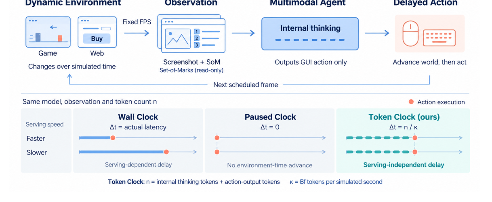
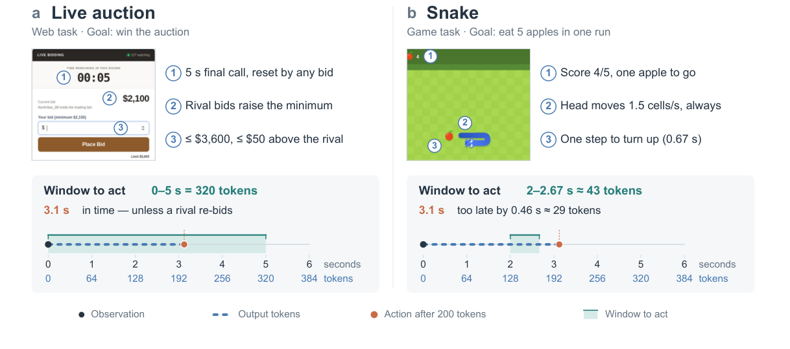
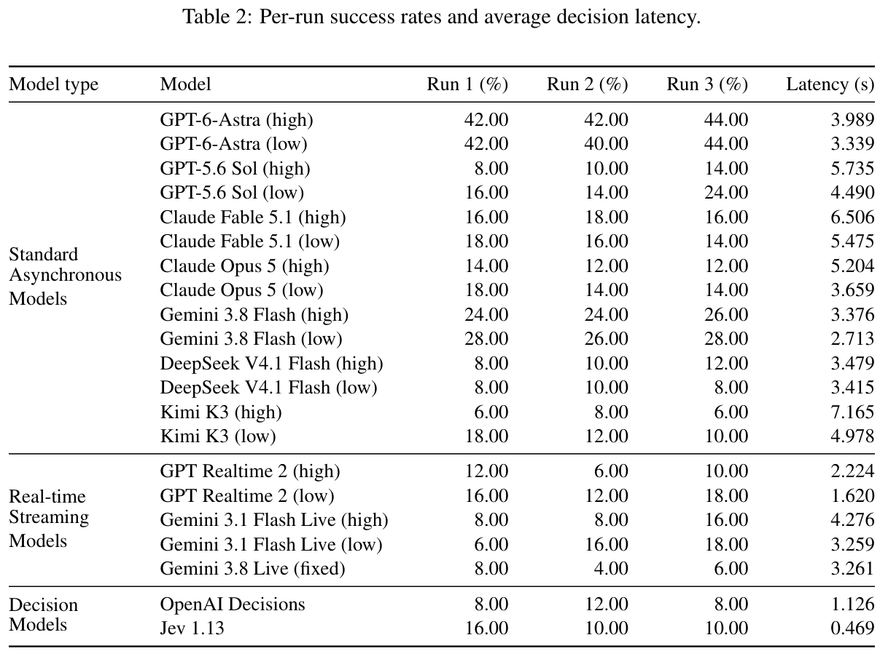
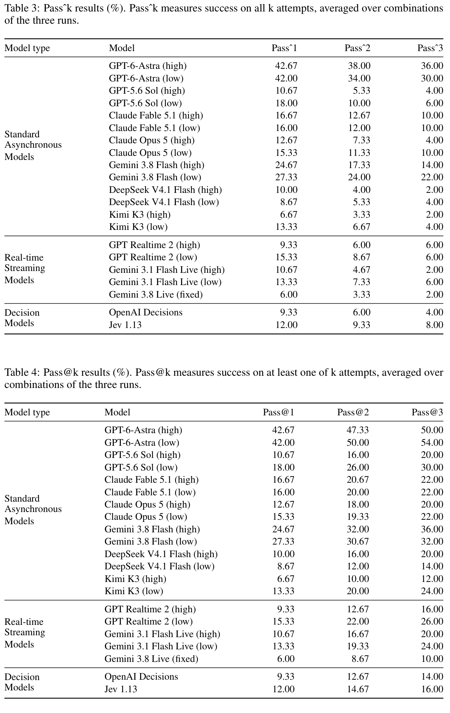
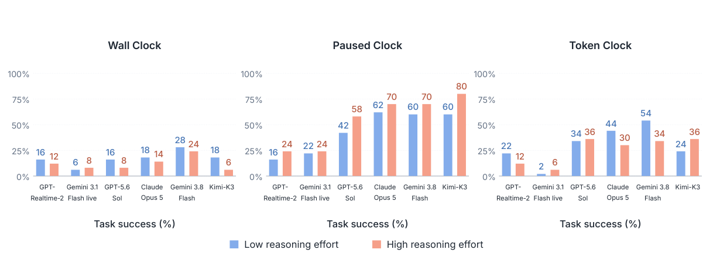
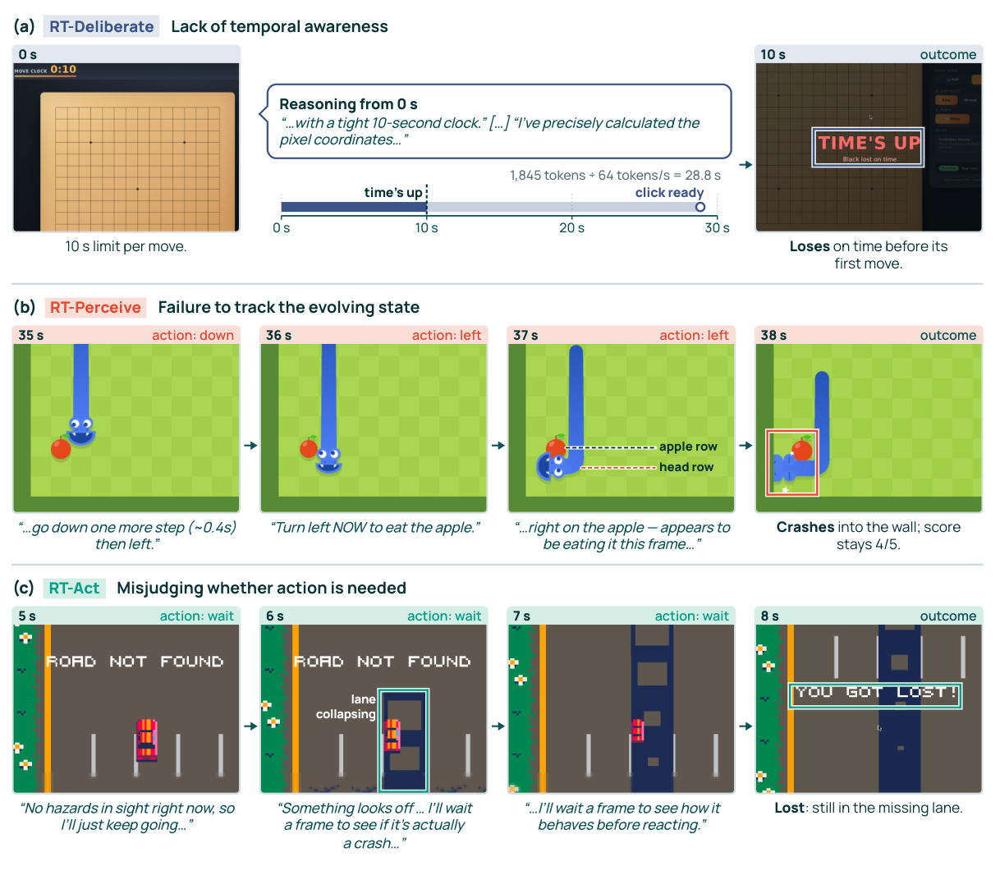

<!-- paper-reading-lang: zh-CN -->
<!-- paper-reading-theme: cobalt -->
# Realtime-Bench：把真实延迟、推理长度与实时行动能力分开测

**原论文**：*Realtime-Bench: Can Frontier Models Solve Real-time Interactive Problems?*，Jingyu Tang、Xu Yang、Zhehao Zhang等，Zotero `MH47BEJ5`。依据26页本地 **arXiv:2610.22155v1，2026-10-15**；[官方首发记录](https://arxiv.org/abs/2610.22155)与版本日期一致。页码均按本地PDF起算。

这是一篇**评估设计与诊断论文**，不是训练了一个新实时模型。它把三种问题分开：一个部署系统在真实等待下能否成功；给它暂停推理时间的理想条件能做到多少；把生成token统一折算成环境时间后，还能否及时执行。其价值不是只报“最好44%”，而是通过时钟、推理强度与观测接口解释为什么会失败。（PDF §§1、3、6）

本篇的 **Realtime-Bench** 是50个网页/游戏任务，不是Pan等另一篇论文的 **RealtimeBench**（六游戏族、180任务、0–100进度及TORSI）。两者同期公开，不能混用分数，也不应按一天的发表差认定前后继承。

```paper-map
{"thesis":"用持续演化的闭环任务检验及时行动，再通过Wall、Paused与Token三种时钟区分部署等待与标准化推理时间成本。","outcome":"50任务、12模型；最佳单次运行44%，最佳三次全成功Pass³为36%，最佳三次平均成功率为42.67%，三个数字不是同一指标。","outcomeSource":"PDF §6, Appendix B.1 Tables 2–4","items":[{"number":"01","label":"能力问题","text":"追踪当前状态、按时间压力分配推理、判断何时行动，是互相连接的三个维度。","source":"PDF §3.1"},{"number":"02","label":"任务范围","text":"30网页与20游戏任务，状态独立变化且机会有期限；不是离线视频问答。","source":"PDF §4, Fig. 3"},{"number":"03","label":"时钟机制","text":"Wall按实际推理等待，Paused取消推理时间成本，Token按n/(Bf)推进，统一行动时间代价。","source":"PDF §3.2, Appendix A.2"},{"number":"04","label":"接口与范围","text":"1FPS截图加只读SoM、共同GUI动作；Jev仅网页且使用结构化文本，覆盖并不完全一致。","source":"PDF §5, Appendix A.1/A.4"},{"number":"05","label":"核心实验","text":"12模型Wall评测；另6模型交叉3时钟×2推理强度，决策模型因token不可得不参加Token分析。","source":"PDF §6.1"},{"number":"06","label":"解释边界","text":"Token Clock不等于等FLOPs；失败标签是选定条件下的行为归因，比例分母不同且可重叠。","source":"PDF Appendix A.2, C.1–C.2"}]}
```

<!-- paper-reading-context:start -->
## 00 / 发表时的研究背景
<!-- context-cutoff: 2026-10-15; basis: first-publication -->

### 当时的领域状态

到2026年10月，多模态模型已从处理离线视频片段，走到接收持续音视频、控制响应时机及调用GUI工具。两类测量却不完全相同：**看懂一段流、适时说话**，不等于**执行会改变世界、又必须赶在窗口内的动作**。网页预订、竞拍和移动障碍还会在模型生成期间改变，因此只看静态任务能力或API快慢，都可能遗漏决定结果的部分。（PDF §§1–2）

先理解“闭环”：动作会影响后续观察，后续观察再决定下一步；如果动作晚到，智能体甚至可能已错过获得下一条证据的机会。“Token Clock”则是实验中的时间成本标准化工具，不是实际硬件时间：同样的生成量被分配同样模拟延迟，目的是减少服务速度差异，而不声称所有模型一token的计算或信息量相同。（PDF §3.2）

### 关键前作与尚存缺口

| 工作与时间 | 已有贡献 | 当时未解问题及与本文的关系 | 来源 |
|---|---|---|---|
| VideoLLM-online（CVPR2024）及后续流式多模态研究 | 将连续视频转成时序对齐的语言交互，改进在线推理和响应效率 | 感知/对话的好成绩不直接证明在动态GUI中采取有效动作；本文把评价目标推进到闭环任务结果 | PDF §2.1；[原工作摘要](https://arxiv.org/abs/2406.11816) |
| OSWorld（2024）与已有GUI智能体评测 | 在真实计算机环境中测截图理解、定位、操作和多步任务，建立可执行GUI接口 | 单步推理等待若不造成环境损失，就难以单独测及时行动；本文还用只读SoM减轻定位瓶颈 | PDF §§2.2、5.1及Xie等引文 |
| VideoGameBench（2025预印本）、Gaia2等动态环境工作（ICLR2026） | 已将真实推理等待、环境持续变化和异步任务纳入智能体评测 | Wall Clock同时依赖服务基础设施，模型的策略质量和部署速度难完全分开 | PDF §2.2；[VideoGameBench摘要](https://arxiv.org/abs/2505.18134) |
| Real-Time Reasoning Gym（2025预印本/ICLR2026） | 研究世界在推理时演化的游戏与规划/反应权衡，并使用模拟时间思路 | 本文不是首次发现token计时；它将统一token代价与网页/游戏任务、三时钟及不同推理强度结合 | PDF §2.2；[原工作](https://arxiv.org/abs/2511.04898) |
| τ-bench（2024预印本/ICLR2025） | 不只统计一次成功，还用Pass^k考察多次尝试是否持续可靠 | 可靠性指标本身不是实时时钟，本文同时保留三次全成功与至少一次成功，检验动态任务稳定性 | PDF §6.1；[原工作摘要](https://arxiv.org/abs/2406.12045) |

### 本文为何在此时提出

新的缺口不是再给模型做一个视频理解题，而是缺少把**实际服务等待、取消等待的能力上限参考、统一生成时间成本**放到同一组闭环任务里对比的协议。作者因此构造带动作窗口的50任务，用三时钟和推理强度交叉测试，询问模型是否会根据剩余时间调整思考，而不只是问哪家API更快。（PDF §§3–6）

本文用语“Token Clock (ours)”应放在它承认的Realtime Gym等前作之后理解，不能写成整个思想此前不存在。前一天公开的Pan等实时游戏/离线教学论文也不被当作本篇已证实的影响来源。上表结合目标论文相关工作与部分原始摘要核对，不冒充逐篇独立复现。
<!-- paper-reading-context:end -->

## 01 / 50个任务在测什么

三个能力维度是：**RT-Perceive**追踪有关状态及信息新鲜度；**RT-Deliberate**依剩余时间调整思考；**RT-Act**决定该等、该动以及怎样让动作生效。它们是分析框架，不是三个分别训练并隔离测试的模型模块。（PDF §3.1）

| 任务域 | 数量 | 子类 | 必须同时满足的条件 |
|---|---:|---|---|
| Web | 30 | Travel10、E-commerce9、Service8、Security3 | 界面/库存/请求变化，GUI操作要满足任务规则与窗口 |
| Game | 20 | Arcade11、Puzzle3、Strategy3、Simulation3 | 场景持续演化，动作时间会影响成败 |

任务来自现实风格网页模拟与改编的开源游戏，作者调整目标与时间约束以便人类可完成；这是一项任务设计说明，不是给出了大规模人类对照成绩。网页与游戏一起覆盖行动机会，但50个精选任务也不代表所有实际部署情境。（PDF §4, Fig. 3）

原Fig.2上方按“动态环境→采样观察→模型生成→延迟后行动→下次观察”读，下面才是替换不同时间代价。它强调同一个闭环接口下改时钟，不是三个互不相关的数据集。（PDF p. 2, Fig. 2）



*原论文 Fig. 2，PDF p. 2。时钟改变动作到达时刻，动作仍需符合当前环境。*

## 02 / 三种时钟的精确含义

对环境时刻 $t_i$ 获得的观察，动作应用时刻为：

$$
t_i^{act}=t_i+\Delta t_i.
$$

| 时钟 | 推理导致的 $\Delta t_i$ | 用来回答的问题 | 仍未控制的内容 |
|---|---|---|---|
| Wall Clock | 真实测到的推理/服务等待 | 当前部署系统能否及时完成任务 | 网络、服务负载、解码等也会影响排序 |
| Paused Clock | 0 | 取消生成等待后任务能做到多少 | 不是整个任务永远静止，动作、显式wait与观察间隔仍使世界推进 |
| Token Clock | $n_i/(Bf)$ | 相同生成代价换算下，能否限制思考并按时执行 | tokenization、隐藏计算与模型架构不被等FLOPs归一化 |

这里 $f$ 是每模拟秒的观察数，$B$是一个观察间隔对应的计费生成token数，$\kappa=Bf$ 的单位是token/模拟秒：

$$
\Delta t_i=\frac{n_i}{\kappa}=\frac{n_i}{Bf}.
$$

主设置为 $f=1$ FPS、$B=64$，所以200个计费token对应3.125模拟秒。**B是换算率，不是超过64token就截断的输出上限**；生成得更多，可以继续生成，只是环境时间走得更远。（PDF §3.2, §6.1）

计费根据完整响应的API usage，含思考token与动作输出相关token，不只是最后一行可见JSON；Gemini Live使用原生function call，计thought及非音频响应token，排除生成音频。输入/prefill的真实耗时与网络等待不会自动变成同等Token Clock代价。决策模型不提供所需token计数，所以不参加这部分分析，不能将“未报告token”当成零token免费动作。（PDF Appendix A.2, §6.1）

### 什么时间没有算进去

§5.3明确说GUI执行延迟不推进环境时间；Token Clock还排除物理推理时间。显式 `wait` / `hold key` 的声明持续时间则有模拟世界含义。这是一套控制协议，不是端到端测量所有设备、感知、鼠标和网络延迟的真实机器人系统。（PDF §5.3, Appendix D）

观察仍遵守固定frame grid，推理跨越的中间观察会跳过，不能在一个1FPS设置下靠更短回答无限索取新帧。模拟器的60Hz动画更新又与1FPS观察不同：场景可以在两次观测间变化60次，而模型没有看到每次变化。（PDF Appendix A.2）

## 03 / 同样200token，为何一个任务赶得上，另一个赶不上

原Fig.4先看上方任务规则，再看下方时间窗。拍卖示例窗口为0–5s，任何对手新出价还可能重置窗口；Snake的特定转向窗是2–2.67s。200token在64token/s下到3.125s，前者可能仍在窗内，后者晚约0.46s。**落窗只说明时间可能允许，不保证价格、位置或动作内容正确**。（PDF p. 5, Fig. 4）



*原论文 Fig. 4，PDF p. 5。图中200token不是模型所有回答的固定长度，只是说明时间代价的例子。*

下面三行是按原公式的教学代入，不是新运行的游戏成绩。固定 $f=1$、$n=200$：

| B | 模拟延迟 | 固定竞拍窗0–5s | 固定Snake窗2–8/3s |
|---|---:|---|---|
| 32 | 6.25s | 太晚 | 太晚 |
| 64 | 3.125s | 窗内但不保证成功 | 晚约0.458s |
| 128 | 1.5625s | 窗内但不保证成功 | 尚未到该特定窗口 |

这也解释了“少想一定更好”为何不成立：有些动作不仅有截止时间，还有合适的起始时刻，需要决定先等还是先做；减少生成量不等于已学会动作时机。下方补充交互允许改变token数、B和任务窗，看同一公式怎样改变到达时刻。关键解释和上述静态表不依赖脚本。

<!-- archify:assets/token-clock-lab.html|Token Clock与动作窗口的交互算例 -->

## 04 / 观察、动作与历史如何约束模型

默认观察是保持比例缩小的768×432截图，加只读Set-of-Marks。点用P#，区域用R#和局部坐标；标记只属于当前观察，不能把旧帧P1当成新帧的同一按钮。没有合适标记时仍可用截图坐标，由harness映射到1920×1080桌面。（PDF §5.1, Appendix A.1）

GUI动作包括click、type、key、hold、scroll、drag、wait等。无合法动作或出现多个冲突动作时执行WAIT，但WAIT的时间戳仍按当前clock计算，不会因解析失败而免去时间成本。鼠标动作持续参数和键保持参数有不同语义，不能仅看输出JSON字段长短判断环境推进。（PDF §5.3, Appendix D, Prompts 2–7）

历史按块清理：活跃视觉观察到21时，将最老10张截图及interactables替为占位，保留对应文字/动作；详细交互超过50轮时，最老10轮变成简洁动作账本。流式模型在session中保留逻辑历史，异步模型重新提交保留context；这样减少每步删历史造成的prefix变化，但不保证所有服务的cache收益相同。（PDF §5.2, Appendix A.3）

```paper-path
{"title":"一条动作如何从观察变成被计分的结果","stages":[{"title":"按观察网格采样","role":"observation","action":"读取当前截图与只读SoM，附上按共同策略保留的历史和任务/clock说明。","why":"尽量降低GUI定位和harness额外负担，同时保留时间相关状态。","output":"当前决策可使用的证据","source":"PDF §5.1–5.2, Appendix A.1/A.3"},{"title":"生成一个动作","role":"model","action":"模型用provider可配的低/高推理强度生成动作；记录等待或计费token。","why":"需要同时知道动作内容和为了它付出的时间。","cost":"不同provider的effort档位不是等算力或等token预算。","output":"动作提案及时间/usage记录","source":"PDF §6.1, Appendix A.4"},{"title":"先推进环境再执行","role":"clock","action":"根据Wall/Paused/Token得到动作时间戳，推进环境至该时刻；无效输出按同钟WAIT。","why":"禁止把过期动作当作仍在旧状态执行，保留迟到的任务后果。","output":"真实应用的动作与新状态","source":"PDF §5.3, Appendix A.2"},{"title":"新观察与终局评分","role":"loop/evaluation","action":"跳过过时中间帧，按网格提供后续观察，到终局或时限后检查任务条件。","why":"一次行动既改变状态，也改变下一次能看到/做到什么。","output":"每episode二元成功与重复运行可靠性","source":"PDF §§3.2, 5.3, 6.1"}]}
```

**覆盖例外**必须保留：Jev1.13不支持截图，网页改用AX tree、interactables和外观描述，且只评Web；OpenAI Decisions可接截图。二者只参加Wall。不能把“12模型”简化为所有模型都用同样模态、覆盖全部50任务且接受全部三时钟。（PDF Appendix A.4）

## 05 / 44%、42.67%与36%分别是什么

每任务做三次独立尝试。若某任务成功 $c$ 次，共 $m=3$ 次，则按三次运行的组合平均，可将报告指标说明性写成：

$$
\widehat{\mathrm{Pass}^{k}}=\frac1N\sum_{j=1}^{N}\frac{\binom{c_j}{k}}{\binom{3}{k}},\qquad
\widehat{\mathrm{Pass@}k}=\frac1N\sum_{j=1}^{N}\left[1-\frac{\binom{3-c_j}{k}}{\binom{3}{k}}\right].
$$

不足 $k$ 的组合数按0计，$N$须是该报告使用的任务分母。$k=1$时二者是三次平均成功率；$k=3$时，前者要求**三次全成功**，后者只要求**至少一次成功**。它们不是立方一个总体平均，也不能将Pass^3写成Pass@3。（PDF §6.1, Appendix B.1 Tables 3–4；公式为组合定义展开）

**说明性例子**：同一任务结果为成功、成功、失败，Pass^1=2/3，Pass^2=1/3，Pass^3=0，而Pass@3=1。模型偶尔能做成，与能可靠重复做成，回答的是不同问题。

Table 2请把Run1/2/3和latency分开读：GPT-6-Astra high为42/42/44%，所以**44%是最好一次运行**，三次平均为42.67%，不是平均44%。其Pass^3为36%，Pass@3为50%。（PDF pp. 18–19, Tables 2–4）



*原论文 Table 2，PDF p. 18。单run、跨run均值和三次一致成功不是一项指标。*

| 模型/配置 | Pass^1均值% | Pass^3全成功% | Pass@3至少一次% | 平均延迟s |
|---|---:|---:|---:|---:|
| GPT-6-Astra high | 42.67 | 36.00 | 50.00 | 3.989 |
| GPT-6-Astra low | 42.00 | 30.00 | 54.00 | 3.339 |
| GPT-5.6 Sol high | 10.67 | 4.00 | 20.00 | 5.735 |
| GPT-5.6 Sol low | 18.00 | 6.00 | 24.00 | 4.490 |
| Claude Fable5.1 high | 16.67 | 10.00 | 22.00 | 6.506 |
| Claude Fable5.1 low | 16.00 | 10.00 | 22.00 | 5.475 |
| Claude Opus5 high | 12.67 | 4.00 | 20.00 | 5.204 |
| Claude Opus5 low | 15.33 | 10.00 | 22.00 | 3.659 |
| Gemini3.8 Flash high | 24.67 | 14.00 | 36.00 | 3.376 |
| Gemini3.8 Flash low | 27.33 | 22.00 | 32.00 | 2.713 |
| DeepSeekV4.1 Flash high | 10.00 | 2.00 | 14.00 | 3.479 |
| DeepSeekV4.1 Flash low | 8.67 | 4.00 | 14.00 | 3.415 |
| Kimi-K3 high | 6.67 | 2.00 | 14.00 | 7.165 |
| Kimi-K3 low | 13.33 | 4.00 | 24.00 | 4.978 |
| GPT-Realtime-2 high | 9.33 | 6.00 | 12.00 | 2.224 |
| GPT-Realtime-2 low | 15.33 | 6.00 | 26.00 | 1.620 |
| Gemini3.1 Flash Live high | 10.67 | 2.00 | 16.00 | 4.276 |
| Gemini3.1 Flash Live low | 13.33 | 6.00 | 24.00 | 3.259 |
| Gemini3.8 Live fixed | 6.00 | 2.00 | 10.00 | 3.261 |
| OpenAI Decisions | 9.33 | 4.00 | 14.00 | 1.126 |
| Jev1.13（仅Web，见下述覆盖限制） | 12.00 | 8.00 | 16.00 | 0.469 |

表中逐配置保留附录报告值，不从中挑每家最有利档位冒充统一默认设置。另有一个未澄清口径：附录A.4说Jev只评30个Web任务，B.1却将其放进统一总表，未在该行明确分母或未测游戏的处理规则。因此本页**不把Jev这一行与完整50任务VLM作严格等覆盖排名**，也不据百分比倒造它的精确成功任务数。

原Tables3–4分别写全成功和至少一次成功，并按三run组合平均。请先认准上、下两表的符号，再比较同一模型；不能用低Pass^3推出模型从来无法完成任务。（PDF p. 19）



*原论文 Tables 3–4，PDF p. 19。三次运行样本很少，表未给完整统计区间，不能将小差别都称为显著。*

## 06 / 三时钟×推理强度：哪些差距仍存在

这部分只选 **6模型**：两种streaming与四种异步VLM，不包括决策模型。对3时钟×2effort共36种配置做比较。图示是该实验块的任务成功，不应与前面三run平均的Pass^1当成同一统计量。（PDF §6.1, Fig. 5）

Fig.5每个模型按蓝low、红high读，三个面板分别Wall、Paused、Token。Pausing后所有六模型提高effort都更好；计入时间后方向却不同。这说明“多想的决策收益”和“为多想支付的等待”必须一起看，不等于作者已经训练出会自动调节effort的算法。（PDF p. 7, Fig. 5）



*原论文 Fig. 5，PDF p. 7。以下按原图视觉核对数字，保留正文某些数值与图表的不一致。*

| 模型 | Wall low/high | Paused low/high | Token low/high |
|---|---|---|---|
| GPT-Realtime-2 | 16 / 12 | 16 / 24 | 22 / 12 |
| Gemini3.1 Flash Live | 6 / 8 | 22 / 24 | 2 / 6 |
| GPT-5.6 Sol | 16 / 8 | 42 / 58 | 34 / 36 |
| Claude Opus5 | 18 / 14 | 62 / 70 | 44 / 30 |
| Gemini3.8 Flash | 28 / 24 | 60 / 70 | 54 / 34 |
| Kimi-K3 | 18 / 6 | 60 / 80 | 24 / 36 |

所有单元单位为任务成功百分比。Claude在Paused high70%、Token high30%、Wall high14%，时间代价未能仅靠标准化服务速度消失；但Token Clock不能消除tokenizer、隐藏计算和观察策略的所有差异。Kimi在Token上提高effort反而更好，也表明“统一用低推理”不是普适结论。（PDF §6.2及Fig. 5）

**源内冲突明确保留**：§6.2文字将Gemini3.8 Flash的Wall写成24→32%，但Fig.5画的是28→24%，附录Table2的Run1也为28/24。这里使用可相互核对的图表值，同时记录32%的正文差异，等待作者说明；不默默将两种数值平均或假定它们属于已说明的不同实验。论文也没有把Fig.5所有面板的重复/聚合口径交代得像B.1一样完整，本页不为其补造置信区间。

## 07 / 放宽token时间成本不保证成功

低effort、固定 $f=1$，将 $B$ 从32改为64、128、无限，生成同样多token所付模拟时间越来越少；无限对应Paused low。下表是Appendix Table5，不是按公式预测的成功率。（PDF §6.2, Appendix B.2）

| 模型 | B32 | B64 | B128 | B无限/Paused low |
|---|---:|---:|---:|---:|
| GPT-Realtime-2 | 8 | 22 | 18 | 16 |
| Gemini Live（本块配置） | 4 | 2 | 18 | 22 |
| GPT-5.6 Sol | 26 | 34 | 32 | 42 |
| Claude Opus5 | 30 | 44 | 56 | 62 |
| Gemini3.8 Flash | 56 | 54 | 58 | 60 |
| Kimi-K3 | 22 | 24 | 58 | 60 |

单位为50任务的成功百分比。总体放宽压力常有帮助，但GPT-Realtime的22→18→16、Gemini Flash的56→54都不是严格单调。样本、策略变化和其他瓶颈仍在；即使没有推理时间代价，任务机制理解、状态追踪和GUI行为仍会失败。单纯更快推理不等于建立实时智能。（PDF Table 5, §7）

## 08 / 失败类别怎样从轨迹得到

作者从失败轨迹建立codebook，再由Codex辅助标注、第二作者检查，并针对候选事件核看视频帧。标签有confirmed、probable、insufficient，主图计前两者。它们描述可见行为，不是对模型内部认知过程的已证实诊断，也未给出完备独立标注一致性研究。（PDF Appendix C.1–C.2）

| 标签 | 合格证据举例 | 不能据此单独判定 | 使用的失败条件分母 |
|---|---|---|---|
| RT-Deliberate：缺乏时间意识 | 可见deadline下生成过长，耗尽仍可利用的行动窗口 | 仅有一次超时或长回答，不证明忽略了可见机会 | TL和TH的有效失败episode合并 |
| RT-Perceive：没有跟上当前状态 | 新观察已改变，仍按陈旧/错误状态执行并影响结果 | 单纯坐标误差或对未来预测错误 | PH的有效失败episode |
| RT-Act：误判该等还是该动 | 明明ready还等待，或条件未满足却过早行动 | 无效输出导致parser回退WAIT，不等于主动决定等待 | PH的有效失败episode |
| Other | 在相应证据阈值下没有获上述标签的剩余失败 | 不等于所有剩余错误都已分类并确知原因 | TL、TH、PH全部有效失败episode |

RT-Perceive和RT-Act可重叠，分母又不同，**这些百分比不应相加当100%因果分解**，Other也不是用100减三项。PH中环境只在生成时暂停，显式等待、动作与观察间隔仍会变化，因此依然能检查状态追踪和动作时机。（PDF Appendix C.2）

Fig.8从每行左到右读观察、决策、结果：a在10s窗口生成1845token，按64token/s约28.8s，没等动作就超时；b在PH仍按旧的apple行转向，说明不只是服务慢；c路面塌陷后主动wait，浪费本来可行动的窗口。它们是机制例证，不是每种失败出现频率的统计样本。（PDF p. 9, Fig. 8）



*原论文 Fig. 8，PDF p. 9。案例支持可见行为解释，不能单独证明模型训练的内部原因。*

```paper-experiments
{"title":"各实验块分别支撑什么","rows":[{"question":"当前部署有多可靠？","setup":"12模型Wall评测，三次运行，分别报告单run、平均和全/任一次成功；注意决策模型覆盖例外。","observation":"Astra high最好单run44%，均值42.67%，Pass³36%，Pass@3为50%。","conclusion":"当前模型在这组动态任务上仍不稳定；不是所有50任务或接口都等覆盖的模型内在能力排名。","source":"PDF Appendix B.1 Tables 2–4, Appendix A.4"},{"question":"移除服务等待后差距是否消失？","setup":"6模型，3时钟×2effort；Token统一B64、1FPS。","observation":"Claude high在Paused70%、Token30%、Wall14%；不同模型effort方向并不一致。","conclusion":"支持时间代价与任务策略共同重要，不是等FLOPs隔离或新的自适应控制器实验。","source":"PDF Fig. 5, §6.2"},{"question":"更多模拟时间是否总更好？","setup":"低effort，B32/64/128/无限，所有50任务。","observation":"总体常改善，但多条曲线不单调，无限时间成本下仍有大量失败。","conclusion":"时间约束之外仍有感知、机制与动作错误，不可外推严格单调规律。","source":"PDF Appendix Table 5"},{"question":"如何解释剩余失败？","setup":"按TL/TH或PH的不同资格条件，模型辅助标注并人审选定证据。","observation":"出现时间分配、状态追踪与行动必要性三类问题，且标签可重叠。","conclusion":"是选定条件下的行为归因，不是互斥、穷尽或内部机制的因果测量。","source":"PDF Fig. 8, Appendix C"}]}
```

## 09 / 真正的改进方向仍是待验证的方案

**作者提出的方向**包括按剩余时间调整推理、持续感知/行动、缓解观察积压与过时计划。但本文没有训练并测量一个完整的新自适应推理系统，不能把这些建议记成已证明的性能提升。1FPS会错过短暂事件，即使Paused也不是完整感知上限；更高FPS又会增加视觉处理、上下文与时延压力。（PDF §7）

**阅读者综合**：本文把“更会解任务”“更快服务”和“知道什么时候值得继续想”拆成更可比较的实验条件。Token Clock是有用的受控代理，不是全物理实时系统；SoM、下采样与历史策略减轻一些接口问题，也改变所测能力的范围。最重要的理解是：**决策质量必须在动作到达时刻兑现**，而实时可靠性还要求同一任务能够重复完成，不能被一次幸运成功或一个低延迟数字代替。

<!-- 可视化决策：三时钟与结果用静态原图/完整表对照；交互只用于改变n和B，追踪同一动作到达窗口，揭示“低延迟不等于动作时机正确”。互动不是任务成功率模拟器；无脚本时正文公式、原Fig.4及静态代入表保留全部关键解释。 -->
<!-- 覆盖：26页PDF正文§§1–8、Appendix A观察/动作/计时/历史/模型范围、B所有指标与B消融表、C代码本/标注与案例、D时钟和动作提示。图表已视觉核对；Gemini Wall文字/图表冲突和Jev覆盖分母未明问题已就地保留，未独立复现实验。 -->
