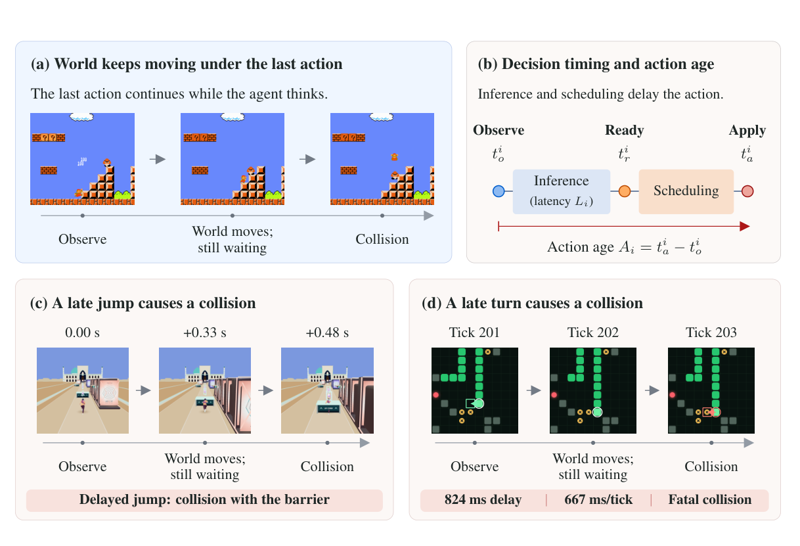
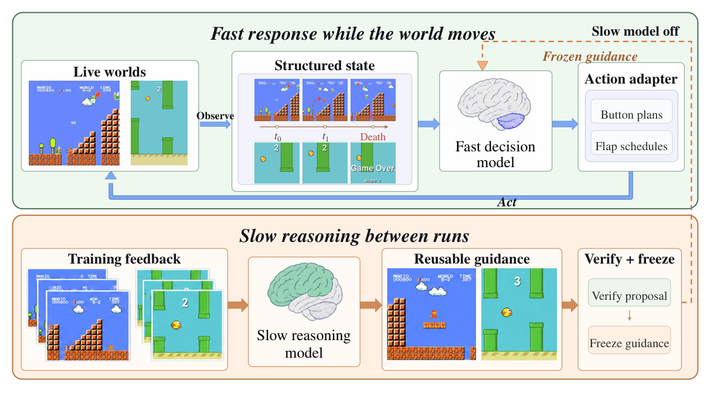
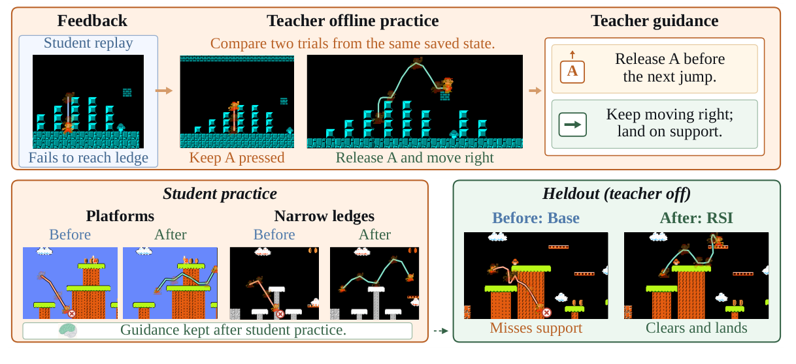
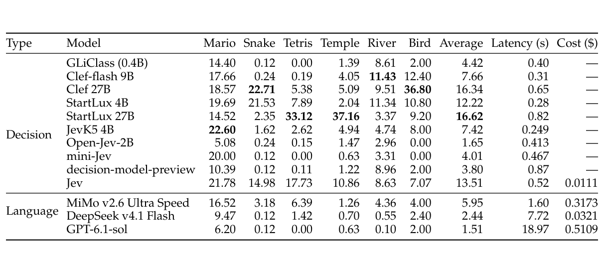
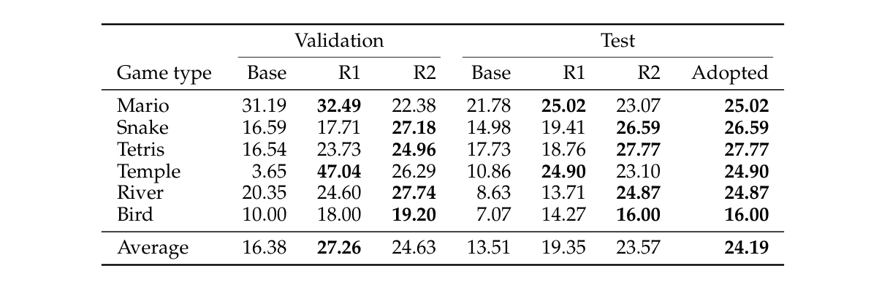
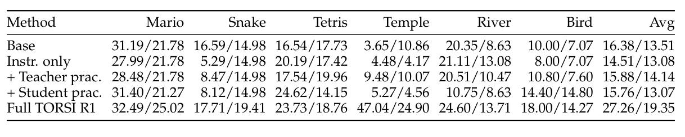
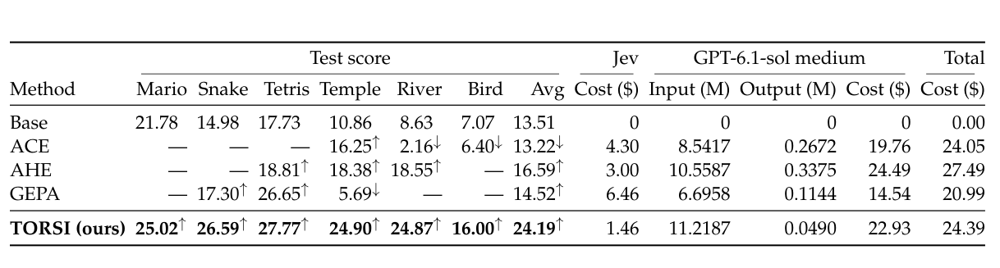

<!-- paper-reading-lang: zh-CN -->
<!-- paper-reading-theme: forest -->
# The World Won’t Wait：把慢推理移到局外，让快智能体在场内行动

**原论文**：*The World Won’t Wait: Evaluating and Teaching Agents Under a Live Clock*，Ningxin Pan、Hanyu Li、Yeqing Shen、Ning Ding、Yehui Tang、Wentao Zhang。以Zotero `XRRV4TN9` 的22页本地 **arXiv:2610.20665v1，2026-10-14** 为准。PDF页眉另有“February, 2026”，与[官方首发记录](https://arxiv.org/abs/2610.20665)不一致；本文不据该页眉推断二月已公开。所有页码按本地PDF第一页起算。

这篇论文提出两个相连的问题：**当环境在模型思考时继续变化，谁还能有效行动；一个来不及在线出手的强推理模型，能否在局外帮助更快的模型？** 前者由RealtimeBench的时钟对照测量，后者由TORSI的离线教师实践、指令提炼与验证门控测试。这里的“学习”不更新模型权重，而是更新学生读取的指令和条件动作规则。（PDF §§1、3–4）

```paper-map
{"thesis":"把行动是否正确与行动何时生效一起评估，再把昂贵推理放在回合之间，转成快学生能在实时场景使用的冻结指导。","outcome":"六类游戏、180任务分成反馈/验证/测试；Jev最终采用的指导使测试归一化进度由13.51升至24.19，不是成功率24.19%。","outcomeSource":"PDF §§3.2–3.3, Table 2","items":[{"number":"01","label":"时间问题","text":"观察到的安全动作可能在推理和调度后已经过时；响应延迟与动作年龄是两种量。","source":"PDF §3.1, Fig. 1"},{"number":"02","label":"测量接口","text":"学生读取结构化文本状态和合法动作，不直接从原始像素感知；旧控制在等待期间继续生效。","source":"PDF §§3.1–3.2, Table 8"},{"number":"03","label":"时钟对照","text":"同任务比较暂停、实时、1.5倍和2倍节奏；强慢模型在暂停时的优势可能在实时中反转。","source":"PDF §3.4, Table 12"},{"number":"04","label":"局外教学","text":"教师分析失败，并在可恢复的反馈状态中试验；学生再按真实延迟检验指导。","source":"PDF §§4.1–4.3"},{"number":"05","label":"更新门控","text":"每个游戏族独立比较验证均值，只在严格提高时采用；测试任务不选指导。","source":"PDF §4.4, Table 2"},{"number":"06","label":"结论边界","text":"只做两轮、六类可重置游戏；同环境跨模型迁移不是新环境泛化，也未证明长期递归持续提升。","source":"PDF §5.4, Limitations"}]}
```

<!-- paper-reading-context:start -->
## 00 / 发表时的研究背景
<!-- context-cutoff: 2026-10-14; basis: first-publication -->

### 当时的领域状态

截至2026年10月，LLM智能体已能多步调用工具、操作网页和玩游戏，反思记忆、提示优化与快慢混合架构也已有研究。但许多任务允许模型思考完再推进环境，因而测到的主要是“给足反应时间会不会选动作”，不是“动作到达时还有没有机会”。真实时间游戏把这个差别放大：角色、障碍和机会窗口都不等待推理完成。（PDF §§1–2）

“实时”在这里指**环境演化与推理并行**，不只是API延迟小；“双时间尺度”则指把即时执行与较慢的改进过程分开。本文所在的进度不是首次发现延迟重要，而是在已有实时评测和非参数自改进基础上，尝试用受控时钟和离线实践把二者连起来。System1是文献库主题，不能据名称把这些实验当成人类快慢思维神经机制的验证。

### 关键前作与尚存缺口

| 工作与时间 | 已有贡献 | 当时未解问题及与本文的关系 | 来源 |
|---|---|---|---|
| Real-time RL（2019）及延迟环境策略研究（2021） | 将行动选择期间的环境演化或延迟纳入决策问题 | 这不是LLM出现后才有的问题；仍需在LLM工具/动作接口下测量延迟如何破坏选择 | PDF §2及Ramstedt/Pal、Derman等引文 |
| VideoGameBench（2025预印本）、Real-Time Reasoning Gym（2025预印本/ICLR2026） | 前者比较实时与暂停游戏；后者构造持续演化游戏并研究反应与规划权衡 | 本文不能宣称此前基准都暂停；其重点是六类机制、明确节奏及可配对的时钟对照 | PDF §2、Table 6；[VideoGameBench](https://arxiv.org/abs/2505.18134)、[Realtime Gym](https://arxiv.org/abs/2511.04898) |
| SwiftSage（2023）、talker–reasoner等快慢智能体（2024） | 用较快行为模块与较慢规划/推理模块协作，提高复杂任务效率 | 部署期若仍需慢模块响应，时钟压力未必消失；TORSI把教师调用移到回合之间 | PDF §2；[SwiftSage原摘要](https://arxiv.org/abs/2305.17390) |
| Reflexion（2023）、ExpeL和技能库路线（2024） | 将反馈抽象成可复用语言经验或技能，不必每次更新底座权重 | 看到失败不等于知道未尝试动作的后果；本文强调可恢复状态中的教师和学生实践 | PDF §2；[Reflexion原摘要](https://arxiv.org/abs/2303.11366) |
| GEPA、ACE及harness演化（2025预印本/2026） | 依据执行轨迹改提示、上下文或可编辑组件，提出并筛选候选更新 | 仍需验证实时动作场景中哪种适配配置有效；本篇与其改编版比较，但没有匹配全部预算和编辑能力 | PDF §2、Appendix B.1；[GEPA](https://arxiv.org/abs/2507.19457)、[ACE](https://arxiv.org/abs/2510.04618) |

### 本文为何在此时提出

已有强推理器与快速决策模型提供了一种可操作的分工：慢教师可以在失败之后解释机制、尝试修正，再把经验压成短指导；快学生在下一次实时游戏中不必等教师出手。其研究缺口是**如何让离线获得的教训在真实延迟下仍然可执行，并且不靠测试集挑选更新**，所以学生实践和独立验证门控与教师反思同样重要。（PDF §§4–5）

原文将许多前作的贡献与时钟处理归纳在Related Work和Table 6。以上关键路线还核对了部分原始摘要，不代表逐篇复现；另一篇次日公开的Tang等 *Realtime-Bench* 与本篇名称相近，应视为同期独立论文，不擅自认定继承关系。
<!-- paper-reading-context:end -->

## 01 / 动作年龄比“模型回得多快”更完整

一次请求有三个时刻：观察时刻 $t_i^o$、响应就绪时刻 $t_i^r$、动作实际应用时刻 $t_i^a$。论文定义：

$$
L_i=t_i^r-t_i^o,\qquad A_i=t_i^a-t_i^o
     =L_i+(t_i^a-t_i^r).
$$

$L_i$是响应延迟，$A_i$是动作年龄，后者还包括等待合法tick或预定执行点的调度时间。决定结果的是 $t_i^a$ 的游戏状态，而非模型在 $t_i^o$ 看到的状态。等待时此前已接受的控制继续执行，因此“暂时不返回”本身也会产生后果。（PDF §3.1, Eq. 1）

看Fig.1先区分b中的Inference与Scheduling，再看d：Snake观察时LEFT安全，但824ms响应超过667ms移动tick；旧方向继续执行，最后到应用动作时已会撞上致命位置。不能只说“输出动作逻辑正确”，也不能把824ms机械换算成对所有观察位置都固定跨几格——tick相位和调度同样影响动作落点。（PDF p. 2, Fig. 1）



*原论文 Fig. 1，PDF p. 2。Mario、Temple和Snake展示不同过期风险；响应就绪不等于立即执行。*

这也是为什么文本中提供时间到接触、位置和几何信息还不足以保证安全：信息本身有年龄。较强的推理可能帮助预测未来，但也可能在计算完成前错过窗口。论文测的是这种联合效果，并没有证明只要减少token就一定得到最优动作。

## 02 / 180任务不是180个测试任务

每类30任务分为 **10反馈、10验证、10测试**，六类合计180；实际最终测试每类10个，合计60个独立任务。反馈用于收集失败和实践，验证用于选择冻结指导，测试只作最终报告。两轮指导实验的每个表值还平均三次运行，不能把任务数与重复episode数混为一谈。（PDF §3.2, Table 2）

| 游戏族 | 实时节奏示例 | 学生输入/动作特点 | 进度参考目标 $R_f$ |
|---|---|---|---|
| Mario | 10 FPS、三条生命 | RAM提取地形/敌人/跳跃状态；未来时槽按钮计划 | 最远3200像素 |
| Snake | 1.5 moves/s | 棋盘、身体、障碍与诱饵；方向及按tick延迟转向 | 85个食物 |
| Tetris | 每行450–200ms | 当前/下一块、候选几何；联合旋转/列，必要时处理不可达落点 | 260行 |
| Temple | 原速度0.30–0.70倍 | 车道、姿态、可见危险和接触时间；跳/滑/变道等 | 130000分 |
| River | 60 FPS | 河道、敌人、燃料；转向/开火/油门及控制转换 | 11000分 |
| Bird | 20 FPS | 高度、速度、管道；从八种完整拍翅日程中选择 | 25个管道 |

这不是所有游戏同一帧率的端到端视觉评测。学生收到**结构化文本状态与合法选择**，harness可以计算当前几何和时间特征，但计分游戏中不能窥视未来状态或搜索模拟器。教师离线恢复反馈状态的权限与学生在线权限不同。（PDF §3.2, Tables 7–8）

### 归一化进度怎样解释

若episode达到的峰值原生进度为 $p(e)$，得分是：

$$
q(e)=100\min\left(\frac{p(e)}{R_f},1\right).
$$

每类先平均其任务分，再对六类做不加权平均。**说明性例子**：Mario最远到1600像素，对3200目标是50分；之后死亡不把已达到的峰值抹掉。分数100只表示达到参考目标，不一定赢下原生游戏；不同游戏的50分也不表示相同难度。（PDF §3.3, Eq. 2；算例为阅读者代入）

因此13.51→24.19是0–100尺度上的**平均进度提升10.68分**，不是成功率提升10.68个百分点，更不是所有任务已接近完成。它让稀疏成功场景中的部分改进可见，代价是不能替代终局成功、安全或生存指标。

## 03 / 暂停、实时和加速时钟分别说明什么

时钟实验固定种子、任务、初始指令、动作、目标和预算，比较Paused、Current、1.5×、2×。但节奏与给模型看的clock字段一起变，因而不是只改变某一个物理变量的完全盲对照；加速也不保证每个游戏分数单调下降。（PDF §3.4）

下表将Table 12的Paused与Table 1的Current并列，保持游戏和指标一致。GPT-6.1-sol均用medium effort，Jev不改指导。（PDF pp. 8、20）

| 游戏 | GPT暂停 | GPT实时 | Jev暂停 | Jev实时 |
|---|---:|---:|---:|---:|
| Mario | 48.20 | 6.20 | 29.31 | 21.78 |
| Snake | 42.71 | 0.12 | 39.65 | 14.98 |
| Tetris | 57.08 | 0.00 | 26.65 | 17.73 |
| Temple | 43.91 | 0.63 | 25.70 | 10.86 |
| River | 38.00 | 0.10 | 41.59 | 8.63 |
| Bird | 33.20 | 2.00 | 6.93 | 7.07 |

暂停时GPT在5/6类更强；实时平均只有1.51，Jev为13.51。它说明在当前系统上，暂停下的任务能力排序不能直接预测live表现。Bird的Jev实时略高于暂停，也提醒读者：动作日程接口和游戏机制可能改变时钟敏感性，不能用一条统一单调定律覆盖六类游戏。（PDF §3.4）

## 04 / TORSI把什么放到局外

原Fig.5上半是实时闭环，慢模型明确处于off；下半才是回合之间的反馈、实践和验证。请看冻结指导如何跨越这两条路径：教师不必在每个动作时被调用，而是影响下一次学生使用的规则。（PDF p. 6, Fig. 5）



*原论文 Fig. 5，PDF p. 6。教师推理被移出实时动作链，不是在线快慢模块不断轮流调用。*

```paper-path
{"title":"一轮指导更新的证据与权限边界","stages":[{"title":"当前学生收集失败","role":"live feedback","action":"在反馈任务上按当前指导运行，记录观察、动作、响应延迟、动作年龄与结果。","why":"改进对象应是当前学生仍然会犯的错，而不是静态预先编好的失败集。","output":"当前轮轨迹D及对齐截图","source":"PDF §§4.1–4.2"},{"title":"教师离线试验","role":"slow practice","action":"从保存的反馈状态恢复，在暂停或减速游戏中试不同动作序列。","why":"轨迹只告诉已经发生的事，实践才能检查未尝试动作的结果与机制。","cost":"依赖可恢复模拟环境，不适用于所有不可逆真实交互。","output":"成功/失败分支与候选教训","source":"PDF §4.2"},{"title":"学生实时复查","role":"student practice","action":"学生带草稿指导在反馈任务上实跑，教师据真实延迟下的新轨迹再修订。","why":"慢教师在暂停条件下可行的动作，未必能在快学生的live接口中正确执行。","output":"可交付的指令、动作说明及条件规则","source":"PDF §§4.2–4.3, Table 9"},{"title":"冻结并验证采用","role":"gate","action":"每类游戏独立比较候选和当前指导的验证均值，严格更好才替换，否则保留。","why":"拒绝没有验证收益的更新，测试集不参与候选选择。","output":"下一轮指导或保留原版；最终在held-out任务报告","source":"PDF §4.4"}]}
```

这是一种非参数适配：模型权重、观察、合法动作、物理规则、节奏、目标与分割保持固定，修改的是指导。指导不只有一句自然语言prompt，还包括action-specific说明、条件动作规则；Tetris的配置允许特定不可达情形重问。不能把它写成对底座做强化学习梯度更新，也不宜把所有可编辑内容都简化为纯文本摘要。（PDF §§4.1–4.3, Table 9）

## 05 / 指导生成与验证门控的数学含义

对游戏族 $f$、轮次 $k$，教师根据当前指导、反馈轨迹和实践证据产生候选：

$$
\widetilde h_{k+1}^{(f)}=T_k\left(h_k^{(f)},D^{(f,k)},B^{(f,k)}\right).
$$

令 $V_f(h)$ 为该游戏验证任务的平均进度，则门控可说明性展开为：

$$
h_{k+1}^{(f)}=\begin{cases}
\widetilde h_{k+1}^{(f)},&V_f(\widetilde h_{k+1}^{(f)})>V_f(h_k^{(f)}),\\
h_k^{(f)},&\text{否则}.
\end{cases}
$$

第一式对应论文Eq.3，第二式把§4.4文字规则写成条件式。等分也拒绝，选择是逐游戏而不是对全benchmark选一个统一“最佳轮”。验证门控只能保证已测验证均值的采用规则，不是测试均值、每次episode或无限改进轮数都单调上升的证明。（PDF §§4.3–4.4）

一个具体机制是Mario的“再次起跳前释放A”。按住跳键与重新按下的语义不同，学生若只看到“应该跳”仍可能原地重复失败。离线分支可对照持续按A与先释放再前进，教师再将动作序列抽象为在相应状态可复用的规则；它不是记住某条测试轨迹。（PDF Table 9, Fig. 6）

Fig.6上方比较同一保存状态的两种试验，下方再看学生实践和held-out结果。原图展示完整R1指导更新，不能把两张成功截图当成“单独A-release规则贡献了多少分”的隔离实验；部分展示样例经过选择，全文另说明并非所有草稿实践都导致改动。（PDF p. 16, Fig. 6及Appendix A）



*原论文 Fig. 6，PDF p. 16。局部例子解释动作语义，量化改善仍应回到整组验证/测试结果。*

## 06 / 基线：快不是充分条件

Table 1中的平均score与latency应一起看：最快的某个模型未必最高分，强慢模型也可能来不及执行。成本横线意味着未计本地计算或账单不可得，不意味着计算免费。（PDF p. 8, Table 1）



*原论文 Table 1，PDF p. 8。latency是响应延迟L的游戏族均值，不是动作年龄A；API费用是每任务而不是总适配成本。*

| 模型 | 平均进度 ↑ | 平均响应延迟s ↓ | API费/任务 |
|---|---:|---:|---|
| GLiClass 0.4B | 4.42 | 0.40 | 未计本地计算 |
| Clef-flash 9B | 7.66 | 0.31 | 未计本地计算 |
| Clef 27B | 16.34 | 0.65 | 未计本地计算 |
| StartLux 4B | 12.22 | 0.28 | 未计本地计算 |
| StartLux 27B | 16.62 | 0.82 | 未计本地计算 |
| JevK5 4B | 7.42 | 0.249 | 未计本地计算 |
| Open-Jev-2B | 1.65 | 0.413 | 未计本地计算 |
| mini-Jev | 4.01 | 0.467 | 未计本地计算 |
| decision-model-preview | 3.80 | 0.87 | 未提供 |
| Jev | 13.51 | 0.52 | 0.0111美元 |
| MiMo v2.6 Ultra Speed | 5.95 | 1.60 | 0.3173美元 |
| DeepSeek v4.1 Flash | 2.44 | 7.72 | 0.0321美元 |
| GPT-6.1-sol medium | 1.51 | 18.97 | 0.5109美元 |

附录还给P50/P95：Jev在Mario的P95是2.63s，MiMo为13.64s，表明平均快不代表没有长尾；对很短动作窗口，尾部尤其重要。本地模型用单张L20Y，API模型受服务和网络影响，所以该排名属于测得的部署系统，不是对纯模型内在思维速度的精确分离。（PDF Appendix B.2, Table 13）

## 07 / 两轮之后为何不是直接采用R2

Table 2请先看左侧验证，再看右侧测试。Mario和Temple的R2验证比当前R1更差，故最终采用R1；其余四类采用R2。24.19是这份**逐游戏由验证决定的混合版本**，不是raw R2的23.57，也不是事后看测试表挑最高的一格。（PDF p. 8, Table 2）



*原论文 Table 2，PDF p. 8。每分数平均三次运行；Adopted的选择依据在验证列，不在测试列。*

| 游戏 | 验证R1 | 验证R2 | 最终版本 | 测试Base | 测试R1 | 测试R2 | 最终测试 |
|---|---:|---:|---|---:|---:|---:|---:|
| Mario | 32.49 | 22.38 | R1 | 21.78 | 25.02 | 23.07 | 25.02 |
| Snake | 17.71 | 27.18 | R2 | 14.98 | 19.41 | 26.59 | 26.59 |
| Tetris | 23.73 | 24.96 | R2 | 17.73 | 18.76 | 27.77 | 27.77 |
| Temple | 47.04 | 26.29 | R1 | 10.86 | 24.90 | 23.10 | 24.90 |
| River | 24.60 | 27.74 | R2 | 8.63 | 13.71 | 24.87 | 24.87 |
| Bird | 18.00 | 19.20 | R2 | 7.07 | 14.27 | 16.00 | 16.00 |
| 六类平均 | 27.26 | 24.63 | 按类选定 | 13.51 | 19.35 | 23.57 | 24.19 |

这里能看见“递归”的实际含义：下一轮面对更新后学生的剩余失败，但一次新提案可以退步，所以需要拒绝机制。两轮数据不能证明长期自主提升，更不能说每条新规则都更好。每类只有10验证任务，反复候选选择也可能带来选择噪声；论文未报告完整置信区间或多轮稳定性研究。（PDF §§4.4、5.2, Limitations）

## 08 / 实践、其他适配方法与迁移

Table 3的每格是“验证候选/测试采用版”，不是同一条指标的区间。被验证拒绝时，测试还使用Base，因而不能把测试列里没变的数解释成候选根本没有任何行为变化。（PDF p. 8, Table 3）



*原论文 Table 3，PDF p. 8。实验比较学习流程，实践预算未匹配，不是严格的独立模块贡献加法。*

| 一轮配置 | 平均验证候选 | 平均测试采用版 |
|---|---:|---:|
| Base | 16.38 | 13.51 |
| 只依据失败写指导 | 14.51 | 13.08 |
| 加教师实践、无学生实践 | 15.88 | 14.14 |
| 加学生实践、无教师实践 | 15.76 | 13.07 |
| 完整TORSI R1 | 27.26 | 19.35 |

**观察结果**是只有失败反思并未改善均值，教师试验和学生实时复查的组合更有效。**可支持的解释**是两种实践在当前设置下互补；由于预算、轨迹和门控会共同改变，不能将完整收益精确拆成各组件的独立因果份额。（PDF §5.2）

与ACE、AHE、GEPA比较时，学生、教师、任务分割和最终验证规则统一，但可编辑组件、内部搜索与回合预算不同。Table 4请同时看采用分数、横线的回退含义及最右侧**总适配API费**，不要与Table 1的每任务费用混淆。（PDF §5.3, Appendix B.1）



*原论文 Table 4，PDF p. 9。横线表示没有采用更新，平均仍包括相应Base；预算未匹配。*

| 方法 | 最终平均进度 | 总适配API费 |
|---|---:|---:|
| ACE | 13.22 | 24.05美元 |
| AHE | 16.59 | 27.49美元 |
| GEPA | 14.52 | 20.99美元 |
| TORSI | 24.19 | 24.39美元 |

冻结指导还迁移到StartLux4B（12.22→25.05）、StartLux27B（16.62→20.43）和MiMo（5.95→7.30）。27B在Tetris与Temple退步，所以平均迁移收益不等于每游戏都赢；所有迁移仍保留这六类环境，不能称新环境泛化。（PDF Table 5, §5.4）

```paper-experiments
{"title":"主要结论分别靠什么验证","rows":[{"question":"暂停成绩能预测实时成绩吗？","setup":"同模型、任务、指令与动作，比较暂停/实时/更快节奏；每类10个测试任务。","observation":"GPT暂停时在5/6类高于Jev，实时平均1.51低于13.51；加速影响并非逐项单调。","conclusion":"说明测量必须计入时间，不能将模型身份、服务和时钟提示完全分离成单因素。","source":"PDF §3.4, Tables 1/12"},{"question":"局外推理能否改善快学生？","setup":"Jev学生、GPT教师，反馈/验证/测试严格分开，逐类采用，平均三次运行。","observation":"Base13.51、R1为19.35、raw R2为23.57、最终混合采用24.19。","conclusion":"支持两轮以内的指导改进，不是所有候选单调进步或无限自我提升。","source":"PDF Table 2"},{"question":"仅反思是否足够？","setup":"一轮指导变体，分别移除教师或学生实践；采用同样的外层验证门控。","observation":"仅指导13.08，两种单独实践14.14/13.07，完整R1为19.35。","conclusion":"支持两类实践的实际作用；预算不匹配，不能精确分摊贡献。","source":"PDF Table 3, §5.2"},{"question":"能否跨模型复用？","setup":"将Jev指导原样用于另外三个actor，环境和时钟不变。","observation":"三个平均值提高，但StartLux27B有两游戏退步。","conclusion":"证明同游戏接口下的跨actor复用，不是跨环境、跨视觉感知的普遍泛化。","source":"PDF Table 5"}]}
```

## 09 / 更会想与来得及做的连接条件

**作者主张**：把强推理的成本放到回合之间，保留快actor的在线响应，可改善实时控制。**实验确实展示**：在结构化状态、可恢复反馈环境、六类游戏、两轮和当前服务部署下，验证采用的指导提高了平均进度，并部分跨actor复用。（PDF §6, Limitations）

这个结论依赖可离线恢复和试验，不能直接迁移到不可逆的物理/交易操作；也不覆盖原始视觉解析的错误与延迟。没有在线教师不意味着指导变长后学生耗时完全不变，本文没有给最终指导下所有延迟分布；总离线学习成本也仍存在。真正可迁移的思想是**按可用时间组织推理、证据收集、规则验证和执行**，而非无条件认为小模型胜过大模型，或把“System1”当一种天生可靠的行动保证。

<!-- 可视化决策：全局时间年龄、局外教学与逐类门控适合静态并列；Table2能完整保留Mario/Temple拒绝R2的路径，比只切换最终版本更便于追踪。未加入仅重播阶段的装饰性交互。 -->
<!-- 覆盖：22页本地PDF的正文、Appendix A任务/动作/指导及案例、B.1适配协议、B.2延迟、B.3成本、C软件来源。原图与表格已视觉核对，未重新执行游戏或独立审计各API服务。 -->
