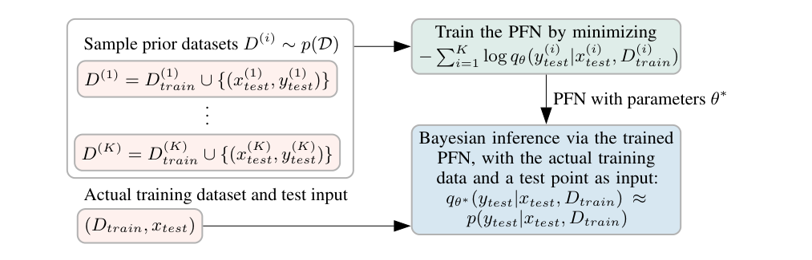
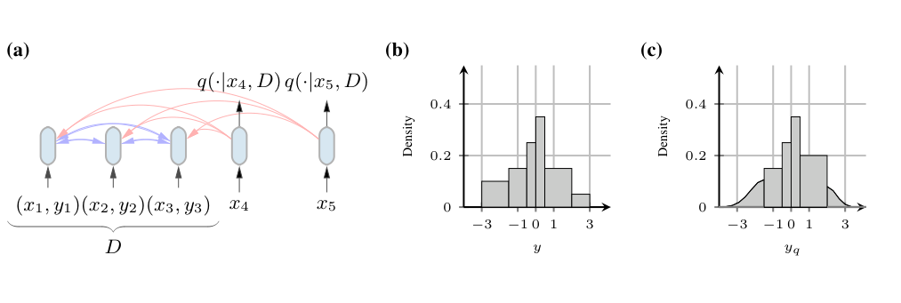
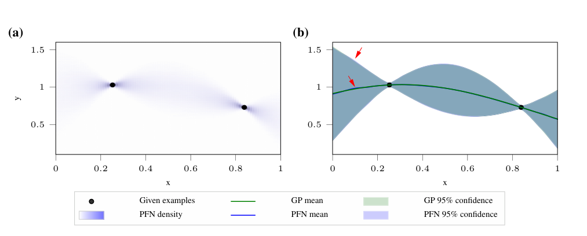
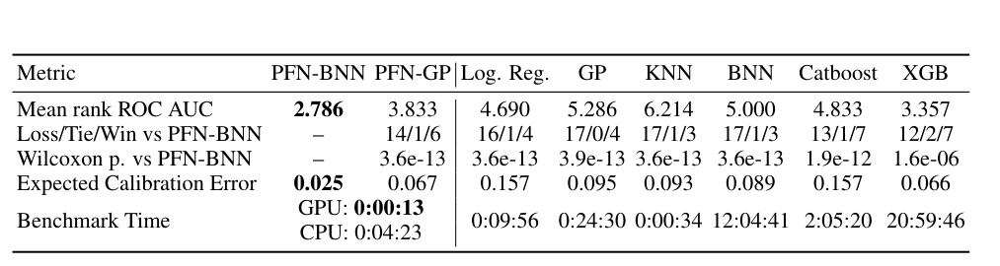

<!-- paper-reading-lang: zh-CN -->
<!-- paper-reading-theme: forest -->
# PFN 原始论文：为什么合成任务训练等价于学习后验预测

**原论文**：*Transformers Can Do Bayesian Inference*，Samuel Müller、Noah Hollmann、Sebastian Pineda、Josif Grabocka、Frank Hutter，ICLR 2022。依据本地24页 **arXiv:2112.10510v7，2024-08-13** PDF。Zotero 以独立PDF `VHVYYSMP` 保存，未挂在另一篇论文之下；标题在这里按PDF恢复，不改写Zotero。版本中的2024脚注明确补充了与Foong等先前结果的关系，不能将其误认为2024年新发表论文。（PDF pp. 1, 4）

这篇论文是后续TabPFN路线的统计出发点。它不要求网络显式输出神经网络参数的后验，而是直接输出“给定这张已标注表，新点的标签是什么分布”。作者发现：**反复从任务先验抽完整数据集、遮住标签并训练条件概率，就已经在优化后验预测的期望KL误差**。Transformer是实现集合输入的一种选择，而不是这个恒等式成立的原因。（PDF §§2–4）

```paper-map
{"thesis":"把难以逐任务求解的后验预测，改写为可由先验采样监督的条件概率学习，将贝叶斯推断成本摊销到一次离线训练。","outcome":"精确GP验证近似目标，超参数混合GP和BNN测试难积分场景；真实表实验只用30个训练标签，不能等同后续TabPFN的大表结果。","outcomeSource":"PDF §§5–7","items":[{"number":"01","label":"想求什么","text":"目标是标签的后验预测分布，不是显式重建任务参数的后验。","source":"PDF §2, Eq. 1"},{"number":"02","label":"怎样得到监督","text":"抽一个任务机制，再在同一机制下抽训练与查询，隐藏查询标签。","source":"PDF Algorithm 1"},{"number":"03","label":"为什么成立","text":"Prior-Data NLL是条件交叉熵，其与目标后验的期望KL只差不依赖参数的常数。","source":"PDF Insight 1, Corollary 1.1"},{"number":"04","label":"如何实现","text":"无位置编码的集合Transformer处理训练对和查询；连续目标用Riemann概率密度头。","source":"PDF §4, Appendix E"},{"number":"05","label":"怎么检验","text":"先和可精确计算的GP比较，再检查超先验GP、BNN、极小表格和Omniglot迁移。","source":"PDF §§5–7"},{"number":"06","label":"保证边界","text":"理论针对抽样先验下的总体目标、足够表达能力与理想优化；有限网络和现实失配仍有误差。","source":"PDF Corollary 1.2, Appendices A–C"}]}
```

<!-- paper-reading-context:start -->
## 00 / 发表时的研究背景
<!-- context-cutoff: 2021-12-20; basis: first-publication -->

### 当时的领域状态

这项工作在 **2021-12-20首次公开，2022年发表于ICLR**；本地读到的却是2024年修订版。背景应回到2021年底：神经网络已经擅长利用大量训练样本，但把一个新小任务学好，常常还要重新拟合；贝叶斯方法能明确使用先验并表达不确定性，却往往要为每份新数据重新做昂贵推断。这里的“先验”是观察当前数据之前对函数/任务的假设，“后验预测”是结合数据后对新标签的分布，不是仅一个最可能的网络权重。（PDF pp. 2–3, §§1–2；[首发记录](https://arxiv.org/abs/2112.10510)）

到此时，**“从少数示例直接预测”已经不是空白概念**。元学习和Neural Processes已探索把一组观测编码成预测规则，GPT-3也展示了不更新参数的示例条件化。尚未自动解决的是：能否把可指定的任务先验变成一个高效、直接、可与贝叶斯预测对齐的学习目标，而非仅训练一个经验上会适应的网络。（PDF pp. 2–4）

### 关键前作与尚存缺口

| 工作与时间 | 已有贡献 | 当时未解问题及与本文的关系 | 来源 |
|---|---|---|---|
| GP与贝叶斯神经网络，早于本文的成熟路线 | GP在特定核假设下能给出可计算的预测分布；BNN把权重不确定性纳入模型 | 灵活先验的预测通常不再可解，且新数据集仍要重新求解；这是PFN要摊销的成本 | PDF §2及§5 |
| NUTS（2014）、Bayes-by-Backprop（2015）等近似推断 | 用采样或变分分布处理难以直接积分的后验，使更多贝叶斯模型可用 | 近似质量与逐任务计算量需要折中；PFN不是对它们微调一个参数，而是改为直接学预测分布 | PDF §2、§5.2–5.3及References |
| Conditional Neural Processes（2018）、Attentive Neural Processes（2019） | 学习由上下文观测集合到条件预测的映射，attention改善了相关上下文利用与欠拟合 | 集合条件化已有先例，本文需说明它怎样与指定先验下的贝叶斯后验预测联系，不能把“看上下文预测”整体当成新发明 | PDF §2；[CNP摘要](https://arxiv.org/abs/1807.01613)、[ANP摘要](https://arxiv.org/abs/1901.05761) |
| GPT-3（2020） | 在语言任务中用提示示例完成少样本任务，不为每项任务更新参数 | 这种现象没有直接提供任意可采样监督任务先验的概率推断接口；PFN把示例条件化用于显式生成的统计任务 | PDF §2；[原工作摘要](https://arxiv.org/abs/2005.14165) |

### 本文为何在此时提出

这些路线分别提供了三个条件：贝叶斯框架告诉研究者**应当预测哪个分布**，任务生成器能够制造大量训练任务，上下文网络能够**把整份小数据当输入**。PFN的切入点是把它们连起来：离线抽任务并遮标签，直接用条件似然训练，使新数据集不必再显式求潜在参数的后验。其关键贡献应结合目标函数的统计解释、集合架构和分布输出一起理解，而不是一句“Transformer能做回归”。（PDF §§3–5）

**时间边界提醒**：TabPFN的2022年预印本、2025年Nature模型及后来的表格排行榜都不是2021年底作者已经拥有的背景；本地v7中2024年新增的归属说明，也应与原始发表语境分开看。上表部分前作核到原始摘要，其余按本篇的Background和实验对照介绍复原，不冒充逐篇复现实验。
<!-- paper-reading-context:end -->

## 01 / 不必先求出模型参数的后验

令 $t$ 是任务或函数，$D=\{(x_i,y_i)\}$ 是观察数据。贝叶斯预测为：

$$
p(y\mid x,D)=\int p(y\mid x,t)p(t\mid D)\,dt.
$$

传统MCMC或变分推断通常先近似 $p(t\mid D)$，再对标签预测做积分。PFN跳过这份显式后验，直接学 $q_\theta(y\mid x,D)$。因此它不会给出每个潜在BNN权重的后验样本；它近似的是预测分布这个边际量。（PDF p. 3, Eq. 1）

所需接口也因此改变：会从任务先验生成联合样本即可，不必给训练算法一个可求值的后验密度。这对于程序式生成器尤其有吸引力，但仍要求采样过程足够廉价、样本足够代表最终应用。（PDF §3）

先看Fig. 1中的两条路径：上方许多合成任务共同更新PFN参数；下方真实数据集直接成为网络输入。图中“training dataset”在下方指输入上下文，不是再次对参数运行优化。（PDF p. 1, Fig. 1）



*原论文 Fig. 1，PDF p. 1。学习算法被提前拟合；新任务的适应发生在激活与上下文中。*

## 02 / 从负对数似然走到贝叶斯预测

采样 $D\cup\{(x,y)\}\sim p(D)$，最小化：

$$
\ell_\theta=\mathbb E_{D,x,y}[-\log q_\theta(y\mid x,D)].
$$

对联合分布应用条件分解，就得到论文Insight 1：

$$
\ell_\theta=\mathbb E_{D,x}\left[H\big(p(\cdot\mid x,D),q_\theta(\cdot\mid x,D)\big)\right].
$$

再用交叉熵恒等式：

$$
\ell_\theta=\mathbb E_{D,x}[H(p(\cdot\mid x,D))]+\mathbb E_{D,x}[\mathrm{KL}(p(\cdot\mid x,D)\Vert q_\theta(\cdot\mid x,D))].
$$

第一项不含 $\theta$，所以降低总体NLL就是降低对先验平均的后验预测KL。这是监督信号为何足够的关键：训练者不必先算精确后验来当teacher，抽出的真实标签已经来自需要近似的条件分布。（PDF p. 4, Insight 1；Appendix A）

### 理论依赖链

```paper-path
{"title":"保证依赖哪些前提","stages":[{"title":"同任务抽联合数据","role":"分布前提","action":"先固定抽到的任务，再产生已知训练对与被遮查询。","why":"保证观测数据与待预测标签属于同一个联合任务分布。","output":"可用条件分解的p(D,x,y)","source":"PDF §3, Algorithm 1"},{"title":"重写总体NLL","role":"恒等式","action":"将对标签的积分转为条件交叉熵，再减去真实条件熵。","why":"证明无需后验teacher也能优化预测KL。","output":"目标与期望KL只差常数","source":"PDF Eqs. 2–4, Appendix A"},{"title":"加入可实现与优化条件","role":"最优解","action":"假设真实预测分布可由模型族表示，并达到总体最小值。","why":"KL的最小值为零，但有限训练并不自动实现它。","cost":"分布外输入、有限容量及优化误差不在精确等式保证内。","output":"在先验支持上的后验预测一致性","source":"PDF Corollary 1.2, Appendix B"},{"title":"提供足够灵活的输出族","role":"表示能力","action":"连续目标用细化分段密度而非强制一个高斯。","why":"避免正确的多峰后验被输出形式先天排除。","output":"可以逐步逼近目标密度的预测头","source":"PDF Theorem 1, Appendix C/E.2"}]}
```

这里有三个容易越界的推论。第一，“总体目标等价”不保证某个有限训练batch的loss每降一次，真实测试集都变好。第二，模型族包含目标分布与优化到全局最优是条件，不是实验已证明的事实。第三，对先验平均误差小不能自动保证每个真实数据集都准确；真实机制离开先验支持时，近似正确的对象也可能不是需要的对象。（PDF Appendices A–D；以上边界为阅读者对定理条件的解释）

## 03 / 集合输入与Riemann输出

训练样本的 $x$ 和 $y$ 线性编码后相加，移除位置编码，使训练集不依赖行的任意排列。多个查询可以一起输入，但attention mask禁止查询互读，预测只能依赖训练集与该查询自身。变化的上下文长度也参与预训练，不是固定一张表的长度。（PDF Appendix E.1）

原Fig. 2左侧说明哪些token可见；右侧两个密度图比较有界分段输出与带尾部的输出。阅读时注意每个柱子的**面积**是概率，柱高是密度，二者不同。（PDF p. 4, Fig. 2）



*原论文 Fig. 2，PDF p. 4。测试点不依赖其他测试点；非等宽bin需要宽度归一化。*

若 $b(y)$ 是包含 $y$ 的区间、$\pi_{b(y)}$ 是softmax预测的区间质量、$w(b)$ 是区间宽度，则有限区间内：

$$
q(y)=\frac{\pi_{b(y)}}{w(b(y))}.
$$

边界通过先验目标样本的分位数确定，使每个bin在先验下约等概率。对无界目标，首尾使用经过缩放的half-normal尾部。**说明性算例**：$[0,1)$、$[1,3)$ 的质量为0.3、0.7，密度分别0.3、0.35；不能把两个质量直接当密度高度。（PDF §4, Appendix E.2；算例为阅读者构造）

Theorem 1说明在其有限密度、几乎处处连续/Riemann可积及全支撑等条件下，可以选足够的bin使 **$\mathrm{KL}(q_B\Vert p)$** 任意小。附录证明先选覆盖足够质量的有限区间，再用上下和细化柱状近似，控制归一化和截断误差。注意这个方向与训练目标中的 $\mathrm{KL}(p\Vert q)$ 不同；它是输出族表达性的论证，不是给定固定bin的训练误差界。（PDF §4, Theorem 1, Appendix C）

## 04 / 先在知道答案的任务上检验

固定超参数的GP可精确计算后验，因此适合区分“近似误差”与“真实任务先验失配”。作者从GP抽合成表，比较PFN和精确GP的均值、置信区间及Prior-Data NLL。不是用另一个也不准确的神经模型当唯一真值。（PDF §5.1）

看Fig. 3时，左侧的密度热图仍能看出离散bin，右侧均值和置信界几乎与GP重叠；红箭头标的是尚存差异。它支持近似很接近，不支持网络已对所有核与全部超参数无误差求解。（PDF p. 5, Fig. 3）



*原论文 Fig. 3，PDF p. 5。可计算的GP提供校验对象，热图不只是一个点预测。*

```paper-experiments
{"title":"由可解模型到真实应用的证据梯度","rows":[{"question":"能否近似已知精确PPD？","setup":"固定核GP，RBF长度尺度0.6，噪声1e-4；各数据规模抽1,000个评估任务，比较NLL。","observation":"密度、均值与置信区间接近精确GP；更多预训练任务进一步靠近精确NLL。","conclusion":"验证先验内预测近似，不是现实任务无条件的校准保证。","source":"PDF §5.1, Figs. 3–4, Appendix F"},{"question":"有超先验还有效吗？","setup":"Matérn GP对噪声、尺度与长度做混合；与MLE-II及NUTS比较。","observation":"论文报告相对MLE-II超过200倍、相对NUTS约1,000–8,000倍的在线加速，并有更低Prior-Data NLL。","conclusion":"支持指定混合先验与比较设置中的摊销收益；不计离线PFN训练。","source":"PDF §5.2, Fig. 4b"},{"question":"难积分BNN如何？","setup":"100个合成数据集，每个100个已知点、200查询；两种BNN规模，比较NUTS和Bayes-by-Backprop。","observation":"Fig.5展示更好的NLL/在线时间折中；报告达到相似质量时约1,000倍对SVI、10,000倍对NUTS。","conclusion":"不是同一预算下所有BNN都已验证，CPU/GPU实现也不同。","source":"PDF §5.3, Fig. 5, Appendix F"},{"question":"能否迁移真实极小表？","setup":"AMLB筛选、再平衡二分类；每子集100行，仅30标签作上下文。","observation":"PFN-BNN平均AUC rank2.786，ECE0.025；XGB rank3.357，ECE0.066。","conclusion":"是强少样本证据，不能当原样完整AMLB或多分类大表结果。","source":"PDF §6, Table 1"},{"question":"图像few-shot是否适用？","setup":"随机线段手写先验，Omniglot 5-way 5-shot，先合成预训练再在30训练任务上微调。","observation":"PFN准确率0.865±0.019，PACOH-NN为0.885±0.090。","conclusion":"说明方法可扩展，但不是完全不见真实图像的零样本胜出。","source":"PDF §7, Table 2"}]}
```

## 05 / 小表结果的数字与限制

Table 1请同时读排名、校准误差和整体benchmark耗时。PFN的13秒是全部小任务评测的GPU总时间，不是每张表13秒；XGB的约21小时还含各任务调参，离线PFN预训练则不在这张表中。（PDF p. 9, Table 1）



*原论文 Table 1，PDF p. 9。原文数据集数出现20与21两种写法；这里保留表的数字，不伪造一致分母。*

| 方法 | 平均ROC AUC排名 ↓ | ECE ↓ |
|---|---:|---:|
| PFN-BNN | 2.786 | 0.025 |
| PFN-GP | 3.833 | 0.067 |
| Logistic Regression | 4.690 | 0.157 |
| GP | 5.286 | 0.095 |
| KNN | 6.214 | 0.093 |
| BNN变分近似 | 5.000 | 0.089 |
| CatBoost | 4.833 | 0.157 |
| XGBoost | 3.357 | 0.066 |

正文数据准备称20个数据集，但其显著性描述和胜/平/负行按21计数；这是本地v7的内部口径差异。它不影响理解PFN目标，但意味着不能从这页再精确计算一个未经确认的“全部表胜率”。另一个重要点是正文脚注承认Insight 1的相应发现先前由Foong等发表；本解读不把该恒等式的思想归属完全归给本论文。（PDF pp. 4, 8–9）

## 06 / 学到的是先验内的学习规则

**作者贡献**是把集合条件概率学习、程序式任务先验和高效预测头组织成可用的摊销推断系统。**证据最强的一环**是可精确求解GP上的近似核验，再由难积分模型和现实少样本任务展示用途。**阅读者推断**：PFN不是取消先验，而是把先验从常见的正则项改写为任务生成程序；不是取消计算，而是用一次跨任务成本替换反复逐任务求解。（PDF §§3–8）

这也解释了后续表格基础模型为何不断改造生成器、上下文结构和输出分布：原始等价目标给出“应学什么”，而任务覆盖、有限容量与长上下文开销决定“实际上能学到多少”。理论结论和工程扩展互相支撑，但不能互相替代。（PDF §§4–8；后一句为阅读者综合）

<!-- 可视化决策：证明依赖与离线/在线路径需并列观察，原Fig.1/2与静态依赖图足以保留所有前提；GP曲线用于验证精度，不需要仅为动画添加交互。 -->
<!-- 覆盖：正文§§2–8、Appendix A/B/C证明、D/E训练与Riemann定义、F比较实现及G/H相关协议；保留20/21数据集口径冲突和KL方向区别。 -->
