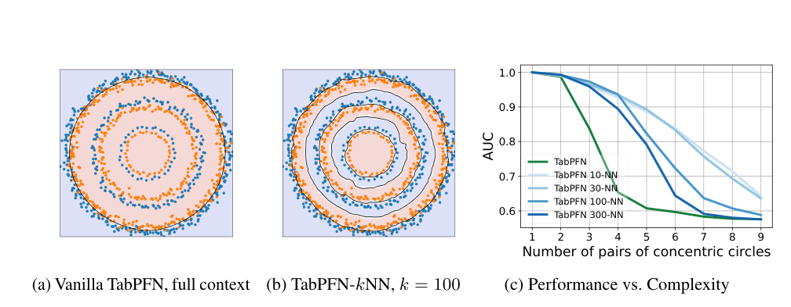
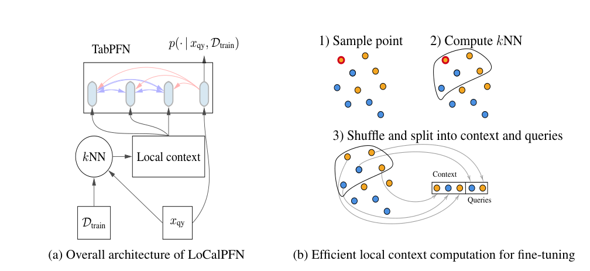
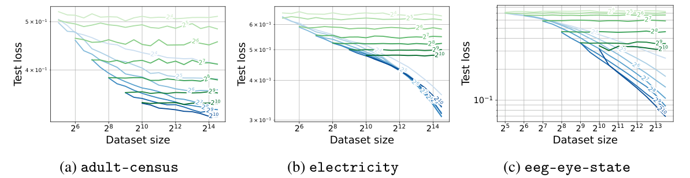

<!-- paper-reading-lang: zh-CN -->
<!-- paper-reading-theme: forest -->
# LoCalPFN：不是读更多行，而是为当前问题读对行

**论文**：*Retrieval & Fine-Tuning for In-Context Tabular Models*，Valentin Thomas、Junwei Ma 等，NeurIPS 2024。

假设一个模型已经学会“看几行有标签的表格样本，就能给新的一行分类”。当训练表越来越大时，最直接的办法似乎是给它看更多行。这篇论文追问：**有限的上下文，究竟应该装进整张表的缩影，还是当前查询附近的相关样本？如果改变了它读到的数据，还应不应该同时改变它使用数据的方式？** 作者在第一代 TabPFN 上给出的答案是：逐查询检索局部上下文，并在这样的局部任务上微调共享模型，形成 LoCalPFN。（PDF §§1–2.4）

这不是“最近邻标签投票”，也不是“每遇到一个测试样本就重新训练一个模型”。检索决定**读哪些训练行**，TabPFN 决定**如何结合这些行预测**，微调则让这套结合方式适应当前数据集。（PDF §§2.3–2.4）

```paper-map
{"thesis":"先把全局难题变成查询附近的局部问题，再让模型在这种局部问题上学会适应。","outcome":"95 张筛选后的分类数据表：平均 AUC 从原始 TabPFN 的 0.867，经仅检索的 0.891，提升至联合局部微调的 0.908。","outcomeSource":"PDF p. 7, Table 1","items":[{"number":"01","label":"问题","text":"大表装不进上下文；即使装得下，固定的小表先验也未必能拟合复杂规律。","source":"PDF §§1–2.3, Figs. 1–2"},{"number":"02","label":"思路","text":"让有限窗口随查询改变：不扩大窗口，也能从更大的训练库挑出更相关的证据。","source":"PDF §§2.2–2.3"},{"number":"03","label":"方法","text":"近邻检索提供局部样本；共享局部上下文使逐表端到端微调可承受。","source":"PDF §2.4, Fig. 3"},{"number":"04","label":"检验","text":"用完整系统比较、联合与串联消融、精确与共享邻域对照，分别回答有效性和设计问题。","source":"PDF Table 1, Tables 9–13"}]}
```

<span class="source-ref">本次解读于 2026-10-18 按 narrative-logic-v1 重写。原文为 Zotero 5QV5CK9L / 附件 5YXPDPRD 的 29 页 PDF，与 [NeurIPS 官方 PDF](https://proceedings.neurips.cc/paper_files/paper/2024/file/c40daf14d7a6469e65116507c21faeb7-Paper-Conference.pdf) 的 SHA-256 完全一致：8d15fa6019cfc4f3<wbr>2a7295dc8d57a069<wbr>1e77a614ff7a4b88<wbr>cd2286f2db31b875。全文、附录及 Checklist 均已读取；不把 PDF 创建时间当发表时间，也不把后期定稿等同 arXiv v1。代码入口：[LoCalPFN](https://github.com/layer6ai-labs/LoCalPFN)。本次没有运行模型微调或复现实验。</span>

<!-- paper-reading-context:start -->
## 01 / 问题与研究背景
<!-- context-cutoff: 2024-06-07; basis: first-publication -->

### 研究问题与价值

论文面对的是**有监督表格分类**：已经有一张带标签的训练表，新来一行只有特征，要求输出各类别的概率。例如，给定鸢尾花的四个尺寸，判断它属于哪个品种。本文不研究生成表格，不用语言模型把每一行写成文字，也没有评估回归任务。（PDF §§2.1、4.1、5）

准确的问题不是“如何让神经网络处理表格”这么宽泛，而是：**在 TabPFN 的上下文容量与预训练先验有限时，怎样利用更大的训练集，并适应更复杂的分类规律？** 成功既意味着优于原始 TabPFN，也要检验收益是否仍存在于强树模型、更多上下文和其他适应策略面前。这里“规模”和“复杂度”是两条轴：前者是可用样本数，后者是分类规律是否难以表达，两者不能混为一谈。（PDF §§1–2、4.2–4.4）

为什么值得解决？传统表格建模通常要为每张表训练模型、反复调参。TabPFN 的吸引力在于复用预训练得到的“学习算法”，通过输入训练样本直接适应新任务。如果它只能服务很小、比较简单的表格，这种复用能力的价值就受限。若能让有限窗口用好大表信息，就有机会扩大其适用范围；若进一步愿意支付一次逐表微调的成本，则可能换来更高精度。**这是两种不同的价值取舍，不是既保留完全零训练，又免费得到最高精度。** 论文的直接证据是分类基准表现，并非已经证明金融或医疗部署收益。（PDF §§1、4.5、5；价值区分为阅读者综合）

### 当时的领域状态

历史边界是 **2024 年 6 月 7 日首次公开**。本次计算结果与图表以稍后的 NeurIPS 2024 定稿为准；本地 PDF 的元数据创建于 2024 年 10 月 31 日，但这不是首发日期。没有逐项证明定稿中的每张表都已出现在 v1。后来的 TabPFNv2 等模型不作为当时已知的前提。<span class="source-ref">[arXiv 首发与版本记录](https://arxiv.org/abs/2406.05207)；PDF p. 1。</span>

理解当时的选择，先区分三个概念。**上下文学习（ICL）**是把有标签样本直接放进模型输入，让同一组固定参数据此给查询分类；输入变了，参数可以不变。**检索**是从当前任务的训练表里选择相关行，不是搜索互联网。**微调**则真的通过训练损失更新网络参数。ICL 与微调可以同时存在：一个模型先通过梯度适应某张表，预测时仍读取这张表的上下文样本。（PDF §§2.1–2.4）

第一代 TabPFN 已经证明这种 ICL 路线在小表上很有竞争力。它预先在大量合成任务上训练，学到根据特征—标签样本做预测的能力，而不是在预训练时记住本文的真实评测表。但模型当时主要面向小数值表，上下文长度受注意力内存开销制约。树模型依然是强基线；研究问题是如何扩展这条有希望的路线，而不是假定它早已全面替代树模型。<span class="source-ref">PDF §§1–2.1；[TabPFN v6，2023 年版本摘要](https://arxiv.org/abs/2207.01848v6)。</span>

### 关键前作与尚存缺口

| 工作与时间 | 已有贡献 | 尚存缺口及与本文的关系 | 来源 |
|---|---|---|---|
| TabPFN，2022 预印本／ICLR 2023 | 用合成任务预训练 Transformer，新小表输入训练行和查询特征即可分类，不必为该任务更新参数 | 建立了可复用的底座，却不保证固定窗口能充分利用大表，也不保证其先验适合所有复杂规律 | [原始摘要与历史](https://arxiv.org/abs/2207.01848v6)；PDF §§1–2.1 |
| TabZilla / When Do Neural Nets Outperform Boosted Trees…，2023 | 跨 19 算法、176 数据集比较，说明数据性质和调参预算会改变胜负，并提供可复用基准与结果 | 支持 TabPFN 是有竞争力的起点，也表明不能仅凭小表平均成绩推断大表表现；本文从其中筛选符合架构要求的分类表 | [2023 年 v3 摘要](https://arxiv.org/abs/2305.02997v3)；PDF §§2.2、4.1 |
| TabR，2023 预印本／ICLR 2024 | 检索其他训练对象的特征和标签，再通过学习到的机制提取预测信号，展示表格深度学习利用邻域的潜力 | 已经说明“邻域信息可能有用”，但它不是直接复用 TabPFN 这种跨任务 ICL 底座的方案；本文并未发明表格检索 | [原始摘要](https://arxiv.org/abs/2307.14338v2)；PDF §3 |
| ICD，2024-02-10 | 优化较小的上下文，将大表的信息蒸馏到固定内存预算内；代价是逐任务优化步骤 | 不是没有解决窗口上限，而是选择了全局压缩路线；一个共享摘要不等于为每个查询挑选相关真实行 | [原始摘要](https://arxiv.org/abs/2402.06971v1)；PDF §§2.2、3 |
| TuneTables，2024-02 首发／03 月 v2 | 通过 prompt/context 优化，把大数据压成小型可学习上下文，使 PFN 更可扩展 | 与 ICD 一样提供可学习压缩方向；尚需回答查询相关的上下文能否更有效。本处依据首发前可用的 v2，不引用 10 月 v3 新结果论证当时状态 | [2024-03 v2 摘要](https://arxiv.org/abs/2402.11137v2)；PDF §§2.2、3 |
| RAG，NeurIPS 2020 | 将参数化模型与检索到的外部记忆结合，并针对这种输入进行任务微调 | 提供作者明确提到的跨领域启发；但语言文档检索的成功并不自动证明表格的距离度量或共享邻域训练有效 | [原始摘要](https://arxiv.org/abs/2005.11401)；PDF §§1、2.4、3 |

上表各工作不是“都失败了”：有的解决快速小表适应，有的解决信息压缩，有的证明邻域特征可以帮助预测。它们共同留下的是一个更精确的问题：**当全局上下文预算固定，能否针对当前查询分配预算，而不是让所有查询共用同一份摘要？这种分配与参数适应又该怎样配合？** 前作核验范围为原始摘要、版本历史与本文相关工作，而不是对所有前作的全文重新评审。（PDF §§2.2、3）

### 本文为何在此时提出

当时已同时具备三个条件：可复用的 ICL 底座、可行的表格邻域检索经验，以及对有限上下文需要选择或压缩信息的认识。但“有一个好底座”不等于“任意给它一些行就能用好整张大表”；“邻居相关”也不等于“任何逐查询处理方式都算得起”。一个有意义的新方向，必须同时回答信息相关性、任务适应和计算复用，而不能只把窗口机械加长。（PDF §§2.2–2.4；本段连接为阅读者综合）

需要区分两类时间证据：局部方法的传统知识可以用来解释一个方向为什么合理；**本文自己新做的同心圆诊断和检索消融，不能被提前当作作者提出方法前已知的事实。** 定稿也引用了晚于首发的工作，例如 2024 年 7 月的 ModernNCA，本解读不把它放进首发动机。正文称为同期的 Mixture of In-Context Prompters 也不被擅自写成已确认的灵感来源。（PDF §3、参考文献 [52]–[53]）
<!-- paper-reading-context:end -->

## 02 / 思路如何形成

**以下是一种基于当时知识的教学性思路重建，并非作者真实发现过程的记录。** 作者确实在引言中说受到语言模型检索与微调的启发；下面更细的因果组织是为了帮助理解，不是对其私人思考过程的声称。（PDF pp. 1–2、§3）

### 起点不是换一个更大模型，而是问窗口里该放什么

已知 TabPFN 的预测取决于两部分：预训练参数，以及当前送入的带标签上下文。既然参数已经有用、窗口又昂贵，那么除了扩大模型和窗口，还存在一个更直接的自由度：**在固定预算里改变输入的信息选择。** ICD 和 TuneTables 已经说明，可以把上下文当成可设计对象，而不是只能随机截取的固定材料。这一步不需要知道本文最后采用什么检索方案。<span class="source-ref">PDF §2.2；[ICD](https://arxiv.org/abs/2402.06971v1)、[TuneTables v2](https://arxiv.org/abs/2402.11137v2)。</span>

### 从全表代表性，转向当前查询的相关性

全局摘要要同时照顾所有查询，预算因此分散。可是我们通常不是要一次回答“整张表是什么”，而是在给定一个具体特征向量后问“这一行是什么类别”。传统最近邻方法和 TabR 提供了一条可用经验：**与目标对象相似的训练样本，可能包含对当前预测尤其有价值的信息。** 因而可以提出一个尚待验证的假设：同样保留若干行，按查询选择，可能优于对所有查询使用同一批行。<span class="source-ref">PDF §2.2 对 TabZilla 中 kNN 结果的引用；[TabR v2 摘要](https://arxiv.org/abs/2307.14338v2)。假设的组织方式为阅读者重建。</span>

这里真正需要的不是“空间近就一定同类”，而是“这个度量下的附近样本有助于判断”。在噪声多、无关特征多，或类别依赖远处信息时，该假设可能不成立。局部方法的价值恰在于它是一种可测试的归纳偏置，而不是无需条件的真理。（PDF §§2.2–2.3；上述反例条件为阅读者推断）

### 有关的信息送进来后，模型会不会仍然按旧习惯使用

预训练提供通用经验，却不保证当前真实任务与其合成任务分布一致。上下文如果从全局样本变成局部样本，输入所描述的任务也可能改变：类别比例、局部变化尺度、可见的规律都不同。因此，基于已有的任务微调与 RAG 经验，还可以提出第二个假设：**让模型在预期部署时会遇到的这类上下文上继续学习，可能比只在部署时改变输入更有效。** 这是一条关于训练条件与使用条件匹配的设计理由，不是已经知道联合训练一定获胜。<span class="source-ref">PDF §§2.4、3；[RAG 原始摘要](https://arxiv.org/abs/2005.11401)。该分布匹配表述为阅读者机制解释。</span>

### 最后一个问题是计算，而不是再找一个理论口号

按查询定制上下文，意味着不同查询可能无法复用同一批上下文计算。因而一个可行方案还需要问：训练时有没有办法让若干相近的查询暂时共用一份局部材料，减少重复处理？**到这里，我们只得到“局部信息选择 + 针对这种条件的适应 + 计算复用”的设计需求，并没有从旧知识推导出唯一正确的算法。** 下一章才揭示本文实际选了什么；其有效性必须交给后面的实验回答。（PDF §2.4 提供共享计算的架构事实；问题化表达为阅读者重建）

## 03 / 核心直觉

**把“用一份全局材料解释所有人”改成“给每个查询准备附近的材料”，再让同一个预训练模型练习如何使用这种材料。** 检索不是让窗口更长，而是让有限窗口更相关；微调不是取代上下文学习，而是校准当前任务中的使用方式。为了让训练可承受，作者又让一批相近查询共享局部上下文；预测时则回到每个查询自己的近邻。（PDF §§2.3–2.4）

论文因此包含两个应分开理解的模型：

| 模型 | 上下文如何选 | 当前数据集是否更新网络参数 | 预测时仍读上下文吗 |
|---|---|---|---|
| 原始 TabPFN | 整张训练表，过大时取子样本 | 否 | 是 |
| TabPFN-kNN | 当前查询在训练表中的近邻 | 否 | 是 |
| LoCalPFN | 微调时共享局部上下文；推理时逐查询近邻 | 是，每张表一套适应后的共享参数 | 是 |

<span class="source-ref">PDF §§2.1–2.4、Appendix A.2.2。表中不包含额外集成或变换。</span>

为什么局部化可能增加整体表达能力？想象复杂的弯曲边界：一个模型若对整张表产生过于平滑的判断，未必能一次抓住所有细节。但不同查询可以选择不同邻域，于是**同一网络在不同位置解答不同的小问题**。许多小问题组成的全局预测函数可以更复杂。这是作者借局部回归所作的类比及其机制解释，不是本文给出的表达能力定理；邻域太小也可能因样本不足、噪声而增加方差。（PDF §2.3）

下面的原论文 Fig. 1 回答“模型是否只是因为放不下所有样本才失败”。先看 a、b 的黑色决策边界：两者面对同一个由三对同心圆构成的二分类问题，a 已放入全部 1,000 个训练点，却明显欠拟合；b 每次只取 100 个近邻，边界反而更贴近环形。再看 c：横轴增加圆环对数，绿色全局模型先退化。每个点平均 25 个随机种子。**这是本文新做的诊断证据，不能倒写成前一章的先验知识。**（PDF p. 2, Fig. 1）



*原论文 Fig. 1。左：完整上下文；中：100 个近邻；右：复杂度变化。该证据支持局部化对这个底座有帮助，不证明任何任务的欧氏近邻都合适，PDF p. 2。*

这就把直觉变成了两个具体操作问题：近邻究竟怎样进入模型？微调时怎样避免为每个样本重复处理一套几乎相似的上下文？

## 04 / 真实实例与方法

### 先明确例子的身份

Iris 是论文列出的评测数据集之一，包含 150 条记录、4 个数值特征、3 个类别。本节采用 [UCI Iris 文件](https://archive.ics.uci.edu/ml/machine-learning-databases/iris/iris.data) 中的真实行，让读者可以核算，而不是凭空编一张表。**以下划分和小邻域是教学配置，不是论文的 TabZilla 划分，也没有运行 TabPFN 的前向或微调。** 我们实际计算了标准化、精确近邻和一次共享上下文的切分；网络内部表示及最终概率不冒充已计算结果。（PDF Appendix A.1, Table 2；实例计算见同目录 assets/compute-iris-example.py 与 iris-example.json）<span class="source-ref">数据归属 R. Fisher / UCI，DOI: 10.24432/C56C76，CC BY 4.0。采用有明确指纹的历史 iris.data，不声称与更正后的 bezdekIris.data 或 TabZilla 副本逐行相同；版本差异见 assets/README.md。</span>

原始文件每个类别有 50 行。演示将每类前 40 行作为训练、接着 5 行作为验证、最后 5 行作为测试，共 120/15/15 行。用测试集中的**第 150 行**作为一直追踪的查询：特征依次为萼片长、萼片宽、花瓣长、花瓣宽，原始值是 **(5.9, 3.0, 5.1, 1.8) cm**。真实标签先留作评估，不能参与检索或输入模型。

### 第一步：把可比较的特征表示准备好

如果不同列的量纲或变化范围差很多，距离容易被某一列支配。演示只用 120 条训练行计算每列均值和总体标准差，再同样变换训练行与查询。该查询变成约 **(0.0119, −0.1364, 0.7305, 0.8077)**。Iris 全是数值列，不需要类别编码；论文主结果还使用类别变量的 one-hot 编码，并在维度不超过底座限制时应用它。（PDF §4.4、Appendix A.2.2；本例统计量为独立计算）

这一步产生的不是标签判断，而是**用于可比较距离计算的特征**。演示只拟合训练统计量，不用测试标签，也不让测试分布参与统计量估计。论文内部还有自己的输入处理细节；这里的计算是可复核的机制演示，不声称逐字节复现官方实现。

### 第二步：用查询特征找训练邻居，再带回它们的标签

为方便读表，演示暂用 **k=4**。按标准化后的欧氏距离，在全部 120 个训练对象里检索，实际得到如下结果。行号为 UCI 文件中非空记录的 1 起始编号；距离无量纲，越小越近。

| 返回的训练行 | 四个原始特征，cm | 已知训练标签 | 与第 150 行的标准化距离 |
|---|---|---|---:|
| 139 | (6.0, 3.0, 4.8, 1.8) | virginica | 0.2057 |
| 128 | (6.1, 3.0, 4.9, 1.8) | virginica | 0.2625 |
| 71 | (5.9, 3.2, 4.8, 1.8) | versicolor | 0.4846 |
| 79 | (6.0, 2.9, 4.5, 1.5) | versicolor | 0.5804 |

<span class="source-ref">数据源 UCI iris.data；精确距离、均值、标准差及切分见 assets/iris-example.json，可由 assets/compute-iris-example.py 重算。检索规则对应 PDF §2.3, Eq. 2。</span>

距离检索只用了四个特征。标签是**找到行之后**随记录取回的，而不是拿查询的真实标签去筛选邻居。四个邻居里两类各有两条，这也展示了为什么“取回邻居”和“最终分类”是不同操作：简单投票在这里会打平，但 TabPFN 还可以看具体特征差异及特征—标签关系。我们不能据此直接断言它会输出哪类或多少概率。

论文不是默认只用 4 个邻居：其规则约为取训练集大小平方根的 10 倍，并受最大上下文数约束，默认上限 1,000；实际不能超过可用训练行。演示故意缩小邻域以显示每一行，因此上述结果不能作为论文精度证据。（PDF §4.4、Appendix A.2.2）

### 第三步：上下文与未标注查询一起进入模型

这四行的特征及已知标签组成上下文，第 150 行只提供特征。TabPFN 先对这些输入编码，再利用注意力结合上下文信息，最后输出类别分数，并转换为类别概率。**它不是把四个标签做平均，也不是在这一步对第 150 行做梯度训练。**（PDF §§2.1、2.3–2.4）

真实标签此时仍不输入预测过程。如果只是 TabPFN-kNN，用的是原始预训练参数；如果是 LoCalPFN，用的是已经针对该训练表微调过的参数。两者预测形式相同，参数来源不同。输出接口是三类概率组成的向量，再取最大概率的类别；本次未运行前向，因此不填写虚构概率。第 150 行的 UCI 真值是 virginica，只在预测结束后用于评估。

### 第四步：LoCalPFN 在预测之前，如何为这张表微调

现在暂时把第 150 行放在测试集一边，**不让它参加微调**。训练所需的监督从那 120 条训练行内部产生：有些行充当带标签上下文，另一些行暂时隐藏标签、充当待预测 query；它们的真实训练标签只用于计算损失。被隐藏标签的训练 query 不等于最终测试集。（PDF §2.4）

最直接的方法，是让每个训练 query 都有自己的精确近邻。但这样每一个 query 都对应不同的上下文，Transformer 必须反复处理大量不同的小表。**主要瓶颈是上下文的前向和反向计算，不是检索库找邻居不够快。** 因此仅换一个近似最近邻搜索器并不能消除重复的模型计算。（PDF p. 4, §2.4）

作者真正采用的是共享局部训练任务：

1. **抽训练锚点**：随机抽训练行，定位一个局部区域；锚点的角色是选择区域，不是额外的预测目标。
2. **检索一批相邻训练行**：为该锚点取上下文长度与 query 长度之和那么多的邻居，排除锚点自身，避免自身重复。
3. **打乱并切分**：一部分成为已知标签的 context，另一部分成为隐藏标签的 queries；同一组 queries 共用这一份 context。
4. **预测并反向传播**：模型预测 queries，使用它们的真实训练标签计算分类损失；更新全模型的共享参数。
5. **反复换局部区域**：重复上述过程，按验证集 AUC 选择停止时机。最后才对保留的测试行逐查询检索并预测。（PDF §2.4、脚注 2、Appendix A.2.2）

仍用同一张 Iris 表，下面给出**真实数据上的一次教学切分**。为便于衔接，选择前面出现过的训练行 139 作锚点；论文实际训练随机抽锚点，不能用测试标签选择。排除 139 后，它的 6 个精确近邻依次是 **128、71、79、127、62、64**。用固定随机种子 20261018 打乱，再切成：

- **共享 context**：62、127、64、128，特征和标签都可见。
- **训练 queries**：79、71，特征可见，标签 versicolor 在预测时隐藏、只作损失目标。
- **最终测试查询**：仍是第 150 行，整个微调过程中不进入这批训练数据。

这次切分与距离已实际计算，但**没有执行梯度更新**。它展示了近似发生在哪里：79、71 使用同一个锚点邻域里的 context，而不是各自精确的 4 个最近邻。邻居的邻居不一定也是自己的近邻，所以这是有代价的计算近似。换来的收益是同一个 context 可以服务多个 query。（PDF §2.4、Fig. 3b；切分为本文教学计算）

原论文 Fig. 3 把两条路径画在一起。先看左侧 a：新查询通过 kNN 从训练表拿到局部 context，再输入 TabPFN；再看右侧 b：训练先选锚点、检索、打乱切分，使多个 query 共享 context。请特别注意：右侧是**微调时的计算安排**，不是要求推理时让不相关的测试行共用邻居。（PDF p. 5, Fig. 3）



*原论文 Fig. 3。相同颜色代表同类，并不要求邻域只含一个类别；训练的共享近似与推理的逐查询检索要分开读，PDF p. 5。*

### 计算究竟省在什么地方

用一个不代表论文实测配置的小形状例子：若一次要为 20 个训练 query 反传，每个 context 有 100 行，精确逐 query 方式需要约 **(20, 101, d)** 的输入；若只用 2 组共享 context，每组 10 个 query，则是 **(2, 110, d)**。这里 d 是编码后的向量维度，不是 Iris 的 4 个原始列。节省来自把 20 份上下文处理降为 2 份，而不是因为 110 比 101 小。（PDF §2.4 的形状定义；数字为教学配置）

论文实际采用 AdamW，学习率和 weight decay 都是 0.01，无 warmup 或学习率调度；附录报告 1,000 个训练 query 的设置、batch 为 2，并每 30 个梯度步骤按验证 AUC 检查与早停。这里不把局部训练近似宣传为零成本，也不把“少调超参数”写成“不用验证集”。至此，算法流程已完整；下一步需要回答公式如何对应这些操作。（PDF Appendix A.2.2）

## 05 / 数学基础与推导

### 先说清楚：本文没有理论保证的推导

这是一篇以方法和实证为主的论文。Checklist 明确写了 **“The paper does not contain proofs.”** 因而不存在一套需要从头复原的收敛性或最优性证明。下面解释的是论文两条核心预测公式，以及为理解实现补充的标准距离与交叉熵推导；**补充推导不是作者证明 LoCalPFN 必然更优的定理。**（PDF p. 24, Checklist 第 3 项；Eqs. 1–2）

### 1 / 先认识符号，理解条件概率

设训练集为 $D_{\mathrm{tr}}=\{(x_i,y_i)\}_{i=1}^{N}$。N 是训练行数，$x_i\in\mathbb R^{m}$ 是 m 个特征，$y_i\in\{1,\ldots,C\}$ 是类别。$x_*$ 是待预测行，$f_\theta$ 是参数为 $\theta$ 的网络，输出 C 个尚未归一化的类别分数，也叫 logits。（PDF §2.1）

表达式 $p_\theta(y=c\mid x_*,D_{\mathrm{tr}})$ 的意思是：“模型已经看到查询的特征和训练上下文后，给类别 c 多少概率。”竖线右边是**已知条件**，不是要与左边做除法。ICL 改变的可以只是条件 $D_{\mathrm{tr}}$；微调则进一步改变下标里的 $\theta$。两种适应因此可以叠加。

PFN 背后的贝叶斯视角，是用合成任务预训练去近似根据上下文做预测的过程，不是说在新表预测时显式求出一套贝叶斯积分，也不是说预训练参数天然包含当前表的真实规律。本篇直接使用训练好的 TabPFN，不重新完成其先验拟合。（PDF §§1–2.1）

### 2 / 标准化距离如何选出刚才的四行

以下是本例使用的标准数学定义，帮助理解论文选择的标准化特征欧氏距离。$\mu_j$、$\sigma_j$ 分别是训练集第 j 列均值、标准差；演示采用总体标准差：

$$
\mu_j=\frac{1}{N}\sum_{i=1}^{N}x_{ij},\qquad
\sigma_j=\sqrt{\frac{1}{N}\sum_{i=1}^{N}(x_{ij}-\mu_j)^2},\qquad
\widetilde{x}_{ij}=\frac{x_{ij}-\mu_j}{\sigma_j}.
$$

先减均值，把各列移到以 0 为中心；再除标准差，把“一单位变化”变成相对于该列自身波动的一单位。Iris 演示四列标准差均非零；真实实现对常数列需要额外处理，不能直接除以 0。两行之间的距离为：

$$
d(x_*,x_i)=\sqrt{\sum_{j=1}^{m}\left(\widetilde{x}_{*j}-\widetilde{x}_{ij}\right)^2}.
$$

逐列作差、平方后相加，再开平方，就是多维空间的直线距离。排序取距离最小的 k 行，并保留其训练标签，记作 $\mathcal N_k(x_*;D_{\mathrm{tr}})$。第 150 行与第 139 行的距离 0.2057 就由此算出。**距离中的求和没有标签项**，因此查询真值不参与这一步。（PDF §4.4 说明距离选择；本例公式及数值为教学计算）

### 3 / 从分数到概率，分母不能省

网络输出分数 $z_c=f_\theta(x_*,D_{\mathrm{tr}})[c]$。分数可以是任意实数，不能直接当概率。softmax 先取指数得到正值，再除以所有类别指数之和：

$$
p_\theta(y=c\mid x_*,D_{\mathrm{tr}})
=\frac{\exp\!\left(f_\theta(x_*,D_{\mathrm{tr}})[c]\right)}
{\sum_{r=1}^{C}\exp\!\left(f_\theta(x_*,D_{\mathrm{tr}})[r]\right)}.
$$

这就是原文 Eq. 1。分母让 C 个概率总和等于 1；它对**类别**求和，不是对训练行求和。比如教学分数 (0, 1, 2) 会转成约 (0.090, 0.245, 0.665)。这组数字只解释归一化，**不是第 150 行的模型输出**。（PDF p. 3, Eq. 1；数值例为教学演算）

作者的关键改动不是换一种概率归一化，而是把条件里的训练上下文替换成当前查询的邻居：

$$
p_\theta(y=c\mid x_*,D_{\mathrm{tr}})
=\frac{\exp\!\left(f_\theta\!\left(x_*,\mathcal N_k(x_*;D_{\mathrm{tr}})\right)[c]\right)}
{\sum_{r=1}^{C}\exp\!\left(f_\theta\!\left(x_*,\mathcal N_k(x_*;D_{\mathrm{tr}})\right)[r]\right)}.
$$

这是 Eq. 2 的等价记法。左边仍写完整训练集，是因为邻居从整个训练库选出；真正送入网络的只有选中的上下文。保持 $\theta$ 不变，换到这个公式，就是 TabPFN-kNN。若 $k=N$，所有训练行都被选中，在相同处理下便退回完整上下文预测。（PDF §2.3, Eq. 2）

### 4 / 微调为什么是提高真实训练标签的概率

令 S 表示一个带标签的局部 context，Q 是与之分离的训练 queries 集。对其中一行 $x_q$，已知真实训练标签 $y_q$，希望模型给它更高概率。标准的负对数似然损失是：

$$
\ell_q(\theta)=-\log p_\theta(y_q\mid x_q,S).
$$

为什么取负对数？概率为 1 时损失是 0；概率越接近 0，损失越大。若把一组查询的条件预测概率相乘作为训练似然，取负对数就会把乘积变成逐样本损失的和；在该组内求平均：

$$
-\frac{1}{|Q|}\log\prod_{q\in Q}p_\theta(y_q\mid x_q,S)
=-\frac{1}{|Q|}\sum_{q\in Q}\log p_\theta(y_q\mid x_q,S).
$$

这是分类交叉熵在单个真实类别标签下的形式，不需要添加不存在的对比损失或奖励函数。对 B 组共享局部上下文，记第 b 组为 $S_b$，其第 j 个 query 为 $(x_{bj},y_{bj})$，每组有 $L_{\mathrm{qy}}$ 个 query，则本次更新的平均损失可写为：

$$
\widehat{\mathcal L}(\theta)
=-\frac{1}{B L_{\mathrm{qy}}}
\sum_{b=1}^{B}\sum_{j=1}^{L_{\mathrm{qy}}}
\log p_\theta(y_{bj}\mid x_{bj},S_b).
$$

这里的分母是参与损失的 **query 总数**，不是 context 加 query 的总行数。context 标签是模型的已知条件，queries 的标签只作为答案用于计算损失；二者不能混在一起泄露目标。刚才 Iris 演示的 79、71 两行就是这种 query，62、127、64、128 则是 $S_b$。（PDF §2.4；损失写法为对标准交叉熵的教学重写，已对照作者公开代码 methods/ftknn.py 的 cross_entropy 与 mean）

再把单样本损失拆开：若真实类别是 t，softmax 分数为 $z_r$，则

$$
\ell=-z_t+\log\sum_{r=1}^{C}e^{z_r},\qquad
\frac{\partial\ell}{\partial z_c}=p_c-\mathbf 1[c=t].
$$

第一式来自把概率的分子、分母分别取对数；第二式来自指数与对数的求导规则。$\mathbf 1[c=t]$ 在 c 是真实类别时等于 1，否则等于 0。直觉是：真实类别的预测概率不够高，就有提高其分数的方向；其他类别的分数受到相反方向的推动。网络再通过链式法则把这份信号传回参数，论文用 AdamW 实施更新。这个局部梯度解释**不保证每次更新都提高验证 AUC，也不保证每类概率都被校准**。（教学推导；优化器来源为 PDF Appendix A.2.2）

### 5 / “联合”改变的是训练任务，不是发明新的损失

把一份训练 context 与对应 queries 的采样方式记作 A，则上述训练可以概括为：

$$
\min_\theta\ \mathbb E_{(S,Q)\sim A(D_{\mathrm{tr}})}
\left[-\frac{1}{|Q|}\sum_{q\in Q}\log p_\theta(y_q\mid x_q,S)\right].
$$

这只是解释性记法，不是论文新增的编号公式。随机全局微调与 LoCalPFN 可以使用相同的交叉熵，区别在于 **A 给模型生成了什么条件下的预测任务**。前者练习“给随机全局 context 的查询分类”，后者练习“给共享局部 context 的附近查询分类”。所以“先全局微调，再加 kNN”并不等价于“在检索上下文中微调”。（PDF §§2.4、4.4；采样分布表达为阅读者教学重建）

共享锚点邻域仍不是逐 query 精确邻域。作者用它做计算近似，论文没有证明它是精确训练目标的无偏估计。默认的标准化／one-hot 检索也不意味着训练了一个可微检索器：端到端微调指更新 TabPFN 的网络参数，不能擅自延伸为对离散 top-k 选择求导。（PDF §§2.4、4.4；作者公开实现使用 FAISS 与网络分类损失）

## 06 / 实验问题与答案

### 先知道评测范围，才知道答案适用于哪里

论文从 TabZilla 的 176 个数据集筛出 **95 张分类表**：最多 100 个特征、10 类，无 NaN，每个 split 中每类至少出现一次。其中 47 张少于 2,000 行，48 张中大表不少于 2,000 行，最大 130,064 行。沿用 TabZilla 的 80/10/10 训练／验证／测试划分，做 10-fold 评估；基线按每 fold 30 轮超参数搜索、验证 AUC 选配置。可用时复用 TabZilla 的基线结果，并非声称所有基线都由作者在同硬件重新训练。（PDF §4.1、Appendix A.2.1）

主要指标是 **AUC，越高越好**。二分类时可直观理解为把正例排在负例前面的能力，而不等于某个固定阈值的正确率。论文同时报告 Mean 与 IQM，后者是中间 50% 分数的均值，并给分层 bootstrap 的 95% 区间。下面只保留决定性的比较，不把完整排行榜当作解释；多类聚合细节不在这里凭空指定。（PDF §§4.1–4.2、Table 1）

### 问题一：检索只是绕过窗口上限，还是还能改善欠拟合

**如何验证 →** 分开设计两种诊断，而不是只在大表上看到分数提升就给出单一解释。Fig. 1 固定 1,000 个训练点，使原始 TabPFN 能看到全表，再增加同心圆对数；Fig. 2 则在 adult-census、electricity、eeg-eye-state 三个真实数据集上改变训练集大小和上下文长度，比较随机上下文与查询近邻上下文。（PDF §§2.3、4.3）

**答案 →** 同心圆实验中，局部上下文改善了“完整上下文仍欠拟合”的情况；在三张真实表上，即使窗口固定，搜索库扩大后检索方法仍能获益。它的意义不是窗口容纳了更多行，而是从更大的库里找到了不同的行。这两项支持分别对应**复杂度**与**数据规模**的困难。（PDF Figs. 1–2）

看原论文 Fig. 2 时，横轴是可用数据集大小，纵轴是测试损失，越低越好；绿色对应随机上下文，蓝色对应近邻上下文，颜色深浅区分窗口长度。重点不是跨子图比较损失数值，而是**在同一张表、固定窗口的一条曲线上，增加可搜索数据是否仍有用**。每个点平均 100 次随机重采样。（PDF p. 4, Fig. 2）



*原论文 Fig. 2。蓝色近邻与绿色随机上下文在大库上的不同趋势，揭示“窗口长度”和“可检索训练库大小”不是同一个变量，PDF p. 4。*

**边界 →** 真实表按大小、复杂度分组的 Fig. 4 进一步展示了类似模式，但复杂度是“算法最好与最差 AUC 差距”的代理，且包含所比较的方法，不是独立测量出的普适复杂度。Appendix Fig. 9 也显示，小邻域可能增大训练—测试损失差距。因而不能概括成“越局部越不会过拟合”。（PDF §4.3、Appendix A.4）

### 问题二：在强基线面前，完整方案有没有实际收益

**如何验证 →** 在同一批 95 表上比较原始 TabPFN、仅检索版、完整 LoCalPFN 和调参树模型；再分别看小表与中大表，避免总体平均掩盖规模差异。原始 TabPFN 主表不额外做置换集成，作者另在消融中检查更强推理版本。（PDF §§4.1–4.2、4.4）

| 方法 | 全 95 表 Mean AUC | 47 小表 Mean AUC | 48 中大表 Mean AUC |
|---|---:|---:|---:|
| 原始 TabPFN | 0.867 | 0.849 | 0.884 |
| 仅检索 TabPFN-kNN | 0.891 | 0.864 | 0.916 |
| LoCalPFN | **0.908** | **0.882** | **0.934** |
| XGBoost | 0.892 | 0.861 | 0.931 |
| CatBoost | 0.891 | 0.856 | 0.926 |

<span class="source-ref">PDF p. 7, Table 1。原表全体 Mean AUC 的 95% 区间：TabPFN [0.864, 0.870]，TabPFN-kNN [0.887, 0.894]，LoCalPFN [0.905, 0.911]，XGBoost [0.889, 0.895]，CatBoost [0.888, 0.895]。本表为选行摘录，不是新的独立实验。</span>

**答案 →** 检索与局部微调都带来增量，完整方案在这套筛选基准上的平均表现最强。但仅检索版在中大表上仍低于 XGBoost：0.916 对 0.931。因此“检索本身已全面超过树模型”不是主表的结论；0.867 到 0.908 也不是每张表都提高相同幅度。（PDF Table 1）

**边界 →** 这是整套系统的结果，不能把全部增益归给某个组件。深度基线的另一个比较仅覆盖 **71 表子集**，因为一些基线没有跑通全部数据；其中 LoCalPFN 的 Mean AUC 是 0.903，不能与 95 表的 0.908 混在一张跨范围排名表里。TabR 是背景相关工作，但不能误称主表已经直接击败了它。准确率、F1 和相对 AUC 的附录结果总体支持收益，不过不意味着所有指标、所有规模都严格第一，例如中大表平均 F1 的 LoCalPFN 0.885 略低于 XGBoost 0.887。（PDF Appendix A.3, Tables 5–8）

### 问题三：检索和微调简单串起来，不就足够了吗

**如何验证 →** 把五种配置拆开：原始模型、随机 context 微调、随机微调后才加 kNN、固定权重直接 kNN，以及始终在局部 context 中微调。关键是比较“使用相同组件，但训练条件不同”的两条路线。（PDF §4.4、Table 9）

| 配置 | 全 95 表 Mean AUC | 48 中大表 Mean AUC |
|---|---:|---:|
| 原始 TabPFN | 0.867 | 0.884 |
| 随机 context 微调 | 0.885 | 0.916 |
| 随机微调后才加 kNN | 0.887 | 0.903 |
| 固定参数，直接 kNN | 0.891 | 0.916 |
| 局部 context 微调，LoCalPFN | **0.908** | **0.934** |

<span class="source-ref">PDF p. 21, Table 9；主文 Fig. 5 左侧。精确读取原表列值，不由柱高估计。</span>

**答案 →** 完整局部微调优于“随机 context 微调完才加检索”，支持训练时就适应局部条件这一设计。**原文一句“事后加 kNN 不改善”的概括要细读**：全体均值其实从 0.885 略升至 0.887，中大表才从 0.916 降到 0.903。准确的说法是收益不稳定、尤其在中大表退化，而不是所有统计量都下降。训练—推理条件匹配是合理机制解释，但这张表不是对所有未来底座的证明。（PDF §4.4、Table 9）

### 问题四：是不是多给一些全局信息，也能取得同样效果

**如何验证 →** 加长全局 context 到 3,000 行、增加 32 路特征与类别置换集成、把不同全局数据块的概率做平均，再比较需要逐任务优化的 ICD。这样可以检查“收益只是原始基线太弱”这一替代解释。（PDF §4.4、Table 11）

**答案 →** 更强的全局路线确实改善基线，但 Table 11 中 LoCalPFN 的全体 Mean AUC 0.908 仍高于 3k+32 路集成的 0.885、全局分块积分式平均的 0.887，以及 ICD 的 0.892。值得保留一个细节：**ICD 0.892 略高于只加检索的 0.891**，不能为了强调局部性，把所有全局方法都说成不如任何近邻版。受支持的是完整方案优于这里检查的替代路线，不是局部上下文在数学上永远优于全局摘要。（PDF Appendix A.5.3, Table 11）

### 问题五：共享邻域的计算近似，会不会牺牲掉收益

**如何验证 →** 对照精确逐 query 邻域训练与共享局部 context 训练，先把训练 query 规模控制在 32，再看可容纳更大训练配置的完整方案。若小规模共享近似就明显退化，它的计算价值便值得怀疑。（PDF Appendix A.5.5, Table 13）

**答案 →** 48 中大表上，精确版与匹配 query 数的近似版 Mean AUC 都是 **0.931**，完整方案为 0.934。这个对照支持“近似在当前设置下可用”，并说明计算复用能让更大的训练配置成为可能；却不能把完整方案的全部差距解释为“近似邻居比精确邻居更准”。（PDF Table 13）

### 问题六：邻域怎么定义、取多大，结论才成立

**如何验证 →** 比较编码器表示、标准化原始特征与 one-hot 处理；另外改变近邻数量上限。前者检查收益是否依赖一个复杂学习到的检索空间，后者检查局部程度的精度—成本取舍。（PDF §4.4、Tables 10、12）

**答案 →** 简单度量已能工作：全体 Mean AUC，编码器／原始特征／one-hot 分别约 0.899／0.900／0.908。one-hot 的收益主要来自小表，因此不能说表示完全无关。仅检索版在上限至少 100 后较不敏感；完整方案在中大表上从上限 20 的 0.916 到上限 1,000 的 0.934。附录过拟合分析又提醒我们：小 k 灵活但方差可能更大。这是一个实际折中，不是“邻居越少越好”或“越多越好”的定律。（PDF Appendix A.4–A.5, Tables 10、12）

### 问题七：精度收益的计算账单是什么

**如何验证 →** 分开计算训练加评估总时间，以及训练和推理时间，而不是用一个“快”字混淆建模与部署。检索版不做逐表梯度训练；LoCalPFN 多出微调，但两者微调完成后的预测结构相同。（PDF §4.5, Fig. 7）

**答案 →** 仅检索版建模方便、总成本低，完整方案用更多计算换取更高精度。但作者明确报告，局部 ICL 的纯推理比树慢 **1–2 个数量级**。因此适合可以用计算换精度的任务，不应宣传成最高吞吐部署方案。计时不在这里改写成未经报告的单条延迟，也不把论文机器上的平均时间比率推广成硬件无关定律。（PDF §4.5、Appendix A.2.2）

这些实验共同回答了“选对上下文是否有用、适应这种上下文是否还重要、怎样把适应算得起”。它们没有回答“任意距离都有效”“新一代底座仍有同样收益”或“回归和缺失数据也已解决”。这正是最后应保留的结论边界。

## 07 / 启示与适用边界

1. **上下文容量不是唯一瓶颈，上下文分配也是算法选择。** 同心圆实验说明装得下仍可欠拟合；真实数据的扩规模实验说明窗口不变时，更大的检索库仍能有价值。可迁移的启示是把“能看多少”与“该看哪些”分开，而不是认定所有模型都应只看局部。（PDF Figs. 1–2）
2. **检索与适应应一起设计，而不只是堆两个组件。** 训练时的输入条件会塑造模型使用上下文的方式。Table 9 支持在这个底座上直接练习局部任务优于随机微调后临时加近邻；它的教训是匹配任务条件，不是声称“微调越多越好”。（PDF §4.4、Table 9）
3. **近似值得用在昂贵的重复计算处。** 本文不是主要靠把近邻搜索变得更粗糙来提速，而是让相近训练 query 复用 context。Table 13 支持这种共享在当前评测里损失不明显；代价是训练邻域不再逐 query 精确，不能当成等价变换。（PDF §2.4、Table 13）
4. **ICL 和参数学习不是二选一。** TabPFN-kNN 保留不更新参数的便利，LoCalPFN 则在每张表上付出适应成本，两者预测时都继续读上下文。选择哪个取决于精度、建模预算与吞吐需求；树模型仍有很强的纯推理成本优势。（PDF §§4.2、4.5）
5. **最强的结论是一个有条件的实证结果。** 在第一代 TabPFN、95 张符合特征数／类别数／无缺失要求的分类表上，检索加局部微调有效，完整系统平均优于所列强基线。邻域度量失效时怎样、其他底座是否同样获益、回归与缺失值怎样处理，都不能从这些结果自动推出。论文的贡献是把一条值得复用的设计方向做实，而不是证明它已经解决所有表格基础模型问题。（PDF §§4.1、5）

<!-- 可视化决策：正文先解释问题、先验知识到假设的桥接与贯穿 Iris 实例，再使用 Fig.1/2/3 定位复杂度、规模和两种运行阶段。读者需要同时比较训练与推理，原图加真实行号切分比交互切换更清楚；本次使用静态视图，无需 Archify。所有关键解释、数值及公式都在可见正文，禁用脚本仍可读。 -->
<!-- 来源覆盖：29 页 PDF 全文文本读取；正文 pp.1–10、参考文献 pp.11–14、Appendix A.1–A.5 pp.15–22 和 Checklist pp.23–29 均已覆盖。Fig.1/3、Table1/9 现有裁图与原文视觉核对；Fig.2 新裁图视觉核对；Table11/12/13 通过 p.22 渲染页视觉核验。不是独立实验复现。 -->
<!-- 正文逻辑自查：1 pass §01研究问题与价值；2 pass §01六条前作与缺口；3 pass §02只依赖已公开前作/标准架构事实，本文新诊断在§03/06，明确教学重建；4 pass §03三句直觉与模型对照；5 pass §04 UCI第150行→训练标准化→139/128/71/79→概率接口，并保留未运行边界，训练切分只用训练行；6 pass §05无理论证明声明、符号→距离→Eq1/2→交叉熵推导→采样任务区别，补充推导明确标注；7 pass §06七组问题→实验→答案，95/71范围与Table9反向趋势保留；8 pass §07五项有证据、有条件的启示。上述为生成者语义自查，不是独立读者结果。完整 gate 记录见 quality-check.md。 -->
