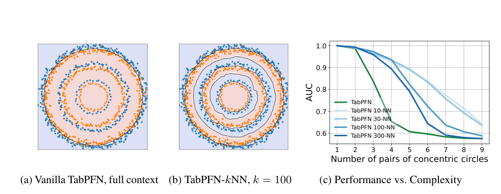
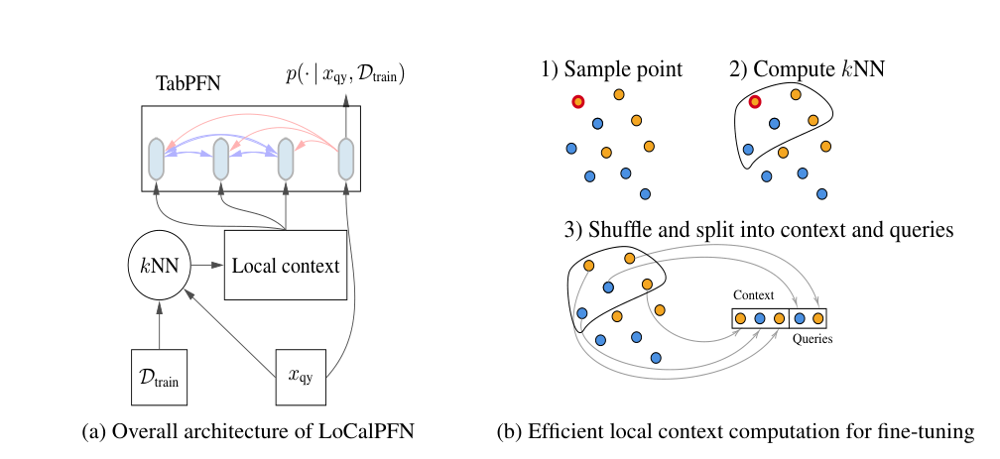
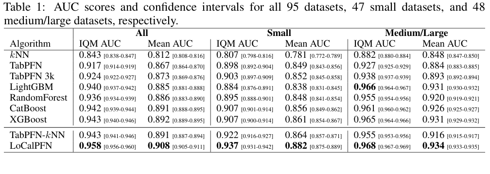
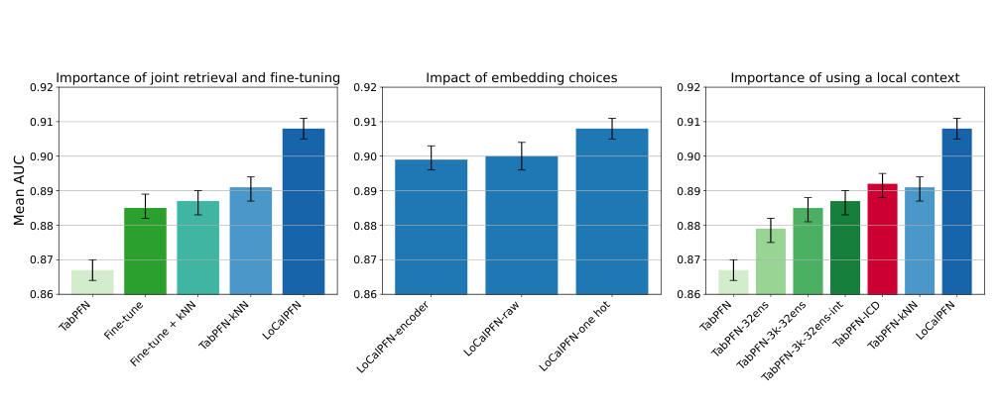
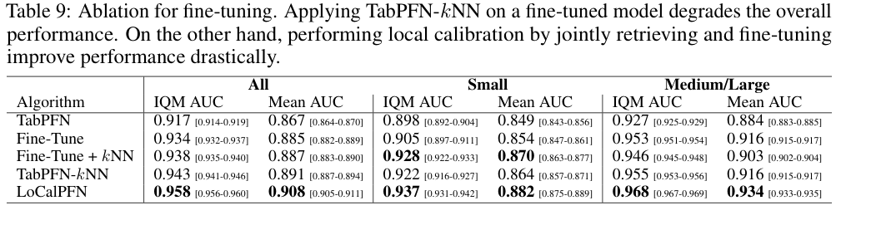

<!-- paper-reading-lang: zh-CN -->
<!-- paper-reading-theme: forest -->
# LoCalPFN：检索局部上下文，再让微调适应这种上下文

**原论文**：*Retrieval & Fine-Tuning for In-Context Tabular Models*，Valentin Thomas、Junwei Ma、Rasa Hosseinzadeh、Keyvan Golestan、Guangwei Yu、Maksims Volkovs、Anthony Caterini，NeurIPS 2024。本解读依据 Zotero `5QV5CK9L` 的 29 页本地 PDF；PDF 元数据创建于 2024-10-31，条目日期 2024-12-16 不作为精确版本号。基模型是第一代 TabPFN，不是后来的 TabPFNv2。代码：[layer6ai-labs/LoCalPFN](https://github.com/layer6ai-labs/LoCalPFN)。（PDF p. 1）

这篇论文把“更大上下文一定更好”变成一个可检验的问题：**预测某个测试点时，需要的是所有训练行，还是它附近最有用的行？** 作者发现全局上下文可能在复杂边界上欠拟合；检索近邻既帮助大表利用更多数据，也改变局部问题的难度。进一步，在这种检索上下文中端到端微调，才形成 LoCalPFN。它不是普通 kNN 投票，更不是对每个测试点单独再训练一套参数。（PDF §§2.2–2.4）

```paper-map
{"thesis":"让每个查询拥有局部上下文，并在同一种局部问题上微调通用ICL模型，改善小模型的复杂边界拟合与长表利用。","outcome":"95个筛选后的TabZilla分类数据集上，平均AUC由TabPFN的0.867到近邻版0.891，再到LoCalPFN的0.908。","outcomeSource":"PDF p. 7, Table 1","items":[{"number":"01","label":"两种失败","text":"上下文长度有限导致大表无法全部使用；即使全表放得下，也可能在复杂规律上欠拟合。","source":"PDF §§2.2–2.3, Figs. 1–2"},{"number":"02","label":"仅加检索","text":"TabPFN-kNN在固定权重下，把全局上下文换成各查询的训练集近邻。","source":"PDF §2.3, Eq. 2"},{"number":"03","label":"再做微调","text":"LoCalPFN对每张任务表更新参数，训练时同样使用局部context，而不是只在部署临时加近邻。","source":"PDF §2.4, Table 9"},{"number":"04","label":"训练可承受","text":"一个锚点邻域划成共享context和多个query，减少昂贵的独立前反向。","source":"PDF §2.4, Fig. 3b"},{"number":"05","label":"受控证据","text":"原始/微调/微调后加kNN/直接kNN/联合局部微调分开比较，避免将系统结果当组件贡献。","source":"PDF Fig. 5, Table 9"},{"number":"06","label":"付出的代价","text":"每张表需要微调，纯预测比树慢；仍受第一代TabPFN的100特征、10类限制，不含回归评估。","source":"PDF §§4.1, 4.5, 5"}]}
```

<!-- paper-reading-context:start -->
## 00 / 发表时的研究背景
<!-- context-cutoff: 2024-06-07; basis: first-publication -->

### 当时的领域状态

时间定位于 **2024年6月首次公开、随后NeurIPS2024定稿**。第一代TabPFN已证明：在小表上，合成预训练加ICL可以免去新任务的参数拟合。社区面临的下一步是把这种便利扩展到大表和复杂边界。context长度有限时随机取一小部分训练行会浪费大表信息；但全部放得下时也未必预测得好，说明“样本装不下”与“当前先验/算法欠拟合”是两种问题。（PDF §§1–2；[首发记录](https://arxiv.org/abs/2406.05207)）

“检索增强”在这里不是搜索网页，而是从当前训练表取与查询有关的行；“微调”是更新当前任务的模型参数；“context优化”则可以保持大部分网络不变、改写其输入上下文。到本文时这些方向已有研究，重要的新问题是它们怎样配合，而不只是能否各自使用。（PDF §3）

### 关键前作与尚存缺口

| 工作与时间 | 已有贡献 | 当时未解问题及与本文的关系 | 来源 |
|---|---|---|---|
| TabPFN第一代（2022预印本/2023） | 固定参数通过训练表上下文直接分类，在小数值表上精度和建模时间很强 | context和先验主要针对小表，随机截取不能保证利用大表增长；复杂全局边界仍可能欠拟合 | PDF §§1–2.3 |
| TabZilla及《When Do Neural Nets Outperform Boosted Trees...》（2023） | 比较19算法、176表，揭示数据性质和预算会改变胜负，并提供可复用结果 | 总体小表表现不能回答TabPFN在更大/更复杂表上的衰退，本文据此筛95表做更具体研究 | PDF §§3、4.1；[原工作摘要](https://arxiv.org/abs/2305.02997) |
| TabR（2023预印本/ICLR2024）等表格检索模型 | 将相似训练对象及其标签用于预测，证明邻域信息能帮助表格深度学习 | 仍是逐任务训练的预测器，不能直接继承TabPFN的跨表免拟合接口 | PDF §3；[原工作摘要](https://arxiv.org/abs/2307.14338) |
| ICD与TuneTables（2024年2月预印本） | 将大数据压成较小的可学习context，或优化PFN的上下文，缓解窗口上限 | 同一压缩context主要服务所有查询；本文转向随query改变的局部context，并让微调也适应该分布 | PDF §§2.2、3；[ICD](https://arxiv.org/abs/2402.06971)、[TuneTables](https://arxiv.org/abs/2402.11137) |

### 本文为何在此时提出

已有路线没有自动解开一个矛盾：更相关的局部上下文可能更准确，却让每个query各跑一遍不同训练侧计算，微调反而难以承受。LoCalPFN的切入是**对query检索局部邻域，并在近似共享局部context中更新参数**，既使大训练库有用，也对齐训练和部署的条件分布。它要验证的不只是“加kNN是否有效”，还包括“先全局微调再临时加kNN，为何不等于联合局部微调”。（PDF §2.4、§4.4）

本文仍使用第一代TabPFN，后来的Nature版、TabICL和TabDPT-Turbo不应被写成它已经比较过的前作。尤其不能因为2026年无检索长context模型表现好，就倒推作者2024年选择局部context没有合理动机。上表的前作贡献结合本篇Related Work和原始摘要核对，不代表重新执行其全部实验。
<!-- paper-reading-context:end -->

## 01 / 为何放得下全表也会欠拟合

主张有两个层次，不能混淆。

1. **规模限制**：训练集 $N$ 大于可用 context 长度时，随机抽 $k$ 行会丢掉大部分样本。继续增加 $N$，那 $k$ 行未必更适合某个查询，因此模型不一定随全表增长改善。
2. **表达限制**：即使 $N=1,000$ 全部放入 context，第一代 TabPFN 学到的先验仍可能把复杂边界过度平滑；一张更局部的表使局部规律更简单。（PDF §§2.2–2.3）

Fig. 1 先看 a、b 的黑色边界：三对同心圆任务中，左侧全局 TabPFN 分不开多重环，右侧 $k=100$ 近邻上下文更贴近边界。再看 c 的横轴增加同心圆对数，绿色全局模型更快退化。25 个 seeds 的平均曲线展示的是这个构造问题的机制，不是证明任意复杂数据都具有合适的局部度量。（PDF p. 2, Fig. 1）



*原论文 Fig. 1，PDF p. 2。全局上下文含1,000点，局部版只保留近邻；更少但相关的数据可以产生更复杂的整体决策边界。*

**阅读者机制解释**：不同查询切换不同邻域，相当于让全局预测函数在输入空间中拼接许多局部问题。即使同一个固定网络只擅长相对平滑的局部规律，这个随查询变化的条件化也能产生更复杂的整体边界；并不需要把每个局部网络重新训练一遍。（PDF §2.3；本段为对作者局部回归类比的解释）

## 02 / 检索改变的是条件，不是投票规则

令 $f_\theta$ 为输出 $C$ 个 logits 的 TabPFN，$D_{\mathrm{train}}$ 为训练行。原始预测为：

$$
p_\theta(y\mid x,D_{\mathrm{train}})=\frac{\exp f_\theta(x,D_{\mathrm{train}})[y]}{\sum_{c=1}^{C}\exp f_\theta(x,D_{\mathrm{train}})[c]}.
$$

近邻版把 context 换成查询的邻居 $\mathcal N_k(x;D_{\mathrm{train}})$：

$$
p_\theta(y\mid x,D_{\mathrm{train}})=\frac{\exp f_\theta(x,\mathcal N_k(x;D_{\mathrm{train}}))[y]}{\sum_{c=1}^{C}\exp f_\theta(x,\mathcal N_k(x;D_{\mathrm{train}}))[c]}.
$$

分母仍对全部类别归一化。检索使用训练特征找近邻，取回这些行的训练标签，然后由 Transformer 在其内部建模关系；不是直接统计最近邻标签的频率，也不是在训练与测试标签之间做距离匹配。（PDF p. 3, Eqs. 1–2）

默认近邻数约为 $k=\min(10\sqrt{N},1000)$，再按实际可用训练行处理。主要结果使用 one-hot 类别编码（受 100 列上限约束）；标准化原始空间和编码器表示也做了消融。FAISS 加速近邻检索，默认采用欧氏距离。（PDF §4.4, Appendix A.2.2, A.5.2）

**说明性算例**：假设一维训练点 $0,1,9,10$ 的标签依次为 A、A、B、B。查询为 $1.2$、$k=2$ 时，context 为靠近 1 和 0 的两行，而查询 $8.8$ 会得到靠近 9 和 10 的两行。模型权重相同，但上下文不同；这里不编造 TabPFN 应输出的精确概率。真实多维任务还要求标准化后距离有意义，无关列过多会损害这种相关性。（PDF §2.3；算例及最后的风险分析为阅读者推演）

## 03 / 为什么朴素局部微调很贵

全局 TabPFN 可用一个 context 同时处理许多 query，输入形状为 $(B,L_{\mathrm{ctx}}+L_{\mathrm{qy}},d)$，通常 $B=1$。训练行彼此 attention，查询只读 context，不读其他 query，因此可以共享计算。（PDF §2.4）

若每条 query 都坚持自己的精确近邻，$N_{\mathrm{qy}}$ 个 query 变成 $B=N_{\mathrm{qy}}$ 个不同 context，每个 $L_{\mathrm{qy}}=1$。瓶颈不再主要是找近邻，而是对这些不同上下文重复执行 Transformer 前向和反向。只把 FAISS 换成近似近邻算法，并不能解决这个重复计算。（PDF p. 4）

原论文 Fig. 3b 展示解决方式：围绕一个锚点找出局部候选集合，再随机分成 context 与多个 query。右侧共享 context 的一批 query 大致相近，但不保证每个 query 拿到的都是它自身精确最近邻；这是计算近似，而不是证明邻近关系具有传递性。（PDF p. 5, Fig. 3）



*原论文 Fig. 3，PDF p. 5。部署每个query检索自己的邻居；微调时多个query共享锚点附近的context，以减少重复计算。*

```paper-path
{"title":"微调路径与最终推理的区别","stages":[{"title":"载入通用TabPFN","role":"任务初始化","action":"从第一代已预训练权重开始，不在当前表重新做百万任务先验训练。","why":"保留小样本先验与快速上下文适应能力。","output":"待针对当前数据集微调的参数","source":"PDF §2.1, §2.4"},{"title":"抽锚点并找邻域","role":"微调采样","action":"抽B个训练锚点，各检索Lctx+Lqy行；排除作为自身近邻的原锚点，打乱后切分。","why":"让同一context被多个相近query共享，大幅减少独立Transformer批次。","cost":"近邻的近邻不一定仍是近邻，因此与逐query精确检索存在偏差。","output":"B个局部context/query子任务","source":"PDF §2.4与脚注2"},{"title":"用局部任务更新权重","role":"微调优化","action":"对query分类损失反向传播，context标签作为已知输入，按验证AUC早停。","why":"让参数习惯检索产生的局部分布，而不是训练全局、推理局部。","cost":"每张表新增训练与验证成本。","output":"适应该表局部预测的共享参数","source":"PDF §4.4, Appendix A.2.2"},{"title":"逐测试点精确检索","role":"部署","action":"在训练集里取当前query的k个近邻，用微调后网络前向输出概率。","why":"测试点按自身位置选择相关信息，不需要共享一个全局随机context。","output":"测试类别概率；不为每个测试点再更新参数","source":"PDF Fig. 3a, Eq. 2"}]}
```

### 一个可追踪的批次形状

**说明性配置**：若一次想对 $N_{\mathrm{qy}}=20$ 个训练 query 反传，设 $B=2$、$L_{\mathrm{ctx}}=100$，则每组 $L_{\mathrm{qy}}=20/2=10$，每个锚点取 110 个近邻，分成 100 context+10 query。输入是 $(2,110,d)$，而精确逐 query 方案约为 $(20,101,d)$。节省来自上下文复用，不是认为 110 小于 101，也不是将上下文与查询混为已知标签。（PDF §2.4；此处数字为说明性例子）

论文实际微调用 AdamW、学习率 0.01、weight decay 0.01，无 warmup 或 scheduler；固定 1,000 个训练 query、batch 2，每 30 步评估并按验证 AUC 早停。步数由验证决定，因此不能把它描述为“不使用验证数据的零调参算法”。（PDF Appendix A.2.2）

## 04 / 95 个数据集上的证据如何读

从 TabZilla 的 176 张表中筛出 95 张：至多 100 特征、10 类、无 NaN、各 split 每类至少一个样本。47 张小于 2,000 行，48 张中大表最高 130,064 行。采用 TabZilla 的 80%/10%/10% train/validation/test 划分，10-fold 评估；基线每 fold 30 轮 HPO，按验证 AUC 选配置。（PDF §4.1）

这里的“不含缺失”非常重要，不能因为方法叫 foundation model 就声称测试了任意混合类型和不完整表。深度基线很多没在全部 95 表上跑通，因此与它们的专门比较改用另一个 **71 表子集**；这不能与 95 表结果直接混排。（PDF §4.2, Appendix A.3.1）

看 Table 1 时，第一组是全部95表，第二组是47小表，第三组是48中大表；每组的 IQM 与 Mean 是不同统计量。IQM 是中间50%分数的均值，不是“最好的50%”。原图保留分层 bootstrap 的95%区间。（PDF p. 7, Table 1）



*原论文 Table 1，PDF p. 7。TabPFN不含额外置换集成；LoCalPFN和近邻版使用相同基模型起点。*

| 方法 | 全部 IQM AUC ↑ | 全部 Mean AUC ↑ | 小表 Mean AUC ↑ | 中大表 Mean AUC ↑ |
|---|---:|---:|---:|---:|
| kNN投票 | 0.843 | 0.812 | 0.781 | 0.848 |
| TabPFN | 0.917 | 0.867 | 0.849 | 0.884 |
| TabPFN 3k context | 0.924 | 0.873 | 0.852 | 0.893 |
| LightGBM | 0.940 | 0.885 | 0.838 | 0.931 |
| RandomForest | 0.936 | 0.886 | 0.848 | 0.920 |
| CatBoost | 0.942 | 0.891 | 0.856 | 0.926 |
| XGBoost | 0.943 | 0.892 | 0.861 | 0.931 |
| TabPFN-kNN | 0.943 | 0.891 | 0.864 | 0.916 |
| LoCalPFN | 0.958 | 0.908 | 0.882 | 0.934 |

**观察结果**：全部表 Mean AUC 的 0.867→0.891→0.908，表明检索与局部微调逐步改善当前基模型；但中大表上直接近邻版 0.916 仍低于 XGBoost 0.931，LoCalPFN 才到0.934。把“无微调版本已经超过所有树模型”当成结论是不正确的。0.041 的平均AUC增益也不是每个数据集都提升4.1个百分点。（PDF Table 1）

论文的“复杂度”分析使用不同算法最好与最差 AUC 的差作为代理，并按它分成五个分位组；这不是独立于比较算法的标准复杂度量。Fig. 4 展示 LoCalPFN 在高差异组仍有竞争力，但不能证明掌握了一个普适的数据复杂度定律。（PDF §4.3, Fig. 4）

## 05 / 为什么必须联合，而不只是串联

原论文 Fig. 5 左边比较训练上下文形式，中间比较检索表示，右边比较全局 context 的各种强化版本。先按这三个问题分开看，而不是把所有柱高排序。尤其“先随机context微调、部署再加kNN”与“直接在局部context中微调”不是同一个训练分布。（PDF p. 9, Fig. 5）



*原论文 Fig. 5，PDF p. 9。柱图是不同系统变体的平均AUC，不是对主模型的可加贡献分解。*

关键数字在 Table 9。这里值得比正文一句概括更精确：全体 Mean AUC 中，Fine-Tune+kNN 的 0.887 比 Fine-Tune 的0.885略高；但在中大表上，它从0.916掉到0.903。因而原文“事后加kNN不改善”的概括应理解为缺乏一致收益、尤其大表退化，不应转述成所有平均指标都下降。（PDF p. 21, Table 9）



*原论文 Table 9，PDF p. 21。阅读同一列的数值，才能区分全体均值与中大表的相反趋势。*

| 变体 | 全95表 Mean AUC ↑ | 48中大表 Mean AUC ↑ |
|---|---:|---:|
| TabPFN | 0.867 | 0.884 |
| 随机context微调 | 0.885 | 0.916 |
| 随机微调后加kNN | 0.887 | 0.903 |
| 固定权重直接kNN | 0.891 | 0.916 |
| 局部context联合微调 | 0.908 | 0.934 |

**作者机制解释**：训练与部署的 context 分布应保持一致。**实验支持**：联合局部微调优于上述串联方案。**阅读者限定**：这验证的是该基模型与当前数据的训练策略；不是对未来一切 ICL 模型都已经完成的验证。（PDF §§4.4–5）

```paper-experiments
{"title":"主要组件的独立检验","rows":[{"question":"更长全局context或更多集成能代替局部检索吗？","setup":"1k/3k context、32路置换集成、跨多个全局chunk平均、ICD优化context。","observation":"全表mean AUC分别约0.879、0.885、0.887、0.892；LoCalPFN为0.908。","conclusion":"局部联合微调强于这些强化全局上下文方案；不能据此说每种纯检索都显著胜过ICD。","source":"PDF Appendix A.5.3, Table 11"},{"question":"检索表示很复杂才有效吗？","setup":"编码器特征、标准化原始特征、one-hot类别编码对照。","observation":"Mean AUC为0.899、0.900、0.908，one-hot改善主要在小表。","conclusion":"简单度量已可用，类别距离处理仍有收益；并非表示选择完全无影响。","source":"PDF Appendix A.5.2, Table 10"},{"question":"邻居越多越好吗？","setup":"48中大表上将近邻上限从20改到1000，比较直接近邻和联合微调。","observation":"LoCalPFN的mean AUC从0.916到0.934；直接近邻100以上变化较小。","conclusion":"存在实用的性能/成本折中，不是上下文无限加长就一定最好。","source":"PDF Fig. 6, Table 12"},{"question":"共享近似邻域会伤害学习吗？","setup":"精确近邻batch32与近似共享query32控制比较，再与完整方案比较。","observation":"前两者中大表mean AUC都为0.931；完整方案为0.934。","conclusion":"当前对照支持共享近似可用；更大批次收益与近邻精确度要分开看。","source":"PDF Appendix A.5.5, Table 13"},{"question":"速度收益能否用于高吞吐服务？","setup":"分开测逐任务训练和预测时间，与已拟合树比较。","observation":"近邻方法纯推理比树慢1–2个数量级；LoCalPFN训练也新增成本。","conclusion":"更适合愿意用计算换精度的建模情境，不能宣传为全面最快推理。","source":"PDF §4.5, Fig. 7"}]}
```

## 06 / 更低建模成本与更慢查询同时成立

TabPFN-kNN 不更新参数，训练成本近乎为零，但预测时仍要检索并对多个不同 context 进行前向。LoCalPFN 额外逐表微调，换来更高准确性；微调后与近邻版的同规模网络有相同预测形式。树模型一旦训练完，往往能用很小开销服务查询。（PDF §4.5）

例如 Fig. 7b 报告近邻上限1,000时局部模型预测约0.72 s，而 CatBoost 约0.01 s；这些是该实验折算/平均的计时，不能换成“单条延迟”或未注明硬件的普适比率。论文自己的结论是纯推理慢1–2个数量级，并强调高吞吐部署应考虑这一点。（PDF p. 10, Fig. 7）

## 07 / 局部条件化与适应之间的闭环

局部检索没有凭空扩大 Transformer 的窗口，却让有限窗口可以受益于更大的训练库：全表越大，查询可能找到更有用的邻居。共享局部任务让微调可承受，而联合训练又减少“全局任务学到的参数、局部任务使用”的错配。这三个环节连在一起，才解释了 LoCalPFN 相对基模型的改进。（PDF §§2.3–2.4, 4.4）

限制也从同一机制而来：检索度量不良时，上下文未必相关；局部化可能增加方差；参数微调放弃了原先完全免训练的部署；底座仍不能自然处理超过100列、10类、回归或NaN。论文证据说明局部检索和微调对第一代TabPFN是有效扩展，不等于这些约束已消失，也不代表比较数字可直接与不同划分的TabICL、TabDPT结果横向排名。（PDF §§4.1, 5）

<!-- 可视化决策：真正重要的区别是精确逐查询推理与共享局部上下文训练；原Fig.3加批次形状算例可以同时保留两条路径，交互切换反而隐藏并列对照，因此使用静态图。Fig.5与Table9同时保留以揭示全体/中大表的差异，不按图像估算额外数值。 -->
<!-- 来源覆盖：全文核心方法、所有正文实验以及Appendix A.1/A.2/A.3/A.4/A.5的相关协议、Tables9–13均可访问；无将缺失深度基线的71表结果当成完整95表结果。 -->
