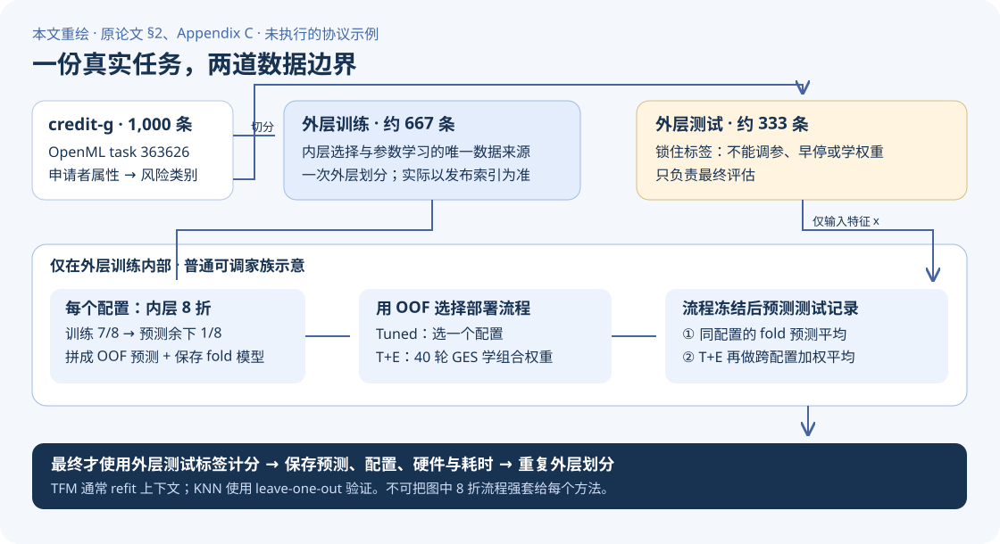
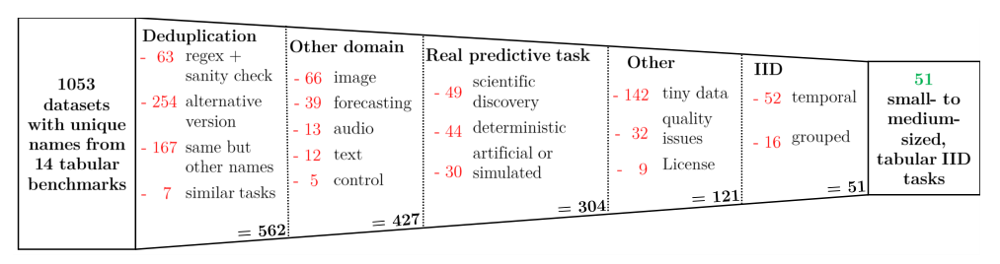
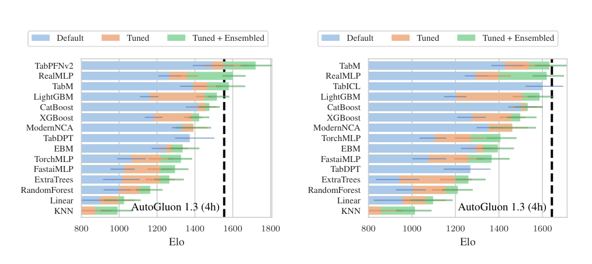
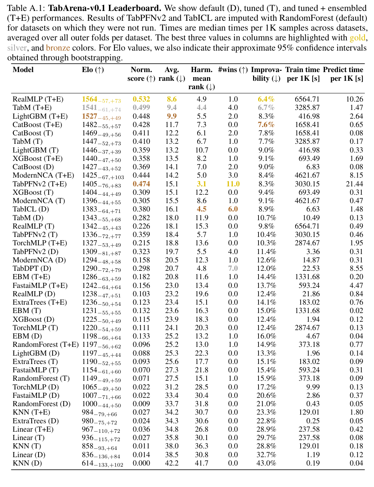
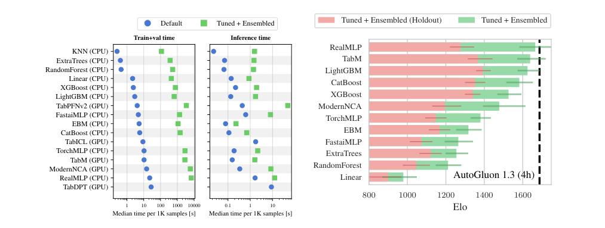
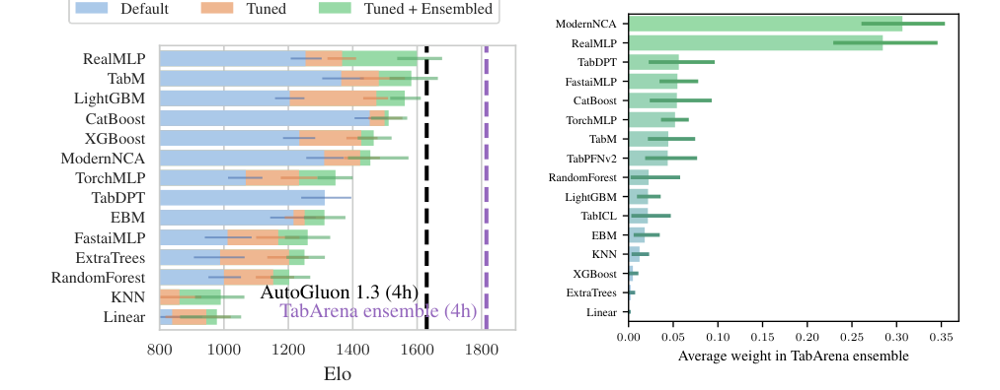

<!-- paper-reading-lang: zh-CN -->
<!-- paper-reading-theme: cobalt -->
# TabArena：把表格模型排行榜变成可维护的测量系统

**原论文**：*TabArena: A Living Benchmark for Machine Learning on Tabular Data*，Nick Erickson 等，NeurIPS 2025 Datasets and Benchmarks spotlight。本次依照新版 13 问完整深读，依据 Zotero `SAZSYEMX` 的 66 页 **arXiv:2506.16791v4，2025-11-03**。首次公开时间是 **2025-06-20**。正文实验固定在 **TabArena-v0.1**；后续研究检索截至 **2026-10-26**，单独放在后文，不能与原论文快照拼榜。（PDF pp. 1–2；[版本记录](https://arxiv.org/abs/2506.16791)）

设想你今天写出一个表格模型，比两年前公开的基线高了几个点。你究竟改进了架构，还是恰好用了更好的预处理、更多调参、不同的测试划分？TabArena 研究的是让这些问题可以被检查的测量系统：**选什么任务、怎样实现基线、如何验证与集成、怎样聚合，以及发现问题后怎样更新**。它的关键发现是，同一家族是否使用内层交叉验证与跨配置集成，足以改变相对排序；单独排名也不能替代对组合价值的测量。（PDF §§1–3）

本页用四类措辞区分信息：**原文报告**指本文声称或观测到的内容；**已有文献**指其他可核实来源；**合理推断**给出证据和推理，但不冒充实验结论；**待验证猜测**用于尚未执行的反例与研究提案。真实任务来源、说明性计算和未执行的实验会分别注明。

```paper-map
{"thesis":"把数据、模型、验证和版本维护一起定义为基准，才能把模型潜力与评估流程带来的优势分开。","outcome":"从1053个候选数据集人工筛到51个IID预测任务，构建16模型的可复用实验及预测产物；不覆盖所有表格使用场景。","outcomeSource":"PDF §§1–2, Fig. 2","items":[{"number":"01","label":"任务有效性","text":"许可、真实预测、IID、去重与无泄漏处理，优先于单纯堆积数据集数量。","source":"PDF §2.2"},{"number":"02","label":"实现质量","text":"用AutoGluon统一接口和测试，与作者协商模型和搜索空间，避免弱基线。","source":"PDF §2.1"},{"number":"03","label":"两层验证","text":"外层测泛化，内层8折选配置；通常保留8个fold模型做预测平均。","source":"PDF §§2.1–2.3, Appendix C.3"},{"number":"04","label":"三种设置","text":"Default、Tuned、Tuned+Ensembled分别回答默认可用性、配置搜索和跨配置集成。","source":"PDF §3.1"},{"number":"05","label":"多种尺度","text":"Elo看成对胜负，Improvability看误差差距；时间还要拆训练与预测。","source":"PDF §2.3, Appendix A.1"},{"number":"06","label":"持续维护","text":"数据、模型、结果与维护协议一起发布；新版本不能与旧快照的绝对Elo直接拼接。","source":"PDF §2.3, Appendix E"}]}
```

<!-- paper-reading-context:start -->
## 00 / 发表时的研究背景
<!-- context-cutoff: 2025-06-20; basis: first-publication -->

### 研究问题与价值

给定不断变化的模型、数据版本和建模流程，怎样让“哪个表格方法值得用”的答案仍可核查、可更新？**本文的研究对象是完整测量系统，不是新的预测网络。** 输入包括候选任务、模型实现、配置搜索和验证协议，输出不应只有名次，还应保留预测、预算、硬件与版本，使后来者能够重新检查结论。（PDF §§1–2）

这决定了它的价值：减少重复训练强基线的成本，避免把错误任务或弱实现继续复制进新论文，同时让研究者区分“架构更好”与“给了它更好的验证和集成流程”。可信的评估可以帮助选型，但不是已为所有非IID、时序或极大表给出统一答案。（PDF §1 Focus Statement、§3.2）

### 当时的领域状态

TabArena于 **2025-06-20首次公开，随后NeurIPS2025发表**。本地是11月v4，因此具体榜单按该冻结版本读；背景则回到2025年上半年：树模型、较强的逐表神经网络和预训练表格基础模型（TFM）已经同时具有竞争力，但很多“谁最好”的比较仍混用不同数据版本、验证划分、搜索范围和集成方式。基础模型还引入了预训练污染与适用尺寸限制，旧式静态成绩表越来越难维护。（PDF §§1–2；[首发记录](https://arxiv.org/abs/2506.16791)）

这里 **IID 指独立同分布**，直观上是训练和未来测试样本可以视为从同一来源随机抽取；如果部署目标是预测未来月份或从未见过的医院，随机切分未必模拟了那个目标。**交叉验证（CV）**让数据轮流承担训练与验证角色，减少结论依赖某一次幸运切分的程度。**超参数优化（HPO）**则是在学习率、树深等配置之间做选择；训练网络权重、选择超参数和最终计分属于不同操作，必须分清谁能看到哪些标签。（概念说明；PDF §§2.1–2.3）

一个必要背景是：**评估的对象不是只有网络名字，还包括完整建模流程**。holdout只留一份验证集；嵌套CV把模型选择与外层泛化评估分开；bagging跨训练划分平均；PHE再组合已搜索的多个配置。此前若只给一种模型强集成、另一种只跑单配置，可能把流程差异误记成架构优劣。（PDF §2.1、§3.2）

### 关键前作与尚存缺口

| 工作与时间 | 已有贡献 | 当时未解问题及与本文的关系 | 来源 |
|---|---|---|---|
| OpenML-CC18、AMLB、CTR23 等已有公共基准（2010 年代至 2023） | 提供共享数据、任务或划分，使研究不必完全依赖作者自选小样本 | 任务原始来源、IID 适当性、许可和重复版本仍需人工核查；可下载不等于适合所有表格结论 | PDF §2.2、§4及Table 2；此行依据本文对前作的归纳 |
| TabZilla（2023，核对 2024 年修订摘要） | 比较 19 个算法、176 个数据集，指出模型家族差异常小于轻量调参带来的变化，并分析数据元特征 | 已经反对简单的树/NN 二选一；仍需要统一强实现、跨配置集成和长期维护，而非再次争论一个永久赢家 | PDF §§1、4；[原工作](https://arxiv.org/abs/2305.02997) |
| AutoGluon-Tabular（2020）及既有集成实践 | 用多层/多模型组合和工程化流程提升真实建模表现，不只寻找一个最佳配置 | 许多学术benchmark未系统测这种潜力，模型单独名次也不等于对组合系统的价值 | PDF §2.1、§3.2；[原工作摘要](https://arxiv.org/abs/2003.06505) |
| TabRepo（2023 首发、2024 修订） | 保存大量表格模型的预测与指标，支持低成本模拟 HPO、集成和跨任务迁移；TabArena 直接建立在其基础设施之上 | 缓存预测、模拟集成早已存在；这里需要补上更严格的任务人工审查、更新的模型与可纠错维护协议 | PDF Table 2、§4、Appendix C.5；[原工作摘要](https://arxiv.org/abs/2311.02971) |
| RealMLP（2024）与新一代逐表 NN、TFM（截至 2025 年上半年） | 强预调默认使 MLP 具备竞争力；预训练的 TabPFNv2、TabICL 把上下文学习带入实用比较 | 方法版本、尺寸限制、调参方式与污染暴露不同；弱旧实现或未说明适用范围会改变所测对象 | PDF Table 1、§2.1；[RealMLP 原摘要](https://arxiv.org/abs/2407.04491) |
| TabReD（2024，核对 v4 摘要） | 用 8 个工业级数据集展示时间切分与随机切分可能产生不同模型排序 | 已证明任务切分会改变问题；它研究非 IID 时间任务，不能因不满足本文 IID 筛选标准就说它是低质量工作 | PDF Table 2、§4；[原工作](https://arxiv.org/abs/2406.19380) |

### 本文为何在此时提出

当时的缺口不是缺少任何共享数据，而是这些环节尚未形成一个可持续纠错的整体：任务是否合适、实现是否可靠、验证是否公平、组合潜力是否被测到，常常在不同工作里分别处理。一个新系统必须保存这些选择及其产物，才可能在发现问题后修正，而不是只替换榜首名字。（PDF §§1–2、4）

“Living”对应明确的维护与贡献协议。原文承认 AMLB、TALENT 当时也有活跃维护，不能把前作概括成全部停止更新。本文把各处已有的优点组织为一个协作系统；其必要性来自评估流程的缺口，后来的模型成绩不能充当当年的动机。（PDF §§4–5）
<!-- paper-reading-context:end -->

## 01 / 怎样想到“测量系统”

**以下是教学性思路重建，不是作者真实决策史。** 既有基准已说明共享数据有用，统一比较研究又说明预算与预处理会改变排序；AutoML实践则长期表明，单一最佳配置不是模型家族能达到的全部能力。把这些知识放在一起，就可问：如果研究真正比较的是用户能得到的预测流程，为什么只保存一个分数，而不保存流程产生的验证和测试预测？（PDF §§1–2、4）

更具体地说，TabRepo 已提供缓存预测做低成本模拟的先例，AutoGluon 已展示组合预测的用途，TabReD 又说明任务划分必须符合应用。把这三条经验合起来，一个自然的设计假设是：建立可检查的数据与模型接口，保存选择和评估的产物，并把修正当作版本更新。如果它有用，后来者就应能在不重训所有基线的情况下解释结果为何改变。**这是合理推断，不是被证实的作者发现史**；它不需要先知道本文哪些模型最终领先。（已有文献：[TabRepo](https://arxiv.org/abs/2311.02971)、[AutoGluon](https://arxiv.org/abs/2003.06505)、[TabReD](https://arxiv.org/abs/2406.19380)）

作者确实在相关工作中明确列出其他领域的 living leaderboard 为启发。可归因的启发是公开、持续更新这一组织方式；具体的表格验证协议仍需独立设计，不能从一个相似界面直接推出。（PDF §4）

### 核心直觉

**核心直觉是：把排行榜的单位从“算法名字”改成“任务版本×实现×模型选择×集成×成本”的组合。** 在这个单位上保存原始产物并持续纠错，才可能说清楚排名为何改变；51表与16模型是这一系统的初始实例，不是living概念本身。（PDF §§1–3）

## 02 / 用一项真实任务走协议

选择论文任务表中的 **credit-g，1,000 条记录的二分类任务**，OpenML dataset **46918**、task **363626**。任务是根据申请者属性预测信用风险类别。输入是一份带数值、类别属性和标签的表；输出是一套经过内层选择、在外层测试计分的预测流程及其产物。以下追踪一次外层评估，未重新训练，也未获得某条记录的实际预测概率。（PDF Appendix B.2, Table B.2，p.40）

1. **先确认任务适当性**：检查来源、许可、重复版本与随机划分是否合适，而不因文件是CSV就默认IID。该任务入选不意味着所有信贷部署都可随机切分。
2. **锁住外层测试**：它小于 2,500 条，适用 10 次重复 3 折外层 CV。在一次外层划分中，约 667 条用于建模、333 条用于最终评估；实际整型大小以发布索引为准。留出的记录 $x$ 从现在起不能参与调参、早停或权重选择。（PDF §2.3；约数为教学说明）
3. **内层 8 折形成可选择产物**：以一个可调家族为例，每个配置将当前外层训练数据分为 8 份，每次在约 7/8 上拟合，在余下 1/8 上预测，合成整份 OOF（out-of-fold，折外）预测。每条 OOF 记录未用于对应 fold 的参数拟合，但其标签仍可能用于早停与后续选择，所以 OOF 不能当作永远独立的最终测试。预处理也只能在相应训练边界内学习。这里选择的是超参数，外层测试仍未打开。（PDF §2.1、Appendix C.1/C.3/A.6）
4. **决定保留什么**：Tuned选一份配置，T+E在OOF预测上选择多配置权重。对同一条外层记录x，先平均一个配置的fold预测，再按配置权重组合；TFM则按论文规定的refit路径处理，不能强行说每种模型都保留8份网络。（PDF §§2.1、Appendix C.3–C.4）
5. **最后计分并保存**：取得外层测试AUC与建模/预测耗时，保留预测、配置、硬件和数据版本；重复外层划分，再跨任务聚合。最终Elo来自任务比较，不是对单条credit-g记录预测“信用分”。（PDF §2.3）

这样可以把三件事分开：**训练**只使用当前 fold 的拟合部分；**选择**使用 OOF 标签和预测挑配置或组合权重；**评估**在流程冻结后使用外层测试标签。常规模型部署时会执行保留下来的 fold 模型；TFM 通常以 refit 后的完整训练上下文预测。KNN 另用高效的 leave-one-out 验证，是附录明确列出的例外，不应把“所有方法都训练 8 份”写成通则。（PDF Appendix C.1、C.3）

下图是本文为阅读重绘的协议图。沿上方从任务到产物走；中间的外层测试隔离线强调，调参和权重学习只能在内层发生。



*本文重绘 · 依据原论文 §2、Appendix C.1/C.3–C.5；样本数量为约数，不是已运行的预测轨迹。*

这条真实任务流程说明本篇的方法在哪里：防止选择信息流入测试、分清两层集成、留下能重用的实验产物。下面展开任务筛选和数学聚合，再看协议怎样改变可观察结果。

## 03 / 筛选定义了测量能力

v0.1聚焦IID、500至250,000训练样本的分类/回归。它暂时排除时间依赖、主体组、分布漂移、极少样本、超大表及其他任务。若医学记录同一个病人的多个时间点被随机切开，测到的就可能是记忆主体而不是预测新病人；因此“IID是否适当”是任务层面的判断，不能只看一张矩形CSV。（PDF §1 Focus Statement, §2.2；例子为阅读者说明）

人工筛选包括：数据与任务去重、真实预测来源、非图像/音频直接展平、非确定性规则、合适规模、无不可逆泄漏的版本、允许科学使用的许可、可公开下载与明显伦理问题。这里的代表性依赖其定义，不是所有行业任务的概率抽样。（PDF §2.2, Appendix B）

原 Fig. 2 从左至右给出 1053 个候选到 51 个任务的过滤。请读每一步剔除的原因：重复版本不提供额外独立证据，时间任务需要不同协议，不合适许可限制共享。**图中记录的是最先发现的排除原因**，作者遇到一个明确排除理由后就转向下一数据集，未对每个被排除数据集穷尽所有检查。因此各栏不表示所有质量问题的独立普查。（PDF p. 5, Fig. 2；Appendix B，p.36）



*原论文 Fig. 2，PDF p. 5。人工任务判断与可自动执行的尺寸/去重过滤是不同步骤。*

## 04 / 内外层验证与两层集成

外层训练/测试负责估计最终泛化。小于2,500样本时用10次重复3折外层CV，其他任务用3次重复3折；每个外层训练部分再做8折内层CV。选择参数、早停与集成权重不能触碰外层测试标签。（PDF §2.3, Table 2）

```paper-path
{"title":"由候选配置到一次外层测试预测","stages":[{"title":"锁住外层测试","role":"测泛化","action":"生成重复的外层训练/测试划分，分类按类别分层。","why":"让最终指标来自未参与选择的样本。","output":"当前外层训练集与独立测试集","source":"PDF §2.3"},{"title":"在训练集做8折","role":"选配置","action":"每个配置训练8个fold模型，收集out-of-fold预测并计算选择指标。","why":"避免单个holdout过小或幸运划分改变选择。","cost":"明显增加建模成本，不能与单模型训练价直接比较。","output":"配置分数、OOF预测及fold模型","source":"PDF §2.1, Appendix C.3"},{"title":"选择或组合配置","role":"建模决策","action":"Tuned选最佳配置；Tuned+Ensembled用OOF预测做40步greedy ensemble selection。","why":"利用多个配置误差的互补性，而不是丢掉全部非冠军配置。","output":"稀疏非负且和为1的权重","source":"PDF Appendix C.4"},{"title":"只在最后测一次","role":"外层评估","action":"平均fold模型预测，再按配置权重组合，对外层测试计分。","why":"用同样的数据边界对比完整预测流程。","cost":"预测要跑多个fold及配置，延迟随保留成员增加。","output":"此dataset/fold的预测、指标与耗时","source":"PDF Appendices C.3–C.4"}]}
```

**重要例外**：TFM根据作者建议在训练+验证数据上refit上下文，不套8fold模型平均。TabICL与TabDPT在本版只评默认，因为当时原实现没有提供明确HPO协议。其他可调模型使用1默认+200随机配置；每配置每训练split限1小时。不要把“200配置搜索”和“给所有模型同样秒数”混为一谈。（PDF §2.1）

### 两种集成是两层，而不是一个词

对于配置 $c$，8fold预测先做：

$$
\bar f_c(x)=\frac18\sum_{k=1}^{8}f_{c,k}(x).
$$

再跨配置组合：

$$
\widehat f(x)=\sum_cw_c\bar f_c(x),\qquad w_c\ge0,\quad\sum_cw_c=1.
$$

这里 $x$ 是待预测样本，$f_{c,k}$ 是第 $c$ 个配置、第 $k$ 个 fold 拟合出的预测器，$w_c$ 是利用 OOF 数据选择的配置权重。这是对附录算法的教学记号。前者是 bagging 式的交叉验证集成，后者是 PHE；Tuned 通常也保留前者。因此“单个模型家族”可能包含多份实际预测器。（PDF Appendix C.3–C.4）

为什么平均后仍能当概率用？若每个成员对所有类别的概率和是 1，先求成员平均，概率和仍是 1；再按非负、总和为 1 的权重组合，也保持这个性质。这只保证输出合法，**不保证 AUC 或误差一定优于最佳成员**。性能是否改善，要看误差互补、权重是否可靠，以及独立外层测试的结果。（数学性质的教学展开）

### 权重怎样一步步得到

GES 是贪心集成选择。开始没有成员，每轮尝试把一个候选加入当前组合，选择让 OOF 指标最好的那个；同一个候选可以重复入选。设已经选了 $n$ 次，当前集成预测为 $g_n$，下一步加入候选 $\bar f_c$ 后是：

$$
g_{n+1}(x)=\frac{n}{n+1}g_n(x)+\frac{1}{n+1}\bar f_c(x).
$$

分母 $n+1$ 来自“此前 $n$ 票加一票”。在 OOF 数据上逐个比较候选，重复 40 轮后，每个配置被选中的次数除以 40 就是其权重。没有被选中的配置可以从推理系统中删除；搜索阶段仍然付过训练成本。第一轮直接选一个候选即可，不需要给空集成定义预测。这个过程是附录算法的等价解释，不是额外的最优性定理。（PDF Appendix C.4，p.47）

**说明性例子**：两个配置权重0.75、0.25，每配置保留8个fold模型，预测时最多需要16个成员，而不是2个；权重为零者可以剪掉。模型类型仍只有一个家族，但服务成本不同。（PDF Appendix C.4；例子为阅读者构造）

## 05 / 指标的数学与直觉

本文没有给出“此协议必然找出所有未来任务最优算法”的证明。需要理解的数学主要是概率平均与跨任务聚合：非负且和为1的权重使分类概率仍归一化；Elo将胜负压到一个相对标尺；Improvability则保留误差差距。三者用途不同，不能互相当作模型置信度。（PDF §2.3、Appendices A.1、C–D）

二分类用ROC AUC，多分类用log-loss，回归用RMSE。Elo通过成对胜/平/负把异构任务放到共同尺度：

$$
P(A\text{胜}B)=\frac{1}{1+10^{(R_B-R_A)/400}}.
$$

这里 $R_A,R_B$ 是两个完整预测流程的相对评分；$P$ 是比较模型赋予 A 胜出的概率。每个任务先按其指标比较谁更好，出现平局也会保留；Elo 以 Bradley–Terry 形式拟合这些成对结果。随机森林默认配置锚定 1000。**说明性代入**：高 400 分对应 $10/11\approx90.9\%$ 的模型化胜率，不是准确率 91%，也不是未来任意新任务的保证。更换任务集、模型池或协议后，应重新拟合和校准，不能直接拼接绝对 Elo。（PDF §2.3、Appendix D.1–D.2）

把Elo式变形成胜率赔率，可以看到尺度的来源：$P/(1-P)=10^{(R_A-R_B)/400}$。同分时赔率1即胜率1/2，高400分时赔率10即10/11。这个计算解释的是拟合的比较模型，不是证明真实比赛独立同分布；数据集bootstrap也只能覆盖相应任务抽样的不确定性。（教学代数展开；PDF Appendix D.1）

Improvability则衡量离逐数据集oracle最好方法还差多少：

$$
I(m)=\frac1{|\mathcal D|}\sum_{d\in\mathcal D}\left(1-\frac{e_d^*}{e_{d,m}}\right),\qquad e_d^*=\min_a e_{d,a}.
$$

越低越好。误差0.10而oracle0.08时，该任务的可改进空间是20%，不是准确率下降20个百分点。Elo只看谁赢，$I$看差多少；两种聚合可能产生不同排序，所以论文保存原始预测与指标，允许用户检查和重排。（PDF §2.3, Appendix A.1；算例为阅读者构造）

这里 $e_{d,m}$ 是模型在任务 $d$ 上、先跨外层划分平均后的误差；二分类把 AUC 转为 $1-\mathrm{AUC}$，多分类用 log-loss，回归用 RMSE。$e_d^*$ 是本次比较方法池里该任务最小的误差，具有事后 oracle 性质。公式 $I$ 用 0 到 1 的比例表示，表中再乘 100%。对误差为零的退化情形，式子本身需要实现约定，不能直接代入 $0/0$；本页不臆造论文未写出的约定。（PDF Appendix A.1，p.27）

### 置信区间究竟覆盖什么

bootstrap 是重复“从这 51 个任务中有放回地抽 51 个”，每轮重算 Elo，观察其变化，而非把每个 CV fold 都算成独立新任务。附录 D.1 **明确假设数据集是从某个未知任务生成分布 IID 抽出的**；这与每张表内部的样本能否随机切分是两个层次。该区间不能自动覆盖领域构成改变、模型开发反复看榜、预训练污染或未见任务类型。（PDF Appendix D.1）

还有一个细节：作者先构造均值中心化 Elo 的区间，再整体平移到默认随机森林 1000 的坐标。因此随机森林自己也有非零宽度区间；平移没有把参照方法在未知任务总体上的随机性全部纳入。这更适合解释相对差异，不能仅凭两个边际区间重叠或不重叠就替代成对显著性检验。主文和 D.1 写 200 次 bootstrap，D.2 写 100 次，本页保留这个文字不一致。（PDF Appendix D.1–D.2，p.48）

## 06 / 实验问题与答案

**问题→** 同一个模型家族，在默认、只选最优配置和组合配置时，实际名次与成本怎样变？**验证→** 在固定任务与实现上比较这三种部署系统，再对TFM做兼容子集分析。**答案→** 验证和集成能实质改变排序，但还必须同时付出建模和预测成本；下面数值是v0.1快照，不是实时网页排名。（PDF §3.1）

原Fig.4左边只评TabPFNv2适用的33个任务，右边是TabICL适用的36个分类任务。必须先看这两个分母：小表TFM优势不能与全部51任务、含回归的结果不加限制地比较。跨全表补齐时，论文以默认RandomForest替代不适用位置，并明确标注imputed。（PDF p. 7, Fig. 4；Appendix A.1）



*原论文 Fig. 4，PDF p. 7。子集结果是真实适用范围内的比较；不是每个模型都在全部51表原生运行。*

全表、含补齐的Table A.1给出可读数值。下表摘录关键行，时间为跨表**每1,000样本的中位数**，不是单次查询延迟，也不是相同硬件下每秒吞吐。原表保留bootstrap区间。（PDF p. 31, Table A.1）

| 配置 | Elo ↑ | Improvability ↓ | 建模秒/1K | 预测秒/1K |
|---|---:|---:|---:|---:|
| RealMLP T+E | 1564 | 6.4% | 6564.71 | 10.26 |
| RealMLP Default | 1238 | 12.4% | 21.86 | 0.84 |
| TabM T+E | 1541 | 6.7% | 3285.87 | 1.47 |
| TabM Tuned | 1447 | 7.7% | 3285.87 | 0.17 |
| TabM Default | 1343 | 10.7% | 10.49 | 0.13 |
| LightGBM T+E | 1527 | 8.3% | 416.98 | 2.64 |
| LightGBM Tuned | 1446 | 9.0% | 416.98 | 0.33 |
| LightGBM Default | 1197 | 13.3% | 1.96 | 0.14 |
| CatBoost T+E | 1482 | 7.6% | 1658.41 | 0.65 |
| CatBoost Tuned | 1469 | 7.8% | 1658.41 | 0.08 |
| CatBoost Default | 1427 | 9.0% | 6.83 | 0.08 |
| RealMLP Tuned | 1342 | 9.8% | 6564.71 | 0.49 |
| TabPFNv2 Default（部分补齐） | 1309 | 11.4% | 3.36 | 0.31 |

最直接的机制例子是RealMLP：相同搜索产物，Tuned到T+E的Elo从1342到1564，预测成本从0.49到10.26 s/1K；这不是网络结构变了。LightGBM也能从同类集成获益，所以“集成让深度学习赢”不等于只给NN增加预算。（PDF Table A.1）

下面把四个家族在 Tuned 和 T+E 下的 Elo 放在同一标尺。RealMLP 的改变量明显大于 CatBoost；这揭示了协议对结论的影响。条形是点估计，原表区间和后文显著性分析仍需一起读。

```paper-chart
{"type":"bars","title":"跨配置集成的收益因家族而异","origin":"本文重绘 · 原论文 Table A.1","unit":"Elo","domainMax":1700,"source":"PDF p.31, Table A.1；同一51任务、同一方法池，主表含部分TFM补齐","note":"Elo越高越好；未画置信区间不等于无不确定性。这些是v0.1点估计，不能与实时榜拼接。","rows":[{"label":"RealMLP · Tuned","value":1342},{"label":"RealMLP · T+E","value":1564},{"label":"TabM · Tuned","value":1447},{"label":"TabM · T+E","value":1541},{"label":"LightGBM · Tuned","value":1446},{"label":"LightGBM · T+E","value":1527},{"label":"CatBoost · Tuned","value":1469},{"label":"CatBoost · T+E","value":1482}]}
```

### 交互比较协议与成本

打开下面的探索视图，先选 RealMLP，再在 Default、Tuned、T+E 间切换；同时观察保留的预测器、Elo 和预测成本。再选 CatBoost，对照相同协议改变的收益是否一致。第二个视图可追踪 credit-g 从外层切分到测试计分的信息边界。这里查阅的是论文表中报告的结果与协议说明，**没有在浏览器里训练模型，也没有按滑块生成新的科学结果**。

<!-- archify:assets/protocol-explorer.html|交互探索：同一家族、不同协议，究竟改变了什么 -->

阅读完整Table A.1时，先找各模型后缀D/T/T+E，再看是否部分补齐和时间列。同一家族三行代表不同部署系统，低者更好的列与高者更好的列也不能混读。（PDF p. 31）



*原论文 Table A.1，PDF p. 31。绝对Elo依赖这一模型池，不与后续版本直接拼榜。*

## 07 / 协议与互补性的对照

Fig.6左侧分开建模/验证与预测耗时；右侧在相同的Tuned+Ensembled框架内比较holdout与cross-validation。请先看同一行的粉/绿差异，而不是把右边仅解释成模型家族的排名。（PDF p. 8, Fig. 6）



*原论文 Fig. 6，PDF p. 8。验证设计能系统性改变测到的峰值能力，集成还带来预测成本。*

```paper-experiments
{"title":"六个实验问题与有边界的答案","rows":[{"question":"谁在强搜索与集成后更强？","setup":"51任务、16模型，默认/选最佳配置/PHE，TFM按适用范围子集或标注补齐。","observation":"强NN如RealMLP、TabM的集成很强，传统调参设置下CatBoost依然突出。","conclusion":"模型与验证/集成协议一起决定结果，不能还原成永久的树对NN二选一。","source":"PDF §3.1, Fig. 1, Table A.1"},{"question":"TFM适合什么任务？","setup":"分别限制TabPFNv2与TabICL兼容任务，比较同一协议。","observation":"TabPFNv2在兼容小表子集上很强，调参/PHE可进一步提高。","conclusion":"是其适用范围内的证据，不能用补齐后的全表成绩反推原生能力。","source":"PDF Fig. 4, Appendix A.1"},{"question":"是否值得用更多计算？","setup":"性能差距与建模/预测时间画Pareto前沿；不同数量配置做集成。","observation":"树在有限建模预算和低推理延迟上强，NN大集成需要更高预测成本。","conclusion":"峰值精度和部署效率是不同目标。","source":"PDF Figs. 5–6"},{"question":"holdout与CV测到的潜力是否相同？","setup":"在调参和集成框架内比较holdout与CV；考察验证和最终部署流程的整体变化。","observation":"作者报告holdout设置低估各家族可达到的性能，并偏向自带集成的模型。","conclusion":"支持认真比较验证流程；该设置同时涉及选择、训练数据利用及fold集成，不能把全部差值只归给验证估计方差。","source":"PDF §3.2, Fig.6, Appendix C.3"},{"question":"点估计榜首是否显著强于所有对手？","setup":"Friedman检验加Nemenyi事后比较，另有逐任务配对检验。","observation":"不同子集中均存在没有检测到显著差异的头部组，包含NN和GBDT，适用时也包含TFM。","conclusion":"不能把点估计第一写成确定的普遍优势；未显著也不证明严格等效。","source":"PDF Appendix A.5, Figs.A.12–A.14, Appendix F"},{"question":"排名较低的模型是否无价值？","setup":"从保存预测模拟跨家族集成，portfolio用leave-one-dataset-out构造。","observation":"跨模型集成超过单家族；最高权重模型未必单独最强。","conclusion":"误差互补与验证过拟合都可能影响权重，不把权重当因果贡献或科学真值。","source":"PDF Fig. 7, Appendices C.5/A.6"}]}
```

原Fig.7左边比较模拟的全模型集成，右边是平均权重。ModernNCA等高权重不能直接等价为“最可靠”：作者发现验证过拟合可能让某些模型被过度选择。需要同时检查独立外层测试与验证差距。（PDF p. 9, Fig. 7）



*原论文 Fig. 7，PDF p. 9。左侧集成为保存结果上的模拟；右侧权重不是单模型精度排行。*

## 08 / 启示与适用边界

- **可重复的单位是完整工作流**：强默认、搜索后最佳配置、跨配置集成回答不同问题，不能因为名字相同就混报。（PDF §3.1）
- **公开预测让基准成为可研究对象**：可以检验权重、错误互补和验证过拟合，但集成权重不等于某方法的因果贡献。（PDF Fig.7）
- **持续维护必须连同范围一起版本化**：补齐的全表成绩与原生兼容子集不同，新版本的绝对Elo也未必可直接拼接；扩范围应重新说明IID与预算条件。（PDF §§2–5）

共享预测可以廉价重算指标、模拟组合；维护协议使发现泄漏、错误版本或弱实现后能修正。TabArena-Lite保留任务，但减少外层fold，而不是换成随意挑的简单表。它适合研究迭代，完整基准再检查稳定性。（PDF §3.2, Appendix A.4/E）

**作者主张**是把基准作为需要版本化、持续维护的软件。**测量支持**是数据审查、受控实现和验证/集成对结果的可观察影响。**阅读者综合**：可靠排行榜的单位不是“算法名字”，而是任务版本、训练协议、配置集合和部署形式的组合。即便一个模型在此版本胜出，也不能省略其预算、兼容范围、预训练污染风险与集成成本。（PDF §§2–5）

## 09 / 最脆弱的假设

**合理推断：最需要警惕的是“经筛选的公开任务及其等权平均，足以代表读者关心的未来任务总体”。** 这是对外推结论的诊断，不是说本文的数据筛选没有价值，也不能仅凭现有证据确定它比所有其他假设都更脆弱。论文实际改善了许多数据问题；风险出现在把一份明确范围内的测量，扩写成对任意表格应用的推荐。

这个假设支撑了两件不同的事。第一，D.1 的 bootstrap 将 51 个数据集当作来自任务分布的 IID 样本，才有“未知任务总体”的解释。第二，等权聚合把每个入选任务赋予同等分量，而真实部署可能只关心医疗、极低延迟，或新主体泛化。人工筛选是有目的的选择，不能自动等同于对实际应用分布的概率抽样。（PDF §2.3、Appendix B/D.1）

有三条具体证据说明应保留这层限制：其一，1053 个候选最终只留下 51 个；其二，B.1 明确排除时间和分组任务；其三，Table B.1 中商业营销有 16 个任务，教育、环境、工业制造各只有 1 个。**这些事实说明覆盖不均匀，尚不证明某个模型的排名一定有偏**。若未来任务的领域、尺寸或预算构成改变，模型相对顺序也可能改变；应该用领域留出、任务权重敏感性和新增任务验证来诊断。（PDF pp.36–40）

另一个独立风险是公开榜单被反复用于模型开发。嵌套 CV 可以隔离单次建模的测试标签，却无法让多轮研究中已被看过的 benchmark 重新变成新任务。作者在 §5 和 E.6 已承认污染与 benchmark overfitting 的风险，报告 TabDPT 的预训练涉及 7 个基准任务；这个暴露事实不等于已经证明它的成绩由记忆造成，原文也没有可通用检测 TFM 污染的方法。（PDF pp.10、55–56）

还需区分**任务层的外推风险**和**单次选择中的验证过拟合**。后者已有本文内部证据：A.6 报告 ModernNCA 的测试轨迹在约 25 配置后下降，验证表现却继续变好；TabM 相对更稳健。即使完全不读外层测试，反复针对同一 OOF 信号调参和学集成权重也会过度选择幸运候选。作者给出的 TabM 机制解释仍带有“possibly”的推测限定。（PDF Appendix A.6，Figs.A.15–A.16）

## 10 / 一周能验证什么

**建议做“缓存结果上的分析复现”**：在同一版结果、同一任务和外层划分上，检验“RealMLP 的 Tuned→T+E 增益是否大于 CatBoost 的对应增益，以及推理成本是否同步增加”。这直接检查论文关于协议改变家族比较的证据，不需要重跑约 2500 万个模型，也不等于独立复现其训练质量或集成机制。

### 资源、数据与冻结规则

已核实官方仓库有 evaluation-only 安装路径，以及 `examples/plots/run_export_results_per_split.py`。它从缓存结果层生成 `results_per_split.csv`，含 dataset、fold、method、测试/验证误差、训练/推理时间、指标、问题类型与补齐标记；该逐 split CSV **不是现成托管文件**。仓库 README 区分结果层、约 10 GB/方法的 processed 层和约 100 GB/方法的 raw 层。本计划只需要结果层，避免误下载预测全集。（已有文献：[官方 README](https://github.com/autogluon/tabarena)、[导出脚本](https://github.com/autogluon/tabarena/blob/95820a2cec37174fe3e25da4df80e11ae76b8761/examples/plots/run_export_results_per_split.py)）

本次核对的仓库提交是 `95820a2cec37174fe3e25da4df80e11ae76b8761`，日期 2026-10-25。它用于说明当前访问路径，**不保证自动加载的 artifact 就是 2025 年 v0.1**。第一天必须同时冻结代码依赖、模型版本、数据 split 和 artifact 标识/指纹。若只能取得新版模型产物，项目应改称“新版快照复验同一现象”，不能用相同名字对 Table A.1 强行验数。v0.1 缺失就按下面备选方案降低结论强度。

资源预算是普通 4–8 核 CPU、16 GB 内存、预留约 10 GB 安装与结果空间，不需要 GPU，也不调用付费模型。**这是未实测的保守工作预算**，不是对依赖或下载量的保证；结果层本身小，主要时间可能花在依赖兼容与版本定位。先限定结果 tier、设置缓存目录并核对预计大小，超出预算立即停止，不能因一个“下载结果”命令隐式取回数百 GB 文件。

### 具体实验与判据

1. 锁定 RealMLP、CatBoost 的 T 与 T+E 四套流程，取它们共有且非补齐的任务/split。不要把今天名称相同的新版模型混入旧版。
2. 对每个任务先跨 outer folds 求平均误差，再计算 T+E 相对 T 的误差降低比例。二分类用 $1-\mathrm{AUC}$，多分类用 log-loss，回归用 RMSE；不要直接把不同单位的原始误差相加。
3. 报告每家族的任务胜率、平均相对误差降低，以及对应时间列。若重算 Improvability，oracle 方法池必须固定；若重算 Elo，必须固定全部比较方法、锚点和官方实现。只留四行后拟合的 Elo 不应再期待等于 Table A.1。
4. 主要对照是**同一家族、相同搜索产物、只改变最后选择/组合**。再以任务为簇做 2000 次 bootstrap，记录种子 0、1、2 的敏感性；重复 folds 不能冒充独立的任务样本。
5. 预先规定：在可取得的冻结任务集上，RealMLP 的平均相对增益为正，且相对 CatBoost 增益之差的 95% bootstrap 区间下界为正，才称“支持这项缩窄后的比较”；同时核对推理时间增长。若区间跨零，结论是证据不足；若平均差为负且稳定，则这次快照不支持该比较。这个判据针对方向与不确定性，不额外发明一个“有用就必须提升 5%”的任意门槛。

上面的统计量与论文用 Elo 表达的原始比较相关，但不完全相同，因此方向不一致时要进一步定位任务、指标与聚合方式，不能立即宣称推翻论文。依赖固定缓存的分析还不能排除原训练代码、预处理或预训练污染问题。

| 日程 | 当天的具体交付 | 提前停止或切换条件 |
|---|---|---|
| 第 1 天 | 定位代码与 artifact，保存版本/许可/指纹清单，创建 CPU 环境 | 找不到 v0.1 则明确转为新版快照或表格审计 |
| 第 2 天 | 导出小型结果表，检查方法、任务、split 和 imputed 字段 | 任务/模型不匹配时停止验旧表数字 |
| 第 3 天 | 复算逐任务 T→T+E 误差变化，逐行核对 3 个任务 | 不一致先查指标方向与折均值，禁止挑任务 |
| 第 4 天 | 复算聚合结果、画精度与推理成本对照图 | 无预测数据时不重新“学习”PHE 权重 |
| 第 5 天 | 任务簇 bootstrap、领域留一分析、三个种子敏感性 | 不把结果不显著改成筛掉不利任务 |
| 第 6 天 | 分析反向/异常任务与预算差异 | 区分协议作用与模型版本变化 |
| 第 7 天 | 输出可重跑脚本、数据清单、支持/不支持/不确定的结论 | 写清没有重训模型及未验证的机制 |

**低资源备选**：若 v0.1 artifact 不可取得，只从本文 Table A.1 与 F.1 做可核查的表格级重建，验证协议变化与任务异质性；不能从均值和标准差伪造逐 fold 数值，不能声称独立训练复现。若只取得轻量结果表而没有 OOF 预测，也不能将它当成能任意改变集成权重的预测仓库。以上均是方案，本次未执行科学复现实验。

## 11 / 怎样设计公平反例

### 反例一：大多数任务的小胜，抵不过关键任务的大败

**待验证构造**：针对“等权排行榜的赢家就是我的最佳部署选择”这个外推，构造两个仍属 IID、样本量相近的任务族。A 在大量任务上有极小优势，B 在少量高代价任务上明显更好；部署恰好更重视后者。保持模型实现、数据划分、搜索产物和候选池不变，只在事先声明的业务混合权重与效用下比较。

这个反例利用 Elo 只看胜负、不看误差幅度的性质。为了避免挑结果，必须先用开发任务定义任务族、部署权重与有意义差值，再在留出的独立任务检验。对照包括等权 Elo 推荐、固定部署权重下的期望损失，以及预算匹配的简单默认基线；衡量推荐造成的额外损失，也就是 decision regret。

若 Elo 赢家在独立部署任务上稳定产生更高 regret，它反驳的是**把当前等权排名无条件外推到该部署分布**，不反驳 TabArena 在其任务集上正确算出了 Elo。若换用事先声明的部署权重后，原赢家仍更好，或者差异落在不确定区间内，我的反对就失去支持。也不能在看完结果后任意挑一个权重制造逆转。（原文事实依据：PDF §2.3 对 Elo 幅度盲点的讨论；反例为阅读者设计）

### 反例二：选择信号持续改善，真实泛化恶化

这是对“更多配置加贪心集成能持续带来更好泛化”这一过强解读的直接机制挑战。构造小样本 IID 二分类任务族，固定潜在数据分布、候选算法和独立外层测试；候选池中同时放入稳定但略保守的模型，以及方差较大、容易偶然贴合 OOF 的模型。逐步增加可选配置数，但绝不使用外层测试选停止点。

比较最佳单配置、均匀平均和 40 步 GES，在独立外层测试上记录误差，同时保留 OOF 的选择轨迹。分别在相同候选池与相同训练成本两个视角报告，避免把新增搜索成本隐藏掉。预期失效是：OOF 改善，GES 却越来越偏向偶然候选，测试收益趋零或变负。重复生成独立任务与划分，并单独改变 OOF 样本量，才有机会辨别选择噪声与真正互补性。（构造未执行）

本文 A.6 已报告类似的 ModernNCA 现象，因此“集成可能过拟合”本身**没有新颖性**。一个更有判别力的检验是，选择过拟合能否在不看测试标签的情况下被事先预测。若 GES 在新任务上仍稳定优于两个对照，候选数增加也未造成测试退化，这个具体反对不成立。作者主张的是当前条件下整体获益，未声称每个任务和每个候选规模都单调改善。（PDF Appendix A.6）

时间切分、全新医院主体或百万行表是重要压力测试，但超出 v0.1 的 IID/尺寸范围；仅在这些场景表现下降，不能构成对其原范围内结论的反证。

## 12 / 后续研究改变了什么

**检索截止 2026-10-26**。本轮实际搜索了论文标题、标识符、扩展/复现/批评/污染/验证过拟合，并打开以下工作的原始论文页面及相关正文。下面只选直接影响解读的三项研究；均按所访问的 arXiv 版本理解，未独立复现，也不将预印本直接称作已完成同行评审。没有找到并核实“TabArena 整体结论已被推翻”的独立复现报告；这不等于不存在批评或负面结果。

### BeyondArena：把明确排除的场景纳入同一体系

**已有文献**：Purucker 等，*Beyond IID: How General Are Tabular Foundation Models, Really?*，2026-06-29 首发，arXiv **2606.30410v1**。它明确建立在 TabArena 基础设施上，是作者团队的直接扩展，不是独立团队的复现。工作引入 DataFoundry，在 **142 个任务、11 个模型**上统一研究 IID、时间、分组任务以及更广尺寸和特征类型。（[原文 §1、§4–6](https://arxiv.org/html/2606.30410v1)）

其核心问题是：小中型 IID 上的 TFM 优势能否带到更困难的应用？作者报告，默认上下文学习的 TFM 在 tiny/small/IID 上很强；在非 IID、大规模、高维及高基数类别数据上，经调参与集成的传统方法仍有优势。这里同时变化了任务、模型版本和部分协议，**不能把两篇 Elo 做减法来量化某一因素的因果作用**。不同子基准也存在重叠，不能把“大数据”和“时间任务”的效应直接拆开。

更直接的证据来自其分组划分消融：两个示例分组数据集把合适的外层分组划分换成随机划分后，排名 Kendall $\tau$ 分别为 **0.49、0.60**。这说明任务协议会改变被测能力，但仅涉及该消融的两个数据集。它修正的是把 IID 排行推广到非 IID 的预期，与 v0.1 原本声明的边界一致。（[BeyondArena §6、Appendix F.2](https://arxiv.org/html/2606.30410v1#A6.SS2)）

### TabPrep：模型以外还有未测到的性能空间

**已有文献**：Tschalzev 等，*TabPrep: Closing the Feature Engineering Gap in Tabular Benchmarks*，2026-06-01 首发，arXiv **2606.02384v1**。作者把算术组合、类别条件结构和伪类别交互的特征生成纳入 TabArena 流程，研究“纯模型比较是否低估包含特征工程的性能前沿”。这也是有作者重叠的直接延展，不能当作独立第三方确认。（[原文 §1、§3–4](https://arxiv.org/html/2606.02384v1)）

原文使用 200 个调参配置，其中 25% 加入 TabPrep；涉及标签的特征生成嵌套在内层训练边界内，以防泄漏。论文报告树、NN、线性及 TFM 均可能受益，说明“架构的比较”还取决于允许怎样改写输入。它不是证实任意特征工程都有效，也不意味着原始 TabArena 完全没有预处理：原始 C.1 已有类型转换、编码和缺失处理，§5 也已承认额外特征工程可能改变排序。后作把这个已知缺口变成可测的具体实验。（[TabPrep §3.5、§4、Appendix B.8](https://arxiv.org/html/2606.02384v1)；PDF Appendix C.1、§5）

### 排名脆弱性分析：第一名的措辞需要多窄

**已有文献**：YongKyung Oh，*Position: State-of-the-Art Claims Require State-of-the-Art Evidence*，2026-05-17 首发，访问 **2605.17273v3，2026-06-03**。它用多个公开排行榜的结果检查效应大小、跨任务胜率和删除任务后的稳定性，包含 **2025-12-11 的 TabArena 快照**，并将二分类、多分类、回归分开分析。（[原文 §3–4、Table 1、Appendix B.6](https://arxiv.org/html/2605.17273v3)）

这属于后续独立分析，不是 TabArena 的新模型，也没有重新训练其全部方法。其所用平均原始误差、诊断阈值与 TabArena 官方 Elo 不是同一对象，尤其异单位 RMSE 的平均需要谨慎；不能把报告的“fragility rate”译成“某百分比结果是错的”。可信的启示更窄：一个标量第一名，不自动意味着有意义的大幅提升、多数任务取胜或任务构成扰动下稳定。原论文 A.5 已做显著性分析，因此后作不能被写成“首次发现 TabArena 从来没有统计检验”。

综合这些来源，今天应把论文理解为**可维护评测体系的起点**：范围在扩展，输入处理也进入比较对象，名次解释则需要更清晰的证据边界。官方仓库如今区分 model 与自主管调参的 system，并提供 beyond-IID 入口；这是本次核实的 2026 年软件状态，不能倒写成 2025 年论文已有的能力。（[官方仓库](https://github.com/autogluon/tabarena/tree/95820a2cec37174fe3e25da4df80e11ae76b8761)）

## 13 / 一个值得追的研究方向

### 从更新排行榜，走向主动维护可用的选型结论

**待验证提案：决策边界驱动的基准维护（Decision-Boundary Benchmark Maintenance）**。TabArena 保存了预测和协议，BeyondArena 扩大任务覆盖，TabPrep 补充输入处理；仍有一个实际需求：当一家企业只说明了应用构成与资源范围时，基准能否明确告诉它“现有证据足以支持哪项选型结论；还缺哪类新任务才能解除歧义”？

研究对象改成**带适用范围的决策结论及其失效边界**。候选策略是“预处理×模型×调参/集成协议”，输入还包括部署任务族的混合比例范围和硬件预算。输出可以是一个受支持的候选集合，也可以诚实地拒绝推荐；下一步优先征集或评估能缩小关键决策歧义的真实任务。单纯让所有模型 Elo 的方差更小，不一定解决这个问题，因为有些不确定性不会改变部署选择。

下面是提案的最小数学表述，**不是 TabArena 的公式或已证定理**。设 $z$ 表示应用任务族，$q(z)$ 是未来任务混合比例；$\mathcal Q$ 是用户事先允许的混合集合。$\ell(a,z)$ 是策略 $a$ 在任务族 $z$ 上的期望损失，$\lambda$ 表示成本偏好，$c(a,z)$ 是在指定硬件/规模下的成本。只比较满足硬约束的策略，并在每个应用族内预先定义可比效用，不能直接混加不同量纲的 RMSE 和 AUC。

$$
U(a;q,\lambda)=-\sum_zq(z)\big[\ell(a,z)+\lambda c(a,z)\big].
$$

若有覆盖误差的联合不确定集合 $\mathcal C$，考察候选 $a$ 在全部允许部署场景下、相对最强可行对手的最坏优势：

$$
G(a)=\inf_{q\in\mathcal Q,\,\lambda\in\Lambda,\,(\ell,c)\in\mathcal C}
\left[U(a;q,\lambda)-\max_{b\ne a}U(b;q,\lambda)\right].
$$

直觉是把“在我最喜欢的权重下赢”改成“在声明范围内改变任务比例、成本偏好和估计误差，结论还剩多少余量”。只有 $G(a)>0$ 才发布该范围内的唯一推荐；否则给出未排除候选与造成歧义的任务族。这里的“支持”严格依赖 $\mathcal Q,\Lambda,\mathcal C$ 是否合理，不能把未经校准的经验区间叫作无条件证书。范围外新任务的机制变化仍可能让推荐失效。

### 候选新意与最近工作的区别

**已有文献**早就研究 benchmark lottery、稳健决策和主动评估，不能把重加权或主动选题本身当新发现。[The Benchmark Lottery（2021）](https://arxiv.org/abs/2107.07002) 已讨论任务选择改变算法相对表现。[RankBALD（COLM 2026，作者公开仓库）](https://github.com/bonaventuredossou/al_rankbald) 则以测试 item 与成对模型顺序的互信息为目标主动选择评估题；本次核对的是作者 README/摘要说明，未核实其完整证明。BeyondArena-Core 也已经选择较少 splits 来维持数据集上的排名稳定。

因此，**在本次已核实检索范围内，候选贡献应收窄到“对未知部署混合与成本约束，主动补充跨数据集/协议证据，并允许拒绝推荐的维护闭环”**。它要优化的是独立未来任务上的错误推荐风险与维护成本，不是恢复固定 benchmark 的完整顺序。若仅把 RankBALD 的 item 换成 dataset，却仍只恢复旧 Elo，研究就退化成应用搬迁。若已有工作完成同一决策对象、同一独立验证协议，则必须撤回这里的新颖性判断。

### 最小判别实验

用旧版任务作为开发池，用新来源任务族作为最终审计池，按来源和采集过程去重；开发集内部再分出可逐步揭示的候选任务，避免最后审计池参与任务获取。先构造已知真值的任务损失矩阵做校准检查，再用冻结模型在真实任务上验证；合成矩阵只能检查算法逻辑，不能冒充应用价值。

比较四种同预算维护方式：随机新增任务、按元特征覆盖新增任务、面向固定排名的主动评估，以及本提案的决策歧义缩减。另放入两个强零假设对照：不主动采集、只做预声明的分层报告；不改采集、只做稳健重加权。对所有方法冻结模型池和可选协议；不允许为自家策略添加额外训练预算。

**可证伪预测**：在相同真实任务获取成本下，本提案应在相同推荐覆盖率下减少未来任务上的 regret，并将“错误发布唯一推荐”的频率控制在预先声明的水平。报告风险–覆盖曲线、审计池上的失效频率和实际获取成本，不能只报告更多拒绝后更小的错误率。决策集合的联合校准需要单独验证；做不到时只能声称经验规则。

**停止判据**：若优势在去掉元特征/领域泄漏后消失，若简单分层或稳健重加权达到相同性能，若联合区间在新来源任务上失准，或若“主动维护”只在已见任务池上省算力，就没有证据支持所设想的概念贡献。真正困难的部分可能是没有足够独立的新任务来源，而非获得更复杂的优化器。

一周可以用第 10 节的小型结果表构造决策区域，筛查目标是否有意义；要证明新意与价值，仍需独立任务获取、成本核实和更完整的近邻文献调研。**这是从局限与需求出发的研究假设，尚未执行，尚不能保证首创或有效。**

<!-- 可视化决策：保留5张经PDF核对的原图；新增协议SVG、Table A.1重绘图与离线交互。交互动作是切换家族/协议以观察报告的精度-成本权衡，以及沿真实任务追踪数据边界。所有核心结论在正文、静态图和表中可读，交互不生成新测量。 -->
<!-- 来源覆盖：本轮重读本地v4正文、关键方法与评估附录A–E，核对Table A.1、B.2与F.1的含义及相关行。未逐字重述所有搜索空间与每任务表格；未执行科学训练/复现。全文指纹见provenance.json，检索查询、访问范围和遗漏见search-audit.md。 -->
<!-- 13问自查：1–2在§00；3在§01教学重建；4在§01核心直觉；5在§02–04真实credit-g协议；6在§04–05基础与公式；7在§06–07六类问答；8在§08；9在§09；10在§10；11在§11；12在§12；13在§13。人工语义自查与自动/浏览器检查分别记录在quality-check.md，不构成独立读者研究。 -->
