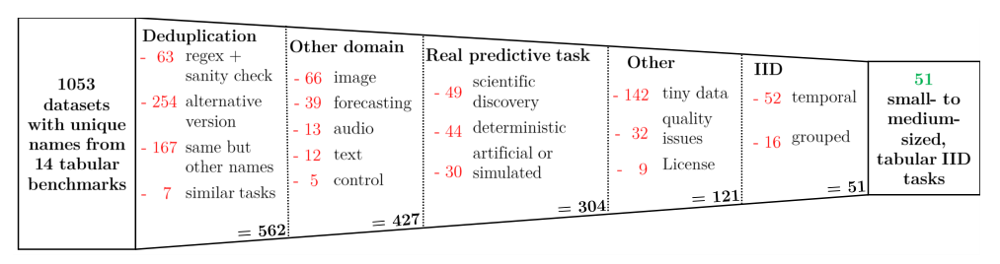
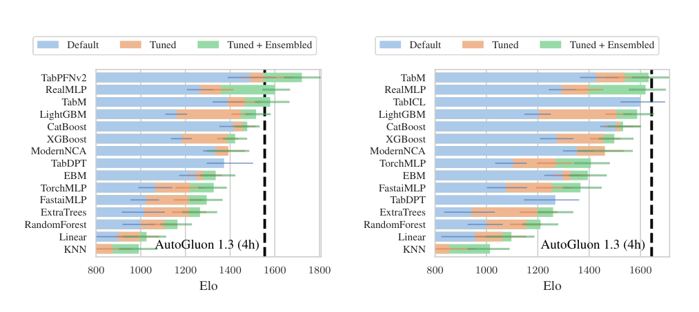
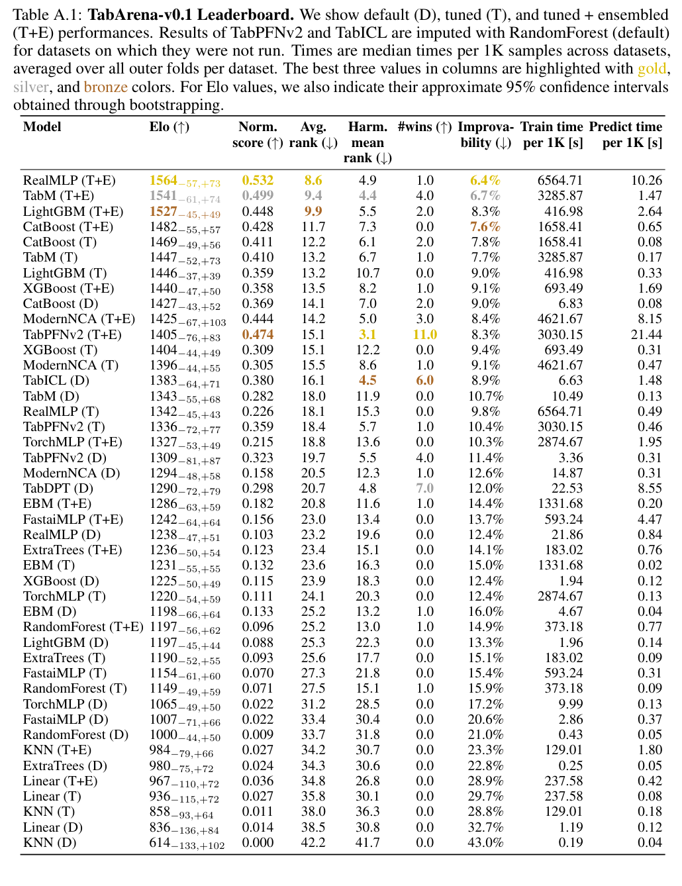
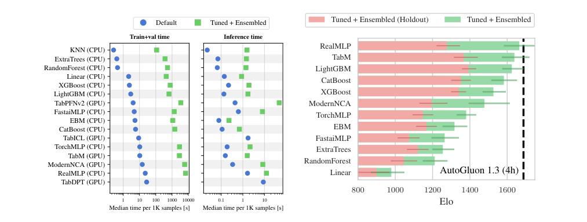
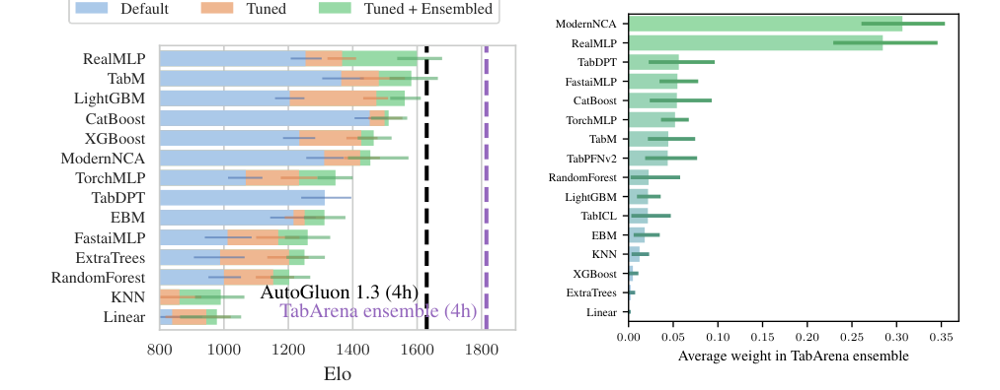

<!-- paper-reading-lang: zh-CN -->
<!-- paper-reading-theme: cobalt -->
# TabArena：把表格模型排行榜变成可维护的测量系统

**原论文**：*TabArena: A Living Benchmark for Machine Learning on Tabular Data*，Erickson等，NeurIPS 2025 Datasets and Benchmarks。依据Zotero `SAZSYEMX` 的66页 **arXiv:2506.16791v4，2025-11-03**。论文分析的是 **TabArena-v0.1** 的冻结结果，不是此刻网站的实时排行榜；后续论文里的TabArena-Lite、模型版本与方法池应分别核对。（PDF pp. 1–2）

TabArena不是新的预测网络，而是一个测量系统：**筛哪些任务、怎样实现基线、如何验证与集成、如何聚合结果，以及发现错误后如何更新**。若只抄第一页谁排第一，会漏掉它最重要的结论——同一个模型是否使用内层交叉验证与跨配置集成，足以改变排行榜；模型单独排名又不等于它在多模型集成中的价值。（PDF §§2–3）

```paper-map
{"thesis":"把数据、模型、验证和版本维护一起定义为基准，才能把模型潜力与评估流程带来的优势分开。","outcome":"从1053个候选数据集人工筛到51个IID预测任务，构建16模型的可复用实验及预测产物；不覆盖所有表格使用场景。","outcomeSource":"PDF §§1–2, Fig. 2","items":[{"number":"01","label":"任务有效性","text":"许可、真实预测、IID、去重与无泄漏处理，优先于单纯堆积数据集数量。","source":"PDF §2.2"},{"number":"02","label":"实现质量","text":"用AutoGluon统一接口和测试，与作者协商模型和搜索空间，避免弱基线。","source":"PDF §2.1"},{"number":"03","label":"两层验证","text":"外层测泛化，内层8折选配置；通常保留8个fold模型做预测平均。","source":"PDF §§2.1–2.3, Appendix C.3"},{"number":"04","label":"三种设置","text":"Default、Tuned、Tuned+Ensembled分别回答默认可用性、配置搜索和跨配置集成。","source":"PDF §3.1"},{"number":"05","label":"多种尺度","text":"Elo看成对胜负，Improvability看误差差距；时间还要拆训练与预测。","source":"PDF §2.3, Appendix A.1"},{"number":"06","label":"持续维护","text":"数据、模型、结果与维护协议一起发布；新版本不能与旧快照的绝对Elo直接拼接。","source":"PDF §2.3, Appendix E"}]}
```

<!-- paper-reading-context:start -->
## 00 / 发表时的研究背景
<!-- context-cutoff: 2025-06-20; basis: first-publication -->

### 当时的领域状态

TabArena于 **2025-06-20首次公开，随后NeurIPS2025发表**。本地是11月v4，因此具体榜单按该冻结版本读；背景则回到2025年上半年：树模型、较强的逐表神经网络和预训练TFM已经同时具有竞争力，但很多“谁最好”的比较仍混用不同数据版本、验证划分、搜索范围和集成方式。基础模型还引入了预训练污染与适用尺寸限制，旧式静态成绩表越来越难维护。（PDF §§1–2；[首发记录](https://arxiv.org/abs/2506.16791)）

一个必要背景是：**评估的对象不是只有网络名字，还包括完整建模流程**。holdout只留一份验证集；嵌套CV把模型选择与外层泛化评估分开；bagging跨训练划分平均；PHE再组合已搜索的多个配置。此前若只给一种模型强集成、另一种只跑单配置，可能把流程差异误记成架构优劣。（PDF §2.1、§3.2）

### 关键前作与尚存缺口

| 工作与时间 | 已有贡献 | 当时未解问题及与本文的关系 | 来源 |
|---|---|---|---|
| OpenML-CC18、AMLB、CTR23等已有公共基准 | 提供共享数据、任务或划分，使研究不必完全依赖作者自选小样本 | 任务原始来源、IID适当性、许可和重复版本仍需人工核查；可下载不等于适合所有表格结论 | PDF §2.2、§4及Table 2 |
| Grinsztajn等（2022）、TabZilla（2023）、TALENT等比较工作 | 扩大模型与数据覆盖，分析预算、数据性质及神经网络/树的差异，公开更多结果 | 不同协议与数据处理仍不完全可比，部分方法版本会过时；需要能修正错误的持续协议 | PDF §§1、4；[TabZilla原摘要](https://arxiv.org/abs/2305.02997) |
| AutoGluon-Tabular（2020）及既有集成实践 | 用多层/多模型组合和工程化流程提升真实建模表现，不只寻找一个最佳配置 | 许多学术benchmark未系统测这种潜力，模型单独名次也不等于对组合系统的价值 | PDF §2.1、§3.2；[原工作摘要](https://arxiv.org/abs/2003.06505) |
| RealMLP（2024）、TabM（2024预印本/2025）等强逐表NN | 表明良好默认、训练与集成能显著提升表格神经方法，而非只有树可用 | 新网络需要强实现和公平验证才能判断，不能沿用旧而弱的NN基线 | PDF Table 1、§3；[RealMLP原摘要](https://arxiv.org/abs/2407.04491) |
| TabPFNv2、TabICL（2025年初）及TabDPT（2024预印本） | 让预训练、上下文预测成为现实竞争者，改变逐表训练独占的格局 | 尺寸、任务类型与预训练数据不同，不能把缺失结果、补齐结果和原生运行混成一个排名 | PDF §2.1、Fig. 4 |

### 本文为何在此时提出

当时的缺口不是再多一套固定数据集，而是缺少把**数据审查、强基线实现、内外层验证、配置集成、结果共享和持续更新**绑在一起的测量基础设施。TabArena因而把benchmark当软件来版本化，既发布排名也保留预测与元数据，让研究者能复查某种选择为何改变结果，并在模型或数据出错时修正。（PDF §§1–3）

“Living”应理解为有维护和贡献协议，不是宣称此前所有基准都无人更新；原文也承认AMLB、TALENT有活跃维护。后来的TabPFN-2.5、TabICLv2和TabPFN-3已经出现在今天的讨论里，却不属于2025年6月的已知结果。本文价值首先是比较方式的升级，不能只用后来榜首证明它当时有必要。（PDF §§4–5）
<!-- paper-reading-context:end -->

## 01 / 筛选测量的到底是什么能力

v0.1聚焦IID、500至250,000训练样本的分类/回归。它暂时排除时间依赖、主体组、分布漂移、极少样本、超大表及其他任务。若医学记录同一个病人的多个时间点被随机切开，测到的就可能是记忆主体而不是预测新病人；因此“IID是否适当”是任务层面的判断，不能只看一张矩形CSV。（PDF §1 Focus Statement, §2.2；例子为阅读者说明）

人工筛选包括：数据与任务去重、真实预测来源、非图像/音频直接展平、非确定性规则、合适规模、无不可逆泄漏的版本、允许科学使用的许可、可公开下载与明显伦理问题。这里的代表性依赖其定义，不是所有行业任务的概率抽样。（PDF §2.2, Appendix B）

原Fig.2从左至右给出1053个候选到51个任务的过滤。请读每一步剔除的原因，而不是把“数据集越多越好”当作质量指标；去重后的另一版本、时间任务与不合适许可都不能被当作额外独立证据。（PDF p. 5, Fig. 2）



*原论文 Fig. 2，PDF p. 5。人工任务判断与可自动执行的尺寸/去重过滤是不同步骤。*

## 02 / 一张表上的内外层数据流

外层训练/测试负责估计最终泛化。小于2,500样本时用10次重复3折外层CV，其他任务用3次重复3折；每个外层训练部分再做8折内层CV。选择参数、早停与集成权重不能触碰外层测试标签。（PDF §2.3, Table 2）

```paper-path
{"title":"由候选配置到一次外层测试预测","stages":[{"title":"锁住外层测试","role":"测泛化","action":"生成重复的外层训练/测试划分，分类按类别分层。","why":"让最终指标来自未参与选择的样本。","output":"当前外层训练集与独立测试集","source":"PDF §2.3"},{"title":"在训练集做8折","role":"选配置","action":"每个配置训练8个fold模型，收集out-of-fold预测并计算选择指标。","why":"避免单个holdout过小或幸运划分改变选择。","cost":"明显增加建模成本，不能与单模型训练价直接比较。","output":"配置分数、OOF预测及fold模型","source":"PDF §2.1, Appendix C.3"},{"title":"选择或组合配置","role":"建模决策","action":"Tuned选最佳配置；Tuned+Ensembled用OOF预测做40步greedy ensemble selection。","why":"利用多个配置误差的互补性，而不是丢掉全部非冠军配置。","output":"稀疏非负且和为1的权重","source":"PDF Appendix C.4"},{"title":"只在最后测一次","role":"外层评估","action":"平均fold模型预测，再按配置权重组合，对外层测试计分。","why":"用同样的数据边界对比完整预测流程。","cost":"预测要跑多个fold及配置，延迟随保留成员增加。","output":"此dataset/fold的预测、指标与耗时","source":"PDF Appendices C.3–C.4"}]}
```

**重要例外**：TFM根据作者建议在训练+验证数据上refit上下文，不套8fold模型平均。TabICL与TabDPT在本版只评默认，因为当时原实现没有提供明确HPO协议。其他可调模型使用1默认+200随机配置；每配置每训练split限1小时。不要把“200配置搜索”和“给所有模型同样秒数”混为一谈。（PDF §2.1）

### 两种集成是两层，而不是一个词

对于配置 $c$，8fold预测先做：

$$
\bar f_c(x)=\frac18\sum_{k=1}^{8}f_{c,k}(x).
$$

再跨配置组合：

$$
\widehat f(x)=\sum_cw_c\bar f_c(x),\qquad w_c\ge0,\quad\sum_cw_c=1.
$$

这是对附录算法的说明性记号。前者是bagging式的交叉验证集成，后者是PHE；Tuned也通常保留前者。因此“单个模型家族”并不意味着只运行一个已拟合的神经网络。（PDF Appendix C.3–C.4）

**说明性例子**：两个配置权重0.75、0.25，每配置保留8个fold模型，预测时最多需要16个成员，而不是2个；权重为零者可以剪掉。模型类型仍只有一个家族，但服务成本不同。（PDF Appendix C.4；例子为阅读者构造）

## 03 / Elo、差距与可复用结果

二分类用ROC AUC，多分类用log-loss，回归用RMSE。Elo通过成对胜/平/负把异构任务放到共同尺度：

$$
P(A\text{胜}B)=\frac{1}{1+10^{(R_B-R_A)/400}}.
$$

默认RandomForest锚定1000。**说明性代入**：高400分对应 $10/11\approx90.9\%$ 的模型化胜率，不是准确率91%，也不是未来任意新任务的保证。对换一套模型池或数据集后重新拟合的Elo，不能把绝对值当作共同量尺。（PDF §2.3, Appendix D.1）

Improvability则衡量离逐数据集oracle最好方法还差多少：

$$
I(m)=\frac1{|\mathcal D|}\sum_{d\in\mathcal D}\left(1-\frac{e_d^*}{e_{d,m}}\right),\qquad e_d^*=\min_a e_{d,a}.
$$

越低越好。误差0.10而oracle0.08时，该任务的可改进空间是20%，不是准确率下降20个百分点。Elo只看谁赢，$I$看差多少；两种聚合可能产生不同排序，所以论文保存原始预测与指标，允许用户检查和重排。（PDF §2.3, Appendix A.1；算例为阅读者构造）

置信区间通过对数据集bootstrap得到，主文/附录主要描述200轮；另一随机性段落提到100轮。本解读不把这种轮数描述差异解读成新的实验。其区间刻画任务集合的不确定性，也不能替代数据污染审计。（PDF Appendix D.1–D.2）

## 04 / 结果为什么随协议变化

原Fig.4左边只评TabPFNv2适用的33个任务，右边是TabICL适用的36个分类任务。必须先看这两个分母：小表TFM优势不能与全部51任务、含回归的结果不加限制地比较。跨全表补齐时，论文以默认RandomForest替代不适用位置，并明确标注imputed。（PDF p. 7, Fig. 4；Appendix A.1）



*原论文 Fig. 4，PDF p. 7。子集结果是真实适用范围内的比较；不是每个模型都在全部51表原生运行。*

全表、含补齐的Table A.1给出可读数值。下表摘录关键行，时间为跨表**每1,000样本的中位数**，不是单次查询延迟，也不是相同硬件下每秒吞吐。原表保留bootstrap区间。（PDF p. 31, Table A.1）

| 配置 | Elo ↑ | Improvability ↓ | 建模秒/1K | 预测秒/1K |
|---|---:|---:|---:|---:|
| RealMLP T+E | 1564 | 6.4% | 6564.71 | 10.26 |
| TabM T+E | 1541 | 6.7% | 3285.87 | 1.47 |
| LightGBM T+E | 1527 | 8.3% | 416.98 | 2.64 |
| CatBoost T+E | 1482 | 7.6% | 1658.41 | 0.65 |
| CatBoost Tuned | 1469 | 7.8% | 1658.41 | 0.08 |
| CatBoost Default | 1427 | 9.0% | 6.83 | 0.08 |
| RealMLP Tuned | 1342 | 9.8% | 6564.71 | 0.49 |
| TabPFNv2 Default（部分补齐） | 1309 | 11.4% | 3.36 | 0.31 |

最直接的机制例子是RealMLP：相同搜索产物，Tuned到T+E的Elo从1342到1564，预测成本从0.49到10.26 s/1K；这不是网络结构变了。LightGBM也能从同类集成获益，所以“集成让深度学习赢”不等于只给NN增加预算。（PDF Table A.1）

阅读完整Table A.1时，先找各模型后缀D/T/T+E，再看是否部分补齐和时间列。同一家族三行代表不同部署系统，低者更好的列与高者更好的列也不能混读。（PDF p. 31）



*原论文 Table A.1，PDF p. 31。绝对Elo依赖这一模型池，不与后续版本直接拼榜。*

## 05 / 验证和集成是实验对象，不是背景装饰

Fig.6左侧分开建模/验证与预测耗时；右侧在相同的Tuned+Ensembled框架内比较holdout与cross-validation。请先看同一行的粉/绿差异，而不是把右边仅解释成模型家族的排名。（PDF p. 8, Fig. 6）



*原论文 Fig. 6，PDF p. 8。验证设计能系统性改变测到的峰值能力，集成还带来预测成本。*

```paper-experiments
{"title":"四项结论各自测量什么","rows":[{"question":"谁在强搜索与集成后更强？","setup":"51任务、16模型，默认/选最佳配置/PHE，TFM按适用范围子集或标注补齐。","observation":"强NN如RealMLP、TabM的集成很强，传统调参设置下CatBoost依然突出。","conclusion":"模型与验证/集成协议一起决定结果，不能还原成永久的树对NN二选一。","source":"PDF §3.1, Fig. 1, Table A.1"},{"question":"TFM适合什么任务？","setup":"分别限制TabPFNv2与TabICL兼容任务，比较同一协议。","observation":"TabPFNv2在兼容小表子集上很强，调参/PHE可进一步提高。","conclusion":"是其适用范围内的证据，不能用补齐后的全表成绩反推原生能力。","source":"PDF Fig. 4, Appendix A.1"},{"question":"是否值得用更多计算？","setup":"性能差距与建模/预测时间画Pareto前沿；不同数量配置做集成。","observation":"树在有限建模预算和低推理延迟上强，NN大集成需要更高预测成本。","conclusion":"峰值精度和部署效率是不同目标。","source":"PDF Figs. 5–6"},{"question":"排名较低的模型是否无价值？","setup":"从保存预测模拟跨家族集成，portfolio用leave-one-dataset-out构造。","observation":"跨模型集成超过单家族；最高权重模型未必单独最强。","conclusion":"误差互补与验证过拟合都可能影响权重，不把权重当因果贡献或科学真值。","source":"PDF Fig. 7, Appendices C.5/A.6"}]}
```

原Fig.7左边比较模拟的全模型集成，右边是平均权重。ModernNCA等高权重不能直接等价为“最可靠”：作者发现验证过拟合可能让某些模型被过度选择。需要同时检查独立外层测试与验证差距。（PDF p. 9, Fig. 7）



*原论文 Fig. 7，PDF p. 9。左侧集成为保存结果上的模拟；右侧权重不是单模型精度排行。*

## 06 / “活基准”的核心是可纠错

共享预测可以廉价重算指标、模拟组合；维护协议使发现泄漏、错误版本或弱实现后能修正。TabArena-Lite保留任务，但减少外层fold，而不是换成随意挑的简单表。它适合研究迭代，完整基准再检查稳定性。（PDF §3.2, Appendix A.4/E）

**作者主张**是把基准作为需要版本化、持续维护的软件。**测量支持**是数据审查、受控实现和验证/集成对结果的可观察影响。**阅读者综合**：可靠排行榜的单位不是“算法名字”，而是任务版本、训练协议、配置集合和部署形式的组合。即便一个模型在此版本胜出，也不能省略其预算、兼容范围、预训练污染风险与集成成本。（PDF §§2–5）

<!-- 可视化决策：这是基准系统论文，主图展示数据筛选和内外层验证，不伪造网络架构；静态原图及配置成本表便于同时对照分母、预算和指标，交互排序会隐藏原始协议差异，因此未添加。 -->
<!-- 覆盖：正文、Appendix A.1/A.4/A.6、B筛选、C.3–C.5、D.1–D.2与E维护协议相关部分；本页排名均为v0.1冻结快照，不声称执行了2500万模型的复现实验。 -->
