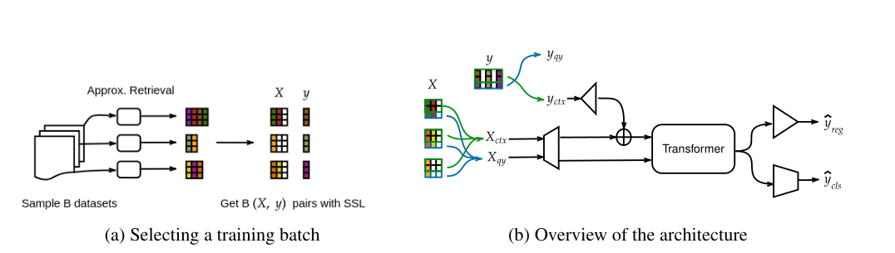
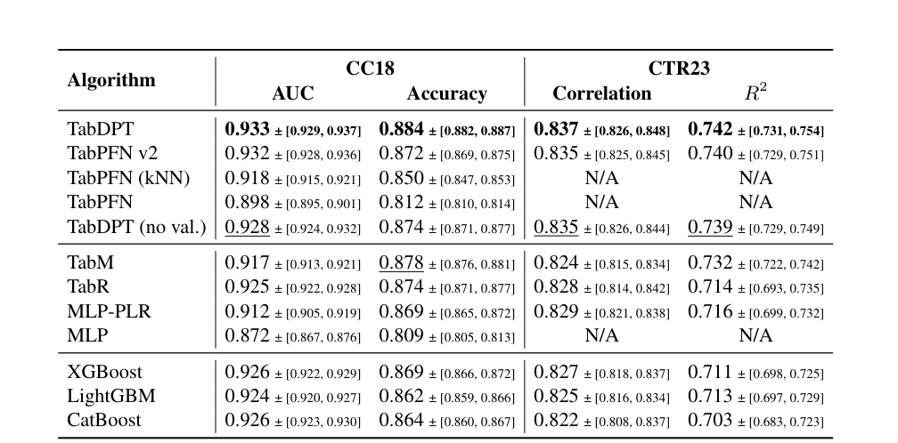
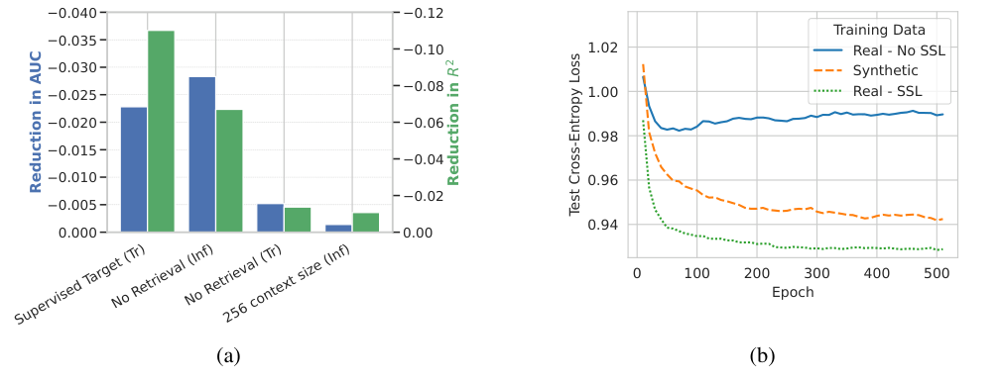
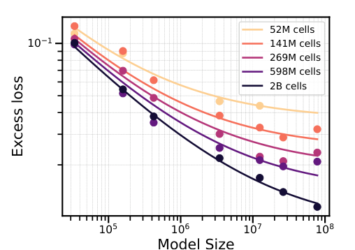

<!-- paper-reading-lang: zh-CN -->
<!-- paper-reading-theme: saffron -->
# TabDPT：用真实表的自监督任务预训练通用预测器

**原论文**：*TabDPT: Scaling Tabular Foundation Models on Real Data*，Junwei Ma、Valentin Thomas 等。Zotero 条目 `V7LZ2JEQ` 的本地 PDF 共 31 页，首页标为 NeurIPS 2025，PDF 元数据创建于 2026-01-15；正文还引用截至 2026-01-14 的外部排行榜。因此这里是含后续更新的本地版本，不能按条目日期 2026-04-23 推断论文首发时间，也不能把该排行榜叙述当作今天的实时结果。（PDF pp. 1–2）

TabDPT 要验证一条与纯合成先验不同的路线：**能否从相对有限的真实表格中，挖出足够多的预测任务，预训练一个面对新表不必再更新参数的模型？** 核心组合是随机目标列自监督、局部上下文检索、行 token Transformer，以及预训练和部署时一致的局部问题形式。它继承了局部 ICL 的想法，却把这种任务构造提前到跨表预训练，而不是只在每张新表上做微调。（PDF §§1, 3）

```paper-map
{"thesis":"把真实表中的不同列轮流变成监督目标，再在近邻上下文中学习预测，使跨表预训练既可扩充任务也匹配局部部署。","outcome":"在CC18分类、CTR23回归上获得强预测质量；数据和模型扩展的经验幂律支持继续投入，但不证明任意规模外推。","outcomeSource":"PDF §§4.3–4.5","items":[{"number":"01","label":"数据难题","text":"只预测每张真实表原有的一个标签，任务太少且容易过拟合。","source":"PDF §3.2"},{"number":"02","label":"自监督扩充","text":"随机选目标列、去除它，再打乱和丢弃部分输入列，构成分类或回归子任务。","source":"PDF §3.2, Appendix D"},{"number":"03","label":"局部任务","text":"预训练和部署都用相似行作上下文，避免让有限上下文随机浪费在不相关行上。","source":"PDF §§3.3–3.4"},{"number":"04","label":"共享网络","text":"一行一个token，不用行位置编码；同一backbone搭分类与回归两个head。","source":"PDF §3.1"},{"number":"05","label":"扩展证据","text":"从33K至78M参数、52M至2B cells观察到联合幂律，拟合指数0.42与0.39。","source":"PDF §4.5, Eq. 2"},{"number":"06","label":"协议边界","text":"默认TFM可并回validation；no-val变体必须单独看，原始数据去重为作者报告而非本次重新审计。","source":"PDF §4.3, Appendix B.1"}]}
```

<!-- paper-reading-context:start -->
## 00 / 发表时的研究背景
<!-- context-cutoff: 2024-10-23; basis: first-publication -->

### 当时的领域状态

TabDPT **2024-10-23首发，NeurIPS2025发表**，本地文件还含2026年1月更新。其最初问题应放回2024年：表格ICL已经显示潜力，但成功的原生模型主要依靠人工设计的合成任务先验；与此同时，公开真实表不少，却往往一表只有一个业务标签，直接拿少量任务反复监督训练容易过拟合。图像/语言里“更多真实数据推动预训练”的经验，还不能直接搬到异构表格上。（PDF §§1–3；[首发及修订记录](https://arxiv.org/abs/2410.18164)）

这里需区分**逐任务自监督**与**跨表预训练**：前者可以利用当前表无标签行，但换表后未必免重新训练；后者希望同一套参数到了新表，只换有标签context就能预测。本文关心的是怎样从真实表构造足够多的可迁移任务，而非再给一张表加一个常规预训练阶段。（PDF §2, Tabular Self-supervised Learning）

### 关键前作与尚存缺口

| 工作与时间 | 已有贡献 | 当时未解问题及与本文的关系 | 来源 |
|---|---|---|---|
| PFN与TabPFN第一代（2021–2023） | 用任务先验采样把学习算法摊销进固定网络，建立表格ICL的原生接口 | 合成生成器能否覆盖真实表的复杂性、如何持续扩充有用任务仍是问题 | PDF §§1–2；[PFN](https://arxiv.org/abs/2112.10510)、[TabPFN](https://arxiv.org/abs/2207.01848) |
| STUNT等表格自监督/少样本路线（2023） | 从无标签表里生成辅助任务，利用列间关系帮助标注少的任务 | 在当前表或任务族有效，不等于已有一个无需新表训练的广覆盖通用预测器 | PDF §2、§4.6及STUNT引文 |
| LoCalPFN（2024） | 用query近邻形成局部context，并联合微调改善大表与复杂度扩展 | 每张目标表仍需微调；TabDPT把局部任务对齐前移到通用预训练，尝试部署只做前向 | PDF §3.3–3.4及Thomas等引文；[原工作](https://arxiv.org/abs/2406.05207) |
| 用LLM或跨表表示学习处理表格的同期路线（2023–2024） | 表格序列化、真实表预训练和共享表征，使跨数据集迁移成为实际研究方向 | 数值文本化受token/context效率限制，不少方法仍要任务特定拟合；本文选择紧凑行token与真实表SSL | PDF §2及Hegselmann/Gardner等引文 |

### 本文为何在此时提出

作者的突破口是让一张真实表不再只有一个任务：随机指定目标列、删掉该输入列，再改变输入子集、分类/回归形式和局部邻域，得到许多条件预测问题。结合行级编码和训练/部署一致的检索context，就有机会同时缓解**真实任务数量少**与**有限context利用低效**两个瓶颈。文中的扩展规律实验进一步询问：此路线是否会随着真实数据和参数增加持续受益，而不只是一个小benchmark上的技巧。（PDF §§3–4.5）

**修订环境另列**：本地2026年文件出现的TabPFNv2、TabICL与TabPFN-2.5等对比，不全是2024年10月首发时已公开的工作；它们说明后来的对比环境，不证明作者最初是在回应这些后发模型。这里复原的是原始问题背景，后文精确实验仍按本地PDF版本解释，不能假定v1已经包含全部新结果。
<!-- paper-reading-context:end -->

## 01 / 为什么自监督不仅是补几个缺失值

一张表 $D=\{X,y\}$ 往往只有一个原始标签 $y$。如果只有百余张表，监督任务数量远小于语言预训练中的文本变化。TabDPT 随机把一个有足够不同值的列 $c$ 设为目标，输入变为 $X_{\setminus c}$。连续目标可标准化用于回归，或随机分箱用于分类；离散目标则用于分类。之后还随机选输入列子集并打乱列次序，让同一目标需要在不同信息条件下被预测。（PDF §3.2, Appendix D）

**设计理由**：模型不应记住“第七列总是标签”，也不应只掌握每张表的原始业务任务。轮换目标扩大可学习的列间关系；列子集进一步产生多种条件分布，组合数远多于单纯每列预测一次。这里是可构造任务数的组合式增长，不意味着这些任务在统计上独立，更不等于凭空获得同样数量的新真实样本。（PDF §3.2；最后一句为阅读者推断）

**说明性算例**：一张有年龄、收入、地区和风险的表，不仅能用前三列预测风险，也可以暂时用年龄、地区预测收入，或用收入、风险预测地区。目标列必须从输入移除，否则模型学到的是复制答案。这个例子用于解释任务形式，不是论文实验数据。（PDF §3.2, Appendix D）

## 02 / 从真实表构造局部训练批次

原论文 Fig. 2 左侧把多张表变成一个 batch；右侧将行分成 context 与 query，context 的特征嵌入和目标嵌入相加，query 只携带特征。注意图中的两条输出是分类/回归 head，不是对同一个查询强行同时产生两个监督标签。（PDF p. 5, Fig. 2）



*原论文 Fig. 2，PDF p. 5。SSL产生子任务，局部检索构造上下文，损失只作用于查询目标。*

```paper-path
{"title":"预训练与部署如何在同一种局部问题上对齐","stages":[{"title":"挑表与临时目标","role":"预训练","action":"从训练表集合抽一张，随机挑目标列c，选分类或回归并处理目标。","why":"不局限于原标签，尽量利用每张真实表中的关系。","cost":"真实表的覆盖与重复问题仍是数据质量约束。","output":"输入列X去c和临时目标y","source":"PDF §3.2, Algorithm 1"},{"title":"形成局部子表","role":"预训练","action":"围绕随机查询行取相似行，随机划分上下文与查询，再做输入列子采样。","why":"学习部署时会遇到的局部任务，控制上下文规模而不是随整表无限增长。","cost":"训练用共享局部集合近似多个查询各自的精确近邻。","output":"一组局部上下文和多个查询","source":"PDF §3.3, Appendix D"},{"title":"行编码并更新","role":"预训练","action":"context的特征与标签编码相加；query读context；对相应任务head的查询损失反传。","why":"固定长度行表示节省cell级表示的开销，共享backbone利用两类任务。","output":"能处理新表的固定参数模型","source":"PDF Eqs. 1, Appendix C/D"},{"title":"在新表做近邻ICL","role":"部署","action":"每条测试行仅从新表训练集检索近邻，组装上下文并前向，不再更新参数。","why":"让表格知识通过上下文适应，而不是对每张表重新调参和拟合。","cost":"检索和多次局部前向仍有服务延迟。","output":"分类概率或回归预测","source":"PDF §3.4, §4.7"}]}
```

训练输入在 Eq. 1 中写为：

$$
\widehat y_{\mathrm{qy}}=\mathrm{Transformer}_\theta\left([\phi_x(X_{\mathrm{ctx}})+\phi_y(y_{\mathrm{ctx}}),\ \phi_x(X_{\mathrm{qy}})]\right).
$$

$\phi_x$ 是行特征映射，$\phi_y$ 是标签映射；加号是逐元素相加，方括号表示上下文与查询序列的拼接及相应掩码，不是把标签作为查询的已知输入。context 彼此可见，query 只能读取 context，context 不读取 query。（PDF p. 5, Eq. 1）

分类查询使用交叉熵、回归查询使用 MSE，附录伪代码如此说明；后面 scaling 图定义的混合评估损失又使用 CE 与 $1-\rho$，两者不能不加说明当成同一个训练目标。（PDF Appendix D, Code Block 2；§4.5）

检索在预处理后的特征空间通过 FAISS 完成。列先编码为数值并标准化，极值裁剪到 10 个标准差范围；取到局部 context 后还会局部标准化，回归标签也如此处理。预训练代码会将临时目标从查询检索表示中掩去，输入再删除目标列；不能按知道答案后的距离选择上下文。（PDF Appendix C.1, D）

## 03 / 行 token 的效率与硬上限

TabDPT 不将每个 cell 甚至每个数字字符变成 token。一整行映射到一条隐藏向量，因此长度由行数控制；没有行位置编码，训练行次序不应产生自然语言那样的语义差异。它放弃了显式 cell 级的可变列结构，换取更宽的行表示和更低内存。（PDF §3.1）

主配置为 78M 参数、16 层、隐藏宽度 768、4 个注意力头；训练使用 batch 256，context/query 长度配置各为 1,024，调度自由 AdamW、学习率 $5\times10^{-4}$、weight decay 0.05、label smoothing 0.1；主实验推理用 2,048 context 与 8 路集成。训练配置和推理 context 数不能混为一个数。（PDF §4.2–4.3, Appendix C, Tables C.1–C.2）

### 特征与类别超上限时怎么办

- **特征**：$F_{\max}=100$。较少列补齐，较多列用 PCA 降到上限。PCA 保留高方差方向，不保证保留最有预测力的小方差方向；这就是用固定行编码换效率的统计代价。（PDF §3.4；后一限定为阅读者推断）
- **类别**：$C_{\max}=10$。作者把类别索引写成以 10 为基数的数位，分别预测各数位，将所需任务数压到 $\lceil\log_{10}C\rceil$。例如 25 类需要两个数位任务，而非 25 个 one-vs-rest。它不同于 TabICL 的条件层级分类；原文这一段没有完整说明组合概率、非法数位组合及归一化细节，因此本页不杜撰其为严格的联合概率分解。（PDF §3.4）

缺失值在归一化后填 0，也就是均值填补。作者尝试额外 missing mask、复杂标签嵌入和 cell token 等方案并未改善其训练设置；这些“Bitter Lessons”是特定实验经验，不能用来否定别的模型里同类设计的价值。（PDF Appendix A, C.1）

## 04 / 真实数据的规模与污染控制

训练语料为 123 个 OpenML 表，共约 32M 行、2B cells，覆盖金融、医学、生物、工业等。论文用 cell 数度量数据量，因为不同列数的行不是等价的信息单位；它不等同于 transformer 的 token 数。附录列出 93 张原标签为分类、29 张为回归、1 张无默认标签，但每张表都可通过 SSL 产生两类任务。（PDF §4.1, Appendix B）

**作者报告**：对训练与评估表比较名字、文件哈希、行列数、目标统计、逐列均值/方差/偏度/峰度和单变量拟合，再对相似表人工检查并从训练中去除相关数据。这比仅比较名称更严格。**核验范围**：本次阅读核验的是论文描述及清单，不是重新下载全部 OpenML 原始表执行去重；不能把作者的污染检查声明升级为本次独立证明“绝无泄漏”。（PDF Appendix B.1）

真实与合成的比较也有具体分母：论文用其架构与训练过程，对比开放的 TabPFN 第一代合成生成器，并不是用同预算重做所有未公开生成器。因而证据可以说明“真实数据+该 SSL 在当前比较中更好”，不能证明“真实数据普遍优于任何合成数据”。（PDF §4.4, Fig. 4b）

## 05 / 107 个评估集，必须分开看是否使用验证数据

评估来自 CC18 的 72 个分类集与 CTR23 的 35 个回归集，合计 107。每种方法至少两个划分，95% bootstrap 置信区间。TabDPT 与部分 TFM 不需要为每张表搜索参数，主版本将 validation 并入 context；若传统基线把 validation 留作调参而不 refit，这就有可用训练行数差异。作者提供 `no val.` 版本用于对照。（PDF §§4.1–4.3）

看原论文 Table 1 时，先找 TabDPT 与 TabDPT(no val.) 两行，再看下方 TabM 的分类准确率。前者的 0.884 领先，后者降到 0.874，而 TabM 为 0.878。因此“TabDPT 显著胜出”需要附带这个评估设置，不能忽略额外上下文。（PDF p. 7, Table 1）



*原论文 Table 1，PDF p. 7。四项指标都为高者更好；no val. 表示不把验证集并入训练上下文。*

| 方法 | CC18 AUC ↑ | CC18 Accuracy ↑ | CTR23 相关系数 ↑ | CTR23 R² ↑ |
|---|---:|---:|---:|---:|
| TabDPT | 0.933 | 0.884 | 0.837 | 0.742 |
| TabPFN v2 | 0.932 | 0.872 | 0.835 | 0.740 |
| TabPFN(kNN) | 0.918 | 0.850 | 不适用 | 不适用 |
| TabPFN 第一代 | 0.898 | 0.812 | 不适用 | 不适用 |
| TabDPT(no val.) | 0.928 | 0.874 | 0.835 | 0.739 |
| TabM | 0.917 | 0.878 | 0.824 | 0.732 |
| TabR | 0.925 | 0.874 | 0.828 | 0.714 |
| MLP-PLR | 0.912 | 0.869 | 0.829 | 0.716 |
| MLP | 0.872 | 0.809 | 不适用 | 不适用 |
| XGBoost | 0.926 | 0.869 | 0.827 | 0.711 |
| LightGBM | 0.924 | 0.862 | 0.825 | 0.713 |
| CatBoost | 0.926 | 0.864 | 0.822 | 0.703 |

表中为中心值，原图保留完整区间。TabDPT 相对 TabPFNv2 的分类 Accuracy 为 1.2 个百分点差异，但回归 R² 仅 0.002，区间明显重叠；不能把四个中心值都略高解读为每个指标都统计显著。论文还用数据集级胜率、Elo/Glicko 与临界差异图检查，解释范围仍受同一协议限制。（PDF Table 1, Fig. 3a, Appendices E/G）

## 06 / 哪个组件起作用

Fig. 4a 左图的条不是各方法完整准确率，而是移除组件后的下降，蓝轴 AUC、绿轴 R²，两个轴的尺度不同。先比较 “Supervised Target(Tr)” 与 “No Retrieval(Tr/Inf)” 标签，再看右侧曲线：没有 SSL 的真实数据训练很早过拟合，真实+SSL 的曲线继续下降。不要把图中两种颜色的条高直接相减。（PDF p. 8, Fig. 4）



*原论文 Fig. 4，PDF p. 8。Tr是预训练，Inf是部署；右侧比较指定架构和数据生成方案，不是所有真实/合成训练的定理。*

```paper-experiments
{"title":"主要结论各自依靠哪项对照","rows":[{"question":"真实表SSL是否抑制过拟合？","setup":"预训练仅原始监督目标对比随机列SSL，跟踪CC18 test CE；训练可延至1024 epochs验证饱和。","observation":"无SSL约50 epochs后过拟合；SSL在500 epochs附近仍保持更低损失。","conclusion":"支持多目标任务扩充有效，不仅是换了一个更大的Transformer。","source":"PDF §4.4, Fig. 4b"},{"question":"局部检索应该只在部署加吗？","setup":"预训练无检索、部署无检索分别消融，与完整流程比较AUC和R²下降。","observation":"移除训练检索会下降；移除部署检索也明显下降。","conclusion":"支持训练和部署问题形式对齐；各条不是可相加的独立贡献。","source":"PDF §4.4, Fig. 4a"},{"question":"真实数据比什么合成数据更好？","setup":"相同TabDPT训练方案，对比真实+SSL和TabPFN第一代开放合成生成器，等训练进展观察。","observation":"真实+SSL收敛更快、最终test CE更低。","conclusion":"支持此生成器/架构/预算内的结论，不覆盖未公开生成器或其他合成先验。","source":"PDF §4.4, Fig. 4b"},{"question":"只有少量标签时能适应吗？","setup":"7个CC18数据集，每类10个标签，其他训练行无标签；先产生伪标签再加入高置信度上下文，50 seeds。","observation":"TabDPT(semi)平均准确率77.56%，STUNT为76.76%，5/7个数据集更好。","conclusion":"支持特定半监督扩展；不是只看10条总样本的纯监督few-shot结果。","source":"PDF §4.6, Table 2"},{"question":"大模型和更多数据是否值得？","setup":"33K–78M参数，52M–2B cells，真实数据预训练，拟合联合幂律。","observation":"参数指数0.42、数据指数0.39，拟合范围内均有稳定改善。","conclusion":"是经验规律与投入依据，不保证范围外或新数据分布继续服从相同指数。","source":"PDF §4.5, Eq. 2, Fig. 1"}]}
```

## 07 / 经验 scaling law 的含义

论文采用联合拟合：

$$
\widehat\ell(P,D)=AP^{-\alpha}+BD^{-\beta}+E,\qquad \alpha=0.42,\quad\beta=0.39.
$$

$P$ 是参数量，$D$ 是训练数据 cells 总数，$A,B$ 是比例系数，$E$ 是拟合的不可约项。图的纵轴是 $\widehat\ell-E$，而不是原始 loss；混合任务指标取分类 CE 与回归 $1-\rho$ 的均值，所以也不能将其当作单一分类 AUC。（PDF §4.5, Eq. 2）

**说明性推演**：在该拟合成立且其他条件不变时，仅数据项因数据翻倍缩为 $2^{-0.39}\approx0.763$，即该项约下降 23.7%；这不是“总测试误差下降23.7%”，因为参数项和 $E$ 仍在，也不是实际新实验。更大模型只有在数据量相应足够时才能发挥作用；反之数据项变小以后参数项会主导。（PDF Eq. 2；数值为阅读者代入公式计算）

原论文 Fig. 1 每条线固定一个数据规模，横轴增加模型参数，实点为实验、曲线为幂律拟合。应该同时观察“沿一条线变大”和“换到更多数据的线”，才看得到双重瓶颈；曲线平滑不能证明未知更大规模的结果已经测过。（PDF p. 1, Fig. 1）



*原论文 Fig. 1，PDF p. 1。纵轴为去掉拟合常数E后的excess loss，对数坐标下展示经验趋势。*

## 08 / 迁移成本被提前，而不是消失

运行时间实验对 TFM 计检索与前向，对传统方法计 HPO+训练+预测；在约 2M 行上折算每 1,000 行的耗时。此口径下主模型至少比逐任务基线快一个数量级，但不计跨表预训练。若固定树模型已训练好，其纯推理约 0.02–0.10 s/1,000 行，往往比 TabDPT 更快。论文明确把这两种部署情境分开，不能用建模加速宣传替代服务吞吐比较。（PDF §4.7）

整篇论文的依赖链是：**真实表规模有限 → 随机列SSL扩大任务 → 局部上下文对齐训练与部署 → 参数与数据共同扩展带来稳定收益**。SSL 与检索不是装饰性附加模块，而是在数据少、上下文有限的情况下，使跨表预训练持续有效的机制。（PDF §§3–4.5）

与此同时，它仍假设矩形表的行大体可按 i.i.d. 处理，缺少显式时间、分布漂移与层级结构建模；固定列数编码、PCA 和局部距离也会引入偏差。结果支持真实表预训练是一条可扩展且开放的路线，不支持“无需关注数据泄漏、列语义与任务结构”的更强结论。（PDF §5, Appendices A/B/C）

<!-- 可视化决策：预训练与部署的局部任务对齐可由原Fig.2和阶段图同时解释；数位分类策略原文细节不全，不制作可能暗示虚构概率流程的交互。scaling用公式代入与原图并排更便于比较，因此采用静态视图。 -->
<!-- 来源覆盖：已读取正文、Appendix A失败设计、B训练数据与污染分析、C模型/检索/预处理、D训练伪代码、E评级与F/G分层结果及检验。排行榜是PDF中冻结的2026-01-14作者陈述，本解读不以其为当前排名结论。 -->
