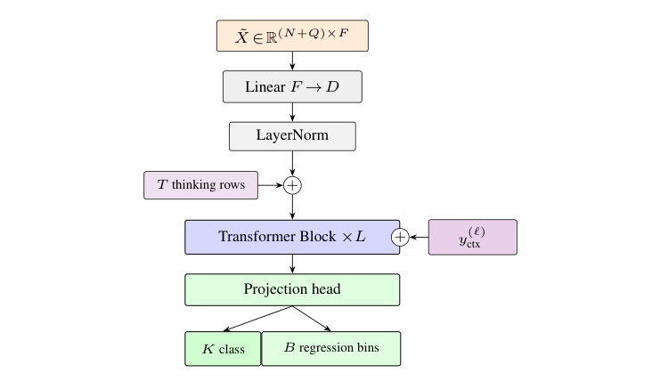
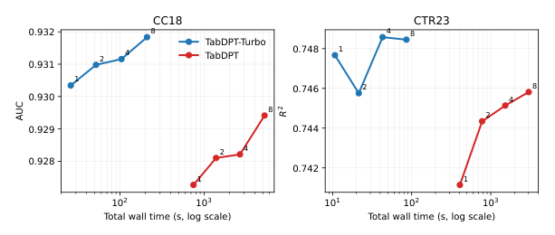
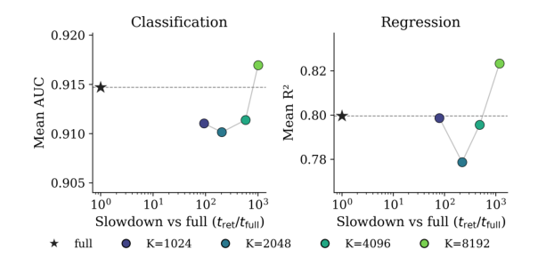
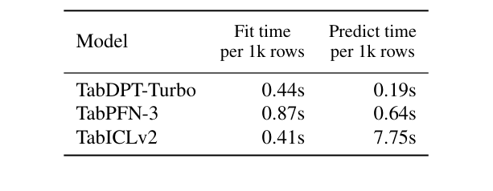

<!-- paper-reading-lang: zh-CN -->
<!-- paper-reading-theme: cobalt -->
# TabDPT-Turbo：用共享长上下文替代逐查询检索

**原论文**：*TabDPT-Turbo: Efficient In-Context Learning for Tabular Prediction*，Hosseinzadeh、Labach、Xue、Han、Thomas、Caterini。依据Zotero主条目 `DFAGC498` 的9页 **arXiv:2608.01400v2，2026-08-25**，附件 `FMN7AKYM`。本版本发布为TabDPT v1.2，与上一份TabDPT解读中的旧模型不是同一checkpoint。（PDF p. 1）

本页按新版13问重构，检索截至 **2026-10-26**。另核实官方软件 **v1.2.0在2026-06-17已公开发布**，因此“8月arXiv首发”不能再写成Turbo最早公开时间。原文结果、其他文献、合理推断及未执行提案分别标明。

这篇论文把TabDPT原先的选择反转过来：**当模型真正学会长上下文后，还需要为每个查询重新检索并处理一张局部表吗？** Turbo保留行token和真实表自监督，取消检索，使一批查询共享一次完整context计算；同时扩充训练数据、修改attention和回归目标。速度优势来自计算共享，不是简单把近邻搜索库优化了一下。（PDF §§1–3）

```paper-map
{"thesis":"用长上下文预训练和共享context避免重复局部前向，在接近前沿精度的同时优化建模与预测效率。","outcome":"同硬件、8次前向的TabArena-Lite测试中，Turbo fit/predict分别0.44/0.19秒每1K行；它不是宣称纯精度第一。","outcomeSource":"PDF §4, Table 1","items":[{"number":"01","label":"旧瓶颈","text":"逐query近邻产生不同context，使昂贵Transformer上下文处理无法充分共享。","source":"PDF §§1–2"},{"number":"02","label":"数据","text":"真实表从112扩到1445，保留随机目标列SSL，并对CC18/CTR23/TabArena去重。","source":"PDF §3.1, Table 2"},{"number":"03","label":"长context","text":"预训练最长32K行，部署测试至100K共享context，不构建kNN索引。","source":"PDF §§3.1, 3.4"},{"number":"04","label":"结构","text":"32层行Transformer，64个thinking rows，逐层将目标注入V流，Q/K标准化与门控attention。","source":"PDF §3.2"},{"number":"05","label":"概率回归","text":"2048个目标bin，训练CDF的CRPS，点预测为bin中心期望。","source":"PDF §3.3"},{"number":"06","label":"边界","text":"仅128输入维；比较0.76秒总体口径与同硬件表的分项口径，不把不同测量直接相加。","source":"PDF §§3.2, 4.1"}]}
```

<!-- paper-reading-context:start -->
## 00 / 发表时的研究背景
<!-- context-cutoff: 2026-06-17; basis: first-official-software-release -->

### 研究问题与价值

假设模型已经具备强预测能力，用户却要在有限GPU内存和延迟预算下处理很多查询：检索挑出的精确局部context，是否还值得为每条query重复计算？**Turbo追求的是质量—成本折中，而不是每个数据集上的最高分。** 输入仍是新表有标签context及测试特征，成功要同时验证取消检索后质量是否足够、共享计算是否真的更便宜，并用同硬件计时区分不同阶段。（PDF §§1、3.4、4）

这能扩大TFM在资源受限和频繁预测场景中的可用性，但不承诺从任意短context旧模型删掉FAISS就会变好；模型训练长度、数据、结构与损失都已变化。（PDF §§3–4）

### 当时的领域状态

Turbo的软件在 **2026-06-17**以v1.2.0公开，官方release当时已说明默认full context、默认无检索和新权重，并写着“Paper link coming soon”。论文随后于 **2026-08-02**进入arXiv，**08-25**修订；本节以6月已公开的软件为历史边界，具体实验按8月PDF，不声称完整论文细节6月已披露。彼时长context、行压缩、真实数据预训练和KV缓存都已有进展；作者选择的是在保持有竞争力质量的同时降低服务总成本。（[官方v1.2.0发布记录](https://github.com/layer6ai-labs/TabDPT-inference/releases/tag/v1.2.0)；[arXiv记录](https://arxiv.org/abs/2608.01400)）

**表格基础模型（TFM）**先跨任务预训练，**上下文学习（ICL）**在新表上输入有标签训练样本后直接预测，通常不更新权重。**检索**在forward之前选择哪些行，**attention**在forward内部决定怎样读取已有材料。移除前者仍保留后者；计算能否共享，取决于各query是否真的读取相同context及其状态。

理解这点，要把检索的两笔账分开：寻找近邻是一笔，对每个query处理不同邻域的Transformer计算又是一笔。后者使一批查询不能充分共享训练侧状态。长context模型已经有机会在attention内部选择相关行，因此取消外部检索不再只是“少用一个有帮助的模块”，而可能换回更高的计算复用。（PDF §§2、3.4）

### 关键前作与尚存缺口

| 工作与时间 | 已有贡献 | 当时未解问题及与本文的关系 | 来源 |
|---|---|---|---|
| LoCalPFN（2024） | 证明局部检索context与联合微调能改善第一代TabPFN的规模/复杂度利用 | 独立query的局部context带来重复前向，纯推理可能慢于树；这一代价不是FAISS单独能消除 | PDF §§1–2；[原论文](https://arxiv.org/abs/2406.05207) |
| TabDPT路线（2024首发、后续v1.1） | 用真实表随机列SSL和检索对齐训练/部署，得到可跨任务前向预测的行级模型 | 本篇对照v1.1仍依赖每query检索；长context和语料覆盖尚可继续扩大 | PDF §§1、3.1及Table 2 |
| TabICL与TabICLv2早期版本（2025–2026年初） | 用混合的cell编码/行ICL与长度适应attention推进大表能力 | 压缩前特征处理在列数增长时仍有开销；Turbo选择更纯粹的行token并承担固定输入维度限制 | PDF §2及Qu等引文；[v2首发版](https://arxiv.org/abs/2602.11139v1) |
| TabPFN-2.5与TabPFN-3（2025–2026年5月） | 扩展精度和部署方式，后者也改进了行压缩、分块及缓存 | 已有高效缓存不能据此宣称所有负载都无瓶颈；Turbo需在同硬件下检查共享context的新折中 | PDF §2、§4.1及Table 1 |
| CRUMB（2026-06-09，软件发布前已公开） | 将query聚类，每簇共享一个分布匹配的训练子集，缓解逐query检索的重复forward | 说明“共享”并不必然要求全局full context；不是Turbo已被证实受其启发，需作为独立已有方案公平比较 | [原文§1–4](https://arxiv.org/html/2606.11473v1)；历史日期另核对arXiv |

### 本文为何在此时提出

到这一时期，相关性不一定只能由外部近邻选择提供：长context与attention已有新的可行路径，代价却要按查询共享程度重新计算。因此未解问题是：能否在更大真实语料和较长任务上学会使用共享context，使过去值得支付的局部处理成本变得不再划算？这里尚不能预设取消检索后准确率保持，也不能把后面的检索消融当先验。（PDF §§1–3）

因此不能把2024年LoCalPFN的选择按2026年的模型能力评判，也不能把Turbo的系统结果当成只删除检索这一因素的纯消融。已有context缓存、不同feature数量和硬件也会改变折中。其历史贡献是一条针对推理效率重新组织学习与部署的路线，后文同硬件计时和检索消融分别检验它的不同部分。
<!-- paper-reading-context:end -->

## 01 / 思路与核心直觉

**以下是教学性重建，不是作者私人发现过程。** LoCalPFN与旧TabDPT已说明相关邻域有用，也暴露过不同query无法充分共享context计算的代价。若有长context行模型，另一个已有选择是让所有query读取同一训练状态，再由内部attention选择材料。比较的关键因此从“搜索快不快”，变成“整张context是否要为每条query重算”。（PDF §§1–2；此前局部路线并非错误前提）

长序列温度、门控及更丰富真实任务提供了可尝试的训练工具，但它们不先验保证模型能从全局context选好信息。因此合理假设是：先训练适应共享长context，再检查外部检索的边际质量是否还覆盖其成本。这条路线不能靠新模型最终更快来循环证明。PDF引用的Shaheen等机制研究在2026年8月公开，应留作后来的解释，不能当作6月软件发布前已确立的动机。（PDF §§2–4；桥接为阅读者重建）

**实际核心idea是以一次共享的长context处理，替代多份逐query局部处理，并通过长序列预训练让这种共享仍有足够预测质量。** 模型不再构建kNN索引，但内部依然读取上下文；“无检索”不等于不选择信息。（PDF §3.4）

## 02 / 同一批查询怎样少算

先看可核查的真实回归任务 **concrete_compressive_strength，1,030条记录**，TabArena dataset **46917**、task **363625**。输入是材料配比、龄期等属性，目标是混凝土抗压强度；这项任务与下文的万行算量示例分开。来源和规模可在 [TabArena Table B.2](https://arxiv.org/html/2506.16791v4#A2.SS2) 核对，本次不声称它是Turbo的某项已公开逐query案例。

在一个训练/测试划分中，仅从训练部分计算预处理统计量并提供其强度标签；未标注配方作为query。训练行先补到128维、线性映射，添加thinking rows，并在每层value流读取训练目标；query在共享context上得到2048-bin分布，取期望并还原到强度尺度。最后才用留出强度算RMSE或 $R^2$。这是把论文方法应用于真实任务的教学追踪，未运行、未填造任何配方的强度预测。

为比较规模成本，再使用**明确构造的10,000行训练表、1,000条query、20个特征**。20列低于128输入维上限，避免PCA掩盖共享与检索的结构差别：

1. **准备同一训练context**：按训练侧统计量编码和标准化输入，保存可见目标。部署不构建近邻索引，也不把测试真目标用于筛行。（PDF §§3.1、3.4）
2. **一次行级处理**：每行补到128维再映射，加入64个learned thinking rows，训练标签在每层被编码进context的value流。query只带特征，不能互相传递信息。（PDF §3.2）
3. **批量读取**：1,000条query都读取同一训练/思考行状态。旧路线若每条取2,048个邻居，就要处理许多不同的局部小表；Turbo多处理一次较长context，换回训练侧复用，不是每个query都只做一个标量计算。（PDF §3.4）
4. **回归输出**：每条query得到2048个bin的概率，取bin中心的期望，再逆变换回原目标尺度。分类任务改用活动类别logits，不把两套输出同时当某条记录的监督答案。（PDF §3.3）
5. **只在训练时反向更新**：跨表预训练轮换目标列、隐藏query目标，用长context练习上述形式；新用户表上权重固定。本节没有运行模型，故不填造1,000个预测值或延迟。

这个实例把信息路径与算量路径接起来：模型还要能在10,000行中找到有用模式，计算共享才有意义。下面的成本对照只是动机说明，后面的检索实验才是质量核验。

### 交互追踪共享到底省在哪里

下面的探索视图可改变 $N,K,Q$，比较逐query局部计算与一次共享context的**简化attention配对数**。它会显示哪种方式算术上更便宜，也会提醒检索、投影、batch和缓存未计入。另一组控件追踪训练标签、thinking rows与query的读写边界。所有曲线都显著标为教学算量，不预测真实秒数，更不虚构新精度结果。

<!-- archify:assets/mechanism-explorer.html|TabDPT-Turbo：查询数量改变共享与检索的成本边界 -->

## 03 / 共享与检索的成本比较

旧TabDPT对每条测试行找 $K$ 个邻居，再处理各自context。即便FAISS很快，多个不同局部表上的Transformer前向仍昂贵。Turbo让所有query共用完整训练context：训练行表示只算一次，query按需批量读取。它保留精确attention的长序列算量，却减少重复的训练侧工作。（PDF §§2, 3.4）

用说明性配对量看这种差别，忽略层数、宽度与检索开销：$Q$个query各自长度 $K$ 的局部问题，可能需要约 $QK^2$ 的训练侧attention；共享 $N$ 行的上下文约需 $N^2+NQ$。前者不必总是更贵，取决于 $N,K,Q$，所以“取消检索必快”不是数学定理。论文的贡献是通过长context训练让后者有足够质量，实测其在目标设置下更合算。（PDF §3.4；复杂度对照为阅读者按结构推演）

计入每条局部query对其 $K$ 个context的读取，局部式可补为 $Q(K^2+K)$。令它与共享式相等，得到教学上的转折点

$$
Q_* = \frac{N^2}{K^2+K-N},\qquad K^2+K>N.
$$

当分母为正，更多query可以摊薄一次 $N^2$ 的处理成本；分母不为正时，在这个简化模型里共享方案不会凭query增多获得更低的配对量。真实计时还包含thinking rows、宽度、硬件和kernel，若已缓存context，两种路径都不能再次计入每请求完整重算。因此这个转折点只解释动机，不能当服务系统的速度定律。

```paper-path
{"title":"从真实表SSL到共享上下文部署","stages":[{"title":"扩充真实任务","role":"数据","action":"筛选OpenML表、去重，随机选目标列并选其余列子集构造分类或回归。","why":"让大规模真实任务支撑长context学习，避免只记原始业务标签。","cost":"去重是作者流程，未在本次重新执行原始数据审计。","output":"更多样的真实表自监督任务","source":"PDF §3.1"},{"title":"训练长序列","role":"预训练","action":"随机选context和query，最长context约32K，使用共享行表示和attention优化。","why":"使模型在不依赖外部近邻选择时也能聚焦有用上下文。","output":"固定参数的长context行模型","source":"PDF §§3.1–3.3"},{"title":"构建共享context","role":"部署fit","action":"全体训练行进入同一序列，追加thinking rows，保留标签条件。","why":"不为每条测试行重复处理一套近邻context。","output":"可供所有query读取的训练侧状态","source":"PDF §3.4"},{"title":"批量预测","role":"部署predict","action":"query只读取context和thinking rows，不互读，再输出分类概率或回归分布。","why":"保留查询间条件独立，批量规模可变化而不改变任务语义。","cost":"首次长context仍有二次attention与内存成本，非免费预测。","output":"预测及可选多次前向聚合","source":"PDF §§3.2–4"}]}
```

## 04 / 真实数据与训练对齐

| 数据统计 | TabDPT v1.1 | Turbo | 比例 |
|---|---:|---:|---:|
| 数据集 | 112 | 1445 | 12.90× |
| 总行数 | 32.4M | 309.9M | 9.56× |
| 特征总数 | 15.3K | 43.7K | 2.86× |
| cells | 0.87B | 5.60B | 6.41× |

来自本篇Table2，不用上一份TabDPT报告的123表/2B cells替换这份v1.1对照。差异可能来自版本和数据处理口径，本PDF未给逐项对应账目；本页按当前对照解释。（PDF Appendix A.2）

训练过滤去除少于10列、超过200列或300MB文件的表，去掉高于100基数的类别列和常数列。对CC18、CTR23、TabArena的可能重复或派生表先过滤，再对相同行列数表做重排比较去重。这减少污染风险，但“相同大小重排相近”也不是对一切变换重复的完备判定。（PDF §3.1）

SSL继承随机目标列、类别合并/打乱、回归随机函数与归一化、随机输入子集。关键变化是部署不再检索，因此训练也随机选context/query，避免要求模型只适应局部近邻任务。训练最长32K行、推理至100K行又包含长度外推，二者不要混称。（PDF §§3.1, 3.4）

## 05 / 标签路由与行级结构

结构为32层、512维、8头、SwiGLU的pre-norm行Transformer，输入补零到128维；超过128特征需PCA或选列。64个thinking rows是可学习软token，不走原始数值编码器。它们参与context计算，提供latent计算位置，不是语言模型推理链。（PDF §3.2）

原Fig.3从上到下读：输入线性映射，插入thinking rows，各层额外接收context目标，再经联合输出头。图中额外 $y_{ctx}^{(\ell)}$ 应理解为逐层目标条件，不是把query真标签喂进去。（PDF p. 7, Fig. 3）



*原论文 Fig. 3，PDF p. 7。回归和分类共享backbone，但输出头的有效区域不同。*

作者将context标签经每层小MLP映射，再与该行表示拼入attention的 **value流**；query与key仍由行表示生成。这种设计的动机是持续提供标签信号，而不过早让context与query表征产生过大形式差异。标签仍会通过各层输出影响后续表示，不能误解为模型完全不根据标签改变相似度。（PDF §3.2；后一句为结构解释）

每头Q/K归一化、按token/head计算的sigmoid输出门，以及随context长度变化的温度，分别控制点积尺度、注意力贡献和长序列分散。论文没有给温度的精确函数形式，不套用TabICLv2的QASSMax公式来填补。（PDF §3.2）

## 06 / CRPS的数学与直觉

本文没有给出新架构或去检索策略的普适理论保证。回归部分需要补的基础是CDF：$F(z)$表示目标不大于z的累计概率，一次观察y对应在y处从0跳到1的阶跃CDF。CRPS比较整条累计曲线，而不是仅比较均值。（PDF §3.3；下面积分为标准定义展开）

分类最多预训练16类，只对有效类别做softmax；多于16类沿用TabDPT数位策略。回归将标准化目标分成2048个均匀bin，§3.3明确范围为 $[-10,10]$；预测质量 $p_b$，CDF为 $F_\theta$，用CRPS：

$$
\mathrm{CRPS}(F_\theta,y)=\int_{-\infty}^{\infty}\left(F_\theta(z)-\mathbf1\{y\le z\}\right)^2\,dz.
$$

这是标准CRPS定义，用来解释文中“predicted CDF与目标CDF”的损失；离散实现对应在bin上做带间距的近似。点预测为 $\widehat y=\sum_bp_b c_b$，$c_b$为bin中心，再还原目标尺度。它不是对2048个值做多数投票，也不是把最大概率bin中心当唯一回归输出。（PDF §3.3；积分形式为定义性展开）

**说明性例子**：真实值在0附近，把0.5质量放在−8与8、或把全部质量放在0附近，均值都可能为0；MSE点预测区分不了两者，CRPS却会惩罚前者的CDF偏差。因此分布目标能训练不确定性形状，但proper scoring rule本身不保证有限模型在所有现实表上都已校准。（PDF §3.3；例子与限定为阅读者说明）

可把这个例子进一步算清：若y=0，错误分布在−8和8各放1/2质量，那么区间(−8,0)中预测CDF为1/2而观察CDF为0；(0,8)中预测仍为1/2而观察已为1。两边平方差都是1/4、长度各8，故CRPS为 $8/4+8/4=4$；点质量全放0时为0。**这是理想离散分布的手算，不是2048-bin模型的新实验**，它说明相同均值可以有完全不同的分布损失。

还包括分类/回归损失比例自适应、query logits的z-loss和context预测CE。论文只简述辅助项动机，未逐项给全部精确实现和消融，不将它们各自描述为已隔离验证的增益。（PDF §3.3）

## 07 / 实验问题与答案

先用新旧版本比较回答“系统是否更高效”，再在同一个Turbo上添加不同k的检索回答“当前checkpoint还需要检索吗”，最后用等结构长短context训练检查长度选择。这三组问题的控制对象不同，不能将系统升级全部归给删检索，也不能用异硬件排行榜代替同硬件计时。（PDF §4、Appendix A.4）

Fig.1对旧v1.1和Turbo分别取1、2、4、8次前向，旧模型用2048近邻。读横轴总wall time的对数尺度，再看纵轴CC18 AUC与CTR23 R²；这不是每个测试点延迟，也不是同一模型的强制相等时长比较。（PDF p. 4, Fig. 1）



*原论文 Fig. 1，PDF p. 4。更好或相近精度不代表每一项预算下都单调提高，尤其回归的小预算点。*

取消检索还必须检查精度，而不能只报快。Fig.2星号是共享full context，圆点是不同 $K$ 的检索；横轴是相对full的慢速倍率，越右越慢。大 $K=8192$ 略超过full精度，但接近1000倍慢；小 $K$ 不但慢，还可能更差。（PDF p. 4, Fig. 2）



*原论文 Fig. 2，PDF p. 4。分类综合CC18及Lite分类，回归综合CTR23及Lite回归，分母与Fig.1不同。*

论文报告最大检索对照约AUC0.917 vs full0.915、R²0.83 vs0.80；这些不是单独CC18、CTR23 Fig.1的0.93/0.75尺度，不能跨图拼接。作者据此选择近似最优而大幅更快的无检索路径。（PDF §4.2）

## 08 / 同硬件结果与启示

Table1用同一H100和96vCPU，默认每模型8次前向，给出两阶段耗时。先比较predict再比较fit：TabICLv2的fit0.41比Turbo0.44略小，因此“最快”指组合折中，不是每一列都第一。（PDF p. 4, Table 1）



*原论文 Table 1，PDF p. 4。单位均为秒/1K行；表中阶段的归一化分母不可默认相同后直接相加。*

| 模型 | Fit秒/1K行 | Predict秒/1K行 |
|---|---:|---:|
| TabDPT-Turbo | 0.44 | 0.19 |
| TabPFN-3 | 0.87 | 0.64 |
| TabICLv2 | 0.41 | 7.75 |

下面只重绘表中的 **predict** 列，避免把fit和predict任意相加。读者应先记住共同硬件、8次前向和每1K行归一化；它并非真实到达流量下的p99延迟。

```paper-chart
{"type":"bars","title":"同硬件表中的预测阶段耗时","origin":"本文重绘 · 原论文 Table 1","source":"PDF p.4, Table 1；同一H100与96vCPU，8次前向，TabArena-Lite","unit":"秒/1K行","domainMax":8,"note":"越低越好；只画predict列，不把fit时间加入此图，不推断逐请求或其他设备延迟。","rows":[{"label":"TabDPT-Turbo","value":0.19},{"label":"TabPFN-3","value":0.64},{"label":"TabICLv2","value":7.75}]}
```

正文另报总体平均0.76秒/1K instances，不能强行把它与上表0.44+0.19=0.63视作相同归一化/聚合口径；本地报告没有完整展开它们的对应计算。对异硬件旧排行榜的比较，作者也仅作审慎的可能性说明，同硬件Table1更有直接解释力。（PDF §4.1）

```paper-experiments
{"title":"速度论文的主要验证","rows":[{"question":"取消检索是否牺牲太多质量？","setup":"完整Turbo分别full context与K=1024/2048/4096/8192检索，测AUC/R²和相对时间。","observation":"只有最大K略超过full，代价近1000倍时间；其他检索设置通常更差且至少慢100倍。","conclusion":"支持当前checkpoint使用共享context，不证明任何短context模型都能直接移除检索。","source":"PDF §4.2, Fig. 2"},{"question":"比上一版是否更高效？","setup":"CC18/CTR23，旧v1.1使用2048近邻，两者取1/2/4/8前向。","observation":"Turbo在相近或更好质量下大幅减少总wall time。","conclusion":"是新数据、结构、目标和长context训练的系统升级，没有逐组件全套因果消融。","source":"PDF Fig. 1"},{"question":"长context训练本身有用吗？","setup":"相同d256/L8，最大context1024或16384，每batch总行数一致。","observation":"长context模型验证轨迹更好。","conclusion":"比单纯扩大模型的对照更直接，但仍是给定数据和训练条件下。","source":"PDF Appendix A.4, Fig. 5"},{"question":"扩大模型是否仍受益？","setup":"相同最大32768 context，中等模型为完整模型一半attention blocks。","observation":"大模型约500epochs后超过中等模型。","conclusion":"支持容量扩展，不能直接推导无限规模幂律。","source":"PDF Appendix A.4, Fig. 6"}]}
```

**综合理解**：旧TabDPT用检索把大表拆成局部小问题；Turbo改成训练模型自己在长context中聚焦，让共享计算重新变得可用。依赖条件是足够长的训练序列、合适温度、更多真实任务和有效行编码。128维硬编码、PCA/选列、超多类别、数据质量与时间依赖仍是边界；其目标是性能—效率折中，不是纯精度排行榜冠军。（PDF §§3–5）

具体Takeaways是：**成本瓶颈可能在检索之后**，应测完整的context计算；**删除组件要以重新训练后的能力为条件**，不能跨年份反推局部方法没价值；**速度与质量必须按同一负载读**，fit、predict、每1K行和总wall time不能任意相加换算。对固定128维与长序列成本的限制也仍需保留。（PDF §§3–5）

## 09 / 最脆弱的假设

**合理推断：效率主张最依赖“许多query可以在同一个足够有效、较稳定的context上摊销计算”。** 论文展示了批量固定任务下的收益，却没有给出任意 $N,K,Q$、请求到达率、context更新频率与高维处理方式下统一最优的结论。这里选择的是服务目标的敏感条件，不断言它在所有数据上都是最弱假设。（PDF §3.4、§4.1）

当 $Q$ 很小、$N$ 很大时，full context先付出的二次工作可能还没有机会被摊薄；如果请求之间context一直变，缓存和批量共享也可能失效。另一方面，长context保留的信息未必都与query有关，PCA/选列压至128维也可能破坏稀有方向。**模型可以处理长序列、模型在长序列上准确、服务负载足以回收其处理成本，是三件不同的事。**

原文有支持也有边界：同checkpoint的检索消融显示最大 $K$ 略提高质量，但速度极慢；同硬件表显示Turbo的predict最低，却非fit列最低。它没有比较CRUMB式簇共享检索、针对单query的长驻缓存负载或所有延迟SLA。因此“取消逐query检索在本文设置值得”有证据，“检索已经普遍没必要”超出证据。（PDF §4、Fig.2/Table1）

真实语料的去重也依赖可检测重复规则；作者排除基准及派生表是重要防护，不是所有语义变换污染均被证明不存在。本文未给完整训练算力和所有组件单独消融，不能将系统增益全归给无检索或CRPS。

## 10 / 一周能做的最小复验

**选择一个窄问题：在同一Turbo v1.2 checkpoint上，query数量是否改变full context与局部检索的速度—质量折中？** 这检查共享机制，避免把v1.1→v1.2所有变化揉成一个组件效应，也无需重训模型。

代码访问已核实：官方 [v1.2.0 release](https://github.com/layer6ai-labs/TabDPT-inference/releases/tag/v1.2.0) 对应提交 `9cfb05e0a6bc380ae6c99c08adc8d50dacd4f246`，默认`context_size=None`且关闭检索；可通过`context_reduction`重新选择。当前主分支已有v1.3，**直接pip安装最新版本不是复现Turbo论文**。应锁定tag和权重哈希，确认checkpoint实际为1.2，再核对参数语义与预处理。（[官方仓库](https://github.com/layer6ai-labs/TabDPT-inference)）

### 数据、对照与预算

用credit-g二分类、concrete回归和一个训练样本较多的TabArena任务，固定发布split并与测试去重；先将 $N$ 限为512/2048，GPU足够再扩到8192。$Q$ 取1/8/32/128，相同query集合的前缀构成配对；局部context固定 $K\le N$，不要把 $K=N$ 的伪检索误认成局部选择。每组使用相同数据、权重、列处理、随机种子与精度，先单次前向，再以8次前向确认论文对应预算。

对照包括full无缓存、full已建缓存（若该tag支持并经确认）、逐query局部检索，以及一个**固定context、只拆query batch**的语义不变性检查。把检索构建、预处理、context计算和predict分开；GPU同步、预热后重复20次，记录p50/p95、峰值显存和总时间。AUC/RMSE必须在相同测试标签上计算，不得用质量更低的配置换快后省略误差代价。

估计资源为8核CPU、32GB内存和12–24GB GPU，模型小任务运行不超过1个GPU工作日，预留10GB空间；均为未实测工作预算，不能承诺原文H100/96vCPU速度。无GPU时只做512context的小规模CPU检查，并明确不验证原文100–1000倍倍率。若检索接口无法可靠启用，缩小为full路径的batch共享实验，不声称完成检索消融。

**预声明判据**：固定同一context时，拆分或重排query batch后的预测差应落在重复运行的数值噪声包络内；若超出，先排查mask、预处理随机化和实现。速度方面，配对时延比应随 $Q$ 体现更多共享优势，且优势不能由降低成员数或更换输入造成。质量差和速度各给不确定范围，不设一个所有任务通用的“可忽略0.01 AUC”。如果原文范围外负载出现速度逆转，只说明服务边界，不自动推翻原图。

| 日程 | 具体交付 |
|---|---|
| 第1天 | 锁定v1.2 tag、权重、设备与数据split，确认默认不是v1.3 |
| 第2天 | 最小full/检索路径，核对128维处理与数据边界 |
| 第3天 | 单成员的N/K/Q配对扫参，先通过batch语义不变检查 |
| 第4天 | 8前向确认可运行子集，记录全部OOM和超时 |
| 第5天 | 拆阶段计时、同步重复、显存与质量曲线 |
| 第6天 | 解释少query/大context反转及局部选择的质量差 |
| 第7天 | 整理指纹、脚本、记录、支持/不支持/不确定结论 |

这是一项推理机制复验计划，**本次未训练或运行模型，也未替用户租用算力**。

## 11 / 怎样设计公平反例

**反例一：孤立到达的query。** 让同一张大表只服务一个新query，或在每次请求前合法加入一批新标注；分别测full重建、能合法复用的cache和局部context。在相同准确性容限下比较端到端p95/总成本，而非只量最后一层计算。若局部策略稳定更便宜，反驳的是“任何负载full都最快”，不反驳原文多query批量实验。若full在这些条件仍更好，这个反对失效。

**反例二：有少量相关行的大量全局干扰。** 构造或筛选具有稀有子群的IID任务，让query来自稀有群，但context多数属于其他群；低维表示必须保留群信息，并使用独立测试。比较full、逐query检索、均匀采样和簇共享context，记录群内误差与校准，不能只看多数群平均分。若full只因大量无关行而丢失稀有规律，说明内部attention不总能替代外部选择；若模型能正确聚焦或检索同样失败，反对不成立。

**反例三：query组成改变了检索结果。** 将一个固定query与不同伴随query打包，研究簇共享检索是否改变其输出，而full固定context下应保持近似不变。这不属于Turbo的失败，恰恰提供它相对某些共享局部wrapper的语义优势；如果引入新局部策略，必须把该代价纳入比较，不能只展示更快的吞吐。

所有反例均为未执行设计。时间漂移或超过128维的PCA损失还涉及额外任务/表示假设，不能将它们直接称为“删检索的独立反证”。

## 12 / 后续工作与解释边界

**检索截止2026-10-26**。先区分软件后继、并行机制研究和独立应用比较；没有核实到一项独立工作完整重跑本文并整体否定其效率结果。

**软件后继v1.3，2026-09-08。** [官方release](https://github.com/layer6ai-labs/TabDPT-inference/releases/tag/v1.3.0) 对应提交 `97e5494431e9527c7edb31cb4dcfc5f00b232fdf`，说明小幅架构/训练调整，并增加完整概率回归与分位数接口。它是正式可核实的后续发布，不能用今天README中的v1.3成绩冒充本文v1.2；概率输出API新增也不意味着原模型此前没有2048-bin训练目标。

**机制研究Shaheen等，2026-08-18 v1。** [Understanding the Surprising Generalization Properties of Tabular Foundation Models](https://arxiv.org/html/2608.17957v1) 与团队有作者重叠，研究单表SSL、任务多样性、列清理以及learned retrieval。它报告训练表数量不等于任务数量、某些去重/表级筛选不改善其训练设置，以及query/key共享等控制支持检索聚合视角。原文也承认这是解释性证据而非所有TFM唯一机制的证明。它晚于6月软件发布、与8月论文同时期，不能倒充Turbo当初设计的已知结果。

**不同研究对象：query共享检索已有先例。** [CRUMB，2026-06-09](https://arxiv.org/html/2606.11473v1) 早于软件发布，不能列为Turbo后作；它在冻结TabICLv2等模型上组合query聚类与MMD context选择，证明值得比较的中间路线已存在。后来的 [LoGIC，2026-09-05 v1](https://arxiv.org/html/2609.05955v1) 在图任务上也每簇共享context并分离标注与halo预算，但任务与backbone不同，不是Turbo计时的独立复现。

**独立竞争比较。** [TabFM，2026-09-29 v1](https://arxiv.org/html/2609.37959v1) 将Turbo纳入TabArena结果，提供更新质量比较；它改变了方法池/评估汇总，部分协议文字也与TabArena原论文不同，不用绝对Elo跨报告拼接，更不把质量排名替代同机效率。更大的默认模型质量更高，与Turbo优先效率的目标可以同时成立。

**后续数据流认知。** [Verma等，2026-10-04 v1](https://arxiv.org/html/2610.05352v1) 系统区分记忆更新、标签延迟与query批量，发现重复context编码是重要成本，并用另行预训练的小型因果模型展示增量缓存。该实验未直接验证Turbo，因此仅用于说明“静态context共享”与“context持续更新”不同，不声称已反驳或解决Turbo的在线服务问题。

## 13 / Follow-up：先承诺预测语义，再优化共享

**待验证提案：Semantic-Contract Context Sharing，为局部推理定义不随query伴随者改变的预测契约，再编译可共享计算。** 需求来自交互式评分：同一个客户的结果不应因为它恰好与哪些其他客户同批请求而明显变化，吞吐优化也不能暗中改变所读证据。

仅提出“聚类query共享局部context”已经不新：CRUMB、MixturePFN和LoGIC覆盖了这条路线。候选方向改成**固定每query语义与调度执行的解耦**。先定义只依赖训练数据 $D$ 和该query $x$ 的context规则 $S(D,x)$，把逐query串行输出作为契约：

$$
f_{\mathrm{contract}}(x)=T\big(x;S(D,x)\big).
$$

调度器可以在到达流中合并、拆分、缓存请求，但输出需满足

$$
\sup_{\mathcal B\ni x}\left\|f_{\mathrm{serve}}(x;\mathcal B)-f_{\mathrm{contract}}(x)\right\|\le\varepsilon,
$$

其中 $\mathcal B$ 是合法伴随query批次，$\varepsilon$ 是事先声明的数值/近似容差。**这是研究目标，不是已有保证。** 若每个局部context内部有多层非线性交互，邻域重叠不意味着深层KV可以直接拼接；exact复用可能只存在于特定层或相同context，甚至根本不能获得实质加速。这个可行性问题正是需要研究的核心。

候选方法先识别哪些计算真的等价：可共享无任务变换和初始行编码；对相同context哈希合并；对于相近但不同context，若采用近似复用，必须以独立校准query估计误差并允许回退。另一条路线是预训练明确区分可复用全局状态和query专属局部更新，但不能假称原checkpoint原生支持它。若最终只是普通缓存字典或原有kNN批处理，就没有足够研究贡献。

近邻比较必须包括CRUMB的test-side clustering、固定训练簇路由、Turbo固定full context、LoGIC共享局部context，以及compiled-task-memory与streaming缓存方向。前两者可能改变各query所见context，full在语义上稳定却成本高；本提案要回答的是**质量容差、batch不变性、p99与复用比例能否同时改善**，不只缩小平均forward数。*Compiled Task Memory*全文本轮被访问验证阻挡，仍是未排除的新颖性风险。

最小判别实验选2个真实分类、1个回归任务和一个可控制局部结构的合成任务，冻结teacher与 $S(D,x)$，准备完全相同的query集合但不同到达率、排列和batch分组。训练/校准query与最终审计query分开；所有方法保留相同context预算、成员数和硬件。测试无漂移与context合法更新两种负载，计入索引、缓存构建/失效、排队和数据移动。

**可证伪预测**：在相同契约误差和业务质量容限下，语义感知共享应优于串行局部推理的p99和累计成本，同时不产生同query跨batch的不可控漂移。如果可复用计算几乎为零、误差校准失效、排队吞掉吞吐收益，或CRUMB/固定簇加普通缓存即可达到相同折中，就应停止或重新定义贡献。一周可先测量context重叠和batch敏感性，不能声称已构建完整编译器。

本提案根据实际检索缩小了原创性主张：**不再把共享检索本身称为新idea**，只保留预测语义契约与可复用性边界这一候选问题；需要补读全文受限近邻和精确/近似attention复用文献。未执行实验，不保证首创或有效。

<!-- 可视化审计：4张原图、1个predict列重绘；新增离线N/K/Q教学算量与信息路径交互，不补造温度函数，不把配对数当实测速度。 -->
<!-- 13问映射：1–2 §00；3–4 §01；5 §02/04/05；6 §03/06；7 §07/08；8 §08；9–13 §09–13。历史边界从arXiv日期修正为已核实软件发布，全文与后续核验范围见search-audit.md。 -->
