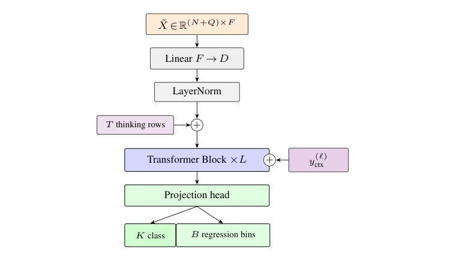
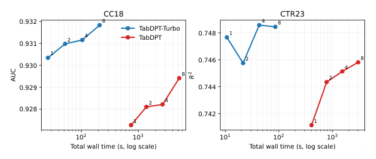
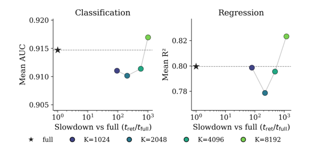
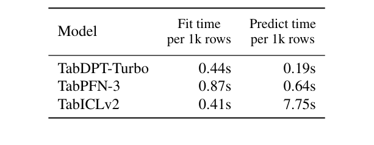

<!-- paper-reading-lang: zh-CN -->
<!-- paper-reading-theme: cobalt -->
# TabDPT-Turbo：用共享长上下文替代逐查询检索

**原论文**：*TabDPT-Turbo: Efficient In-Context Learning for Tabular Prediction*，Hosseinzadeh、Labach、Xue、Han、Thomas、Caterini。依据Zotero主条目 `DFAGC498` 的9页 **arXiv:2608.01400v2，2026-08-25**，附件 `FMN7AKYM`。本版本发布为TabDPT v1.2，与上一份TabDPT解读中的旧模型不是同一checkpoint。（PDF p. 1）

这篇论文把TabDPT原先的选择反转过来：**当模型真正学会长上下文后，还需要为每个查询重新检索并处理一张局部表吗？** Turbo保留行token和真实表自监督，取消检索，使一批查询共享一次完整context计算；同时扩充训练数据、修改attention和回归目标。速度优势来自计算共享，不是简单把近邻搜索库优化了一下。（PDF §§1–3）

```paper-map
{"thesis":"用长上下文预训练和共享context避免重复局部前向，在接近前沿精度的同时优化建模与预测效率。","outcome":"同硬件、8次前向的TabArena-Lite测试中，Turbo fit/predict分别0.44/0.19秒每1K行；它不是宣称纯精度第一。","outcomeSource":"PDF §4, Table 1","items":[{"number":"01","label":"旧瓶颈","text":"逐query近邻产生不同context，使昂贵Transformer上下文处理无法充分共享。","source":"PDF §§1–2"},{"number":"02","label":"数据","text":"真实表从112扩到1445，保留随机目标列SSL，并对CC18/CTR23/TabArena去重。","source":"PDF §3.1, Table 2"},{"number":"03","label":"长context","text":"预训练最长32K行，部署测试至100K共享context，不构建kNN索引。","source":"PDF §§3.1, 3.4"},{"number":"04","label":"结构","text":"32层行Transformer，64个thinking rows，逐层将目标注入V流，Q/K标准化与门控attention。","source":"PDF §3.2"},{"number":"05","label":"概率回归","text":"2048个目标bin，训练CDF的CRPS，点预测为bin中心期望。","source":"PDF §3.3"},{"number":"06","label":"边界","text":"仅128输入维；比较0.76秒总体口径与同硬件表的分项口径，不把不同测量直接相加。","source":"PDF §§3.2, 4.1"}]}
```

<!-- paper-reading-context:start -->
## 00 / 发表时的研究背景
<!-- context-cutoff: 2026-08-02; basis: first-publication -->

### 当时的领域状态

Turbo于 **2026-08-02首发、8月25日修订**。此时高质量TFM已不稀缺，长context、行压缩、真实数据预训练和KV缓存都已有进展。作者选择的问题更贴近资源约束：**在不追求每项精度都第一的前提下，能否保留有竞争力的预测质量，显著降低拟合上下文与服务查询的总成本**。（PDF §§1–2；[首发记录](https://arxiv.org/abs/2608.01400)）

理解这点，要把检索的两笔账分开：寻找近邻是一笔，对每个query处理不同邻域的Transformer计算又是一笔。后者使一批查询不能充分共享训练侧状态。长context模型已经有机会在attention内部选择相关行，因此取消外部检索不再只是“少用一个有帮助的模块”，而可能换回更高的计算复用。（PDF §§2、3.4）

### 关键前作与尚存缺口

| 工作与时间 | 已有贡献 | 当时未解问题及与本文的关系 | 来源 |
|---|---|---|---|
| LoCalPFN（2024） | 证明局部检索context与联合微调能改善第一代TabPFN的规模/复杂度利用 | 独立query的局部context带来重复前向，纯推理可能慢于树；这一代价不是FAISS单独能消除 | PDF §§1–2；[原论文](https://arxiv.org/abs/2406.05207) |
| TabDPT路线（2024首发、后续v1.1） | 用真实表随机列SSL和检索对齐训练/部署，得到可跨任务前向预测的行级模型 | 本篇对照v1.1仍依赖每query检索；长context和语料覆盖尚可继续扩大 | PDF §§1、3.1及Table 2 |
| TabICL与TabICLv2早期版本（2025–2026年初） | 用混合的cell编码/行ICL与长度适应attention推进大表能力 | 压缩前特征处理在列数增长时仍有开销；Turbo选择更纯粹的行token并承担固定输入维度限制 | PDF §2及Qu等引文；[v2首发版](https://arxiv.org/abs/2602.11139v1) |
| TabPFN-2.5与TabPFN-3（2025–2026年5月） | 扩展精度和部署方式，后者也改进了行压缩、分块及缓存 | 已有高效缓存不能据此宣称所有负载都无瓶颈；Turbo需在同硬件下检查共享context的新折中 | PDF §2、§4.1及Table 1 |

### 本文为何在此时提出

作者保留TabDPT的开放真实数据与行表示路线，但把原先“有限context靠检索补相关性”改成“先训练较长context，让所有query共享同一训练侧计算”。扩大语料、逐层目标路由、thinking rows、attention稳定化与概率回归一起支撑这次转向。它不是证明检索理念错误，而是问：**当模型能力和训练长度变了，过去值得支付的检索成本还值得吗**。（PDF §§3–4.2）

因此不能把2024年LoCalPFN的选择按2026年的模型能力评判，也不能把Turbo的系统结果当成只删除检索这一因素的纯消融。已有context缓存、不同feature数量和硬件也会改变折中。其历史贡献是一条针对推理效率重新组织学习与部署的路线，后文同硬件计时和检索消融分别检验它的不同部分。
<!-- paper-reading-context:end -->

## 01 / 去掉检索为什么反而减少计算

旧TabDPT对每条测试行找 $K$ 个邻居，再处理各自context。即便FAISS很快，多个不同局部表上的Transformer前向仍昂贵。Turbo让所有query共用完整训练context：训练行表示只算一次，query按需批量读取。它保留精确attention的长序列算量，却减少重复的训练侧工作。（PDF §§2, 3.4）

用说明性配对量看这种差别，忽略层数、宽度与检索开销：$Q$个query各自长度 $K$ 的局部问题，可能需要约 $QK^2$ 的训练侧attention；共享 $N$ 行的上下文约需 $N^2+NQ$。前者不必总是更贵，取决于 $N,K,Q$，所以“取消检索必快”不是数学定理。论文的贡献是通过长context训练让后者有足够质量，实测其在目标设置下更合算。（PDF §3.4；复杂度对照为阅读者按结构推演）

```paper-path
{"title":"从真实表SSL到共享上下文部署","stages":[{"title":"扩充真实任务","role":"数据","action":"筛选OpenML表、去重，随机选目标列并选其余列子集构造分类或回归。","why":"让大规模真实任务支撑长context学习，避免只记原始业务标签。","cost":"去重是作者流程，未在本次重新执行原始数据审计。","output":"更多样的真实表自监督任务","source":"PDF §3.1"},{"title":"训练长序列","role":"预训练","action":"随机选context和query，最长context约32K，使用共享行表示和attention优化。","why":"使模型在不依赖外部近邻选择时也能聚焦有用上下文。","output":"固定参数的长context行模型","source":"PDF §§3.1–3.3"},{"title":"构建共享context","role":"部署fit","action":"全体训练行进入同一序列，追加thinking rows，保留标签条件。","why":"不为每条测试行重复处理一套近邻context。","output":"可供所有query读取的训练侧状态","source":"PDF §3.4"},{"title":"批量预测","role":"部署predict","action":"query只读取context和thinking rows，不互读，再输出分类概率或回归分布。","why":"保留查询间条件独立，批量规模可变化而不改变任务语义。","cost":"首次长context仍有二次attention与内存成本，非免费预测。","output":"预测及可选多次前向聚合","source":"PDF §§3.2–4"}]}
```

## 02 / 真实表扩充与训练对齐

| 数据统计 | TabDPT v1.1 | Turbo | 比例 |
|---|---:|---:|---:|
| 数据集 | 112 | 1445 | 12.90× |
| 总行数 | 32.4M | 309.9M | 9.56× |
| 特征总数 | 15.3K | 43.7K | 2.86× |
| cells | 0.87B | 5.60B | 6.41× |

来自本篇Table2，不用上一份TabDPT报告的123表/2B cells替换这份v1.1对照。差异可能来自版本和数据处理口径，本PDF未给逐项对应账目；本页按当前对照解释。（PDF Appendix A.2）

训练过滤去除少于10列、超过200列或300MB文件的表，去掉高于100基数的类别列和常数列。对CC18、CTR23、TabArena的可能重复或派生表先过滤，再对相同行列数表做重排比较去重。这减少污染风险，但“相同大小重排相近”也不是对一切变换重复的完备判定。（PDF §3.1）

SSL继承随机目标列、类别合并/打乱、回归随机函数与归一化、随机输入子集。关键变化是部署不再检索，因此训练也随机选context/query，避免要求模型只适应局部近邻任务。训练最长32K行、推理至100K行又包含长度外推，二者不要混称。（PDF §§3.1, 3.4）

## 03 / 目标信息为何逐层进入值流

结构为32层、512维、8头、SwiGLU的pre-norm行Transformer，输入补零到128维；超过128特征需PCA或选列。64个thinking rows是可学习软token，不走原始数值编码器。它们参与context计算，提供latent计算位置，不是语言模型推理链。（PDF §3.2）

原Fig.3从上到下读：输入线性映射，插入thinking rows，各层额外接收context目标，再经联合输出头。图中额外 $y_{ctx}^{(\ell)}$ 应理解为逐层目标条件，不是把query真标签喂进去。（PDF p. 7, Fig. 3）



*原论文 Fig. 3，PDF p. 7。回归和分类共享backbone，但输出头的有效区域不同。*

作者将context标签经每层小MLP映射，再与该行表示拼入attention的 **value流**；query与key仍由行表示生成。这种设计的动机是持续提供标签信号，而不过早让context与query表征产生过大形式差异。标签仍会通过各层输出影响后续表示，不能误解为模型完全不根据标签改变相似度。（PDF §3.2；后一句为结构解释）

每头Q/K归一化、按token/head计算的sigmoid输出门，以及随context长度变化的温度，分别控制点积尺度、注意力贡献和长序列分散。论文没有给温度的精确函数形式，不套用TabICLv2的QASSMax公式来填补。（PDF §3.2）

## 04 / CRPS让回归学习整个CDF

分类最多预训练16类，只对有效类别做softmax；多于16类沿用TabDPT数位策略。回归将标准化目标分成2048个均匀bin，§3.3明确范围为 $[-10,10]$；预测质量 $p_b$，CDF为 $F_\theta$，用CRPS：

$$
\mathrm{CRPS}(F_\theta,y)=\int_{-\infty}^{\infty}\left(F_\theta(z)-\mathbf1\{y\le z\}\right)^2\,dz.
$$

这是标准CRPS定义，用来解释文中“predicted CDF与目标CDF”的损失；离散实现对应在bin上做带间距的近似。点预测为 $\widehat y=\sum_bp_b c_b$，$c_b$为bin中心，再还原目标尺度。它不是对2048个值做多数投票，也不是把最大概率bin中心当唯一回归输出。（PDF §3.3；积分形式为定义性展开）

**说明性例子**：真实值在0附近，把0.5质量放在−8与8、或把全部质量放在0附近，均值都可能为0；MSE点预测区分不了两者，CRPS却会惩罚前者的CDF偏差。因此分布目标能训练不确定性形状，但proper scoring rule本身不保证有限模型在所有现实表上都已校准。（PDF §3.3；例子与限定为阅读者说明）

还包括分类/回归损失比例自适应、query logits的z-loss和context预测CE。论文只简述辅助项动机，未逐项给全部精确实现和消融，不将它们各自描述为已隔离验证的增益。（PDF §3.3）

## 05 / 精度—速度与检索消融

Fig.1对旧v1.1和Turbo分别取1、2、4、8次前向，旧模型用2048近邻。读横轴总wall time的对数尺度，再看纵轴CC18 AUC与CTR23 R²；这不是每个测试点延迟，也不是同一模型的强制相等时长比较。（PDF p. 4, Fig. 1）



*原论文 Fig. 1，PDF p. 4。更好或相近精度不代表每一项预算下都单调提高，尤其回归的小预算点。*

取消检索还必须检查精度，而不能只报快。Fig.2星号是共享full context，圆点是不同 $K$ 的检索；横轴是相对full的慢速倍率，越右越慢。大 $K=8192$ 略超过full精度，但接近1000倍慢；小 $K$ 不但慢，还可能更差。（PDF p. 4, Fig. 2）



*原论文 Fig. 2，PDF p. 4。分类综合CC18及Lite分类，回归综合CTR23及Lite回归，分母与Fig.1不同。*

论文报告最大检索对照约AUC0.917 vs full0.915、R²0.83 vs0.80；这些不是单独CC18、CTR23 Fig.1的0.93/0.75尺度，不能跨图拼接。作者据此选择近似最优而大幅更快的无检索路径。（PDF §4.2）

## 06 / 同硬件计时与可支持结论

Table1用同一H100和96vCPU，默认每模型8次前向，给出两阶段耗时。先比较predict再比较fit：TabICLv2的fit0.41比Turbo0.44略小，因此“最快”指组合折中，不是每一列都第一。（PDF p. 4, Table 1）



*原论文 Table 1，PDF p. 4。单位均为秒/1K行；表中阶段的归一化分母不可默认相同后直接相加。*

| 模型 | Fit秒/1K行 | Predict秒/1K行 |
|---|---:|---:|
| TabDPT-Turbo | 0.44 | 0.19 |
| TabPFN-3 | 0.87 | 0.64 |
| TabICLv2 | 0.41 | 7.75 |

正文另报总体平均0.76秒/1K instances，不能强行把它与上表0.44+0.19=0.63视作相同归一化/聚合口径；本地报告没有完整展开它们的对应计算。对异硬件旧排行榜的比较，作者也仅作审慎的可能性说明，同硬件Table1更有直接解释力。（PDF §4.1）

```paper-experiments
{"title":"速度论文的主要验证","rows":[{"question":"取消检索是否牺牲太多质量？","setup":"完整Turbo分别full context与K=1024/2048/4096/8192检索，测AUC/R²和相对时间。","observation":"只有最大K略超过full，代价近1000倍时间；其他检索设置通常更差且至少慢100倍。","conclusion":"支持当前checkpoint使用共享context，不证明任何短context模型都能直接移除检索。","source":"PDF §4.2, Fig. 2"},{"question":"比上一版是否更高效？","setup":"CC18/CTR23，旧v1.1使用2048近邻，两者取1/2/4/8前向。","observation":"Turbo在相近或更好质量下大幅减少总wall time。","conclusion":"是新数据、结构、目标和长context训练的系统升级，没有逐组件全套因果消融。","source":"PDF Fig. 1"},{"question":"长context训练本身有用吗？","setup":"相同d256/L8，最大context1024或16384，每batch总行数一致。","observation":"长context模型验证轨迹更好。","conclusion":"比单纯扩大模型的对照更直接，但仍是给定数据和训练条件下。","source":"PDF Appendix A.4, Fig. 5"},{"question":"扩大模型是否仍受益？","setup":"相同最大32768 context，中等模型为完整模型一半attention blocks。","observation":"大模型约500epochs后超过中等模型。","conclusion":"支持容量扩展，不能直接推导无限规模幂律。","source":"PDF Appendix A.4, Fig. 6"}]}
```

**综合理解**：旧TabDPT用检索把大表拆成局部小问题；Turbo改成训练模型自己在长context中聚焦，让共享计算重新变得可用。依赖条件是足够长的训练序列、合适温度、更多真实任务和有效行编码。128维硬编码、PCA/选列、超多类别、数据质量与时间依赖仍是边界；其目标是性能—效率折中，不是纯精度排行榜冠军。（PDF §§3–5）

<!-- 可视化决策：共享与逐query上下文的差别可用静态阶段图和原Fig.2同时看清；原文未给温度函数的完整细节，不制作暗示可复现实参的交互。表格与图旁保留不同口径。 -->
<!-- 覆盖：全部9页正文及Appendix A架构/语料/TabArena-Lite排名/长context与容量消融。没有将新论文112表旧版本口径覆盖旧报告123表，也不虚构精度图和分项时间的同一分母。 -->
