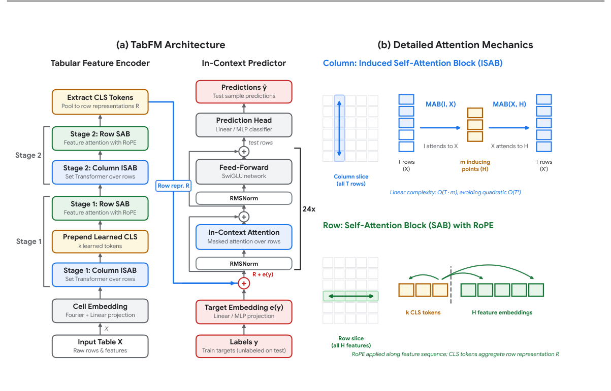
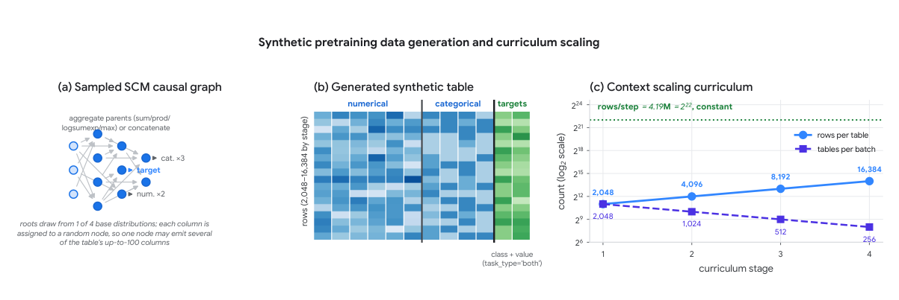
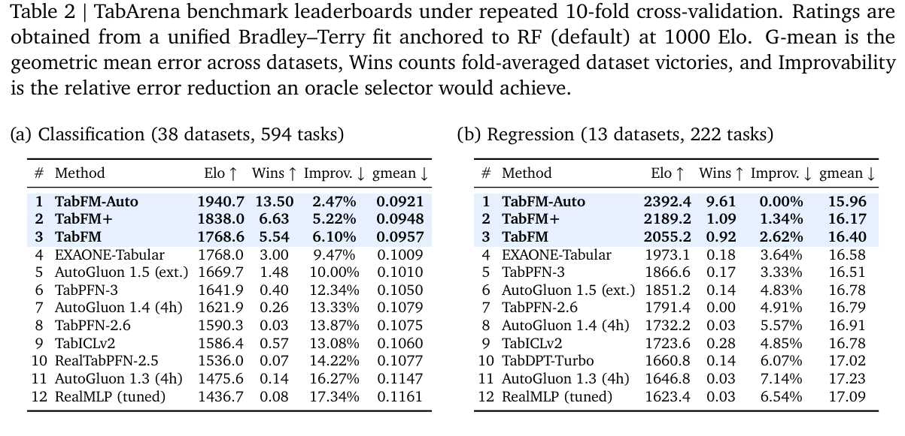
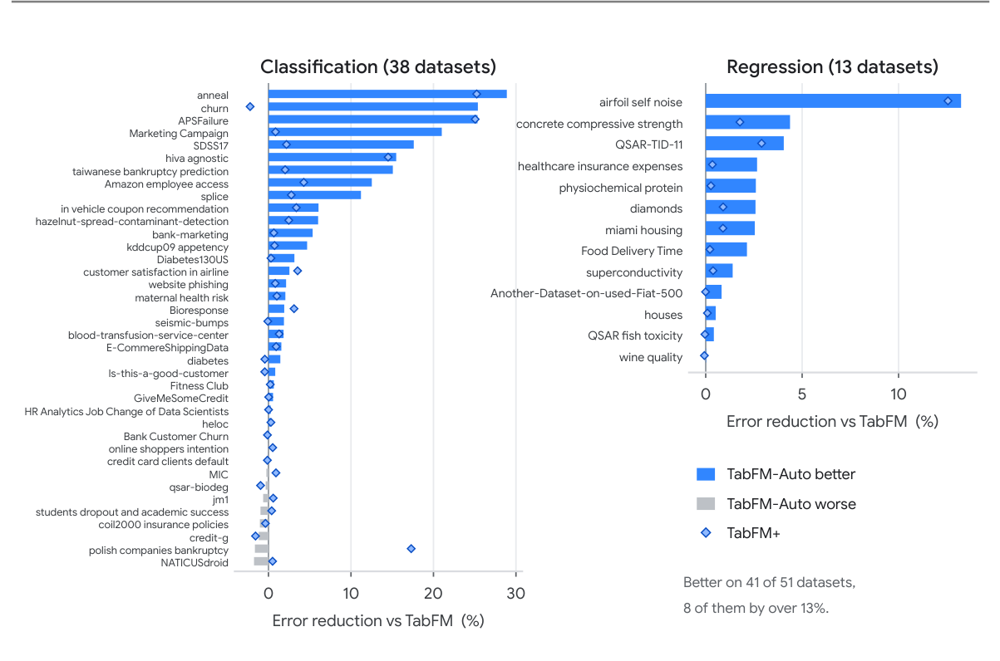

<!-- paper-reading-lang: zh-CN -->
<!-- paper-reading-theme: plum -->
# TabFM：冻结模型的零样本预测，与模型外的特征搜索

**原论文**：*TabFM: A Zero-Shot Foundation Model for Tabular Data*，Weihao Kong、Erez Louidor Ilan、Shuxin Nie、Taman Narayan、Rajat Sen、Yichen Zhou、Deqing Fu、Samet Oymak、Abhimanyu Das，Google Research。依据Zotero主条目 `KZJI8QQR`、附件 `8BSENE3N` 的15页 **arXiv:2609.37959v1，2026-09-29**。论文名TabFM不等同本文件夹的通用分类名TabFM。（PDF p. 1）

本论文的“zero-shot”指：**不为新任务更新基础模型权重**，不是不给训练标签。模型仍将当前任务的有标签训练表作为上下文。它在同一冻结checkpoint外增加两层流程：TabFM+做32视图集成和验证拟合，TabFM-Auto再用Gemini搜索特征工程程序。这三层的可用数据、计算预算和“训练”含义不同，是理解结果的主线。（PDF §§1, 3–5）

```paper-map
{"thesis":"用Fourier数值嵌入和两轮列/行编码构建行表示，深ICL做任务预测；再以冻结权重上的多视图和LLM特征程序扩展测试时能力。","outcome":"报告在其TabArena51表方法池中领先，但基座、32视图校准和六小时程序搜索的结果必须分开。","outcomeSource":"PDF Table 2, §§3.3–5","items":[{"number":"01","label":"数值入口","text":"偏移0/1/3三元特征组，每slot使用32个可学习Fourier频率，数值与类别分开参数。","source":"PDF §3.1, Eq. 1"},{"number":"02","label":"两轮表征","text":"列ISAB与行SAB交替两阶段、8个CLS压成1024维行表示，训练标签在早期与ICL都注入。","source":"PDF Fig. 2, Table 1"},{"number":"03","label":"上下文预测","text":"24层行ICL，测试只读训练context；主要参数在深预测器，不在cell编码器。","source":"PDF §3.1, Eqs. 4–7"},{"number":"04","label":"合成课程","text":"SCM合成数据，特征上限100，四阶段context从2048扩到16384。","source":"PDF §3.2, Fig. 3"},{"number":"05","label":"TabFM+","text":"32个变换视图，cross/SVD特征，验证NNLS权重收缩与分类Platt校准。","source":"PDF §4"},{"number":"06","label":"TabFM-Auto","text":"Gemini迭代编写特征/预处理程序，最多96评估或6小时，基础模型权重不变。","source":"PDF §5"}]}
```

<!-- paper-reading-context:start -->
## 00 / 发表时的研究背景
<!-- context-cutoff: 2026-09-29; basis: first-publication -->

### 当时的领域状态

这份Google Research报告于 **2026-09-29公开**。此前表格基础模型已从早期小表分类推进到回归、较长context、真实数据续训和高效部署。研究焦点因而不再只有“能否用Transformer替代树”，还包括**数值信息怎样编码、表征/上下文计算怎样分工，以及固定模型外的输入处理能挖出多少额外能力**。（PDF §§1–2；[首发记录](https://arxiv.org/abs/2609.37959)）

这里的“零样本”并不是没有任务标签，而是不对新任务更新基础网络权重。context仍包含训练标签，外围还可能验证拟合权重、校准概率或搜索程序。到了这个阶段，区分基座模型与围绕它运行的完整系统尤为重要，否则会把六小时数据工程搜索的精度误记成单次前向的能力。（PDF §§3.3–5）

### 关键前作与尚存缺口

| 工作与时间 | 已有贡献 | 当时未解问题及与本文的关系 | 来源 |
|---|---|---|---|
| PFN与TabPFN系列（2021–2025） | 建立合成任务预训练与上下文预测的统计/实践路线，后续扩展混合列和概率预测 | 通用接口不规定最好的数值嵌入和计算分工；本文在这条范式内设计更深的预测器与表编码 | PDF §2及Müller/Hollmann引文 |
| TabICL、TabICLv2与TabPFN-3（2025–2026） | 推进列集合编码、行汇聚、目标感知、循环分组与长context学习 | 这些是本文明确借鉴的已有结构，不应把“先压缩行再ICL”记成TabFM首创；本文组合不同嵌入、阶段和容量 | PDF §§2、3.1；[TabICL](https://arxiv.org/abs/2502.05564)、[TabPFN-3](https://arxiv.org/abs/2605.13986) |
| Fourier特征与数值表征研究，早于本文 | 用不同频率的周期映射帮助网络表达连续值与较高频变化，为数值精细编码提供工具 | 通用频率映射不等于已解决异构表格；仍要处理类别/数值差异、尺度、分组与任务监督 | PDF §2、§3.1及Tancik等引文 |
| Real-TabPFN、TabDPT与Turbo（2024–2026） | 证明真实表任务与不同context组织也是强路线，速度/数据来源不只一种选择 | 本文仍选择纯合成基座，需要与这些已有模型比较，不能用“基础模型”名称代替实证 | PDF §2及Ma/Hosseinzadeh/Garg引文 |
| AutoGluon与CAAFE等自动数据/特征工程路线（2020–2023以后） | 已有多模型组合、自动管道，以及LLM根据数据语义构造特征的思路 | 冻结TFM能否成为强而高效的评估器、外层搜索能提高多少，仍需具体协议验证；这连接到TabFM+和Auto | PDF §2、§5及Hollmann等2023引文；[AutoGluon摘要](https://arxiv.org/abs/2003.06505) |

### 本文为何在此时提出

作者在已有ICL技术栈上聚焦两个层次。模型内，Fourier cell嵌入、两轮非共享列/行编码与24层行ICL试图更好利用数值和关系；模型外，利用冻结权重对不同输入视图的敏感性构造Plus，再让LLM闭环搜索任务特征管道。其动机是：**更强的通用统计先验仍未必自动发现某个任务的领域表达方式**，如物理无量纲数、业务分组等。（PDF §§3–5）

这应被理解为“强基座与外围数据程序协同”的报告，而非所有组件都首次出现。原文没有把所有嵌入、结构与外层选择逐一隔离做等成本消融，因而前作脉络能解释设计为何合理，却不能替代后文的性能和预算核验。今天以后的网站排名或实现更新不参与本节的发表时判断。
<!-- paper-reading-context:end -->

## 01 / Fourier嵌入保留什么数值信息

一张表有 $T$ 行、$H$ 列，第 $j$ 组取列 $(j,j+1,j+3)\bmod H$。对每个slot $g$ 的标量 $v$，使用32个可学习频率：

$$
\gamma_g(v)=\left(\cos(2\pi\omega_{g,1}v),\sin(2\pi\omega_{g,1}v),\ldots,\cos(2\pi\omega_{g,32}v),\sin(2\pi\omega_{g,32}v)\right)^\top.
$$

数值与类别走各自的频率和投影 $W_g$，将三个slot投影相加得到宽128的cell组表示。它不是把数字字符串交给语言tokenizer；不同频率允许同时表示较慢变化与较细的数值结构。**阅读者限定**：周期映射可能混叠，实际保真依赖多频率、训练分布和预处理，不能仅凭“Fourier”一词保证任意数值尺度都精确。（PDF §3.1, Eq. 1）

### 与TabICLv2相似但不同

它同样先分组、目标感知列编码、行聚合再做ICL，但重复了**两套不共享参数的列/行阶段**，使用8个CLS而不是4个，最后1024维、24层。约408.7M参数中，ICL预测器约402.7M，占绝大多数。这些数字说明主要容量用于行间任务推理，不是“400M都用来理解列名”。（PDF Table 1）

原Fig.2从输入向上读左侧编码器，再到中间ICL；右侧解释ISAB压缩与RoPE。标签既在训练cell处加，也在最终训练行表示处加。不要套用第一代TabICL“直到最后才看标签”的描述。（PDF p. 2, Fig. 2；§3.1）



*原论文 Fig. 2，PDF p. 2。8个CLS拼成1024维行表示，查询目标为空。*

## 02 / 如何防止查询之间传递信息

feature attention用padding mask，row attention只允许前缀训练行作为keys：

$$
M^{ctx}_{ik}=\begin{cases}0,&k\le T_{train},\\-\infty,&k>T_{train}.\end{cases}
$$

$$
\mathrm{Attn}(Q,K,V;M)=\mathrm{softmax}\left(\frac{QK^\top}{\sqrt{d_k}}+M\right)V.
$$

不允许某个测试点读取另一个测试点，也不允许训练摘要依赖测试集合。列ISAB由256个inducing vectors先读训练行，再广播回所有行，因此可以把很多查询拆批或换序而不改变其应有的条件上下文。（PDF §3.1, Eqs. 2, 4, 7）

**说明性追踪**：训练表只有A/B两个带标签样本，新增一个没有标签的测试点，不能改变原训练摘要；另一个测试点也不能通过新测试点得到额外信息。它只能从训练样本学到关联，并结合自己的特征输出。这是mask的结构性依赖限制，不是说不同预测值在现实概率意义下绝对统计独立。（PDF §3.1；本段为阅读者解释）

列ISAB约 $O(THmE)$，行内attention约 $O(TH^2E)$，最终ICL仍有 $O(T^2d)$。因此“列模块线性时间”不能缩写成“整个TabFM线性”；随着context变长，深预测器仍会主导。（PDF p. 6, Attention Complexity）

## 03 / 四阶段合成任务课程

随机SCM定义列间依赖，输入混合数值/类别，改变样本数、类别比例、噪声与平衡。每表同时携带分类和回归目标，只对query计算训练损失。主文没有列出完整优化器、损失组合权重和各阶段步数，本页不从后来的模型习惯猜这些实参。（PDF §3.2）

| 阶段 | 表内行数 | 每batch表数 | 每步行数 |
|---|---:|---:|---:|
| 1 | 2048 | 2048 | 4,194,304 |
| 2 | 4096 | 1024 | 4,194,304 |
| 3 | 8192 | 512 | 4,194,304 |
| 4 | 16384 | 256 | 4,194,304 |

Fig.3画的是每步总行数/tokens固定，**不等于每步总FLOPs固定**：attention有序列长度二次项，行数翻倍而batch减半仍可能让对应算量增长。正文称保持compute不变，是比图中确证的tokens恒定更强的简述，本解读保留这一区别。（PDF p. 6, Fig. 3；计算解释为阅读者推演）

先看Fig.3a/b抽到一个SCM如何产生表，再读c中上升的context与下降的batch；不应把右侧的16K直接当作所有评估表实际训练行数。预训练最多100列，部署更宽表依赖长度/宽度外推或选列。（PDF §3.2, §6）



*原论文 Fig. 3，PDF p. 6。恒定tokens不自动消除长序列注意力的计算增长。*

## 04 / 三个部署层级分别“学习”了什么

```paper-path
{"title":"从冻结基座到带外层搜索的系统","stages":[{"title":"TabFM基座","role":"零权重更新","action":"输入当前任务训练标签和查询，固定基础网络输出预测。","why":"把跨任务学习摊销到合成预训练，不再为每张表拟合网络权重。","cost":"仍使用任务标签与上下文；zero-shot不是无监督。","output":"基座预测","source":"PDF §3.3"},{"title":"构造32个视图","role":"TabFM+","action":"一半原列，一半添加cross/SVD特征，再做归一化、列/类排列和类别索引变化。","why":"从同一权重得到有差异的预测，利用额外结构与误差互补。","cost":"多次前向，附加特征与预处理有计算成本。","output":"32份成员预测","source":"PDF §4"},{"title":"验证拟合集成与校准","role":"TabFM+","action":"内层验证拟合非负权重，向均匀权重收缩，分类再做Platt校准。","why":"利用成员表现差异且降低权重过拟合。","cost":"冻结基础权重不等于没有数据驱动拟合。","output":"校准后的加权预测","source":"PDF §4"},{"title":"程序搜索","role":"TabFM-Auto","action":"Gemini根据CV分数与报错迭代Python管道，最多96评估或6小时，选top3中的一个方案再各foldrefit。","why":"通用扰动难以替代领域特征，如物理无量纲数或诊断分组。","cost":"引入LLM、外层验证搜索及代码执行，不能与基座相同预算比较。","output":"任务专属的预测管道，不是新的基础权重","source":"PDF §5"}]}
```

TabFM+为每表抽至多约 $\lfloor\sqrt H\rfloor$ 个乘积cross特征与SVD分量；半数成员保留原表，原列cap500。每视图独立做可选Yeo–Johnson、4标准差裁剪、列/类别重命名等。因为分组与RoPE依赖列顺序，变换确实会产生不同内部表示，而不是重复同一个预测。（PDF §4）

以 $P$ 为验证成员预测，权重约束在单纯形，NNLS选出的 $w$ 再收缩：

$$
w_{final}=0.75w+0.25\frac{\mathbf1}{K},\qquad K=32.
$$

**说明性例子**：某成员原权重0时，仍获得0.25/32的最终权重；因此“NNLS稀疏选择”与“最终所有零权重都可剪掉”并不等价。校准参数和权重在任务验证数据上拟合，仍需防止反复选择带来验证过拟合。（PDF §4；例子为阅读者代入）

TabFM-Auto允许在冻结主预测器之外拟合甚至混合辅助模型，不能把它描述成整个系统一切参数都不训练。candidate在看不到测试split/评估fold的sandbox内按三折CV评分，首个训练fold中搜索出的程序复用到各外层fold。它不是每个外层测试集都单独挑一个最有利方案。（PDF §5）

## 05 / 数字对应哪套TabArena协议

本报告用51表：38分类、13回归；共594分类任务实例与222回归实例，合计816。方法池67个配置，Bradley–Terry拟合、RandomForest锚1000，每数据集等权，取100轮bootstrap的中位Elo。本文称重复10折CV，但不同表实际实例数已在Table2给出，不能把51×10当作实际总任务数。（PDF §3.3, Table 2）

下表摘原Table2；gmean是各表误差的几何均值，wins把每数据集fold胜率累加，因而允许小数。Elo是这一个方法池里的相对评分，不是不同报告之间可直接相减的绝对能力单位。（PDF p. 7）

| 系统 | 分类Elo ↑ | 分类gmean ↓ | 回归Elo ↑ | 回归gmean ↓ |
|---|---:|---:|---:|---:|
| TabFM-Auto | 1940.7 | 0.0921 | 2392.4 | 15.96 |
| TabFM+ | 1838.0 | 0.0948 | 2189.2 | 16.17 |
| TabFM基座 | 1768.6 | 0.0957 | 2055.2 | 16.40 |
| EXAONE-Tabular | 1768.0 | 0.1009 | 1973.1 | 16.58 |
| TabPFN-3 | 1641.9 | 0.1050 | 1866.6 | 16.51 |
| AutoGluon1.5 extreme | 1669.7 | 0.1010 | 1851.2 | 16.78 |
| TabICLv2 | 1586.4 | 0.1060 | 1723.6 | 16.78 |

分类基座与EXAONE的0.6 Elo差非常小，不能从中心值直接宣称统计显著。回归领先更大；由此作者推测Fourier表示对连续值有帮助，但本篇没有单独关掉Fourier的等预算消融来隔离该原因。（PDF §3.3；最后的证据限定为阅读者说明）

阅读原Table2要先分清两类任务，不能将回归2392与分类1941相减比较“哪项任务更容易”。它们各自的误差尺度、胜率对手和拟合评分不同。（PDF p. 7, Table 2）



*原论文 Table 2，PDF p. 7。基座不更新权重，Plus与Auto仍消耗额外验证和推理预算。*

## 06 / 程序搜索的收益与未检验的解释

报告中TabFM+相对基座分类+69.4 Elo、回归+134.0 Elo；TabFM-Auto相对基座+172.1/+337.2 Elo。减法可从表中复核，但不能直接把增益归于单一“LLM推理”因素：还改变了输入特征、数据处理和模型外围设置。（PDF §§4–5）

Fig.6每条横柱是Auto相对基座的误差减少，菱形是Plus；41/51表改善，13个回归全部改善，其余10个分类表不改善。图内与图注关于“大幅改善”的阈值有不同写法（8个超13%、10个超10%），可能是阈值不同，不能合成未经提供的新计数。（PDF p. 10, Fig. 6）



*原论文 Fig. 6，PDF p. 10。41个改善不等于51个全胜，负柱保留失败案例；误差减少百分比不是准确率百分点。*

作者统计“修改表的程序”中位误差减少2.14%，不修改表者0.27%。它支持特征工程值得关注，但这是搜索后程序的分组观察，不是随机分配有/无特征工程的受控消融，可能伴随任务难度与搜索成功率差异。（PDF §5）

```paper-experiments
{"title":"将基座、系统和解释分层","rows":[{"question":"纯合成冻结基座有多强？","setup":"51表816任务，67方法配置池，基座不做任务权重更新。","observation":"分类Elo1768.6、回归2055.2，在该报告默认TFM中领先。","conclusion":"是当前模型池/版本的结果，不是实时网站或所有未来任务的保证。","source":"PDF Table 2, §3.3"},{"question":"额外视图与校准能否提高？","setup":"32视图，cross/SVD、NNLS加均匀收缩、分类Platt校准。","observation":"分类+69.4、回归+134.0 Elo。","conclusion":"是整个Plus流程增益，没有分解每一变换的独立贡献。","source":"PDF §4, Table 2"},{"question":"LLM特征搜索是否有进一步收益？","setup":"三折训练内CV，最多96候选/6小时，Gemini选top3中的程序，外层fold测试。","observation":"Auto在41/51表改善，回归13/13改善，10个分类任务未改善。","conclusion":"支持该预算下的外层系统，不与单次基座推理当等成本比较。","source":"PDF §5, Fig. 6"},{"question":"为什么改善？","setup":"搜索完成后按有无表变换分组，观察中位误差减少。","observation":"改表2.14%，不改表0.27%。","conclusion":"是关联性解释，不是对Fourier、LLM或特征工程的严格单因子因果归因。","source":"PDF §5"}]}
```

## 07 / 模型不更新，任务流程仍会学习

**作者主张**展示了一条强冻结表格预测器与外层数据程序协同的路线。**能从全文重建的机制**是Fourier与分组编码、训练限定摘要、两轮列/行处理、深ICL及多视图权重收缩。**未充分披露的部分**包括完整预训练实参和Auto的所有候选程序细节，后者另引独立论文；本页不假装已经复现。（PDF §§3–6）

预训练100列、16K行，部署更宽更长表仍依赖外推/选列；自由文本没有原生语义tokenization，模型也不原生处理关系schema。SCM采样不能保证所有现实测试表在分布支持内，更不能提供因果识别。最重要的术语区分是：**固定基础权重 ≠ 没用训练标签 ≠ 没有验证拟合 ≠ 没有外层搜索成本**。（PDF §6；最后总结为阅读者解释）

<!-- 可视化决策：冻结基座/Plus/Auto的三层操作需同时对照预算与标签依赖，原架构和静态阶段图更清楚；不为未公开全部搜索细节编写虚构交互。表格保留同一池数值，所有算例明确非新实验。 -->
<!-- 覆盖：全部15页，正文§§3–6架构公式、合成课程、Table2协议、多视图和Auto闭环；参考列表用于核对来源，不把引用的优化理论当本模型已证明的收敛保证。 -->
