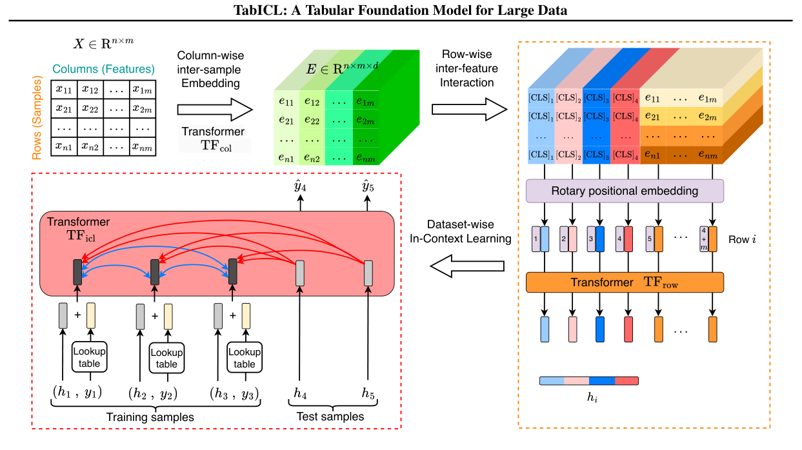
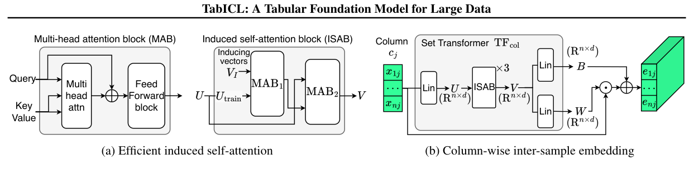
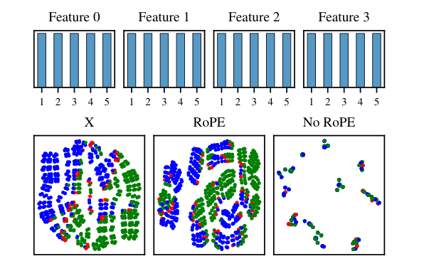
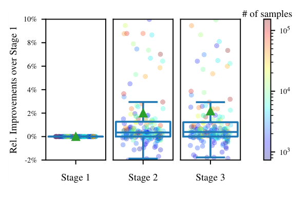
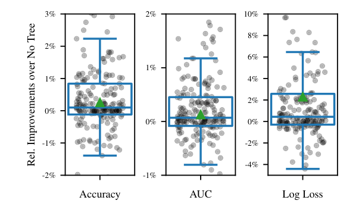
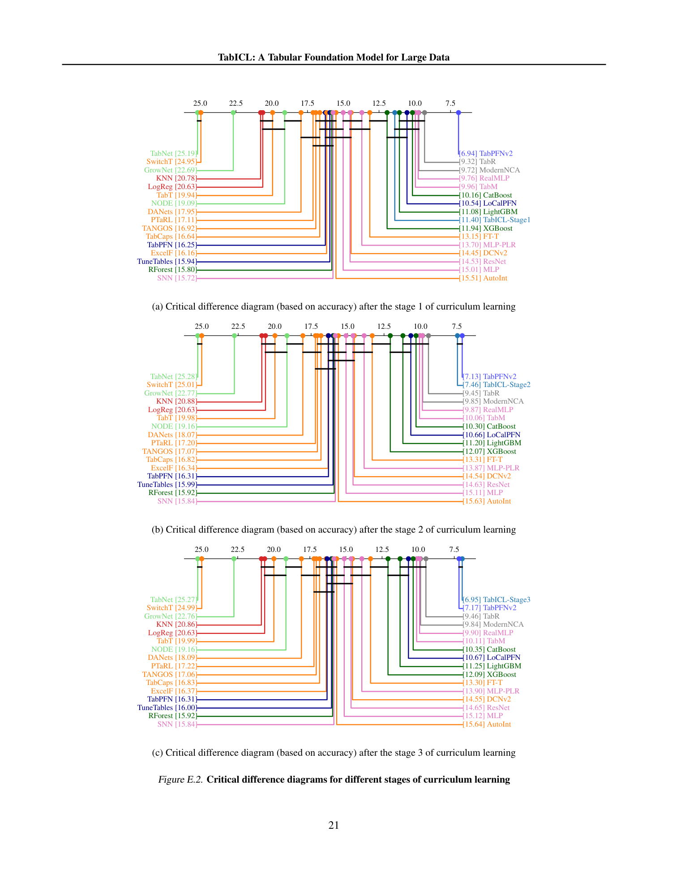

<!-- paper-reading-lang: zh-CN -->
<!-- paper-reading-theme: plum -->
# TabICL：先把一行压成表示，再让大表做上下文学习

**原论文**：*TabICL: A Tabular Foundation Model for In-Context Learning on Large Data*，Jingang Qu、David Holzmüller、Gaël Varoquaux、Marine Le Morvan，ICML 2025。以 Zotero `XKRXCPY2` 的 31 页本地 ICML/PMLR PDF 为准；PDF 元数据创建日期为 2025-05-24，条目的 2025-10-06 日期不作为版本标识。所有来源位置使用本地 PDF 的一基页码。代码链接：[soda-inria/tabicl](https://github.com/soda-inria/tabicl)。（PDF p. 1）

TabICL 的出发点是一个结构性问题：**为什么要在每一列上重复做昂贵的跨样本注意力？** 它先用列分布信息为每个 cell 编码，再将一整行压缩为固定宽度的表示，最后只在行表示之间做 ICL。这样仍保留训练样本作为上下文，却不再在完整的 cell 网格里层层往返。压缩发生在看到标签之前，是整篇论文最关键的设计选择与信息瓶颈。（PDF §§3.1–3.5）

```paper-map
{"thesis":"把可迁移的列分布编码、行内交互和样本间 ICL 解耦，减少大表推理中随特征数重复发生的二次注意力。","outcome":"在 TALENT 的主要可原生分类子集上与 TabPFNv2 接近，同时更快；50万行属于可运行性演示而非同规模精度排名。","outcomeSource":"PDF §§5.1–5.2, Appendix E.2","items":[{"number":"01","label":"规模问题","text":"TabPFNv2 的逐列跨样本注意力带来 n²m 项，行数大时尤其昂贵。","source":"PDF §3.5"},{"number":"02","label":"列级编码","text":"共享 Set Transformer 用训练列的分布产生逐 cell 的权重与偏置，不依赖列名语义。","source":"PDF §3.2, Fig. 2"},{"number":"03","label":"行级压缩","text":"行内 Transformer 加四个 CLS，输出 512 维行表示；RoPE 避免同分布列混淆。","source":"PDF §3.3, Fig. 4"},{"number":"04","label":"数据集级 ICL","text":"只在最终模块加入训练标签，测试行读取有标签行表示，返回类别分布。","source":"PDF §3.4"},{"number":"05","label":"训练外推","text":"合成 SCM 加树先验，经过 1K、1K–40K、40K–60K 三阶段长度课程。","source":"PDF §4, Appendix E.1"},{"number":"06","label":"证据边界","text":"主要比较含32路集成，且大表上TabPFNv2训练集截到30K；不是完全同数据量的架构消融。","source":"PDF §5.1"}]}
```

<!-- paper-reading-context:start -->
## 00 / 发表时的研究背景
<!-- context-cutoff: 2025-02-08; basis: first-publication -->

### 研究问题与价值

当训练表从几千行变成几万乃至更多行时，ICL还能有竞争力，还是会因为每列都重复跨行attention而失去实用性？**本篇的目标不是少看训练行，而是重新安排“编码特征”和“根据标签预测”的分工，尽量保留信息并降低长表成本。** 成功要同时看新表精度、运行资源与所用训练行数；仅能运行50万行，并不等于已经证明同规模准确率领先。（PDF §§1、3.5、5）

如果这条路线可行，预训练算法的复用便能从小表扩到较大分类任务，减少逐任务调参成本。但压缩是有损可能性的设计，不能预设它完全保留任何未来标签所需信息。（PDF §§3.1、6）

### 当时的领域状态

TabICL于 **2025-02-08首发，随后发表于ICML2025**。就在此前一个月，Nature版TabPFN已经把表格基础模型从小数值分类扩到更真实的中小表格。于是问题发生变化：不再只是“ICL能不能做表格预测”，而是**这种优势能否在更多训练行时继续成立，且不把资源成本推得过高**。（PDF §§1、2.3；[首发记录](https://arxiv.org/abs/2502.05564)）

长表需要先区分两个量：整张训练库有多少行、每次模型实际用多少context。缩小context可以便宜一些，却可能丢信息；保留更多cell表示又会增加跨样本attention的开销。TabICL研究的是这条结构性权衡，而不是仅为已有模型找一个更好的学习率。（PDF §§1、3.5）

### 关键前作与尚存缺口

| 工作与时间 | 已有贡献 | 当时未解问题及与本文的关系 | 来源 |
|---|---|---|---|
| PFN/TabPFN第一代（2021–2023） | 用合成任务学会固定权重的表格ICL，一行一个token | 小型任务有效，但窗口与行编码限制了适用范围，不能直接说明大表仍有优势 | PDF §2.3 |
| TabPFNv2（2025年1月） | 丰富先验和双轴cell attention，使回归、混合列和中小表性能明显增强 | 跨行attention在各特征位置重复，保留特征轴让大行数场景更昂贵 | PDF §§1、2.3、3.5 |
| ICD、TuneTables、LoCalPFN等（2024） | 学习小context、压缩任务，或按query选择近邻，缓解有限窗口 | 多数在既有ICL底座外改变context，仍可能增加逐任务适配或逐query重复计算；本文尝试直接改表征与推理分工 | PDF §2.3；[ICD](https://arxiv.org/abs/2402.06971)、[LoCalPFN](https://arxiv.org/abs/2406.05207) |
| Set Transformer（2019）及既有集合attention | 用诱导向量等机制高效处理无自然顺序的集合，聚合再广播统计信息 | 通用集合模块不是完整表格学习器；本文将其用于可共享的列分布编码，再与行内交互、ICL衔接 | PDF §§3.2及Lee等引文 |
| TabDPT预印本（2024年10月） | 将真实表SSL与局部检索用于通用表格模型，说明纯合成并非唯一路线 | 提供另一种数据/上下文扩展方向；TabICL选择合成任务和结构性压缩，两条路线不能仅凭发布时间宣称互相替代 | PDF §2.3；[首发记录](https://arxiv.org/abs/2410.18164) |

### 本文为何在此时提出

已有方法说明了两种代价：直接保留cell网格会重复支付跨行计算，截短或压缩context又可能丢样本信息。一个可行的新方向需要同时利用列分布、保留行内关系，并让最昂贵的跨行推理不再随每列重复。这里先提出要求，具体如何满足、又丢掉哪些信息，要等方法和消融回答。（PDF §§1、3.1–3.5）

这也解释了为何分布感知、CLS压缩与RoPE不是无关装饰：压缩之前必须保留有用列关系，还要避免同分布列混淆。本文后续仍会讨论压缩时不看标签的代价。2026年的TabICLv2、TabPFN-3与Turbo都不能作为2025年2月的前作；此处只说明当时为什么值得探索这条路线，不借后来的成功为选择背书。
<!-- paper-reading-context:end -->

## 01 / 从计算瓶颈到核心直觉

**以下是教学性思路重建，不是作者真实发现史。** 从已知双轴attention的成本出发，行多时昂贵的是“每个特征位置再做一次样本间比较”。既有表征学习提供一个方向：先压缩再做任务推理。但如果直接把原始一行压成向量，数字缺少跨表固定语义；Set Transformer一类集合模块又提示，可以先从整列的统计分布条件化编码，再建模行内交互。（PDF §§1–3；此前Set Transformer等来源见背景表）

这样得到的假设是：若压缩前已保留必要的列身份与交互，那么最终根据标签做ICL时，也许只需要固定宽度行向量，不必保留完整特征轴。这是有风险的任务无关压缩假设，不是先知道本文TALENT结果以后给出的必然解释。表示是否塌缩、精度是否下降、长上下文是否能学好，都还要检验。（PDF §§3.1–3.3；桥接为阅读者重建）

**实际idea是“先解释一行，再让行之间学习”**：列分布编码与行内attention形成行表示；只有最后的ICL模块加入可见训练标签并做跨行预测。它删的是高成本推理中的特征轴乘子，不是删掉所有二维处理或所有二次计算。（PDF §§3.1–3.5）

## 02 / 用天平任务追踪信息

论文Fig.4用真实 **balance-scale** 数据说明四个同分布列会造成混淆。下面依据该任务的四列定义，构造两条**合法教学记录**，不是声称从图中读取到作者的逐行输出：左重、左距、右重、右距分别为(1,2,3,4)与(3,4,1,2)。左右力矩分别是2对12、12对2，因此应属于相反方向；即使四列总体分布相同，列角色也不能消失。（PDF §3.3、Fig.4）

1. **输入**：训练侧提供若干带L/B/R标签的天平记录；把(1,2,3,4)作为查询时，其R标签只保留评估。标签尚不进入前两模块。
2. **列编码**：每列训练值先被诱导向量汇总，再让查询单元格读取训练摘要。测试行不能反过来改写训练列摘要；输出是每个cell的128维表示，不是“该列叫左重量”的自然语言理解。（PDF §3.2）
3. **行内交互并压缩**：四个特征连同四个CLS进入行Transformer，RoPE区分列位置，四个CLS拼出512维。若对同分布列的置换完全不敏感，两条力矩相反的记录可能混成相同表示，这正是本任务不能容忍的损失。（PDF §3.3）
4. **加入标签做ICL**：训练行表示加其类别编码，查询表示不加真实标签，再进行跨行attention。输出是L/B/R概率，而不是网络内显式执行上述乘法公式；本例力矩计算只帮助理解它需要保留什么信息，本次未运行网络。（PDF §3.4）

离线时用合成任务训练这些共享模块，并按课程扩上下文；上线只换入真实训练context。下面的三模块图与机制公式解释这条通路为什么节省计算、以及每一步还依赖哪些假设。

## 03 / 三个Transformer的分工

先顺着原论文 Fig. 1 的大箭头看：左上是原表，右侧是每行的特征交互与四个 CLS，左下才加入标签做 ICL。标签不应提前进入列编码器，否则后面的多分类层级复用逻辑会被破坏。（PDF p. 3, Fig. 1）



*原论文 Fig. 1，PDF p. 3。三个 Transformer 形成两个大阶段：无标签表征与带标签 ICL。*

```paper-path
{"title":"由原始数值到目标概率","stages":[{"title":"列分布转成 cell 表示","role":"TFcol","action":"每列作为集合输入共享的 Set Transformer，输出每个值的 W、B，再计算 W乘原值加B。","why":"单个数值没有跨表固定语义，整列分布提供偏度、尾部、重复值等统计身份。","cost":"相同分布的两列仍可能无法区分；统计身份不等于语义理解。","output":"n×m×128 的 cell 表示","source":"PDF §3.2, Eqs. 1–6"},{"title":"行内交互与汇聚","role":"TFrow","action":"为每行加入四个 CLS，应用 RoPE 后做特征间 attention，拼接四个 CLS 输出。","why":"既建模特征相互作用，又让后续跨样本推理不再携带特征轴。","cost":"标签无关的512维压缩可能丢掉任务特有信息；RoPE破坏严格列置换不变。","output":"每行固定 512 维向量","source":"PDF §3.3"},{"title":"添加可见标签","role":"标签入口","action":"训练标签经 one-hot 和映射加入训练行表示，测试行不加入真实标签。","why":"同一份行表示可在多个标签分组任务之间复用。","output":"有标签上下文表示与无标签查询表示","source":"PDF §§3.4, 4.3"},{"title":"跨行进行 ICL","role":"TFicl","action":"12层Transformer让上下文彼此注意、测试只读上下文，MLP输出类别概率。","why":"用固定权重学习上下文到预测的算法，而非每张表再做梯度训练。","cost":"样本注意力仍是二次时间，并非线性大表算法。","output":"测试样本类别分布；需要时再按层级路径相乘","source":"PDF §§3.4–3.5, 4.3"}]}
```

## 04 / 列分布编码的数学

先把attention看作“根据当前问题给可见材料分配权重，再加权读取值”，不用先把它理解成某种新距离定理。在一次头计算中，查询Q、键K和值V对应

$$
\mathrm{Attn}(Q,K,V)=\mathrm{softmax}\!\left(\frac{QK^\top}{\sqrt{d_h}}+M_{\mathrm{mask}}\right)V.
$$

$d_h$是每个头的宽度，mask将不可见位置设为负无穷，使softmax权重为0。先算匹配、再归一化、最后混合值；这三步说明为何“只让训练行作key/value”是信息边界，而不是一句装饰性的防泄漏说明。下面的两次MAB正是以不同对象分别充当Q/K/V。此式是标准attention的教学展开，不是本文新的理论保证。（PDF §3.2 的MAB/ISAB定义）

设一列为 $c\in\mathbb R^n$，嵌入宽度 $d=128$。共享模块先为每个 cell 产生权重和偏置：

$$
(W,B)=\mathrm{TF}_{\mathrm{col}}(c),\qquad e=W\odot c+B,\qquad W,B,e\in\mathbb R^{n\times d}.
$$

这里的乘法广播同一 cell 的标量到 $d$ 维；$W$、$B$ 不是整列共享的两个常数，而是各 cell 各有一组参数，由整列训练分布条件化得到。因此它更像一个产生编码器参数的 hypernetwork，而不是固定 lookup 表。（PDF p. 4, Eqs. 1–2）

为什么列编码不直接做 $n^2$ 全注意力？作者使用 $k=128$ 个可学习 inducing vectors 形成中介：

$$
U=\mathrm{Lin}(c),\qquad M=\mathrm{MAB}_1(V_I,U_{\mathrm{train}},U_{\mathrm{train}}),
$$
$$
V=\mathrm{MAB}_2(U,M,M),\qquad (W,B)=\mathrm{Lin}(V).
$$

$V_I\in\mathbb R^{k\times d}$ 是共享的诱导查询，$M$ 是它们从训练值中提取的摘要。第二次 attention 让每个值读取这些摘要，所以单列的交互量是 $nk$ 而不是 $n^2$。论文使用 3 个 ISAB，而不是只执行这组公式一次。（PDF p. 4, Eqs. 3–6）

看 Fig. 2 中间的两组箭头：第一组让 inducing vectors 读取 **训练样本**，第二组让训练和测试输入都读取训练摘要。只有训练样本充当第一步的 key/value，这是避免测试分布反向改变训练表征的关键限制，不能忽略下标 train。（PDF p. 5, Fig. 2）



*原论文 Fig. 2，PDF p. 5。诱导向量不是从数据库检索的近邻；它们是模型中可学习的共享表示。*

**作者观察**：对 40,000 个合成特征的表示做 PCA，偏度、峰度相似的列会聚在一起。**可支持的解释**：编码器学到了分布相关特征。**不能推出**：它知道“收入”和“血压”列的语义，或者识别出了它们的真实生成因果图。（PDF Fig. 3；后两句为阅读者限定）

## 05 / 可区分性与列位置

“表格列没有自然顺序”不等于“列可以互相替代”。如果两列都均匀取 1–5，但分别是天平左重和右重，交换它们可能改变标签。仅凭相同分布的列身份，再用无位置的集合汇聚，原本不同的样本可能被编码成同一个向量。

论文 Fig. 4 的 balance-scale 正是这个问题：先看上方四列同分布直方图，再看下方右图 No RoPE，很多样本挤到相同位置；中图加 RoPE 后更接近原输入所保留的区别。这里是表征塌缩的具体例证，不是 RoPE 在所有表上都必然更好的证明。（PDF p. 5, Fig. 4）



*原论文 Fig. 4，PDF p. 5。颜色表示类别，No RoPE 图中不同样本失去可区分表示。*

RoPE 对位置 $p$ 的 query/key 每两个维度施加旋转，其角度为：

$$
\theta_i(p)=\frac{p}{100000^{2i/d}},\qquad
R_i(p)=\begin{pmatrix}\cos\theta_i&-\sin\theta_i\\\sin\theta_i&\cos\theta_i\end{pmatrix}.
$$

它在点积中引入相对位置信息，帮助区分同分布的不同列。较大的 base 用来改善向更多列的外推。代价是打乱列会改变输出；论文通过多次列置换集成**近似**缓解，而没有恢复数学上的严格置换不变。（PDF §3.3, Appendix D）

四个 CLS 的输出拼为 $4d=512$ 维，使 TFcol/TFrow 可以保持 128 维而不让最终 ICL 表征太窄。这个组合反映的是内存与容量的折中；“四”不是由某个必要性定理推出来的。（PDF §3.3；最后一句为阅读者对设计性质的说明）

## 06 / 复杂度为什么会下降

对 $n$ 行、$m$ 列、固定 $k$：

$$
T_{\mathrm{TabICL}}=O(nkm)+O(nm^2)+O(n^2)=O(nm^2+n^2).
$$

与逐层保留 cell 网格的 $O(nm^2+n^2m)$ 相比，跨样本注意力的二次项不再额外乘 $m$。这不是完全删除跨行注意力，而是**压缩特征轴后再支付它**。如果 $n$ 大而 $m$ 适中，优势最明显；如果列数也极大，行内 $nm^2$ 项仍会成为瓶颈。（PDF §3.5）

FlashAttention 主要改变显存访问和 attention 矩阵的物化方式，不将精确注意力的算术量自动降为线性。作者根据不同模块的 batch size 和 sequence length 拟合峰值内存，再动态分批，必要时把中间激活转到 CPU/磁盘。100K 行、500 特征的示例约占 5GB GPU、25GB 实际 RAM 峰值，正文称可在 32GB RAM 环境处理。对 500K 行、500 特征，导言概述约20GB GPU可运行，而附录具体演示小于14GB GPU、约120GB CPU内存，并可用磁盘offloading降低主存。不能只引用“显存便宜”而省略主存、磁盘与时间代价；这些是一次前向的资源展示，不是50万行精度实验。（PDF §4.4, Appendix E.2, Figs. E.3–E.4）

## 07 / 训练课程与多类外推

### 先学小任务，再扩大上下文

预训练只用合成数据：70% 常规 SCM、30% tree-based SCM。后者不是部署时训练一套新的 XGBoost，而是在生成器的边上映射中，让 XGBoost 拟合随机目标再产生结构化输出；这样将局部规则与不连续模式纳入任务先验。还扩展了非线性激活，含从随机函数族抽样的激活。（PDF §4.1, Appendix C）

| 阶段 | 合成表行数 | 更新范围 | 训练步数 | 主要目的 |
|---|---|---|---:|---|
| 1 | 固定 1,024 | 所有模块 | 160,000 | 廉价学习基础任务和表征 |
| 2 | log-uniform 1K–40K | 所有模块 | 2,000 | 适应长上下文与内存限制 |
| 3 | uniform 40K–60K | 仅 TFicl | 50 | 在保持表征不变时适配更长 ICL |

每个更新步对应 512 个数据集的有效批次；micro-batch 调小不等于有效 batch 变成 1。预训练特征上限 100、类别上限 10；总计 3 张 40GB A100 上约 20 天。论文没有说 500K 行曾作为预训练长度。（PDF §4.2, Appendix E.1）

Fig. 10 中颜色代表数据集大小，阶段 2、3 的大幅改善更多发生在大表上，部分小表也会下降。它是课程继续训练的实际结果；不能只把阶段 3 比阶段 1 更强解释为“上下文长度一个因素”的严格等算力消融。（PDF p. 9, Fig. 10）



*原论文 Fig. 10，PDF p. 9。纵轴为相对准确率改善，点颜色表示样本数，绿三角为平均值。*

### 超过十类时如何保持概率有效

将类别递归分组，每个节点最多处理十个子组；同一行表示在所有子任务共享，只改变加入最终 ICL 的标签。某个类别 $c$ 的概率是沿根到叶路径的条件概率乘积：

$$
p(y=c\mid x,D)=\prod_{i=1}^{r}p(g_i(c)\mid g_{i-1}(c),x,D_{g_{i-1}(c)}),\qquad r=\lceil\log_{10}C\rceil.
$$

**说明性算例**：20 类先分成两组，第一组概率 0.6；在该组十类内部，目标类别条件概率为 0.2，则最终概率是 0.12，不是 0.2，也不是两项相加。这一策略与“为标签做十进制数位编码并假定数位独立”不同；TabICL 每层显式条件于上一级分组。层级误差仍会沿路径累积。（PDF §4.3, Appendix E.3；算例及误差解释为阅读者推演）

## 08 / 实验问题与答案

**问题→** 压缩后能否维持预测质量，并实际降低大表成本？**验证→** 主比较检查精度与概率损失，计时和内存检查计算收益，树先验与课程消融分别检查训练选择；它们不是同一份证据。**答案→** 论文支持与TabPFNv2接近质量下更快的系统，但数据截断、集成和任务分母会限制架构因果解释，下面逐项保留这些条件。（PDF §§5.1–5.3）

TALENT 原有 200 个分类集，120 二分类、80 多分类。论文 §5.1 排除 TabPFNv2 开发用的 15 个数据集，主要分析原生至多十类的 **171 个数据集**；Fig. 8 另报 **12 个超过十类的数据集**。这些数字在本地版本中没有给出一条能将所有计数完全对齐的明细流程，本页按各图自己的分母解释，不用“200”替代每张主结果图的实际样本量。（PDF §§5.1–5.2, Fig. 8, Appendix F）

主要划分是 64% train、16% validation、20% test。TabICL/TabPFNv2 仅用 train 做上下文，没把 validation 并回去；但它们采用 **32 路**预处理/类别/列置换集成，其他深度基线多为单模型。表中传统方法调参总时间由最佳模型训练时间乘 100 估计，不能当成对完整 HPO 流程的逐秒实测。（PDF §5.1, Fig. 5 图注）

更关键的是：大表上的 TabPFNv2 训练集为避免 OOM 被截到 30K，TabICL 不截。这说明新系统能有效利用更多数据，但不是“相同训练行数，只换架构”的受控比较。小表上的统计结果是二者接近、无显著差异，而非 TabICL 所有方面都显著胜出。（PDF §5.1–5.2, Appendix I）

```paper-experiments
{"title":"四类主要问题及其能支持的结论","rows":[{"question":"整体准确率和概率质量如何？","setup":"主要171个至多十类TALENT数据集；32路TFM集成；准确率、AUC和log loss，多重比较用Wilcoxon-Holm。","observation":"TabICL和TabPFNv2领先其他比较方法，但两者准确率和log loss差异没有显著性。","conclusion":"支持相近预测质量下更高效率，不支持所有指标上的显著精度提升。","source":"PDF §5.2, Fig. 5, Appendix I"},{"question":"是否减少实际运行时间？","setup":"A100上测TFM的上下文处理+预测；相对速度图限30K以下且至多十类。","observation":"小表约1.5倍，大表约3–10倍快；10K行100列示例约20s对100s。","conclusion":"支持实测范围内的系统加速；不是预训练成本、纯服务推理或任意硬件上的倍数。","source":"PDF §5.2, Fig. 6, Appendix B"},{"question":"长表是否能继续受益？","setup":"53个超过10K行的大分类数据集；比较TabICL、TabPFNv2和CatBoost，并另测RF扩展。","observation":"TabICL总体优于基础TabPFNv2和CatBoost；RF扩展能进一步改善两种TFM。","conclusion":"支持该大表协议；注意30K截断与RF方法并非同一种上下文设置。","source":"PDF Fig. 7, Appendix G, Fig. G.1"},{"question":"树先验与课程是否有效？","setup":"树先验消融用20K步的小规模预训练；课程实验比较三个继续训练阶段。","observation":"树先验总体改善；平均准确率rank从11.4到7.46再到6.95。","conclusion":"为两个训练设计提供实证，但不能把缩小预算消融幅度直接当作最终模型的可加收益。","source":"PDF §5.3, Figs. 9–10, Appendix E.1"},{"question":"十类以外能用吗？","setup":"12个超过十类数据集，采用层级分类，指标为平均归一化准确率。","observation":"Fig. 8中TabICL取得第二高结果。","conclusion":"支持实用的类别扩展，不说明无需额外前向或层级误差。","source":"PDF Fig. 8, Appendix E.3"}]}
```

树先验消融 Fig. 9 应先看横向三项指标各自的分布：多数点改善幅度不大，个别数据集也变差；尤其 log loss 的正向改善应按误差减少理解。绿三角是平均，不是每一张表都上涨。此处不从图像估读精确百分点，避免把散点和箱线的视觉位置当成已验证表值。（PDF p. 9, Fig. 9）



*原论文 Fig. 9，PDF p. 9。消融仅预训练20K步；数值点不是本解读重绘，保留原图不杜撰精确均值。*

下面的 Fig. E.2 对应三个阶段的准确率排名：阶段 1 的 TabICL 为 11.40，阶段 2 为 7.46，阶段 3 为 6.95。请看各自的节点和连接横线，排名更靠前不必然与相邻模型有统计差异。跨阶段比较反映继续训练后的结果，横线检验是在各阶段方法集合内。（PDF p. 21, Fig. E.2）



*原论文 Fig. E.2，PDF p. 21。保留每阶段所有方法和显著性连线，不能只凭名次差声称显著。*

## 09 / 启示与适用边界

1. **先压缩哪一维决定计算账单**：保留列分布与行内关系后再去掉特征轴，能减少最贵的重复跨行推理，但没有将长表变成线性时间问题。（PDF §3.5）
2. **无自然列顺序不等于无列身份**：天平任务中交换角色能改变答案；需要在不变性和可区分性之间作选择，RoPE与集成是这里的工程折中。（PDF Fig.4）
3. **结构节省与统计成功要分别核验**：复杂度式说明可能省什么，TALENT实验才说明保留了多少预测质量；50万行内存演示不能替代同规模准确率比较。（PDF §5、Appendix E.2）

**作者主张**是长表上无需逐任务参数更新，ICL 仍可具备竞争力。**观察证据**支持在当前分类基准内，用较少的高维 cell 处理与较多行表示处理，获得接近 TabPFNv2 的精度和更低成本。**阅读者推断**：关键并非“彻底不用二维结构”，而是先用二维结构建立表征，再尽早去掉特征轴，把最昂贵的推理集中到固定宽度行表示上。（PDF §§3–6）

这种选择也留下三处边界。第一，压缩时没有目标标签，必须假设通用表征保留了之后任务所需信息。第二，为防止塌缩引入 RoPE，使列置换不变只能近似。第三，$n^2$ 跨样本计算并未消失，可运行的上界依赖 offloading、时间和主存。再加上本版本仅支持分类、TALENT 的均值补缺失与没有显式传类别类型可能影响 TabPFNv2，对结论应保留论文自己的协议限定。（PDF §6, Limitations）

<!-- 可视化决策：列编码的两次attention、行级压缩及最后ICL有清晰的静态数据流；层级类别用一个概率乘法算例即可追踪。并列原图能同时展示信息瓶颈与结果分布，额外切换控件不会揭示新状态，因此不用交互工作流。 -->
<!-- 来源覆盖：已读取正文方法与实验，Appendix B/C/D/E/F/G/H/I的相关复杂度、生成器、RoPE、课程、内存、层级类别、排除数据集、RF与集成证据；未把运行内存图当准确率实验，也未把200总集数套给171主评估。 -->
