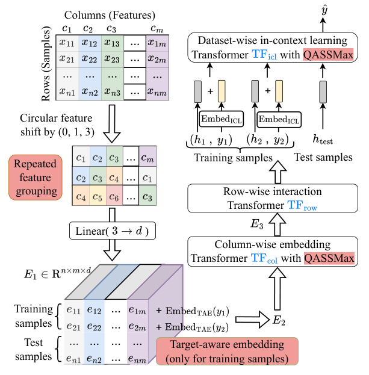
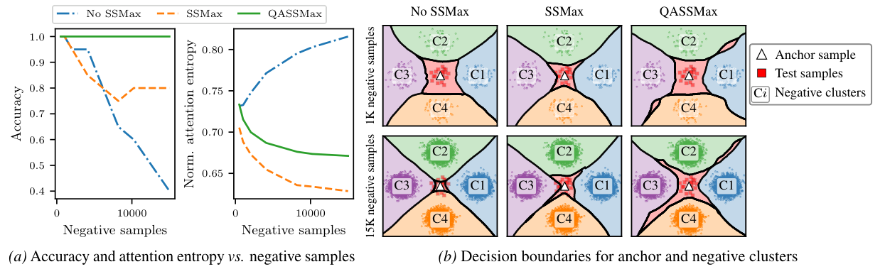
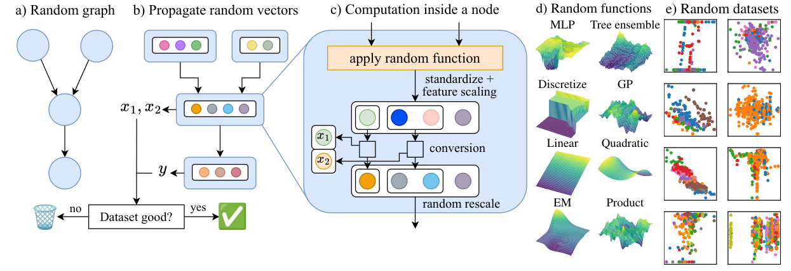
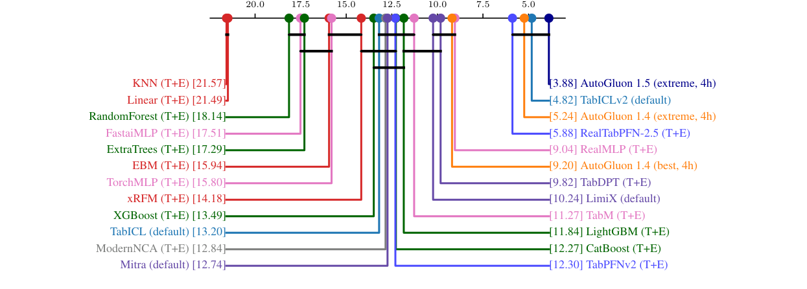
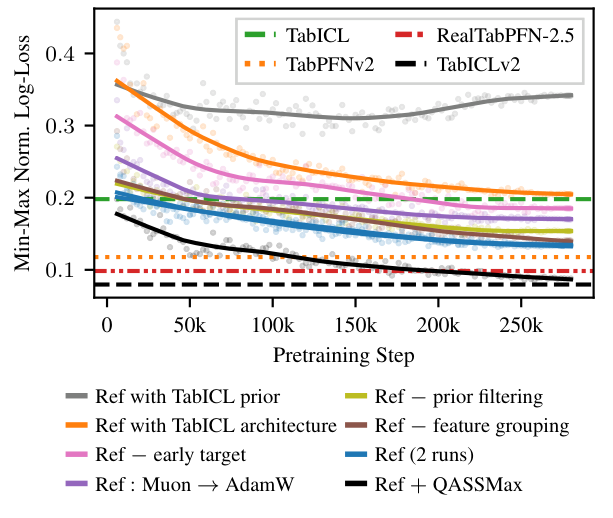

<!-- paper-reading-lang: zh-CN -->
<!-- paper-reading-theme: forest -->
# TabICLv2：先让表征看见目标，再让注意力适应长表

**原论文**：*TabICLv2: A Better, Faster, Scalable, and Open Tabular Foundation Model*，Jingang Qu、David Holzmüller、Gaël Varoquaux、Marine Le Morvan。依据Zotero `2PKI4VVL` 的79页 **arXiv:2602.11139v2，2026-09-16**，含ICML2026正文与大篇幅附录。本文中的模型与基准结果均为此版本快照。（PDF p. 1）

TabICLv1先无标签压缩行，再加入标签做ICL；v2修补其两个瓶颈：**压缩前不知道哪个特征对当前目标重要，长表时softmax又容易把注意力摊薄**。对应方案是早期目标嵌入与query-aware scalable softmax（QASSMax），再配合新合成先验、Muon优化和分位数回归。参数量仍约28M，所以收益不能只解释为把模型变大。（PDF §§3–5）

```paper-map
{"thesis":"让列级表征按目标调整、用长度与query共同控制注意力锐度，再以更丰富任务先验和训练协议驱动小模型的规模外推。","outcome":"兼顾分类与回归；TabArena/TALENT强默认性能，但不同排行榜聚合、失败补齐与硬件差异仍需说明。","outcomeSource":"PDF §6, Appendices J/K","items":[{"number":"01","label":"重复分组","text":"每列参与(j,j+1,j+3)循环三元组，保留m组而非把列数直接除以3。","source":"PDF §3, Fig. 2"},{"number":"02","label":"目标感知","text":"训练行的标签在列压缩之前就加到每个特征表示中，查询标签为空。","source":"PDF §3"},{"number":"03","label":"长序列聚焦","text":"QASSMax按log长度、head/维度及query内容缩放Q，降低attention fading。","source":"PDF §3, Fig. 3"},{"number":"04","label":"新任务先验","text":"随机DAG、8类映射、相关超参数与任务过滤，强调函数和结构多样性。","source":"PDF §5, Fig. 4"},{"number":"05","label":"训练与回归","text":"Muon、三阶段课程；独立回归checkpoint输出999个分位数，用pinball loss训练。","source":"PDF §§3–4"},{"number":"06","label":"证据和成本","text":"原生长表仍有n²计算；1M×500的低内存运行依赖磁盘offload，不是免费扩展。","source":"PDF §4.2, Appendix H"}]}
```

<!-- paper-reading-context:start -->
## 00 / 发表时的研究背景
<!-- context-cutoff: 2026-02-11; basis: first-publication -->

### 研究问题与价值

怎样在不单纯扩大参数量的情况下，让TabICL式压缩保留当前任务所需信息，同时在更长训练context上仍能关注少量关键样本？**本文同时研究信息瓶颈和长度外推，而不只是刷新一个平均排名。** 成功要由目标注入、注意力机制的对照以及分类/回归基准共同支持；能把百万行张量搬进设备，不等于已解决百万行上的全部统计与I/O问题。（PDF §§1–3、7–8）

研究价值也在开放性：如果生成器、训练和推理配方可以复核，研究者能继续修改先验与机制，而不只能比较闭源checkpoint。但“开放配方”不免除对任务范围、概率质量和资源代价的独立验证。（PDF §§1、8–9）

### 当时的领域状态

TabICLv2于 **2026-02-11首次公开**，本地却是9月16日v2。到2026年初，合成表格预训练、真实数据续训、context检索和任务蒸馏都已有竞争性方案。新问题不再是找到任意一个能用的TFM，而是：**能否用相对小且开放的模型，在精度、长表和训练成本之间取得更好的共同折中**。（PDF §§1–2；[v1摘要与日期](https://arxiv.org/abs/2602.11139v1)）

两项背景知识直接关系到设计：压缩行表示之前不知道目标，可能丢掉对当前任务重要的列；长context里即便相关token的logit最高，也会因softmax分母累积大量无关项而被“冲淡”。前者是任务信息瓶颈，后者是长度外推问题，不能仅靠把查询batch变小解决。（PDF §§2.2–3）

### 关键前作与尚存缺口

| 工作与时间 | 已有贡献 | 当时未解问题及与本文的关系 | 来源 |
|---|---|---|---|
| TabICL第一代（2025） | 用列分布编码、行压缩和最终ICL减少跨样本推理的特征轴开销 | 压缩时尚不利用目标标签；高效不代表已经保留全部任务相关信息 | PDF §§2.1、3 |
| TabPFNv2与TabPFN-2.5（2025） | 用丰富合成先验、cell结构、更深网络和部署扩展提高质量 | 先验/训练配方开放程度及大表计算仍有约束；v2寻求更可研究的小模型方案，而非只堆深度 | PDF §§1–2及§5 |
| Real-TabPFN及Real-2.5（2025） | 展示真实表继续预训练可显著增强合成底座，是必须认真对比的路径 | 新语料引入去重与污染约束；本文探索纯合成先验与结构/优化是否还能提供强默认能力 | PDF §§2.1、6；[Real-TabPFN原摘要](https://arxiv.org/abs/2507.03971) |
| Scalable Softmax / SSMax（2025）及温度扩展研究 | 用与context长度相关的缩放，缓解softmax在长序列中难以保持锐度的问题 | 固定每头缩放不必适合所有query与维度；当前v2进一步解释query-aware、逐元素缩放的设计 | PDF §2.2–3及Nakanishi引文 |
| Muon与既有优化器研究（2024以后） | 提供不同于AdamW的矩阵更新几何，为高效预训练提供工具 | 优化器在语言训练中有效，不等于已验证表格任务收益；本文需结合自身数据和结构做消融 | PDF §4.1、§7 |

### 本文为何在此时提出

需要解决的并非只有算得更快：如果压缩时不知道目标，更多训练行未必能找回被丢掉的信息；如果attention在长表失去锐度，更长窗口也未必变成更有用的context。与此同时，有限模型要学哪些任务、用怎样的训练预算，同样决定能否利用这些机制。新方向必须把这几种约束分开，并通过控制实验检查其交互，而不是先假定一项创新解释全部增益。（PDF §§2–5、7）

**版本边界**：上述动机按首发环境复原；后文QASSMax的完整公式、最新消融、基线和资源数字按本地9月v2核对，不声称这些细节在2月v1全都相同。特别是2026年5月TabPFN-3等后发系统，不能因为今天已知就改写为本文2月首次提出时已经有的先行工作。
<!-- paper-reading-context:end -->

## 01 / 思路如何形成

**以下为教学性重建，不是作者完整发现史。** 第一代压缩结构已提供高效行表示，却让表示模块在看到目标前就决定保留什么。从一般监督表示学习可以提出一个方向：如果可见训练标签能更早参与，压缩就可能优先保留对当前目标相关的差别，而不只是边缘分布相似性。这个推断不能把本文自己的表示或消融结果当成已知前提。（PDF §§2.1–3）

另一个问题可以直接由softmax看出：一个相关位置的得分即使不变，分母也会随可见位置数量增加。既有温度与SSMax工作提示，长度相关的缩放值得考虑；query-dependent scaling又提示，不同查询未必需要相同锐度。因此可得到“先让压缩知任务，再让聚焦适应长度与查询”的假设。**何种缩放和先验真正有效仍要实验决定**，而不是从该推理唯一推出最终QASSMax。（PDF §2.2；文中明确提到的SSMax、Selective Attention等启发与阅读者组织区分）

**核心直觉**：不是对每个任务保留同一份无标签摘要，而是在压缩前利用可见训练目标；不是无条件放大所有attention，而是按长度与查询调整读取的锐度。新先验与训练协议让这套小模型在更丰富任务中学会使用这些自由度。（PDF §§3–5）

## 02 / 追踪原文的一次寻针任务

沿论文 **Fig.3的真实报告实验设置**理解，而不另编坐标或概率：训练数据有四个负类簇和一个仅含单个anchor的正类簇；20个测试query固定在anchor附近，逐渐增加负例。本节追踪其中一个红色测试点；它的正类标签不能进入模型。（PDF p.4, Fig.3）

1. **输入与分组**：对这张二维表执行循环特征分组；少列时三元组中的位置可重复，不能误套“至少7列时一对列最多共组一次”的特例。模型仍先得到cell表示。（PDF §3、Appendix A.1）
2. **早期加入可见目标**：训练点的正/负标签嵌入进入特征表示，测试红点不加其真值。这样列编码可以依据哪些训练行属于anchor类来形成任务相关表示，而不是先压完再第一次看标签。
3. **长context读取**：列聚合和最终ICL的query在QASSMax下由长度与内容调制，再对可见训练材料分配权重。增加负例改变的是同一查询面对的分母与上下文，而不是把20个测试点的位置也移动到更容易的区域。（PDF Fig.3图注）
4. **输出与核验**：网络输出该查询的类概率，最后才用保留的测试真值算准确率。论文报告该设置下QASSMax维持100%准确率，但未逐条公开此查询的具体概率或内部权重；本次也未运行模型。这个结果只能作为构造机制检验，真实基准另看后文。

回归checkpoint不参加这个二分类实验；它通过分位数输出处理连续目标。下面先拆目标注入与attention公式，再解释为什么回归损失对应分位数，避免把两种任务的输出混成同一条实际执行路径。

## 03 / 压缩前的目标信息

本模型保留三模块：列Set Transformer、行内Transformer、行表示上的ICL。每个cell宽128，列模块3个ISAB/128诱导点，行模块3层和4个CLS，拼成512维；最终ICL12层。分类和回归分开训练，参数约28M。（PDF §3, Appendix A.4）

首先以循环位移重复分组：

$$
E_1[i,j]=\mathrm{Lin}(x_{i,j},x_{i,(j+1)\bmod m},x_{i,(j+3)\bmod m}).
$$

总共仍有 $m$ 组，每个原特征可出现在多个组中。它与TabPFN-2.5把3列压成一个位置不同：这里不直接将组数降到 $m/3$，目的是打破相同边缘分布列的对称性，同时保留细粒度列信息。代价是列数带来的行内处理没有以同样比例下降。（PDF §3）

训练行立即加入目标：

$$
E_2[i,j]=E_1[i,j]+\mathrm{Embed}_{\mathrm{TAE}}(y_i),\qquad i\in D_{\mathrm{train}}.
$$

查询不加真实标签。这样列模块不只看到数值边缘分布，还能编码与训练目标的关联；行压缩前就有了任务偏好。标签在最终ICL模块又注入一次。**阅读者解释**：若某两列分布相似、只有一列能预测当前目标，早期监督可减小任务无关压缩丢失关键列的风险。（PDF §3；例子为机制说明）

看Fig.2请按从左下到右上的实际箭头：分组→早期目标→列编码→行聚合→ICL。不是只有最后才看标签，也不是使用测试标签增强列统计。（PDF p. 3, Fig. 2）



*原论文 Fig. 2，PDF p. 3。训练样本的目标可见，测试样本目标不可见；QASSMax只放在需要长度外推的列聚合及ICL。*

## 04 / 长表attention的数学

考虑某个相关token的logit为 $s_*$，其余 $n-1$ 个无关token为 $s_0$，标准softmax的该权重为：

$$
a_* =\frac{e^{s_*}}{e^{s_*}+(n-1)e^{s_0}}=\frac1{1+(n-1)e^{s_0-s_*}}.
$$

若差值不随 $n$ 增大，即使相关token一直最高，其质量仍可能被越来越多负例稀释。**说明性代入**：差值5时，100个token约0.60，10,000个约0.015；不是模型忽然忘记排序，而是归一化分母改变了。（PDF §2.2；式和数值为阅读者推演）

SSMax用每头 $s_h\log n$ 缩放query。QASSMax进一步令：

$$
\widetilde q_{hi}=q_{hi}\,\mathrm{MLP}_{\mathrm{base}}(\log n)_{hi}\left[1+\tanh\big(\mathrm{MLP}_{\mathrm{gate}}(q_h)_i\big)\right].
$$

$h$为head、$i$为其维度，$n$为训练context大小。base学习长度趋势，gate按当前query在 $(0,2)$ 内调制；它不是直接对输出概率做温度校准。gate末层初始为0，因此初始乘子为1。它兼容softmax/FlashAttention生态，避免必须重写为另一种稀疏算子。（PDF §§2.2–3, Appendix A.4）

Fig.3中的四个负类簇之外只有一个anchor样本，评估点固定在anchor附近。先看随负例增加准确率与归一化attention熵的变化，再看下方15K负例时边界有没有包住红点。QASSMax在这个构造任务上保持100%准确；这不是现实表的100%泛化保证。（PDF p. 4, Fig. 3）



*原论文 Fig. 3，PDF p. 4。checkpoint均训练280K步，测试20个固定anchor邻域点；熵除以log n归一化。*

## 05 / 新先验提供什么任务

先验从随机图和随机节点函数生成联合表格，取不同节点维度作为观测列与目标；部分隐藏维度自然引入不确定性，正文特别说明不像旧设计在每个节点直接加高斯噪声。八类函数包含MLP、对称树集成、离散化、多元GP、线性、二次、EM式平台和乘积，覆盖不同平滑性、轴对齐与交互。（PDF §5）

相关标量采样让同表多列的基数等超参数可相关；随机Cauchy图增加局部/全局连接多样性。图筛选先去掉与目标没有共同祖先的输入，再用简单ExtraTrees与常数基线的bootstrap比较过滤完全难以学到信号的任务。阶段1约过滤35%分类、25%回归；这使训练预算更集中，但也引入“有可学习关系且能被此筛选器检测”的任务选择偏好。（PDF §5, Appendices E/F）

Fig.4从a到e是生成与拒绝流程；d不是八个部署子模型，而是生成任务时的函数菜单。一个图可以经过组合和后处理产生很多不同列关系，最终模型仍通过ICL预测，而不在新表上显式恢复该图。（PDF p. 6, Fig. 4）



*原论文 Fig. 4，PDF p. 6。SCM先验不提供对现实数据的因果识别保证。*

## 06 / 课程与分位数推导

| 阶段 | 步数 | 合成表样本数 | 训练份额 | 最高学习率 |
|---|---:|---|---|---|
| 1 | 500K | 1024 | 30%–90% | 8e−4 |
| 2 | 40K | 400–10240，log-uniform | 80% | 1e−4 |
| 3 | 10K | 400–60K，log-uniform | 80% | 2e−5 |

所有阶段最多100特征、有效batch64，约35M任务。Muon以Newton–Schulz近似正交化更新方向，并按矩阵尺寸缩放学习率；它与更高学习率、裁剪阈值等一起构成优化协议。每个分类/回归模型约24.5 H100 GPU-days；这是每模型，不是两种任务共同总成本，也不是推理时间。（PDF §4.1）

### 回归预测999个分位数

输出 $\widehat Q_\alpha(x)$，$\alpha=0.001,\ldots,0.999$，对所有分位数求pinball loss：

$$
\mathcal L=\sum_\alpha\rho_\alpha(y-\widehat Q_\alpha),\qquad
\rho_\alpha(u)=u\left(\alpha-\mathbf1\{u<0\}\right).
$$

例如 $\alpha=0.9$ 时，低估1单位罚0.9、高估1单位罚0.1，促使模型学到90%分位而不是均值。推理点估计平均这些分位数，近似利用 $\mathbb E[Y]=\int_0^1Q_\alpha\,d\alpha$；概率输出再排序或isotonic保证单调，并外推指数尾部。有限网格平均与精确分布均值并不完全相同。（PDF §§3–4, Appendix I；算例为阅读者说明）

为什么这种非对称惩罚选出分位数？这是标准统计结论的教学推导，不是本文新发明的定理。固定输入与context，设候选预测为t，真实条件CDF为F；在连续分布且可交换求导与期望的条件下，低于t的样本每个产生斜率 $1-\alpha$，高于t的产生 $-\alpha$，所以

$$
\frac{d}{dt}\mathbb E[\rho_\alpha(Y-t)]
=(1-\alpha)F(t)-\alpha(1-F(t))=F(t)-\alpha.
$$

斜率为0时 $F(t)=\alpha$，即t为该分位数；存在原子质量时应改用次梯度与分位数区间，而不强求唯一等式解。因此输出0.9分位不等于“90%置信度的均值”。训练出有限网格、保证其排序、外推尾部又是后续不同步骤，不自动给出真实任务上的分布校准保证。（PDF Appendix I 的分位输出；数学说明为教学补充）

### 多于十类需要两层扩展

早期目标嵌入只有10类，不能照v1直接在最后套层级分类。v2先用mixed-radix生成每个不超过10类的标签视图，分别运行列模块后**平均表示**，然后最终ICL仍做层级分类。16类例子用基数4×4，$y=11$变成 $(2,3)$；不应把两次预测概率简单相乘冒充这里的表示平均。（PDF Appendix A.3）

## 07 / 实验问题与答案

整体结果回答“完整开放系统是否有竞争力”，逐项消融才回答“设计选择是否帮助当前训练设置”，寻针任务检验长序列机制，超大表实验检验资源与特定数据质量。下面按这些问题读，尤其区分官方最终checkpoint和等步数reference，不能用最终模型对reference的差值声称某一个模块的独立效应。（PDF §§6–7）

TabArena有51表，用二分类AUC、多分类log-loss、回归RMSE；TFM用8个estimator。TALENT原始300表，64/16/20划分，用分类accuracy与回归RMSE，TFM用32个estimator并排除开发表。默认“不调参”仍包括这些内置多视图前向，不能当成只算一次矩阵前向的延迟。（PDF §6, Appendices J/K）

Improvability是平均 $1-e_d^*/e_{d,m}$，越低越好；Elo和平均rank则主要看相对排序。以下是附录明确的中心值，不能跨行集合拼成一个统一排行榜。（PDF Appendices J.2/K.2）

| 评估 | 方法 | 平均rank ↓ | 说明 |
|---|---|---:|---|
| TabArena全51表 | AutoGluon1.5 extreme4h | 3.88 | 比TabICLv2的平均rank更好 |
| TabArena全51表 | TabICLv2默认 | 4.82 | 对AutoGluon1.5成对胜率57% |
| TabArena全51表 | RealTabPFN-2.5 T+E | 5.88 | TabICLv2对它成对胜率59% |
| TALENT附录总集 | TabICLv2 | 4.66 | 开发集排除范围依论文协议 |
| TALENT附录总集 | RealTabPFN-2.5 | 5.11 | TabICLv2对它成对胜率62% |
| TALENT附录总集 | TabPFN-2.5 | 5.45 | TabICLv2对它成对胜率65% |

原Fig.J1必须保留：它说明即使摘要强调“领先”，AutoGluon1.5的rank仍更低，且连线上的方法未必显著不同。成对胜率略过半可以与平均rank不占优同时成立，因为rank还依赖其他方法与各数据集排序。（PDF p. 50, Fig. J.1）



*原论文 Fig. J.1，PDF p. 50。不能把摘要中的一个聚合优势扩展成所有指标和对手均显著更好。*

### 哪个改变真正经受了对照

Fig.10每次修改reference一个组件，均训练280K步；reference没有QASSMax且列/ICL只有4头，官方完整模型训练更久、8头。所以实线消融和虚线完整checkpoint不是严格等预算的组件对照。新先验影响最大；早期目标、Muon与QASSMax各有明显贡献，分组与过滤较小，但效果不应简单相加。（PDF §7, Fig. 10）



*原论文 Fig. 10，PDF p. 8。60个开发验证表、每表最多2048训练样本、两个split；不是完整TALENT的因果贡献比例。*

```paper-experiments
{"title":"将规模、精度和机制证据分开","rows":[{"question":"是否能缓解长context注意力衰退？","setup":"anchor分类玩具任务，固定20查询、增加负例；相同280K预训练预算。","observation":"QASSMax在15K负例仍保持100%准确与低熵，无缩放版本明显退化。","conclusion":"对构造机制的直接验证，不是所有长表任务的精确保证。","source":"PDF Fig. 3"},{"question":"改善只是模型变大吗？","setup":"约28M参数，reference逐个替换先验、架构、优化、标签与分组。","observation":"旧先验配新架构仍很差，旧架构配新先验也有限；显示先验与架构强相互作用。","conclusion":"支持协同设计，不把最终差值只归因于单个模块。","source":"PDF Fig. 10, §7"},{"question":"大表是能运行还是有精度证据？","setup":"1M×500内存/时间演示；另在581K Covertype与671K Kiva等真实分类任务比较。","observation":"演示可在50GB GPU和24GB CPU以下运行，约450s；真实大表仍有强准确率。","conclusion":"资源可行性和真实任务质量来自不同实验，不能合并为所有百万表都最优。","source":"PDF §4.2, Fig. 9, Appendix H"},{"question":"概率回归已被全面验证吗？","setup":"999分位输出与toy概率示例，主回归benchmark主要RMSE。","observation":"点预测强，分布回归缺少成熟基准，仅有toy检验。","conclusion":"能力接口存在不等于所有真实数据分布均已校准。","source":"PDF §8, Appendix I"}]}
```

## 08 / 启示与适用边界

- **压缩先看什么，决定以后还能用什么**：早期标签将当前任务信息前移，但也使表示不再像v1那样完全标签无关，多类扩展需要额外处理。（PDF §3、Appendix A.3）
- **窗口变长不等于有效证据同比增加**：softmax分母提供明确的失败机制，QASSMax对其作有条件修正；构造任务成功不能代替真实长表验证。（PDF Fig.3、Fig.9）
- **任务多样性、架构与优化存在交互**：消融支持共同设计，不支持将增益线性相加；开放实现让这些关系可继续研究，却不会取消磁盘、I/O和分布失配代价。（PDF Fig.10、Appendix H）

压缩后ICL仍有 $O(n^2)$，整体约 $O(n^2+nm^2)$。1M×500、128维float32的cell中间张量约250GB；模型用磁盘memmap、分批写和异步拷贝控制主存。50GB显存和24GBCPU之下的运行并不是只使用这么多总存储，代价转为磁盘容量与I/O。（PDF Appendix H）

缺失目前均值填补，不原生利用列名/自由文本语义，多输出与漂移仍未解决。早期目标注入增强任务感知，也让“只缓存一套完全标签无关行表示处理所有类分组”不再像v1那样直接成立，多类别必须额外处理。（PDF §§3, 8）

**阅读者综合**：此模型缩小了“高效压缩”与“任务相关信息”的矛盾，并用长度适应attention减轻外推衰退。新先验与小模型结构必须一起看：更长上下文本身不是充分条件，更大的分母、任务覆盖和预处理都会改变实际收益。它提供可研究的开放配方，而不是仅一个更高的排名数字。（PDF §§3–9）

<!-- 可视化决策：早期标签、QASSMax公式与anchor对照可静态同时呈现；混合基数需要区别“表示平均”和“概率路径”，用算例比交互按钮更准确。原图保留分布和全部对照，不增加装饰性互动。 -->
<!-- 覆盖：正文、Appendix A结构/多类、C消融、E/F相关生成流程、H资源、I分位输出、J/K完整指标定义与聚合结果；未逐项复现全部GP函数理论证明，不将它们作为本页新结论。 -->
