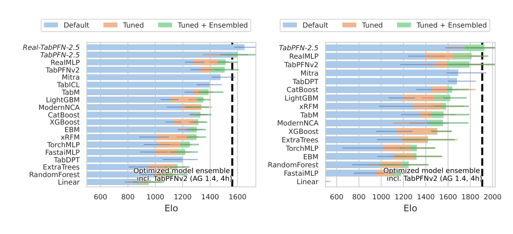
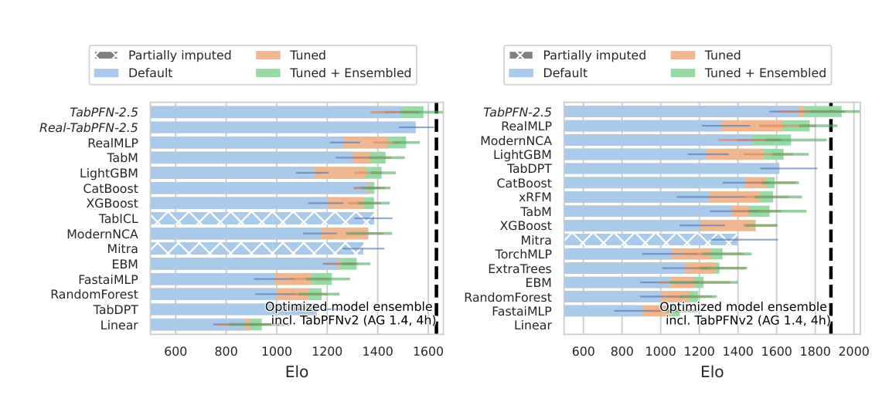
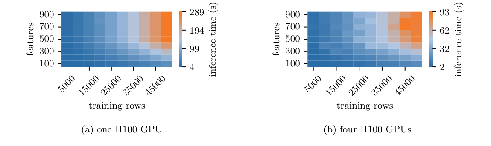
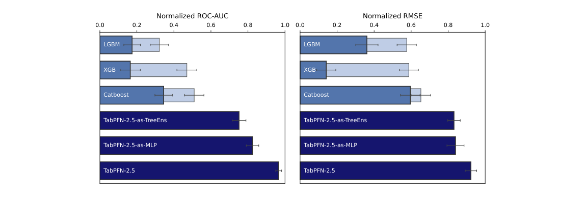
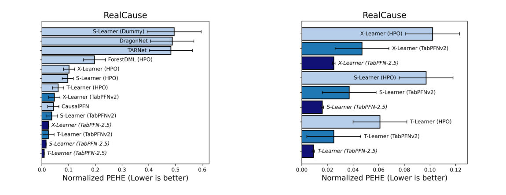

<!-- paper-reading-lang: zh-CN -->
<!-- paper-reading-theme: plum -->
# TabPFN-2.5：扩大合成先验，并把通用预测与部署模型分开

**原论文**：*TabPFN-2.5: Advancing the State of the Art in Tabular Foundation Models*，Prior Labs Team。依据Zotero `SA9FC8Q4` 的35页 **arXiv:2511.08667v2，2026-02-05**；封面报告日期为2025-11-06。版本信息按本地PDF记录，不能仅按Zotero的2025年份推定文件内容。（PDF p. 1）

这份技术报告沿用第二代的双轴attention，重点不是提出一个全新统计目标，而是**更深网络、扩展合成任务、推理多视图和可部署蒸馏**。理解它必须区分三个对象：纯合成预训练的TabPFN-2.5、在真实表继续训练的Real-TabPFN-2.5，以及针对当前任务蒸馏出的MLP/树。三个对象的迁移、成本和开放程度不同。（PDF §§3–6）

```paper-map
{"thesis":"用更大范围的合成任务和更强双轴模型扩展上下文预测能力，再用任务蒸馏解决固定系统的低延迟部署。","outcome":"推荐范围50K行、2K特征，公开评估扩展至100K；分类与回归、默认与调参、纯合成与真实微调的结论应分别读。","outcomeSource":"PDF §§1, 4","items":[{"number":"01","label":"容量扩展","text":"回归18层、分类24层，特征分组从2改为3，并加入64个可学习thinking rows。","source":"PDF §3"},{"number":"02","label":"任务扩展","text":"合成先验扩大行列范围和分布多样性；报告只公开关键变化，不足以独立重建全部生成器。","source":"PDF §3"},{"number":"03","label":"真实续训","text":"Real版本额外使用43张真实表，并报告对公开与内部评估集的去重。","source":"PDF §3, Appendix C"},{"number":"04","label":"多视图推理","text":"列/类置换、量化与稳健缩放等预处理产生集成，HPO/PHE是另一预算层。","source":"PDF §3"},{"number":"05","label":"蒸馏部署","text":"从通用teacher生成任务专属MLP或树，不再在每次预测时携带上下文。","source":"PDF §§3, 4.4"},{"number":"06","label":"证据边界","text":"TabArena-Lite兼容子集、全表和内部基准分开；内部排名不冒充公开复现。","source":"PDF §§4.1–4.4, Appendix G"}]}
```

<!-- paper-reading-context:start -->
## 00 / 发表时的研究背景
<!-- context-cutoff: 2025-11-11; basis: first-arxiv-publication -->

### 当时的领域状态

报告内标注 **2025-11-06**，arXiv可核验首发为 **2025-11-11**；本地PDF是2026年2月v2。本节讨论2025年末已有的环境，不把随后版本更新当成最初研究条件。此时“表格基础模型能否有用”已经有较强证据，竞争焦点转为**扩大适用形状、提高默认表现，以及让固定任务部署更便宜**。（PDF §§1–3；[首发记录](https://arxiv.org/abs/2511.08667)）

基础模型的在线“fit”常指处理上下文，而不是梯度训练；即便建模很快，每次服务查询仍可能要读取大量训练状态。因而基础模型优于逐表树的建模成本，与已经拟合好的树具有更低预测延迟，可以同时成立。这是报告为何要把通用teacher与任务蒸馏学生分开的实践背景。（PDF §§3、5）

### 关键前作与尚存缺口

| 工作与时间 | 已有贡献 | 当时未解问题及与本文的关系 | 来源 |
|---|---|---|---|
| TabPFNv2 / Nature模型（2025年1月） | 扩充合成先验，支持回归、类别和缺失，使中小表默认预测显著增强 | 推荐约10K行/500特征的规模与重复推理成本仍限制应用；2.5在此底座继续扩展 | PDF §§1、3 |
| TabICL（2025年2月）、TabDPT（2024预印本） | 分别探索压缩后的高效ICL与真实表SSL/检索，说明扩展并非只有一条路径 | 各有任务范围、计算和数据依赖权衡；本报告仍沿双轴结构，需解释其扩展与部署折中 | PDF §4.1及对比文献 |
| Real-TabPFN（2025年7月） | 用少量精选真实表继续预训练，说明纯合成权重还可从真实分布获益 | 增益伴随新的语料、去重和污染审查；本报告的Real-2.5是另一checkpoint，不能与纯合成版混称 | PDF §3、Appendix C；[原工作摘要](https://arxiv.org/abs/2507.03971) |
| TabArena（2025年6月）与强逐表NN/AutoML基线 | 使默认、搜索与跨配置集成可以在更明确的任务/协议上比较，强调完整系统潜力 | 一个默认模型必须面对强调参集成，而不只是默认XGBoost；报告用该环境说明何时值得免逐表搜索 | PDF §4.1；[TabArena首发](https://arxiv.org/abs/2506.16791) |

### 本文为何在此时提出

作者一方面增加任务覆盖和模型能力——更多行列、更深结构、thinking rows和多视图预处理；另一方面承认高吞吐服务可能不适合一直保留context，于是提供蒸馏为MLP/树的路径。这里的新意是**强通用预测器与低延迟任务产物的结合**，不是说每种网络组件或知识蒸馏概念都首次出现。（PDF §§3–5）

这条历史定位还能解释两种容易混淆的“训练”：Real版本是基础权重在跨表语料上继续训练；蒸馏是针对当前任务构造专属模型。两者都可能改善使用体验，却不是同一种贡献，结果和成本不能相互挪用。报告未充分披露的生成器与闭源蒸馏细节仍应标未知，不能靠今天的实现倒填2025年的算法过程。
<!-- paper-reading-context:end -->

## 01 / 没有改变的统计接口

输入仍是当前表的有标签训练行 $D_{\mathrm{train}}$ 和未标注查询，输出 $q_\theta(y\mid x,D_{\mathrm{train}})$。可以用继承PFN方法的目标概括：

$$
\mathcal L(\theta)=\mathbb E_{D\sim p(D)}[-\log q_\theta(y_{\mathrm{test}}\mid X_{\mathrm{test}},D_{\mathrm{train}})].
$$

这不是报告新推导的定理，而是它沿用的PFN接口。主要改进在于 $p(D)$ 的覆盖、表示容量以及推理流程。报告没有给全部新生成器超参数、训练课程与细粒度消融，不能为了“解析完整”就编造它们。（PDF §3；式为继承机制的说明性重写）

更深模型并不只是简单把12层翻倍：每个特征位置的分组从2个原特征变成3个，在相同原列数下减小cell表示规模；回归输入从线性改成两层MLP。64个thinking rows是预训练学到的latent token，提供额外运算位置或attention sink，不是测试时调用语言模型，也不是生成自然语言思维链。（PDF §3）

```paper-path
{"title":"通用预训练、可选续训与任务部署的分岔","stages":[{"title":"合成任务预训练","role":"通用teacher","action":"在更丰富、更多行列的合成任务上训练较深双轴Transformer。","why":"让先验覆盖扩展后的表格规模与复杂关系。","cost":"生成器细节与训练成本未完整开放披露，不能独立重建所有环节。","output":"纯合成TabPFN-2.5","source":"PDF §3"},{"title":"选择真实续训版本","role":"可选分支","action":"在43张经筛选去重的真实表继续训练，得到Real-TabPFN-2.5。","why":"调整合成先验与真实分布之间的差异。","cost":"新增真实数据依赖与污染审查需求，不能再称完全纯合成。","output":"另一个checkpoint而非默认模型同义名","source":"PDF §3, Appendix C"},{"title":"组装当前任务视图","role":"在线ICL","action":"当前表经过互补预处理、列/类置换等，固定权重模型输出预测并聚合。","why":"利用编码与预处理变化缓解顺序、异常值及分布失配。","output":"任务预测；可进一步HPO/PHE","source":"PDF §3, §4.1"},{"title":"按需求蒸馏","role":"可选部署分支","action":"以当前训练集和通用teacher构造任务专属MLP或树集成。","why":"高吞吐服务不宜每次重读大上下文。","cost":"蒸馏产物只适用于该任务；引擎为proprietary，报告未给完整算法。","output":"普通单点输入的低延迟预测器","source":"PDF §3, §4.4"}]}
```

## 02 / 先验、真实续训与数据泄漏

纯TabPFN-2.5仅合成预训练；Real版本在43个OpenML/Kaggle表续训。作者描述对TabArena、内部评估与内部验证集用数据标识、schema、行列哈希和人工元数据检查去重，排除相关派生版本。这是作者报告的方法，不是本次重新下载43表执行的污染审计。（PDF Appendix C）

报告还用旧TabPFNv2作新模型配置表现的surrogate：约100次完整训练的约50维配置，预测10,000个候选配置的验证成绩，再选择值得重训的区域。这是**算法开发阶段的元级HPO**，与给某个最终用户表做60配置调参完全不同。说下游“无调参”不意味着模型开发没有使用验证数据或搜索。（PDF p. 5）

预处理新增robust scaling/soft clipping、量化、标准化与SVD附加表示，多种变换形成多个estimator。正文称置换适配，但每组保留位置/分组结构，实际通过多视图近似减弱顺序偏差，不应当作每种排列输出严格相同的数学保证。（PDF §3）

## 03 / 小表与全表的公开结果不是同一个分母

公开基准采用TabArena-Lite，即减到一个外层测试fold，保留其任务集合。Fig.3限制至多10K训练行、500特征；Fig.4放宽到全部任务、最高100K行、2K特征。TabPFN-2.5调参尝试60配置，基线200配置；不适用方法的位置可能补齐，原图以斜线标记。（PDF §4.1, Figs. 3–4）

先读Fig.3左边分类和右边回归的差异：分类默认已能超过四小时AutoGluon1.4；回归更依赖60配置调参。Real版本还带真实表续训，不能把它的柱子当作纯合成默认模型。（PDF p. 7, Fig. 3）



*原论文 Fig. 3，PDF p. 7。AutoGluon1.4为四小时extreme集成；默认、HPO与HPO+集成分别标色。*

Fig.4扩大到全表后，TabPFN-2.5是很强的默认模型；调参后回归超过、分类接近AutoGluon1.4。图中“partially imputed”很重要：它表明某些基线未在对应形状上运行，不是填补输入缺失值。（PDF p. 8, Fig. 4）



*原论文 Fig. 4，PDF p. 8。部分补齐成绩与原生运行成绩需区别；四个最大任务还移除了dt-pfn调参选项。*

### 推荐上限、运行上限和验证上限

| 概念 | 报告给出的范围 | 不能推出什么 |
|---|---|---|
| 推荐使用范围 | 50K行、2K特征 | 不是每个estimator实际同时读取2K列 |
| 公开全表评估 | 最高100K训练行、2K特征 | 不表示所有形状组合都有充足实证 |
| 探索性单H100运行 | 分类约160K×500、回归约85K×500 | 正文明确不在正式benchmark统计里 |
| 每estimator特征处理 | 最多约500列的子采样 | 大表输入支持不等于单次全特征attention |

这些口径分别来自正文、脚注和速度段。报告摘要的“20倍cells”是推荐行列上限乘积相对第二代的变化，不等于速度加快20倍，也不证明任意1亿cells形状质量一致。（PDF §§1, 4.3及脚注1）

## 04 / 加速到底发生在哪条路径

双轴attention仍带行数二次项。报告将总计算写为：

$$
O\big(r^2\min(c,500)+r\min(c,500)^2\big),
$$

$r$为行数、$c$为原列数，500来自每estimator的特征限制。更大feature group、预处理优化和FlashAttention-3让该模型相比第二代约1–2.3倍快；这不是线性attention。多GPU能并行不同计算，但不能据此说算法复杂度变了。（PDF §§3, 4.3）

Fig.8请先读左/右分别一张/四张H100，再看横轴训练行、纵轴特征。颜色计的是处理训练上下文并预测500测试行的秒数；既不是纯cached predict，也不是每个测试点延迟。完整比较还依赖精度、batch和硬件。（PDF p. 9, Fig. 8）



*原论文 Fig. 8，PDF p. 9。大表ICL仍有首次处理成本，不能用多GPU时间冒充CPU低延迟。*

缓存可加速后续查询，但本版分类缓存约每cell **6.1KB GPU+48.8KB CPU**，回归约少25%。**说明性预算**：10K×100=1M cells，仅按该线性估计就约6.1GB显存与48.8GB主存；不含其他开销，也未计多estimator。因此报告只推荐小表使用该模式。（PDF §5；本段乘法为阅读者估算）

蒸馏则换了一条计算路径：用teacher构建该表的MLP或树，部署不再做ICL。Fig.7比较蒸馏产物与teacher和基线的任务精度；右边RMSE面板的归一化方向要看图轴，不能假定所有“normalized”都自动高者更好。它支持某些数据上的精度保留，完整闭源蒸馏细节和普适延迟倍率并未在图中给出。（PDF §§3, 4.4, Fig. 7）



*原论文 Fig. 7，PDF p. 9。蒸馏产物是dataset-specific，不能把其单点速度当原通用模型速度。*

## 05 / 预测更强与因果识别是两件事

报告把TabPFN作为T/S/X等CATE meta-learner的基础估计器。T-learner先分别拟合治疗组和对照组条件均值：

$$
\widehat\tau(x)=\widehat\mu_1(x)-\widehat\mu_0(x).
$$

评估PEHE为预测治疗效应与半合成真值之间的均方根差。**说明性例子**：两个条件结果分别8与5，差值3是效应估计；是否可识别为因果效应，还依赖无未观测混杂、重叠性等任务假设，不能从teacher使用SCM合成预训练直接得到。（PDF §4.5, Appendix D；例子和假设解释为阅读者重建）

原Fig.9与Fig.10分别看全部估计器和固定meta-learner替换底座的比较。T-learner+TabPFN-2.5在RealCause上很强，但这是有明确半合成生成/识别条件的基准，不是任意观察数据上因果关系都已解决。（PDF pp. 9–10, Figs. 9–10）



*原论文 Figs. 9–10，PDF p. 10。PEHE低者更好；预测底座改善可以迁移到效应估计，不替代因果识别条件。*

## 06 / 证据图谱与部署选择

```paper-experiments
{"title":"报告验证了哪些层次","rows":[{"question":"默认模型是否比上一代更强？","setup":"TabArena-Lite兼容子集及全表，按任务类型分别计Elo/成对分数。","observation":"默认2.5明显提升；回归在HPO后进一步超过强AutoML。","conclusion":"支持版本升级的系统结果，没有细分每个新模块的独立贡献。","source":"PDF Figs. 2–4, Appendix G"},{"question":"真实续训是否进一步有益？","setup":"43真实表续训、对内部和TabArena去重，比较Real版本。","observation":"Real版本尤其在分类上更强。","conclusion":"是额外数据与训练的版本，不将其成绩记到纯合成默认模型。","source":"PDF §3, Appendix C, Figs. 3–4"},{"question":"大表和多特征能否处理？","setup":"公开至100K训练行、2K列；内部任务另测50K和高维切片。","observation":"保持强默认表现，但速度仍随形状及每estimator选列变化。","conclusion":"支持定义范围，内部任务并非全部公开可复核。","source":"PDF §§4.2–4.3, Appendix F"},{"question":"固定任务能否更便宜服务？","setup":"蒸馏为任务MLP/树，比较精度；单独测试H100上下文处理速度。","observation":"蒸馏保留大部分精度，通用ICL优化约1–2.3倍加速。","conclusion":"区分蒸馏、cache与通用模型的三种成本，不能混用倍率。","source":"PDF §§3–5, Figs. 7–8"}]}
```

科学边界还包括许可与开放性：报告允许研究和内部评估，但其专门许可限制商业/生产使用，蒸馏引擎也非完整公开算法。这里是按此版本报告说明，不提供实时法律判断。能下载权重、能完整重建训练、能商业部署，是三种不同权限与可复现程度。（PDF §6）

**阅读者综合**：这篇报告把“通用算法迁移”和“任务专属高速部署”分为两层。更强teacher可以提高现有任务流程与蒸馏产物，但更大模型、额外真实续训、更多推理视图都不是零成本；看结果必须问清楚使用了哪一种模型、哪一种预算和哪一种部署路径。（PDF §§3–7）

<!-- 可视化决策：报告关键在多个模型/部署分支与分类回归条件的对照，静态阶段图、两类公开评估图、蒸馏与速度原图更适合并列读取；不为未公开蒸馏过程制作虚构交互。 -->
<!-- 覆盖：正文模型/实验/速度/许可、Appendix C去重、D因果设置、F归一化与高维、G成对比较；没有把推广页的总体描述当逐组件消融，也没有声称核验未提供的完整生成器。 -->
