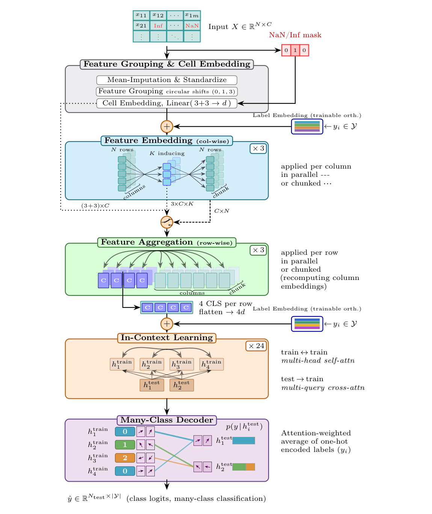
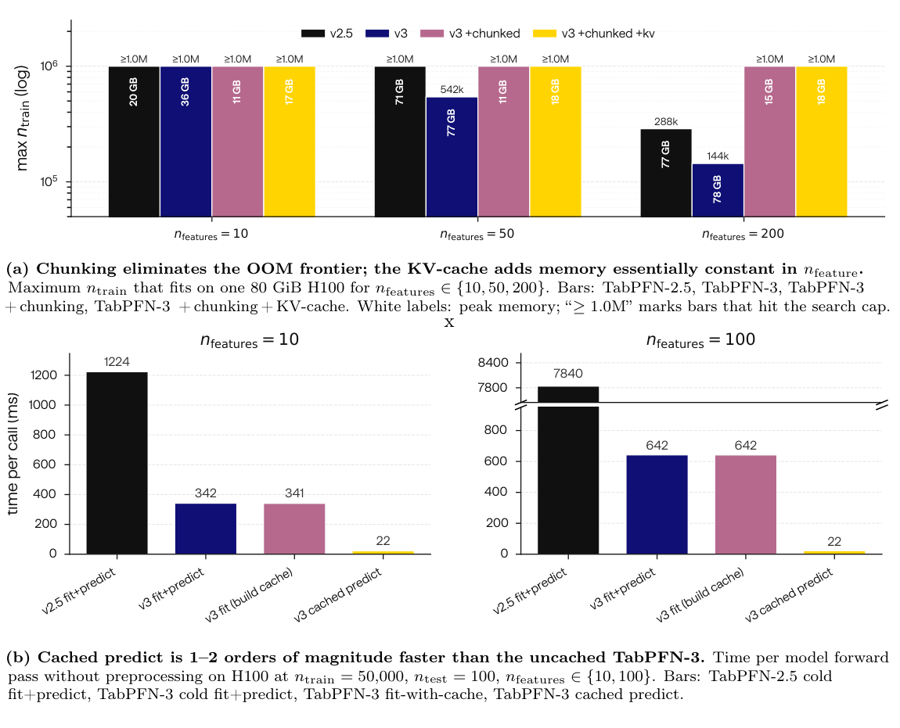
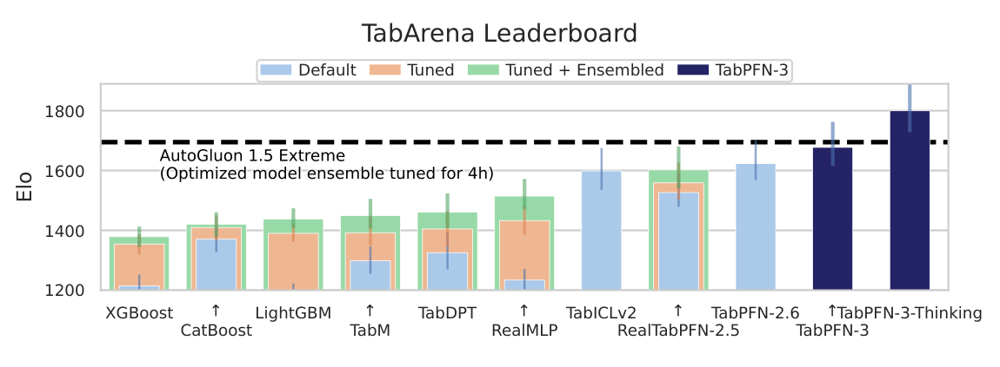
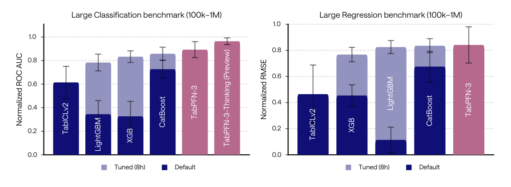
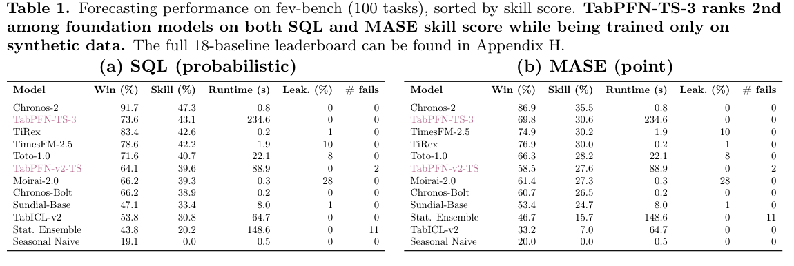
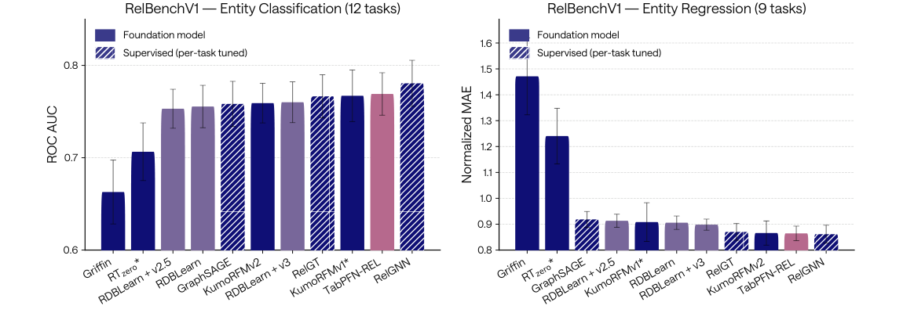

<!-- paper-reading-lang: zh-CN -->
<!-- paper-reading-theme: cobalt -->
# TabPFN-3：行压缩、软检索解码与百万行的内存路径

**原论文**：*TabPFN-3: Technical Report*，Prior Labs Team。依据Zotero `4ZXDEDKZ` 的83页 **arXiv:2605.13986v2，2026-05-28**，报告内部日期2026-05-12。数值与许可均按此快照，不与其他报告的后来排行榜或API行为拼接。（PDF p. 1）

这一代最重要的变化不是在TabPFN-2.5上继续堆cell层，而是借鉴TabICL的**先压成行、再跨行ICL**。它进一步把分类输出改为对训练标签的attention加权，使用保持全表摘要的row-chunking，缩小test侧KV-cache。论文还有Thinking、文本、时间序列和关系数据扩展，必须区分公开checkpoint与API版本，以及可复现结构和只披露接口的组件。（PDF §§2–3）

```paper-map
{"thesis":"把特征处理与行间学习解耦，并缓存全表摘要和紧凑训练状态，使固定权重ICL可在更长context上以可控内存运行。","outcome":"验证的形状前沿是1M×200、100K×2K、1K×20K，不是任意1M×20K；统计领先与能装进显存也不是同一实验。","outcomeSource":"PDF Fig. 4, §§3.2.1–3.2.3","items":[{"number":"01","label":"表示结构","text":"循环特征分组、目标感知列编码、四CLS行压缩、24层行ICL，并用QASSMax适应长度。","source":"PDF §2.1, Fig. 5"},{"number":"02","label":"分类输出","text":"query读取训练行表示，以one-hot训练标签为values，输出软近邻类别分布。","source":"PDF §2.2"},{"number":"03","label":"内存系统","text":"先保留全训练表诱导摘要，再流式处理行；test侧单KV头使缓存主要随行数而非cells增长。","source":"PDF §2.4"},{"number":"04","label":"合成先验","text":"更多图、节点函数、类别/空间/时间与分布外任务，报告训练超过8万亿tokens。","source":"PDF §2.5"},{"number":"05","label":"多种版本","text":"公开TabPFN-3、带文本的Plus和额外测试时计算Thinking不是同一可下载产物。","source":"PDF §2.6"},{"number":"06","label":"证据分层","text":"TabArena、TALENT、内部大表、many-class、时间序列与关系任务各有不同协议。","source":"PDF §3"}]}
```

<!-- paper-reading-context:start -->
## 00 / 发表时的研究背景
<!-- context-cutoff: 2026-05-13; basis: first-arxiv-publication -->

### 研究问题与价值

这份报告的具体问题是：**如何把已有强表格ICL推进到更长context、更多类别和更便宜的重复查询，同时维持有竞争力的预测质量？** 输入仍是新任务的有标签context与无标签查询；扩展的障碍却不只在准确率，还包括压缩前cell激活、训练状态缓存以及固定类别输出槽位。只解决某一项内存峰值，不代表其他限制同步消失。（PDF §§1–2）

这使两种价值需要分别验证：更大任务是否真的预测得好，固定任务的后续查询是否更便宜。文本、时间序列和关系数据又涉及不同版本或专门流程，不能用普通checkpoint的速度和Thinking/Plus的精度合成一个不存在的产品。（PDF §§2.6、3）

### 当时的领域状态

报告内日期2026年5月12日，arXiv **5月13日首发、5月28日修订**。到这个阶段，TFM已在多种中小型任务上表现很强；新的研究与部署压力转向更多行、更多类、重复查询和混合输入。大表的难题不仅是模型是否准确，还包括中间cell表示、缓存和首次/后续调用的内存路径。（PDF §§1–2；[首发记录](https://arxiv.org/abs/2605.13986)）

需要先区分**压缩**与**缓存**：压缩改变后续推理使用的表示形状，缓存复用此前对同一训练context的计算。模型能一次运行百万行，不等于每次查询都从零处理百万行也便宜；同样，已有高速cached predict也不代表首次建缓存无需资源。这些约束推动本篇把架构与推理系统一起设计。（PDF §2.4）

### 关键前作与尚存缺口

| 工作与时间 | 已有贡献 | 当时未解问题及与本文的关系 | 来源 |
|---|---|---|---|
| TabPFN-2.x，尤其2.5（2025） | 双轴attention、较深网络、较大合成任务和预处理集成增强了表格质量，也已有缓存/蒸馏 | 保留cell轴使长表计算与缓存昂贵；分类头和部署形状仍有上限，不是简单继续加层就解决 | PDF §2.1、§2.4及前代对照 |
| TabICL（2025） | 先列/行编码后压成固定宽度行表示，再做ICL，减少跨样本计算中的特征乘子 | 大的压缩前激活仍可能撑满显存，行压缩本身没有给出全部部署内存解法 | PDF §2.1、§2.4.1；[原论文](https://arxiv.org/abs/2502.05564) |
| TabICLv2早期预印本（2026年2月） | 在开放TFM路线中改进先验、结构与长度缩放，为高效大表提供新的强基线 | 本篇继续研究更紧凑缓存、分块和多类别输出；不能把9月v2后来补充的全部实验当作5月已知结果 | PDF §2.1及Qu等引文；[明确的v1记录](https://arxiv.org/abs/2602.11139v1) |
| 既有attention检索解码与软近邻路线 | 用查询对训练表示/标签做可学习的软聚合，使输出不必完全绑定固定类别槽位 | 泛化的解码形式仍需标签嵌入、预训练任务与checkpoint容量支持；不自动消除类数上限 | PDF §2.2及Arbel/Koshil引文 |
| TabArena（2025）与多视角表格评估 | 提供更强的默认/调参/集成参照，揭示峰值精度与预测代价需分开比较 | 中小表排名不足以证明百万行、多特征、文本和关系任务；本报告因而加入不同切片 | PDF §3.1–3.2 |

### 本文为何在此时提出

先压缩后ICL已经提供减少跨行特征乘子的路线，但在压缩发生前，大cell张量仍可能占满内存；缓存虽能加速重复查询，存储量又随任务规模增长。分类方面，结构可以处理更多行，也不等于固定输出槽位能自然适应更多类。因此需要同时回答中间表示、状态复用和标签输出三个约束，而不是再给一个单一“最大行数”。（PDF §§2.1–2.4）

这种定位有助于区分研究贡献和产品扩展：开放checkpoint的三段结构、分块与decoder可具体解释，Plus文本和Thinking的完整算法披露则有限。后文强结果应按对应版本和任务解释，不能从今天看见更强TabFM或Turbo就倒推本篇当时面对的系统约束已经被解决；也不能把“结构可扩展”误记为现有权重无限类、无限形状。
<!-- paper-reading-context:end -->

## 01 / 思路与核心直觉

**以下是教学性重建，不是作者真实发现过程的记录。** 已有TabICL说明可先压缩行再推理；集合模块又有“诱导点读取全训练集，然后广播回每行”的结构。由此可提出一个内存假设：先保存小型全局摘要，再逐行块恢复需要的表示，也许不必同时保存全体cell激活。关键在“先全局、后分块”，否则每块用不同统计，算法本身就变了。（PDF §§2.1、2.4.1）

既有KV缓存与multi-query attention提示，可以把重复查询需要的状态与训练侧全部中间结果分开；已有软检索解码则提示，分类输出可从训练标签聚合，不必只依赖固定类别槽位。这些方向各有前作，不由本篇的最终排名唯一推出。能否保持质量、真实checkpoint支持几类、缓存到底多大，还要看实现和实验。（PDF §§2.2、2.4.2及所引Arbel/Koshil路线）

**实际核心idea是：用目标感知行压缩降低长期计算维度，用全表摘要保持流式计算的语义，再用紧凑训练状态和软标签解码服务查询。** 它把“看整张表”和“同时存整张cell表示”分开，也把“可扩展的输出结构”和“已训练权重的类数上限”分开。（PDF §§2.1–2.4）

## 02 / 跟着一条查询走完路径

用一个**构造的三条训练记录、标签A/B/A和一个无标签查询x**来追踪标准分类checkpoint。这只是可手算的接口例子，不冒充报告中某项实验；Thinking的未公开内部流程不放进这条通路。（PDF Fig.5、§2.2）

1. **预处理与目标感知**：训练与查询特征按训练统计变换，NaN/Inf另带指示；训练标签嵌入进入训练cell，x不获得真实标签。特征分组之后，列编码开始读取训练表。
2. **取得一致的列摘要**：小例子可并行计算；大表时先从完整训练context计算诱导摘要，各行块再读取同一摘要。这样记录x的表示仍取决于同一全表，而不是它恰好被分配到的某个块。（PDF §2.4.1）
3. **压成行并做ICL**：四个CLS汇成512维行向量，训练行再次加入标签，查询只读取训练状态。首次fit可保留各层测试侧需要的KV及最终训练表示，后续查询复用，不必再次执行完整训练侧路径。（PDF §§2.1、2.4.2）
4. **从标签聚合到输出**：若为教学演算指定单头权重(0.2,0.3,0.5)，它对A/B/A标签聚合得到A=0.7、B=0.3。这里真正的权重本应由可学习的查询/训练表示算出；我们没有运行网络，上述数值是演算输入，不是测得的attention。真实多头再平均并转logits。（PDF §2.2）
5. **重复服务与评估**：再来一个查询时复用相同context摘要与KV，但仍根据它自己的特征产生权重。仅在输出后使用保留真值计分；缓存既不是把所有新行答案预存起来，也不是每次重新微调模型。

回归不使用这条标签聚合头，而走5000-bin分布预测；Plus和Thinking另有版本条件。下面展开核心结构与数学，再按任务与预算检查证据。

## 03 / 三段结构怎样节省计算

每列与循环偏移0、1、3的邻居组成特征组，输入还拼接NaN/Inf指示；数值先做填补和标准化，但mask使模型仍可区分真实均值与缺失。训练行目标嵌入先进入列表示，最终ICL前再加一次。（PDF §§2.1–2.3, Fig. 5）

列模块用128个诱导点、宽128的3个ISAB，行模块3层、4个CLS拼成512维，然后24层、8头的ICL。分类约53M、回归约58M参数。保留表示中的两条依赖：列摘要来自训练样本，查询只能读训练状态，不与别的查询交换信息。（PDF Appendix C, Tables 2–7）

看原Fig.5虚线与实线：它们是分块和完整并行的实现路径，不是两个不同的统计模型。最下方many-class decoder只属于分类；回归用5000-bin分布头。（PDF p. 6, Fig. 5）



*原论文 Fig. 5，PDF p. 6。均值填补与显式缺失mask并用；查询真标签始终不可见。*

压缩后跨行attention的主要项不再带特征数乘子：原cell路径约 $O(n^2m+nm^2)$，压缩行后约 $O(n^2+nm^2)$，忽略宽度与层数。二次的 $n^2$ 仍在，FlashAttention、分块或缓存均不把精确attention算术量自动改为线性。（PDF §§2.1, 2.4.1）

## 04 / 软标签解码的数学

本报告没有给出整个系统必然优于所有基线的理论证明。这里可以直接验证的是输出的代数性质：softmax沿训练行产生非负且和为1的权重，one-hot标签把某行的权重累积到其类别，所以结果天然是训练类别上的概率向量。不是对类别logit先做一次softmax，再任意相加。（PDF §2.2）

最后一层训练表示 $h_n^{tr}$ 作keys，查询表示 $h_m^{te}$ 作queries，训练标签的one-hot向量 $v_n\in\{0,1\}^C$ 作values：

$$
\alpha_{mn}^{(h)}=\frac{\exp(q_m^{(h)\top}k_n^{(h)}/\sqrt{d_h})}{\sum_{j=1}^{N_{tr}}\exp(q_m^{(h)\top}k_j^{(h)}/\sqrt{d_h})},\qquad
p_m=\frac1H\sum_{h=1}^{H}\sum_{n=1}^{N_{tr}}\alpha_{mn}^{(h)}v_n.
$$

这里的query包含相应缩放，实际decoder也应用QASSMax；表达式展开的是论文的attention加权聚合，softmax分母沿训练行而不是类别。对各头求平均后，类别向量再clip取log变为logits。（PDF §2.2）

**说明性算例**：三条训练标签A、B、A，单头权重0.2、0.3、0.5，则输出A=0.7、B=0.3。它不是先找一条最近邻再硬投票，也不是每个类别一个固定MLP输出槽；软相似度由整套任务条件表示学习得到。（PDF §2.2；算例为阅读者构造）

进一步对类别求和：因为每条训练行的one-hot分量和为1，$\sum_c p_m(c)=H^{-1}\sum_h\sum_n\alpha_{mn}^{(h)}\sum_c v_n(c)=1$。若把所有A/B标签统一重命名，权重不必改变、输出概率只相应换位置，便能理解“类别等变”。这个教学推导说明解码形式的归一化和重命名性质，**不说明训练context缺少某类时也能凭空预测该类，或预训练标签表没有容量上限**。

解码器参数不依赖 $C$，因而结构上容易扩展类别数、对类别重命名自然等变。但**发布checkpoint仍有160类硬上限**：列与ICL标签嵌入表及one-hot张量在预训练时固定到160。不能把“non-parametric in C”转述成当前权重支持无限类别。附录分类decoder为6头、每头64维。（PDF p. 7, Class-count limit；Appendix C）

## 05 / 分块与缓存的两条路径

朴素分块若每块只用自己的列分布，统计语义会改变。TabPFN-3先在**完整训练context**上计算每个列模块的诱导摘要，再让固定大小行块都读取同一份摘要；各行聚合独立运行，最终拼回行表示。因此它流式的是大中间张量，不是把模型上下文换成几个互不相关子表。（PDF §2.4.1）

```paper-path
{"title":"保持全表语义的两阶段内存路径","stages":[{"title":"全训练表摘要","role":"phase 1","action":"诱导点读取完整训练行，按独立特征列分批限制显存，保存各block诱导状态。","why":"保留全context的分布信息，避免各行块产生不同的局部统计。","output":"小型全表摘要缓存","source":"PDF §2.4.1"},{"title":"流式编码与行聚合","role":"phase 2","action":"重算当前块cell编码，让每个行块读取同一摘要，经行内聚合后输出512维向量。","why":"不同时保留n×m×d中间表示，显存主要由块大小控制。","cost":"重复cell编码带来少量算量，不能宣称完全无开销。","output":"完整上下文/查询的行表示","source":"PDF §2.4.1"},{"title":"构建紧凑ICL状态","role":"fit/cache","action":"训练行保留多头self-attention，test→train只用一个KV头；还保存最终训练行表示供decoder。","why":"缓存从cells级改到行级，test侧KV再缩小8倍。","output":"可跨查询复用的训练状态","source":"PDF §2.4.2"},{"title":"批量查询","role":"predict","action":"复用摘要和KV执行test侧路径，再attention加权训练标签。","why":"不必每次重新做context编码。","cost":"首轮建缓存仍需完整训练侧计算，缓存容量还随行数增长。","output":"低延迟的后续预测","source":"PDF Figs. 7–8"}]}
```

百万行缓存约 **7GiB/estimator**，默认8个estimator不能当作总共只占7GiB；还要留权重、激活与其他缓存空间。它改善的是资源曲线而非取消内存预算。分块等价性针对同一配置的计算，不等于不同预处理、estimator数或精度设置输出一定相同。（PDF §2.4.2）

Fig.7上半部分展示80GiB H100下形状容量，下半部分固定50K训练、100查询，比较冷启动、建缓存与cached predict。100特征时642ms降到22ms，10特征时342ms到22ms；**单estimator且不含预处理**，不能当整个默认系统的服务承诺。（PDF p. 9, Fig. 7）



*原论文 Fig. 7，PDF p. 9。缓存构建成本约等于冷fit+predict，收益来自重复查询的摊销。*

## 06 / 先验与版本披露边界

报告描述改进图生成器、父节点combiner、类别机制、高频振荡、空间关系、many-class、动态SCM和分布外任务，训练超过8万亿tokens。tokens不是独立数据集数量，也不能直接与别的报告cells/GPU-days比效率。公开内容足以理解机制类别，但没有完整披露到可复现全部训练分布与计算的程度。（PDF §2.5, Appendix D）

预测checkpoint的回归头是512→1024→5000的MLP，输出bar-distribution，再从CDF读分位数。它与分类的非参数标签decoder不同；不要把分类的软投票公式套到连续回归输出。（PDF Appendix C, Table 6）

Plus直接处理自由文本列，Thinking在Plus之上增加测试时计算。论文强调其过程只依赖TabPFN，不用LLM、互联网搜索或其他模型，但未给完整可重现的Thinking算法。因此本解读只说明输入、可用性与测得的预算效果，不编造树搜索、自然语言CoT或内部候选筛选步骤。（PDF §2.6）

公开TabPFN-3仅数值/类别；Plus与Thinking是API/企业版本。图中有更强Thinking不能算作普通下载权重已经具备相同表现，更不能把公开模型的延迟和Thinking的精度合并。（PDF §§2.6, 5）

## 07 / 主实验的问题与答案

**问题→** 普通数值/类别checkpoint是否比既有强系统更有竞争力，额外测试时计算还提高多少？**验证→** 在同一报告的方法池中分别看default、AutoML与Thinking，精度和时间各保留对应协议。**答案→** 默认模型改善强单家族基线，但不能据摘要把它在每项指标上都说成超过AutoGluon；Thinking另有预算与可用性，下面逐项解读。（PDF §3.1.1、Table8）

使用51表、816任务的全部splits，训练时间按官方TFM流程测8折CV评分后refit，测试全体任务；普通TFM缓存基线来自H200，TabPFN-3/Thinking测于RTX6000。后者硬件较弱仍值得关注，但横向成本不是严格同硬件重测。（PDF Appendix E.2.2）

Fig.10中普通TabPFN-3与Thinking是两个深蓝柱；虚线为AutoGluon1.5四小时extreme。读完整Table8后会发现：默认TabPFN-3比强单家族方法好，但Elo仍略低于AutoGluon1.5。摘要“超过其他模型”的说法不应扩成“默认系统所有指标都超过AutoML”。（PDF p. 13, Fig. 10；p. 53, Table 8）



*原论文 Fig. 10，PDF p. 13。当前方法池的Elo不能与TabFM或TabICLv2报告的另一池直接作绝对差。*

| 方法 | Elo ↑ | Improvability ↓ | Train秒/1K | Predict秒/1K |
|---|---:|---:|---:|---:|
| TabPFN-3 Thinking | 1800 | 4.7% | 37.69 | 3.26 |
| AutoGluon1.5 extreme4h | 1695 | 5.7% | 289.07 | 4.03 |
| TabPFN-3 Default | 1677 | 6.9% | 2.31 | 0.74 |
| TabPFN-2.6 Default | 1623 | 8.7% | 5.48 | 0.55 |
| RealTabPFN-2.5 T+E | 1602 | 8.3% | 2040.22 | 8.92 |
| TabICLv2 Default | 1599 | 7.7% | 4.02 | 0.38 |

以上为Table8中心值，原表含95%区间。时间为跨任务聚合且fit/predict按各自样本数归一化，不强行相加当同一实例延迟。默认TabICLv2的predict0.38还低于TabPFN-3的0.74，说明不能把“整体Pareto前沿改进”说成每列运行时间都最小。（PDF Table 8）

## 08 / 规模与任务切片的检验

三种验证形状前沿：百万行最多约200特征，十万行最多2K特征，千行可到20K特征；这不是支持1M×20K的笛卡尔积。大行评估13个任务，其中9分类IID、4回归使用时间切分，另用达到1M训练行的4任务作100K→1M缩放曲线。（PDF Figs. 4, 15–16, Appendix F.2）

Fig.15的回归纵轴虽然写RMSE归一化，报告把误差反向后是**高者更好**。Thinking preview只在分类测，因为当时尚不支持时间任务，不能补出右侧缺失的Thinking柱。（PDF p. 16, Fig. 15）



*原论文 Fig. 15，PDF p. 16。9分类/4时间回归；归一化后高者更好，Thinking回归并未测量。*

平均表现领先不等于所有对手都显著落后。附录Fig.33说明大行分类相对8小时XGB/CatBoost的rank差未达到显著性，虽然明显优于某些默认模型和TabICLv2；本地图注的rank还与图中文字不完全一致，故不额外转录有冲突的名次数值。（PDF Appendix F.2, Fig. 33）

many-class主要证据是从回归表分位数分箱、抖动和标签打乱得到的9个任务，最多100类；归一化AUC1.00是比较集合中的最优相对分，**不是100%原始AUC或准确率**。真实多类补充仅4个TALENT的50类以上任务。（PDF §3.2.2）

多特征是6个约100–320样本、1.1K–22K列的分类任务。每estimator默认最多200列，32个estimator提供更多子集机会；并非单次读全22K列，更不保证固定32×200槽位能覆盖全部列。Real-2.5在同成员预算下有时还更强，说明结构与覆盖均有影响。（PDF §3.2.3）

## 09 / 跨任务扩展的证据

时间序列使用专门的TabPFN-TS-3，在合成时间序列续训；不是普通数值checkpoint原封不动。fev-bench100任务里SQL skill43.1%、MASE skill30.6%，按这些skill排名第二，但按胜率的排名不同。Table1同时报告runtime234.6s，远大于Chronos-2的0.8s；强预测不等于最快时间序列系统。（PDF §§3.3, Table 1）

看Table1左右分别SQL和MASE：win、skill、runtime、leak列要一起读，leak是该benchmark的标记，而不是本次重新审计的结论。正因为指标不同，不能只引用“第二”而省略排序依据。（PDF p. 19）



*原论文 Table 1，PDF p. 19。TabPFN-TS-3是专门checkpoint，runtime与表格KV计时不是一个协议。*

关系任务通过TabPFN-REL/RDBLearn构造上下文和特征，RelBenchV1评12分类与9回归任务，遵守时间截断。Fig.21强调的是**基础模型家族内**的强结果，完全监督RelGNN在整体上仍更好；标星基线可能协议不同，不能当严格等条件。（PDF §§3.4, Fig. 21）



*原论文 Fig. 21，PDF p. 20。回归MAE相对LightGBM归一化，低者更好；并未击败所有监督方法。*

```paper-experiments
{"title":"主张需要对应哪项任务","rows":[{"question":"普通表格是否更强？","setup":"TabArena51表816任务；TALENT原300中排除26开发集，评274。","observation":"默认TFM很强，Thinking进一步提升；TabArena默认Elo仍略低于AutoGluon1.5。","conclusion":"区分单家族TFM、AutoML与API测试时计算。","source":"PDF §3.1, Table 8, Fig. 13"},{"question":"百万行是否有质量证据？","setup":"13大行任务、其中4时间回归；与默认和8小时树比较，另4任务缩放曲线。","observation":"总体归一化表现领先，但部分强调参树的rank差不显著。","conclusion":"是有限任务与形状前沿，不代表任意百万表必胜。","source":"PDF Figs. 15–16, Appendix F.2"},{"question":"多类别是否原生可用？","setup":"9个派生many-class任务至100类，以及4个真实50类以上任务。","observation":"归一化AUC很强，当前checkpoint硬上限160。","conclusion":"非参数输出头改善扩展性，但不等于无限类或原始AUC100%。","source":"PDF §§2.2, 3.2.2"},{"question":"概率与因果都全面提高了吗？","setup":"分位数pinball评估；scikit-uplift QINI与RealCause分别比较。","observation":"分位表现强、QINI改善，但RealCause比2.5略差。","conclusion":"不把一种下游提升泛化为所有不确定性和因果估计任务。","source":"PDF §§3.2.4, 3.5"}]}
```

## 10 / 启示与适用边界

- **分块应先保持统计语义**：只拆计算不拆context，需要共享全训练摘要，而不是各块各自预测再假装等价。（PDF §2.4.1）
- **缓存的受益对象是重复使用**：首次构建不免费，默认8个estimator还要按成员计存储；单成员核心predict不等于端到端服务承诺。（PDF Fig.7）
- **结构、checkpoint与系统版本是三层边界**：非参数解码不消除160类标签表上限，数值权重不自动有Plus文本能力，Thinking精度也不能配上default速度。（PDF §§2.2、2.6）

**作者可重建的核心**是：目标感知行压缩减少特征乘子，软标签检索支持多类，完整训练摘要让分块不改变模型含义，单KV头降低后续服务成本。**系统实证**覆盖多个基准和形状，但没有逐一隔离所有新先验与结构改变的贡献。（PDF §2, Appendix C）

**阅读者综合**：这份报告同时优化统计能力与状态复用，两者必须区分。一次冷启动、构建cache、cached predict、蒸馏服务、Plus文本和Thinking预算不是同一种模型调用。最有用的进展在于把规模和部署约束变得更明确，而不是把所有任务压成一个无条件领先的口号。（PDF §§2–5）

<!-- 可视化决策：两阶段分块与KV可通过静态依赖图及Fig.7同时显示首次/后续路径；many-class以soft label权重手算更清楚。Thinking没有完整算法披露，不制作虚构内部搜索交互。 -->
<!-- 覆盖：正文架构/decoder/分块/cache/先验/Plus、§3各主要任务；Appendix C配置、E.2全TabArena表、E.3协议、F.1归一化/F.2统计与F.3任务构造相关内容。83页大量逐任务附表不逐项转录，未声称独立复现实验或闭源Thinking。 -->
