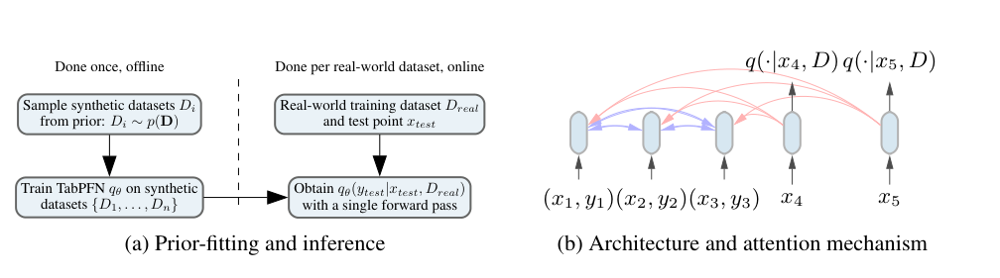
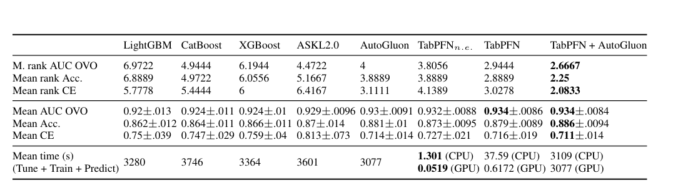
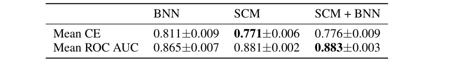

<!-- paper-reading-lang: zh-CN -->
<!-- paper-reading-theme: forest -->
# TabPFN：把小表格的学习算法装进一次前向传播

**原论文**：*TabPFN: A Transformer That Solves Small Tabular Classification Problems in a Second*，Hollmann、Müller、Eggensperger、Hutter，ICLR 2023。这里阅读的是 Zotero 条目 `CL7A9HMJ` 的 36 页本地会议 PDF，不是 Nature 2025 的第二代模型。所有 PDF 页码均按文件第一页起算。本地现仅保留这一份解读；原来与之PDF指纹相同的 `KRQBT2RP` 重复输出已按用户要求清理。（PDF p. 1）

TabPFN 改变的不是某个数据集上的网络结构，而是**“给定一张新表，怎样学出预测器”这一算法本身**。它离线见过数百万张合成表，在线把有标签的训练行当作输入，与待预测行一起送进固定权重的 Transformer。新数据引起的是上下文变化，而不是模型参数更新。它的强项和边界都来自这个转移：昂贵的训练提前摊销，能否泛化则取决于合成任务先验是否接近真实问题。（PDF pp. 1–3）

```paper-map
{"thesis":"先从可采样的任务先验中学会近似贝叶斯预测，再用固定网络为新的小表格直接输出类别概率。","outcome":"主证据来自 18 个小型、纯数值、无缺失的 OpenML-CC18 数据集；不是任意规模表格的普适结论。","outcomeSource":"PDF pp. 7–8, Table 1","items":[{"number":"01","label":"问题","text":"逐表训练、交叉验证和模型搜索很贵，小数据尤其缺乏足够的学习信号。","source":"PDF pp. 1–2"},{"number":"02","label":"先验","text":"以相同概率混合 SCM 与 BNN 生成任务；结构、权重、噪声和超参数也随机化，偏向简单机制。","source":"PDF §§4.1–4.5"},{"number":"03","label":"学习","text":"遮住合成表的一部分标签，用剩余行作上下文，优化被遮标签的交叉熵。","source":"PDF §2, Eq. 2"},{"number":"04","label":"部署","text":"真实训练行携带标签进入上下文，测试行只读训练行，直接返回类别分布。","source":"PDF Fig. 1, Appendix E.2"},{"number":"05","label":"证据","text":"18 表上的平均 ROC AUC 为 0.934；单次与 32 次置换集成必须分开计时。","source":"PDF p. 8, Table 1"},{"number":"06","label":"边界","text":"主评估至多 1,000 个训练样本、100 个数值特征和 10 类；缺失、类别特征及无关列仍是弱点。","source":"PDF pp. 7–9, Appendix A"}]}
```

<!-- paper-reading-context:start -->
## 00 / 发表时的研究背景
<!-- context-cutoff: 2022-07-05; basis: first-publication -->

### 当时的领域状态

TabPFN第一代 **2022-07-05首次公开，2023年发表于ICLR**。要理解它的切入点，应先回到当时表格建模的常规流程：拿到一张新表，训练树或神经网络，用验证/交叉验证选超参数，再预测测试点。即使底层模型很快，这个过程也会在每个任务上重复；AutoML把多个配置、模型和集成组合起来，质量更强，但又增加逐任务搜索成本。（PDF pp. 1–2、§5.2；[首发记录](https://arxiv.org/abs/2207.01848)）

PFN原始论文已经说明“整张训练集可以作为网络输入，预测算法本身可以提前学会”。但其早期真实表格展示限于很少标签的简化任务。于是当时真正的问题不是从零发明in-context learning，而是**构造适合更真实的小表分类的任务先验，让这种算法摊销跨过原型阶段**。（PDF §2, Tabular Data；Appendix C.2.6）

### 关键前作与尚存缺口

| 工作与时间 | 已有贡献 | 当时未解问题及与本文的关系 | 来源 |
|---|---|---|---|
| XGBoost、LightGBM、CatBoost等树模型（2016–2018公开/发表） | 对异构表格提供强而实用的监督学习与调参基线 | 每张新表通常仍要拟合、验证与选配置，知识难直接作为同一个预测算法跨表复用 | PDF §§1、5.2 |
| AutoGluon-Tabular（2020）、Auto-sklearn2.0（2021） | 自动搜索、组合模型与预测，降低手工建模门槛并取得强结果 | 自动化没有取消每任务搜索与集成开销；TabPFN希望在很短在线时间内接近这种质量 | PDF §5.2；[AutoGluon原摘要](https://arxiv.org/abs/2003.06505) |
| PFN《Transformers Can Do Bayesian Inference》（2021预印本/ICLR2022） | 用先验抽样任务训练集合条件预测，近似贝叶斯后验预测 | 早期表格实例仅约30训练标签的简化二分类，先验与任务范围尚不足以直接覆盖本文目标 | PDF §2、Appendix C.2.6；[原论文](https://arxiv.org/abs/2112.10510) |
| 结构因果模型SCM与贝叶斯先验设计的既有理论 | 用图、机制函数与噪声描述联合数据生成，允许表达特征依赖与潜在变量 | 理论并不自动提供高效的真实表预测器；本文将其变成可采样的小表任务族，而不做真实因果图识别 | PDF §4.1–4.4及Pearl/Peters引文 |

### 本文为何在此时提出

作者选择改变“学习算法的设计位置”：不是为当前表再调一种模型，而是用BNN/SCM先验、复杂度偏好和不平衡多类任务，在离线阶段教固定网络怎样利用上下文。在线训练集标签只是条件输入，故新任务适应可以没有梯度更新。论文的历史推进是把PFN理论原型做成强小型数值分类算法，而不是已经解决回归、大表或所有混合类型。（PDF §§2–4、6）

**首发与定稿不能混写**：当前ICLR2023会议版引用了Grinsztajn等2022年7月18日的树/NN分析；该工作晚于TabPFN的7月5日首发，是同期及修订期间的讨论背景，不是更早已存在的研究前提。后来的TabPFNv2、TabICL和TabArena也不参与本节的当时判断。（PDF §5.2；[两者时间记录](https://arxiv.org/abs/2207.08815)）
<!-- paper-reading-context:end -->

## 01 / 任务先验如何变成预测算法

### 从预测一个模型到平均一族机制

普通监督学习往往先找一个参数估计，再拿它预测。PFN 想近似的是后验预测分布。设 $D$ 为已知标签的数据，$x$ 为新输入，$\phi$ 为一个可能的数据生成机制，那么论文 Eq. 1 可写成下面带显式归一化的等价形式：

$$
p(y\mid x,D)=\frac{\int_{\Phi}p(y\mid x,\phi)p(D\mid\phi)p(\phi)\,d\phi}{\int_{\Phi}p(D\mid\phi)p(\phi)\,d\phi}.
$$

其中 $p(\phi)$ 给机制一个先验权重，$p(D\mid\phi)$ 衡量它能否解释已观察数据。分母是数据的边际似然，不应把原式的“正比于”误读成已经归一化。这里没有先找出唯一的因果图，也没有逐个显式执行无限多个模型；神经网络直接近似最后的类别概率。（PDF p. 2, Eq. 1）

关键是训练数据不必来自这个后验积分的精确计算。只要会先抽机制 $\phi\sim p(\phi)$，再抽表 $D\sim p(D\mid\phi)$，就能制造监督信号。对于一条被隐藏标签的合成样本，论文 Eq. 2 是：

$$
\mathcal L_{\mathrm{PFN}}(\theta)=\mathbb E_{\{(x_t,y_t)\}\cup D_{\mathrm{train}}\sim p(D)}[-\log q_\theta(y_t\mid x_t,D_{\mathrm{train}})].
$$

**机制解释**：固定一个上下文和查询时，这个期望交叉熵可以分解为真实条件分布的熵，加上它与 $q_\theta$ 的 KL 散度。因此在模型容量、优化和样本充分的理想条件下，最优输出就是对应先验下的条件分布。这是对 PFN 原理的解释，不意味着有限训练的 TabPFN 已经精确执行了贝叶斯积分，更不意味着真实世界服从所选先验。（PDF §2；本段分解为阅读者对目标函数的推演）

### 为什么要把超参数也随机化

如果每张合成表都来自同一种网络和噪声尺度，模型很容易只学会这个狭窄任务族。作者对图大小、激活、权重尺度、噪声等设置分布，让预测隐式综合多种解释。简单机制被赋予较高概率，相当于让小样本问题不必一开始就承担极复杂函数的自由度。代价是先验偏差：真实规律若大量依赖高频边界、未覆盖的缺失机制或无关特征，学到的偏好就可能不适用。（PDF §§4.1–4.2, Appendix C, Appendix A）

## 02 / 离线训练与在线使用是两条不同路径

阅读原论文 Fig. 1 时，先看左侧虚线：左边的合成任务训练只进行一次；右边每次换一张真实表，不会再次更新参数。再看右侧红色连线：测试点能读取训练点，不能读取另一个测试点，因此批量预测不应靠其他测试点的信息改变结果。（PDF p. 3, Fig. 1）



*原论文 Fig. 1，PDF p. 3。训练行彼此交换信息，测试行仅查询训练行；残差仍保留测试点自身的特征。*

```paper-path
{"title":"从一个合成机制到一个可部署的学习器","stages":[{"title":"抽取机制与表","role":"离线数据","action":"先抽 SCM 或 BNN 及其超参数，再用同一机制生成一张表的全部样本。","why":"表内样本必须共享规律，模型才能从上下文推断规律，而非只识别独立噪声。","cost":"合成机制覆盖范围决定泛化偏置。","output":"一张含特征和连续目标的合成表","source":"PDF §§4.3–4.4, Appendix C.1"},{"title":"制造分类任务","role":"离线任务","action":"随机抽类别数和目标阈值，将连续目标分箱，再打乱类别编号，并划分上下文与查询。","why":"同时覆盖类别不平衡、多分类以及类别编号无语义的特点。","output":"有标签上下文和被隐藏标签的查询","source":"PDF §4.5, Appendix D"},{"title":"更新通用网络","role":"离线优化","action":"用查询交叉熵更新同一个 12 层 Transformer，重复数百万张表。","why":"把每张表的学习过程压缩到固定权重中的上下文算法。","cost":"20 小时、8 张 RTX 2080 Ti 的一次性训练不计入在线延迟。","output":"约 25.82M 参数的固定网络","source":"PDF p. 3, Appendix E.1–E.3"},{"title":"输入新的真实表","role":"在线预测","action":"只用训练集估计预处理统计量，将训练行的特征与标签、以及测试行特征输入网络。","why":"让真实值域接近合成任务，同时避免从测试标签或预处理统计中泄漏信息。","output":"测试点的类别概率；可对置换成员的概率求平均","source":"PDF §3, Appendix C.2.1, C.2.6"}]}
```

每行是一个 token，而不是把数字写成自然语言再分词。特征向量与标签被编码为训练 token，测试 token 没有真实标签。模型没有把样本位置当作时间顺序，因此能把训练集视为集合。不同特征数通过补零等适配进入固定宽度编码器；本版本的 100 特征上限不能据此理解成无限列数。（PDF §2, Appendix E.2）

若训练点数为 $n$、测试点数为 $m$，注意力需要的有效配对从 $(n+m)^2$ 减为 $n^2+nm$：训练—训练和测试—训练，去掉测试—测试。这里“去掉”也包括测试点在注意力中读自己的那一项；自身输入仍可沿残差路径保留。计算仍会随上下文大小近似二次增长，不是线性时间算法。（PDF Appendix C.2.6, E.2）

## 03 / SCM 先验提供什么，不提供什么

结构因果模型用一个有向无环图描述变量如何由父节点与噪声产生：

$$
z_i=f_i(z_{\mathrm{PA}(i)},\epsilon_i).
$$

$z_i$ 可以是隐藏变量，也可以被选成观测特征或目标。作者先抽一个类似多层感知机的图，再删除部分连接、抽权重和噪声。每次重采样噪声并沿图传播，取出特征节点与目标节点的值，就得到一行；同一张表的所有行共享图结构和参数。这样特征可以是目标的原因、结果，或与目标共享原因，避免先验只有“所有特征都是独立输入”的单一形式。（PDF §4.3, Appendix C.1）

**重要区分**：以因果生成过程做先验，不等于恢复真实因果结构。模型在推理时既不输出图，也不保证干预或反事实预测有效。作者明确说这不是因果推断；它仍在做关联预测，只是归纳偏置来自一族 SCM。（PDF p. 5）

BNN 分支则先抽神经网络及权重，再抽输入并前向产生目标。最终预训练以 1:1 概率混合两者。对 SCM 是否必要，不能仅看最终模型与树模型比较，而要看后面的先验消融。（PDF §4.4, Appendix B.4）

### 一个可手算的标签构造

以下是论文给出的三分类阈值例子，而不是模型准确率实验：抽到阈值 $-0.1$ 和 $0.5$ 后，连续值落到 $(-\infty,-0.1]$、$(-0.1,0.5]$、$(0.5,\infty)$ 三段，分别编号 0、1、2，再随机重命名类别。阈值来自随机目标样本，所以区间不要求同宽、类别也不要求均衡。由此模型不能把“标签 2 比标签 0 大”当作类别语义。（PDF §4.5）

训练使用 18,000 步、每步 512 张合成表，即 9,216,000 张表；每表总大小 1,024，训练/查询分割随机变化。这解释了为什么在线喂入真实训练标签是正常输入，而不意味着模型预训练时见过真实评估表。（PDF Appendix E.3）

## 04 / 实验到底比较了什么

主实验不是全部 CC18。作者从至多 2,000 行、100 特征、10 类的 30 张表中，选择 18 张纯数值且无缺失的表作正文结果。每表 5 次随机 50%/50% 训练—测试划分，故最多约 1,000 个训练点。基线用五折验证随机搜索，正文比较最长一小时预算；多分类 AUC 为 **one-vs-one**，不是后来 Nature 论文的 one-vs-rest。（PDF pp. 7–8）

Table 1 要同时看 AUC、准确率、交叉熵和耗时四行。TabPFN 的 AUC 最强并不代表每种指标都最好；AutoGluon 的平均准确率 0.881 高于 TabPFN 的 0.879。右侧集成又是另一个方法，不应把它算成 TabPFN 单模型的能力。（PDF p. 8, Table 1）



*原论文 Table 1，PDF p. 8。基线为一小时请求预算；TabPFN n.e. 为不集成版本，TabPFN 为置换集成，二者不可混用。*

| 方法 | 平均 ROC AUC OVO ↑ | 平均准确率 ↑ | 平均交叉熵 ↓ | 在线总时间 |
|---|---:|---:|---:|---|
| LightGBM | 0.920 | 0.862 | 0.750 | 3,280 s CPU |
| CatBoost | 0.924 | 0.864 | 0.747 | 3,746 s CPU |
| XGBoost | 0.924 | 0.866 | 0.759 | 3,364 s CPU |
| Auto-sklearn 2.0 | 0.929 | 0.870 | 0.813 | 3,601 s CPU |
| AutoGluon | 0.930 | 0.881 | 0.714 | 3,077 s CPU |
| TabPFN 不集成 | 0.932 | 0.873 | 0.727 | 1.301 s CPU / 0.0519 s GPU |
| TabPFN 置换集成 | 0.934 | 0.879 | 0.716 | 37.59 s CPU / 0.6172 s GPU |
| TabPFN + AutoGluon | 0.934 | 0.886 | 0.711 | 3,109 s CPU / 3,077 s 含 GPU |

以上为 Table 1 中心值，原表同时保留标准差，不能把差异直接当成显著性。计时含在线调参、训练、预测；对 TabPFN 则是预处理与前向，假设网络已在内存/GPU 中。论文称单次版本相对约五分钟达到相近表现的基线有 230× CPU、5,700× GPU 加速；这不是固定模型单条在线服务的吞吐提升，也不包含离线预训练成本。（PDF p. 8, Table 1 及脚注 5）

```paper-experiments
{"title":"从机制主张到对应证据","rows":[{"question":"固定权重能否直接处理未见的小表？","setup":"18 张纯数值无缺失表，5 次 50/50 划分；调参树模型与 AutoML；ROC AUC OVO 等。","observation":"TabPFN 平均 AUC 0.934，不集成版本为 0.932；AutoGluon 0.930、CatBoost 0.924。","conclusion":"支持在所筛选的小表分布上获得很强的精度—在线成本折中，不支持所有表都胜出。","source":"PDF Table 1, Fig. 5"},{"question":"优势能否涵盖类别列和缺失？","setup":"恢复全部 30 张 CC18 小表，其中额外 12 张含类别或缺失；同类在线预算。","observation":"TabPFN 的平均 AUC 0.894，AutoGluon 0.895；纯数值上的优势收窄。","conclusion":"任务先验的适配性会改变结果，不能把 18 表主结论无条件推广。","source":"PDF Appendix B.1, Table 2"},{"question":"是哪个先验带来增益？","setup":"较低训练预算，分别训练 BNN、SCM、SCM+BNN 的 PFN。","observation":"平均 AUC 为 0.865、0.881、0.883；CE 为 0.811、0.771、0.776。","conclusion":"支持 SCM 比纯 BNN 更合适；没有清晰证据证明混合先验一定优于纯 SCM。","source":"PDF Appendix B.4, Table 4"},{"question":"上下文变长能外推吗？","setup":"预训练表不超过 1,024 样本，在额外 18 张表上增加训练样本至 5,000。","observation":"Fig. 10 的平均 AUC 在训练长度之外仍改善。","conclusion":"说明有限范围长度外推可行，不消除二次复杂度与硬件限制。","source":"PDF p. 9, Appendix B.1, Fig. 10"},{"question":"无关特征会破坏什么？","setup":"打乱已有特征产生无信息列，与 LightGBM 和 MLP 比较。","observation":"加入无关列时 TabPFN 和 MLP 明显退化，LightGBM 相对稳定。","conclusion":"说明先验没有充分学会忽略无用列，不能把快速泛化等同于全面鲁棒。","source":"PDF Appendix B.3.2, Fig. 9"}]}
```

先验消融的关键不是看最大数字，而是看“SCM”与“SCM+BNN”的差异是否稳定。Table 4 用较小预算重训，所以不能把 0.883 与主实验 0.934 相减，声称存在某个固定先验贡献。下方原表给出均值及波动：SCM 的交叉熵还比混合更低。（PDF p. 19, Table 4）



*原论文 Table 4，PDF p. 19。不同先验在较低训练预算下比较；混合并非每个指标都最好。*

## 05 / 为什么一次前向既很快，又不是免费预测

32 次置换集成会轮换特征列编号、类别编号以及是否使用幂变换，再对概率求平均。它试图消除编码方式不应带来的波动，和重新训练 32 个独立网络不是一回事；它也不是“单次前向”的成本。尤其应区分**列索引置换**与用正交矩阵混合特征的**几何旋转**，论文分别讨论了两者。（PDF §3, Appendix C.2.6, B.3.3）

在线不做梯度优化，节约的是重新从零学习的时间。但每个预测仍要读取上下文；如果一个已训练好的树模型要预测数百万条查询，它的纯推理可能更快。附录 A 已明确说明树模型可把拟合和预测拆开，而 TabPFN 将二者合在一起，因此“绿色 AutoML”主要指快速获得一个新任务的预测器，不是任何部署场景都最低成本。（PDF Appendix A, Table 2）

## 06 / 先验、算力与适用范围的闭环

**作者主张**：学习算法可以通过生成任务而不是逐条手写算法规则来设计。**实际观察**：这条路线在小型数值分类上以极低在线延迟达到强基线水平，且不同错误模式让它与 AutoGluon 互补。**阅读者推断**：最重要的可迁移思想不是“Transformer 天生胜过树”，而是把统计偏好变成可采样任务族，再把贝叶斯式适应过程摊销进参数。（PDF §§1–6, Appendix B.4）

这个闭环也解释了局限：简单 SCM 偏好有利于小样本，却可能低估复杂局部边界；每行 token 让输入紧凑，却受特征维度上限约束；上下文替代梯度拟合，却留下长表的二次注意力成本。论文的成功是为这些约束找到了一个很有价值的工作区间，而不是证明约束已经消失。（PDF Appendix A, C, E）

<!-- 可视化决策：离线/在线两条路径及注意力遮罩可在原 Fig. 1 与有文字解释的阶段图中同时看清；先验与实验比较需要并列阅读，交互切换不会增加机制信息，因此使用静态图、原图和数值表。 -->
<!-- 来源覆盖：已读取正文 pp.1–10、机制附录 C–E、实验附录 A/B/F 的相关协议、表格与图注。相关附录结果重点为 Table 2/4、Fig.9/10。文献列表及逐数据集完整数字不逐项转录。质量自查另见 quality-check.md；未进行独立读者研究。 -->
