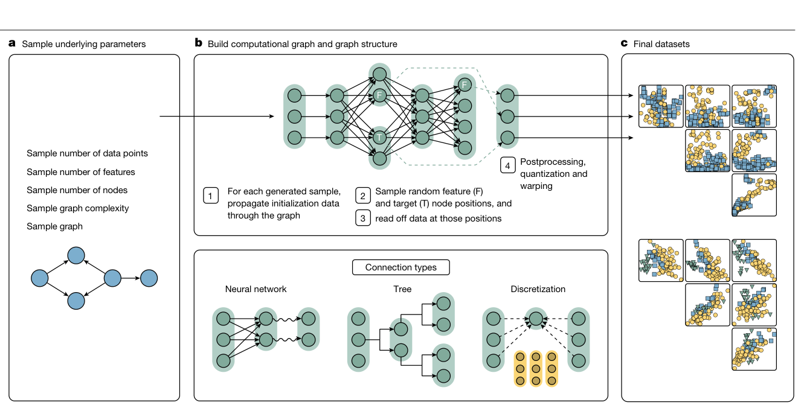
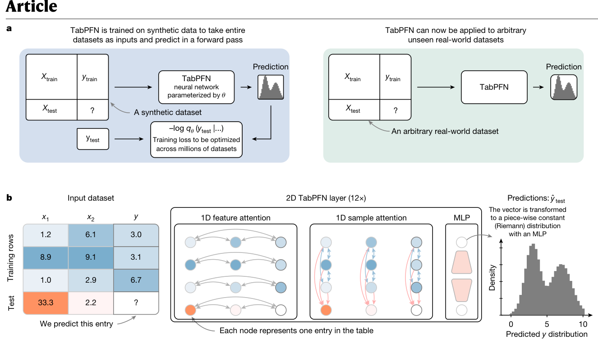
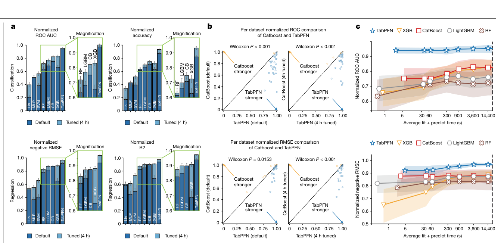
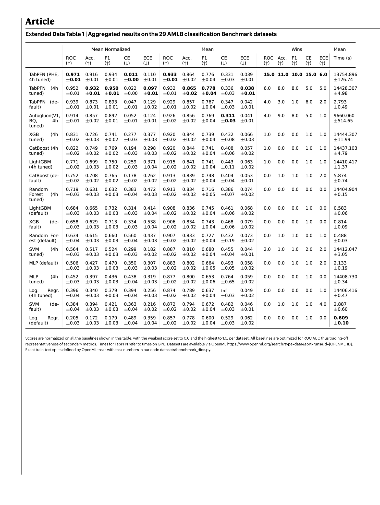
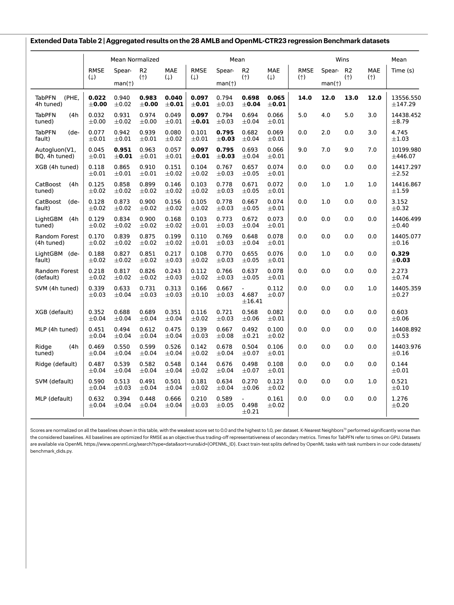
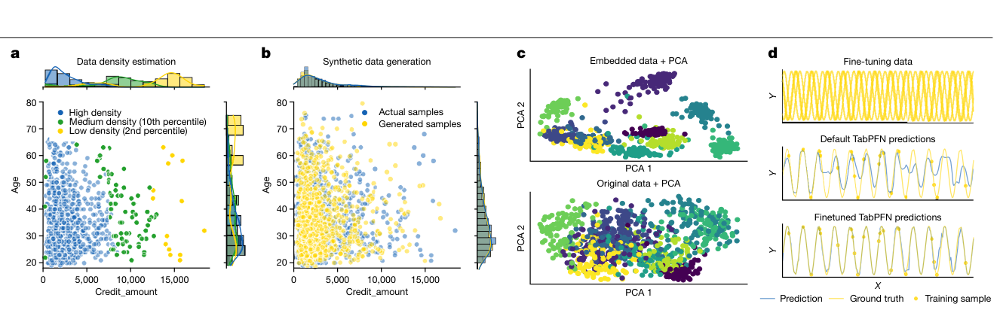

<!-- paper-reading-lang: zh-CN -->
<!-- paper-reading-theme: cobalt -->
# TabPFN 第二代：让合成任务覆盖真实表格的困难

**原论文**：*Accurate predictions on small data with a tabular foundation model*，Hollmann 等，Nature 637, 319–326，DOI：[10.1038/s41586-024-08328-6](https://doi.org/10.1038/s41586-024-08328-6)。本解读以 Zotero `KGSUGZNB` 的 23 页正式发表 PDF 为准，包含正文、Methods 与 Extended Data。PDF 首页注明 2025 年 1 月 8 日在线发表、期刊日期 1 月 9 日。文中“TabPFN”指第二代，不与 ICLR 2023 模型混用。（PDF p. 1）

这篇论文要回答的不是“能不能用合成表训练一个模型”，而是：**合成任务能否足够丰富，使固定权重的模型在缺失值、类别列、异常值、无关特征、分类与回归之间直接迁移？** 作者同时改造了任务生成器、二维表结构上的注意力，以及推理阶段的缓存和集成。因而全文强结果属于整套系统，不能从一张总性能图推断其中某个组件单独贡献多少。（PDF pp. 2–6, Methods）

```paper-map
{"thesis":"用更丰富的合成 SCM 学习表格预测算法，再通过单元格级双向注意力、概率输出和推理缓存，提升中小型真实表格上的准确性与可用性。","outcome":"核心评估是 29 个分类和 28 个回归数据集，至多 10,000 行、500 特征和 10 类；大表可运行不等于在大表上验证领先。","outcomeSource":"PDF pp. 5–6, Methods pp. 9–12","items":[{"number":"01","label":"原有瓶颈","text":"第一代偏向小型数值分类，缺失、类别特征、异常值与回归难以兼顾。","source":"PDF p. 2"},{"number":"02","label":"任务生成器","text":"随机 DAG 中组合神经映射、树、离散化和噪声，再加入非线性变换、量化与缺失。","source":"PDF Fig. 2, Methods pp. 9–10"},{"number":"03","label":"二维网络","text":"每个单元格或特征组有表示，每层先在行内交换特征信息，再沿列读取训练样本。","source":"PDF Fig. 1b, Methods p. 9"},{"number":"04","label":"概率输出","text":"分类返回类别概率，回归返回可表达多峰的分段密度，而非仅一个回归数值。","source":"PDF p. 3, Methods p. 11"},{"number":"05","label":"在线系统","text":"训练状态 KV 可缓存；默认分类四路、回归八路的预处理集成与 PHE 是不同成本级别。","source":"PDF Methods pp. 9, 11–12"},{"number":"06","label":"结果边界","text":"归一化指标突出跨任务相对优势；要与原始 AUC、R² 和纯推理延迟一起理解。","source":"PDF Fig. 4–5, Extended Data Tables 1–2"}]}
```

<!-- paper-reading-context:start -->
## 00 / 发表时的研究背景
<!-- context-cutoff: 2025-01-08; basis: publisher-online-publication -->

### 研究问题与价值

第一代已经能给小数值表做快速分类，但现实问题还会问：有类别列、缺失、无用变量和异常值时怎么办？目标是连续数值、需要预测区间甚至多峰分布时怎么办？**本篇要把同一套“新表作为输入”的学习接口，推进为更通用的中小表默认预测工具。** 成功应同时体现分类和回归质量、不同数据困难下的表现，以及取得新任务预测的成本，而不是只给干净二分类表报一个最高AUC。（PDF pp.1–2、5–6）

潜在价值是减少逐表搜索，让研究者更快试验数据和问题设定；概率输出还为风险判断、密度和生成提供接口。但这些用途的存在，不等于已经分别证明医学决策改善、隐私安全或因果效果正确，后文要将基准证据与概念演示分开。（PDF Fig.6、Methods）

### 当时的领域状态

本节以 **Nature在2025-01-08在线发表**为可核验边界，不用Zotero入库日，也不把后来的TabPFN-2.5或TabICL当成已经成熟的前提。此时表格研究已从“深度学习是否能比树强”走到“跨任务预训练能否提供更强的默认学习算法”：第一代TabPFN显示了小表ICL的速度优势，但现实表常有类别、缺失、无关列和回归目标，距离通用工具仍有缺口。（PDF pp. 1–2）

表格的难处不只是样本少：同一个数字在不同表中可代表完全不同的量，各列尺度和类型也不统一。因此不能直接依赖语言token的共享语义；一个可跨表迁移的算法，还必须在当前训练context里推断哪种关系有用。该论文将“基础模型”落实到**学过很多任务、能在新表复用同一预测算法**，不等同于已经理解全部行业语义。（PDF pp. 1–2）

### 关键前作与尚存缺口

| 工作与时间 | 已有贡献 | 当时未解问题及与本文的关系 | 来源 |
|---|---|---|---|
| XGBoost、LightGBM、CatBoost等强树基线 | 在异构表格上准确、稳健且训练实用，是新方法必须认真比较的工作流 | 逐表拟合和任务间参数复用有限；本文用跨任务学习的算法争取更强默认表现，而非假定树已无价值 | PDF p. 1及References 6–9 |
| Grinsztajn等（2022）、McElfresh等/TabZilla（2023） | 通过更系统的比较揭示无关列、不规则目标、分布和预算会影响NN/树的差异 | 强默认NN不能只在少数干净数值表上成立；这些挑战需要进入模型的任务分布与评估范围 | PDF pp. 1、5及References 14–15；[TabZilla原摘要](https://arxiv.org/abs/2305.02997) |
| PFN（ICLR2022） | 证明先验任务抽样可以监督一个近似后验预测器，支持概率输出与免逐任务优化 | “会近似所选先验”不自动意味着先验覆盖真实表格的复杂条件 | PDF p. 2及Reference 22；[原论文](https://arxiv.org/abs/2112.10510) |
| TabPFN第一代（2022预印本/2023） | 在小型数值分类中，将新表建模转为快速上下文前向 | 主要验证约1000训练行/100特征/10类，缺失、类别、无关列及回归仍需明显扩展 | PDF p. 2及Reference 23 |

### 本文为何在此时提出

第一代说明了算法摊销可行，却留下三类独立要求：练习任务要覆盖真实表的困难，表示要容纳变化的行列与目标类型，重复预测时不能无谓重算训练上下文。仅提升一个干净小表的精度无法同时满足这些要求；只添加推理工程也不能弥补训练任务没有覆盖的情况。（PDF pp.2–4、Methods；约束划分为阅读者综合）

**作者定位与阅读者解释的区别**：作者将这种任务生成视为新的算法设计方式；从前作链条看，它更具体地是在已有PFN接口上同时增强先验覆盖、结构与工程。最终强结果属于这套系统，而不是历史上此前不存在任何数据生成、二维attention或概率回归。后文会分别解释这些设计与证据，不能从整体胜出反推每个组件都单独被证明必要。
<!-- paper-reading-context:end -->

## 01 / 思路如何形成

**以下是教学性重建，不是作者实际发现过程的记录。** 既有PFN原理告诉我们：模型学到的是所抽任务分布中的预测规律，而不是一种无条件通用算法。第一代对缺失和类别列的弱点，因此可以先从“训练时有没有见过对应困难”来提问，而不必先假定需要某个新网络组件。树模型与归纳偏置研究又提供经验：不连续规则、无关列等结构值得进入练习任务。（PDF pp.1–2及所引PFN、第一代TabPFN、树/NN比较）

接着考虑表示：跨表的数字没有固定语义，整行一次压缩固然便宜，却会把不同列的信息提前混在一起；表格天然有行和列两种关系，既有attention与二维表处理工作让“分别处理这两个轴”成为可考虑的方向。最后，常见fit/predict工作流提醒我们：如果上下文状态与测试查询无关，它应有复用机会。以上只构成“更丰富任务、保留表结构、复用上下文”的设计需求，不能用本文最终排行榜反推这些选择各自必然有效。（PDF pp.2–3、Methods p.9；桥接为阅读者解释）

**实际核心直觉**：让模型通过经历数据困难来学会应对它们，并在表格网格上交替交换特征信息和样本信息；推理时保存可复用的训练状态。合成先验决定算法偏好，二维表示决定信息能怎样流动，缓存减少同任务后续查询的重复工作，三者解决的问题不同。（PDF Figs.1–2）

## 02 / 跟着原图走完一次预测

直接沿原论文 **Fig.1b的作者示意表**追踪，不将它冒称真实业务记录：三条有标签行依次是(1.2,6.1)→3.0、(8.9,9.1)→3.1、(1.0,2.9)→6.7；查询是(33.3,2.2)→?。这是回归例子，目的是说明接口，图没有给出其精确真实目标或内部张量值。（PDF p.2, Fig.1b；数值经原图视觉核验）

1. **准备输入**：只用训练侧统计量变换特征与已知目标；查询目标以未知状态输入，不能把问号替换成答案。类别或缺失输入有对应编码，而不是要求所有原始单元格都是完整实数。（PDF Methods pp.9、11）
2. **行内交换信息**：在每个样本内部，不同特征位置互相读取。因此查询的33.3和2.2可以形成联合表示，而不只是两次互不相关的一维回归。
3. **沿列读取训练经验**：各特征位置再与训练行的相应位置交互。重复这一结构，让目标位置的表示结合三条已知样本。查询不能读取别的测试查询，训练行也不依赖它，所以训练key/value可以被缓存。（PDF Fig.1b、Methods p.9）
4. **输出分布而非硬猜一个数**：回归头给各目标区间分配概率质量，转换成密度并映回原目标尺度；再根据需要得到均值、分位数或区间。图中画的是示意多峰密度，不能靠柱高估一个“模型精确预测值”。默认多路预处理预测还要映回相同尺度后组合。（PDF Methods p.11）

离线时，这样的输入来自反复新生成的合成任务，隐藏目标参与损失并更新参数；在线时换入新训练表，只改变条件。下面展开这种训练目标、生成器和二维计算，再看它们在真实表上到底通过了哪些检验。

## 03 / 学到的究竟是什么目标

PFN 的预训练任务是：生成一张完整的合成表，把一部分行的目标列遮住，用其他有标签行作为上下文，预测被遮住的目标。设 $q_\theta$ 是通用网络，$p(D)$ 是任务生成器隐式定义的表分布，训练目标为：

$$
\mathcal L_{\mathrm{PFN}}=\mathbb E_{(X_{\mathrm{test}},y_{\mathrm{test}})\cup D_{\mathrm{train}}\sim p(D)}[-\log q_\theta(y_{\mathrm{test}}\mid X_{\mathrm{test}},D_{\mathrm{train}})].
$$

对多个查询，可理解为对各被遮目标的负对数概率求和或平均；核心是网络只能条件于可见训练标签。理论解释是近似指定任务先验下的贝叶斯后验预测分布，不是保证真实任务分布已经完全被生成器覆盖。（PDF p. 2；Methods p. 10, Training details）

**设计理由**：面对异构表格，绝对数值没有跨表固定语义。“3.0”在一张表里是浓度，另一张表里可能是年龄编码。作者不依赖自然语言列名统一语义，而是让网络在任务中重建数值关系；偏好的算法行为则通过合成数据体现。比如要学会不被缺失拖垮，就必须在任务分布里经历缺失，而不是只在部署时临时补丁。（PDF pp. 1–2, 4）

## 04 / 生成器怎样制造困难

先看原论文 Fig. 2 的三段：左侧随机选择机制规模，中间同一张 DAG 为各行传播噪声并取出特征/目标，右侧后处理改变最终观测形式。图中的树或离散映射是**生成数据的组件**，不是说实际部署时先拟合一棵树再把它接到 Transformer 后面。（PDF p. 3, Fig. 2）



*原论文 Fig. 2，PDF p. 3。神经映射、树和离散化控制合成任务规律；选定的特征与目标来自图内不同节点。*

```paper-path
{"title":"合成任务如何把真实表格的困难带入训练","stages":[{"title":"随机 DAG 与规模","role":"结构层","action":"抽节点数、重定向概率和多个可能不相连的子图。","why":"图内连接产生依赖；不与目标相连的子图自然产生无关特征。","cost":"真实关系仍必须由这族随机机制近似。","output":"一张表共享的依赖结构","source":"PDF Methods pp. 9–10, Graph structure sampling"},{"title":"组合边映射","role":"函数层","action":"使用带非线性的小网络、类别离散化/嵌入、决策树与高斯噪声。","why":"同时覆盖平滑关系、局部规则、不连续变化和不同噪声程度。","output":"内部节点上的连续或离散表示","source":"PDF Methods p. 10, Computational edge mappings"},{"title":"抽观测与扰动","role":"观测层","action":"选特征和目标节点，再做非线性 warping、量化和随机缺失。","why":"把潜在生成规律转成多尺度、混合类型、不完整的实际表。","cost":"这里缺失的主要生成描述是 MCAR，不能据此保证 MNAR 下有效。","output":"分类或回归合成任务","source":"PDF Methods p. 10, Post-processing and Target generation"},{"title":"反复遮目标训练","role":"优化层","action":"每次让模型在上下文中预测查询目标，约 200 万步、每步 64 张表。","why":"每步都有新规律，迫使固定权重学会利用上下文而非记某一表。","output":"每个模型约 1.3 亿合成任务上的通用参数","source":"PDF Methods p. 10, Training details"}]}
```

Methods 给出的数字比正文“约一亿张表”更精确：约 2,000,000 步乘 64 张约为 1.28 亿，论文表述约 1.3 亿。每个任务的训练样本数最高 2,048，查询数固定 128；特征数采样范围 1–160，总表不超过 75,000 cells。因而评估到 10,000 行、500 特征已经包含尺寸外推，不能说预训练每张表就有 10,000 行。（PDF Methods p. 10）

## 05 / 二维注意力与缓存

原论文 Fig. 1b 中，先沿一行让不同特征交换信息，再沿一列把相同特征的不同样本联系起来，重复 12 层后读出目标列表示。注意先后顺序是**行内特征 attention → 列内样本 attention → MLP**。Fig. 1a 则区分离线更新参数和在线固定参数，二者不要混成一个“每表再训练”的流程。（PDF p. 2, Fig. 1；Methods p. 9）



*原论文 Fig. 1，PDF p. 2。网络把单元格或一小组特征作为表示位置；二维结构不等于序列化成自然语言。*

### 特征身份并非完全自动解决

原文正文强调行列重排的适配性，但 Methods 明确说明实际模型不是严格的列置换不变：相同统计分布的不同列需要随机特征身份嵌入，有些配置将两特征组成一个位置；推理时再通过打乱列次序集成近似恢复不变性。把它写成“任何列排列都严格得到完全相同输出”会过度简化。（PDF Methods pp. 9, 11）

**设计代价**：单元格级表示保留了表内结构，不必把全部列挤进一条固定行向量，但中间张量更大。若 $n$ 为行数、$m$ 为特征位置数，逐层沿行列计算的配对量按维度计约为 $O(nm^2+mn^2)$，忽略头数与隐藏宽度。论文 Methods 用 $O(n^2+m^2)$ 描述两个注意力轴的二次依赖，另列出内存 $O(nm)$；两种写法并非同一个总操作计数，不能据前者称总运算与另一维无关。（PDF Methods p. 9；本段总配对量为阅读者按结构展开）

### 为什么训练状态能缓存

样本 attention 的掩码保证：训练行不读测试行，测试行只读训练行、不读其他测试行。于是训练行表示与查询无关，可以提前缓存各层的 key/value。后续查询复用缓存，不必每次重新算完整训练集。论文还采用针对测试查询的 multi-query 变体，只缓存每 cell 的一组 key/value。（PDF Methods p. 9）

缓存是减少**重复查询**的算量，不会让第一次处理训练表没有代价。10,000 训练行、10 特征时，核心推理 CPU 从 32 s 到 0.1 s，约 300×；GPU 约 6×。这些核心模块测量排除了预处理和集成，不应拿来代替整套 fit+predict 的耗时。（PDF p. 3）

## 06 / 数学与概率输出

本篇的统计基础沿用PFN，并未证明新生成器或二维架构一定支配所有算法。必要的数学可以分成三层：训练用负对数概率鼓励正确答案；回归输出需要“区间概率→密度”的归一化；评估又使用不同于概率的跨表相对分数。把这三层混在一起，容易把高归一化AUC当校准概率，或把一个bin的质量当密度。（PDF p.2、Methods pp.10–12）

分类输出离散概率；回归要表达不确定性，不能只返回条件均值。作者使用分段常数的 Riemann 密度，区间边界来自先验目标值的分位数。对有限宽内部 bin，若 $\pi_k$ 是概率质量、$[b_k,b_{k+1})$ 是区间，则可用下面的解释式理解密度：

$$
q_\theta(y\mid x,D)=\frac{\pi_k(x,D)}{b_{k+1}-b_k},\quad y\in[b_k,b_{k+1}).
$$

分母非常重要：概率质量不是密度高度。区间宽度不同，质量相同也会有不同密度。两侧为覆盖全实轴使用 half-normal 尾部，不能把无限尾区间套进上面的有限宽公式。该公式是对论文 Riemann 输出的说明性重写，不是原论文新增编号方程。（PDF p. 3；Methods p. 11, Regression details）

**说明性算例**：区间 $[0,1)$ 与 $[1,3)$ 的预测质量为 0.3 和 0.7，则密度高度分别是 0.3、0.35；积分仍为 1。原论文 Fig. 3b 的双缝光子例子展示多峰分布预测，验证的是在该构造任务上可表达复杂密度，不是证明模型已经掌握物理规律。（PDF p. 4, Fig. 3b）

为什么分宽度恰好正确？在区间内常数密度乘区间宽度，必须等于该区间的概率：$\int_{b_k}^{b_{k+1}}q(y)\,dy=q_k(b_{k+1}-b_k)=\pi_k$。解这条等式就得到上面的密度；各区间质量和为1时，总积分也为1。对落在第k区间的真实目标，负对数密度为 $-\log\pi_k+\log(b_{k+1}-b_k)$，在边界固定时，后项不是网络可优化的量。这是理解分箱训练的教学推导，不是新增的精度定理；尾部仍需按其专门分布处理。

## 07 / 主实验的问题与答案

**问题→** 同一个固定预训练模型，在真实中小表的分类和回归上能否兼顾质量与取得预测的时间？**验证→** 固定数据规模、划分与指标，分别比较默认、调参和进一步集成，既看原始指标也看跨表汇总。**答案→** 主结果支持强默认单模型表现，但超越强AutoML集成时，分类与回归需要不同预算；下面具体数字不能压成一句普适的“秒胜四小时”。（PDF Figs.4–5）

主评估用 29 个 AMLB 分类集、28 个 AMLB/CTR23 回归集，每表 10 次 90%/10% 划分。分类主指标是 **one-vs-rest ROC AUC**，回归主指标是 RMSE。跨表聚合前，将每表所有被比较方法中最差分数映射到 0、最好映射到 1。结果依赖比较集合，因此“归一化 AUC 0.939”绝不是“原始 AUC 93.9%”。（PDF p. 5；Methods p. 12）

对于高者更好的指标 $s$，这种缩放可写为：

$$
\widetilde s_{d,a}=\frac{s_{d,a}-\min_{a'}s_{d,a'}}{\max_{a'}s_{d,a'}-\min_{a'}s_{d,a'}}.
$$

这里 $d$ 是数据集、$a$ 是算法。回归图使用高者更好的负 RMSE；Extended Data Table 2 却显示低者更好的归一化 RMSE。因此图中的 0.923 与表中的 0.077 是 $1-0.077$ 的关系，不是两个互相矛盾的原始误差。（PDF Fig. 4；Extended Data Table 2）

看 Fig. 4 时，左边比较默认与四小时调参，中央每点是一张表，右边横轴是平均 fit+predict 秒数。默认单模型基线、调参单模型基线和 AutoGluon 集成是不同问题，不能全混成“所有基线”。（PDF p. 5, Fig. 4）



*原论文 Fig. 4，PDF p. 5。纵轴为逐表归一化后的表现；这是相对比较，不是原始概率或原始 RMSE。*

以下摘录 Extended Data Tables 1–2 的关键中心值，完整原表在后面保留。时间为在线整套流程的平均值，TabPFN 使用 GPU；模型预训练不计入。

| 方法 | 分类归一化 ROC ↑ | 分类原始 ROC ↑ | 分类时间 s | 回归归一化 RMSE ↓ | 回归原始 R² ↑ | 回归时间 s |
|---|---:|---:|---:|---:|---:|---:|
| TabPFN 默认 | 0.939 | 0.929 | 2.793 | 0.077 | 0.682 | 4.745 |
| TabPFN 四小时 HPO | 0.952 | 0.932 | 14,428.307 | 0.032 | 0.694 | 14,438.452 |
| TabPFN 四小时 PHE | 0.971 | 0.933 | 13,754.896 | 0.022 | 0.698 | 13,556.550 |
| AutoGluon 四小时 | 0.914 | 0.926 | 9,660.060 | 0.045 | 0.693 | 10,199.980 |
| CatBoost 默认 | 0.752 | 0.913 | 5.874 | 0.128 | 0.667 | 3.152 |
| CatBoost 四小时 | 0.822 | 0.920 | 14,437.103 | 0.125 | 0.671 | 14,416.867 |

**观察结果**：默认 TabPFN 在分类上超过四小时 AutoGluon 的上述汇总 ROC；回归却不是如此，默认 TabPFN 的归一化误差 0.077 高于 AutoGluon 的 0.045。回归赶超 AutoGluon 需要 PHE 等进一步投入，正文报告 300 s 的最低 PHE 预算即可超过四小时 AutoGluon。这正是为什么不能只记“2.8 s 超过四小时”的标题。（PDF p. 6, Fig. 5c–d；Extended Data Tables 1–2）

在分类原表中，请区分左侧 Mean Normalized ROC 与中部 Mean ROC 两列，以及最右侧的时间列：同一模型的 0.939 和 0.929 来自不同度量。表中 ± 值与原表脚注一并保留，转录中心值不替代不确定性分析。（PDF p. 18）



*原论文 Extended Data Table 1，PDF p. 18。原图保留归一化指标、原始指标、wins 和时间，避免只选择单个最有利指标。*

回归原表需要先看误差箭头向下，再读中部的原始 R²。原始 RMSE 在表中因目标处理而有特定尺度，不应与其他论文的不同数据集 RMSE 直接排序。正文绘图将误差方向反转，因此“更高更好”的图与“更低更好”的表可以同时成立。（PDF p. 19）



*原论文 Extended Data Table 2，PDF p. 19。归一化 RMSE 的方向为低者更好，与正文归一化负 RMSE 区分。*

## 08 / 鲁棒性与复用能力的检验

```paper-experiments
{"title":"机制、鲁棒性与可迁移能力的证据位置","rows":[{"question":"对中小型真实表是否更准确？","setup":"29 分类+28 回归，10 次 90/10 划分；五折验证随机搜索，30 s 至 4 h；8 CPU 核，TabPFN 加 RTX 2080 Ti。","observation":"默认归一化分类 ROC 0.939 对默认 CatBoost 0.752；默认归一化负 RMSE 0.923 对 0.872。","conclusion":"支持该范围内强默认表现；分类与回归、默认与集成应分开解释。","source":"PDF Fig. 4, Extended Data Tables 1–2"},{"question":"能否应对无关列和异常值？","setup":"给原数据加打乱列；每个 cell 以 2% 概率乘随机异常因子；再分别减少样本或特征。","observation":"Fig. 5a 中模型相对稳健，半数样本仍可达到默认 CatBoost 使用全部样本的表现。","conclusion":"是指定扰动协议内的鲁棒性，不是所有分布偏移或缺失机制的保证。","source":"PDF pp. 5–6, Fig. 5a"},{"question":"是否超出特定数据集集合？","setup":"额外 Grinsztajn 数值/类别基准、TabZilla 子集、五个小型 Kaggle 任务。","observation":"Extended Data Fig. 2 与 Table 6 支持主趋势；Kaggle 比较不含社区特征工程技巧。","conclusion":"扩大了证据范围，但不等于击败比赛最佳人工方案。","source":"PDF Extended Data Fig. 2, Extended Data Table 6"},{"question":"同一个模型能生成数据与提取表示吗？","setup":"German Credit 密度/生成展示，mfeat-factors 的表示 PCA，正弦任务之间微调。","observation":"Fig. 6 展示密度、生成和类别分离；Extended Data Fig. 4 的 50 次微调实验随任务接近而改善。","conclusion":"证明能力存在的概念验证，不是各下游任务都经过大型独立基准的结论。","source":"PDF Fig. 6, Methods pp. 11–12, Extended Data Fig. 4"}]}
```

### 生成并非另训练一个无条件大模型

作者将各列依次当作要预测的目标，利用概率链式法则：

$$
p(x,y\mid D)\approx\left[\prod_{j=1}^{d}q_\theta(x_j\mid x_{<j},D_{:,<j})\right]q_\theta(y\mid x,D).
$$

这里每次预测 $x_j$ 时，只允许条件于更早的列，训练表的当前列作为该子任务的监督目标；$D_{:,<j}$ 表示相应前缀输入列，目标列仍由子任务提供，不能误读为训练时没有 $x_j$ 标签。第一列用无信息的噪声输入解决空输入限制。沿这个分解逐列采样就能生成新行，乘概率则能估密度；作者用 24 种列排列平均降低顺序影响。（PDF Methods pp. 11–12, Eq. 4–5）

Fig. 6 的四块对应四种不同用法：a 看点在密度曲线中的位置，b 比较新样本是否覆盖真实分布，c 比较学习表示与原始数据的二维 PCA，d 比较微调前后对相关正弦任务的预测。二维 PCA 的分离不等同于完整表示质量评测，也没有给生成数据提供差分隐私保证。（PDF p. 7, Fig. 6；后一句为阅读者对证据范围的限定）



*原论文 Fig. 6，PDF p. 7。它展示基础模型的可复用接口，不是统一尺度下四项能力的数值排名。*

## 09 / 启示与适用边界

1. **扩充任务内容比只扩大随机任务数更关键**：要学会处理哪种困难，就应说明生成器怎样制造它，并通过相应扰动实验核验，不能从总体胜出推断所有机制都被孤立验证。（PDF Fig.2、Fig.5）
2. **概率输出扩大了接口，却不自动扩大证据**：多峰回归、生成、密度与表征共用基础模型，但各自演示的范围不等于大型统一任务上的保证。（PDF Fig.3b、Fig.6）
3. **缓存解决复用，不解决所有部署成本**：训练状态可提前处理与保存；新查询仍需读取context，默认、HPO和PHE也是不同预算级别。快速获得新任务预测器，不等于固定任务的每次服务都最快。（PDF Methods、Extended Data Tables1–2）

默认分类四路、回归八路集成；HPO 则搜索预处理与温度等配置；PHE 再用验证预测学习稀疏加权集成。PHE 的 25 次 greedy ensemble selection 与在线 TabPFN 的固定权重前向是两层不同的学习过程。说“完全无需任何调参”适用于强默认配置的使用方式，不适用于表中的四小时版本。（PDF Methods pp. 11–12）

论文给出反例很直接：10,000 行、10 列时预测一个新样本，TabPFN 约 0.2 s GPU，而默认 CatBoost 约 0.0002 s。前者能极快完成一个新任务的建模流程，不意味着固定任务上每条查询都快。另一个常被混淆的数字是单 H100 可处理约 5,000 万 cells：这是内存与可运行性展示，不是五百万行任务上的统计优势验证。（PDF pp. 3, 9）

**作者主张**是“合成数据训练出的基础模型可替代许多中小表上的手工学习算法”。**实验观察**支持强默认精度、特定扰动下的稳健性和部分通用能力。**阅读者推断**则是：合成先验、网络表征和工程优化之间存在耦合，系统效果不能归因于“单纯模型变大”。同时，论文明确未随模型发布合成预训练生成代码；能调用权重与完整从零重训是不同可复现层级。（PDF Code availability p. 13）

<!-- 可视化决策：双轴 attention、随机生成器与缓存依赖可以由并列原图及阶段图直接看清；回归/分类和默认/HPO/PHE的比较需要同屏数值表。此处没有必须逐状态交互才能说明的路径，使用静态图与可展开来源。 -->
<!-- 来源覆盖：本地23页PDF正文、Methods和Extended Data已覆盖；栅格化的Extended Data Tables 1–2通过高分辨率视觉读取校验。未声称核验另行托管的全部Supplementary Tables/Data；其开发集清单和逐任务分数不作为本页独立主张。 -->
