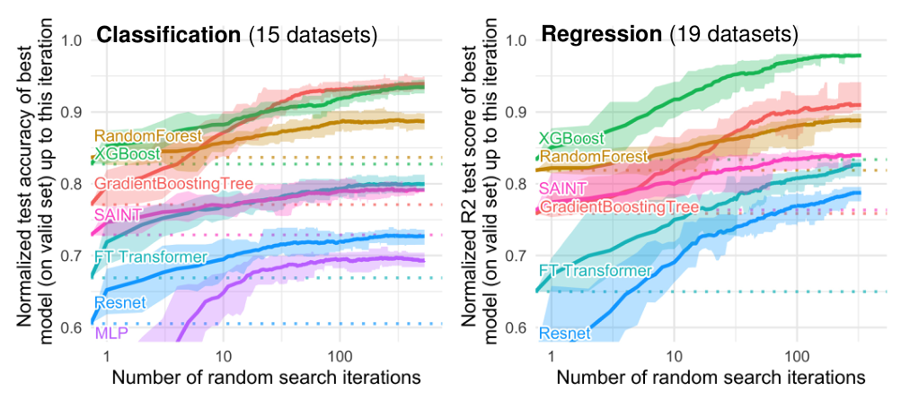
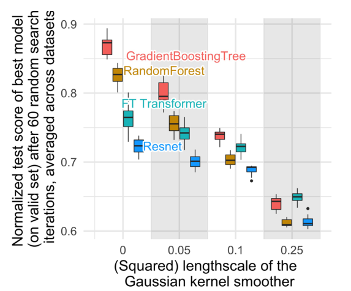
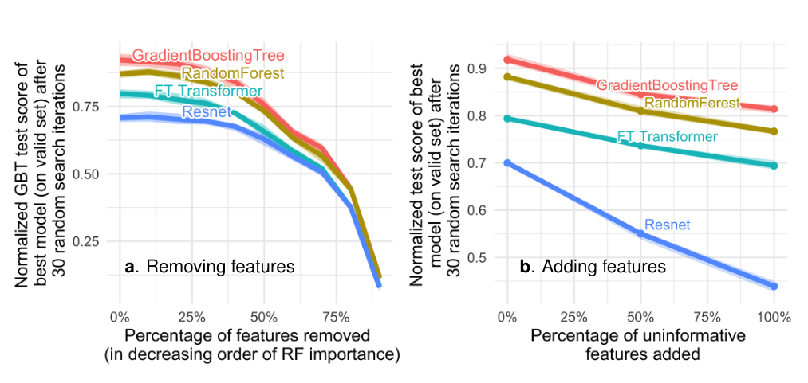
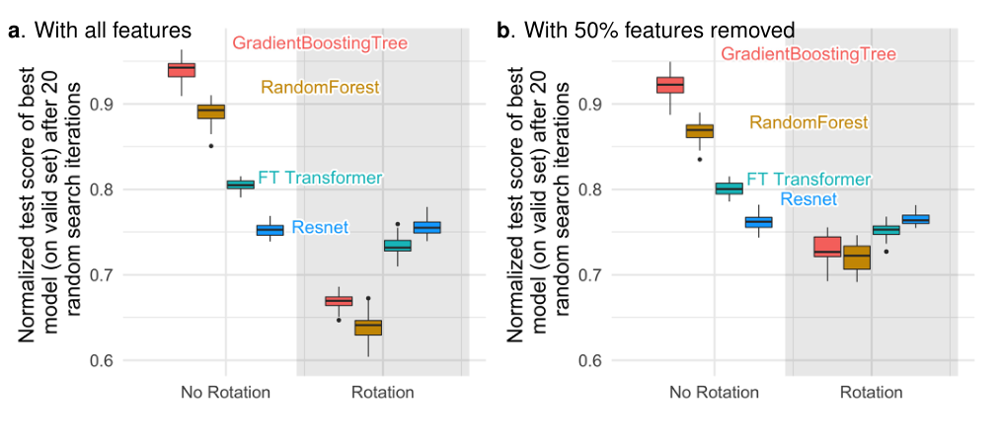

<!-- paper-reading-lang: zh-CN -->
<!-- paper-reading-theme: saffron -->
# 树模型为何擅长表格：从排行榜走向归纳偏置实验

**原论文**：*Why do tree-based models still outperform deep learning on tabular data?*，Léo Grinsztajn、Edouard Oyallon、Gaël Varoquaux。以Zotero `BKDZDVHC` 的33页 **arXiv:2207.08815v1，2022-07-18** 为准；这是标题含“tabular data”的早期预印本，不混用后来标题含“typical”的正式版本及其更新后计数。（PDF p. 1）

论文的价值不止是“树赢了”。它先控制数据筛选和超参数搜索，再通过**平滑训练目标、增删无关列、旋转坐标轴**三类干预，观察树与神经网络之间的差距如何变化。作者想识别哪些偏好在真实异构列上有帮助，而不是证明神经网络表达不了这些函数。结论属于其2022年模型与任务设置，也不否定后来经过跨表预训练的基础模型。（PDF §§3–5）

```paper-map
{"thesis":"在一个明确筛选和调参的中等规模表格基准上比较模型，再用数据变换暴露平滑偏好、无关特征敏感性与坐标取向这三类差异。","outcome":"树在本地v1基准中总体领先；关键科学产物是可复用评估协议与三个设计挑战，而非永久的模型家族胜负判决。","outcomeSource":"PDF §§4–6","items":[{"number":"01","label":"问题","text":"不同论文使用不同表、预处理与调参预算，容易把评估自由度当架构进步。","source":"PDF §§1–3"},{"number":"02","label":"测量对象","text":"45张参考表，异构列、真实预测、非高维、非时序；中等规模训练最多10K行。","source":"PDF §§3.1–3.2"},{"number":"03","label":"比较流程","text":"约400次随机配置与默认起点，重排15次观察搜索预算下的验证选择与测试表现。","source":"PDF §3.3"},{"number":"04","label":"平滑性","text":"平滑训练目标会明显损害树，却较少影响NN，提示NN已偏向过平滑解。","source":"PDF §5.2, Fig. 3"},{"number":"05","label":"无关列","text":"删除低重要性列更帮助MLP；加独立高斯列扩大MLP与树的差距。","source":"PDF §5.3, Figs. 4–5"},{"number":"06","label":"坐标轴","text":"随机正交旋转可反转排序，说明原列方向承载了可利用的信息。","source":"PDF §5.4, Fig. 6"}]}
```

<!-- paper-reading-context:start -->
## 00 / 发表时的研究背景
<!-- context-cutoff: 2022-07-18; basis: first-publication -->

### 当时的领域状态

时间回到 **2022年7月18日这份预印本公开时**。图像和语言上的深度学习成功，尚未转化成“异构列组成的普通表格上，神经网络总比树好”的可靠结论。实践中GBDT和随机森林很常用；研究中则已有不少表格神经架构报告优于树，但它们挑的数据集、预处理和调参预算不一致。问题不只是有没有新模型，而是**这些成绩能不能放到同一把尺上比较**。（PDF §§1–2；[首发记录](https://arxiv.org/abs/2207.08815)）

读这里需要先理解“归纳偏置”：模型并非学不会某类函数，而是在有限样本、给定训练过程下更容易选择某类解。树的轴对齐切分与MLP的平滑偏好，可能在年龄、收入等各有含义的列上产生不同效果。本文从这种偏好出发，而不是争论神经网络在无限容量下能否表示一棵树。（PDF §5）

### 关键前作与尚存缺口

| 工作与时间 | 已有贡献 | 当时未解问题及与本文的关系 | 来源 |
|---|---|---|---|
| 随机森林、GBDT及XGBoost等已有树集成路线 | 在表格预测中提供强基线，按单列阈值逐步构造非线性和交互 | 实践表现强并不解释哪些数据性质让它们受益；本文把树的优势从经验结论变成可干预的研究问题 | PDF §§1–2、§4.1 |
| Gorishniy等《Revisiting Deep Learning Models for Tabular Data》（2021） | 在统一训练/调参协议下，建立强ResNet基线和FT-Transformer，并指出没有普适赢家 | 统一比较已有重要进展，但任务覆盖仍有限；本文扩展筛选与预算研究，并追问差距来自何种偏置 | PDF §2；[原工作摘要](https://arxiv.org/abs/2106.11959) |
| SAINT（2021） | 引入行/列attention、改进嵌入与对比式预训练，在其基准中报告强结果 | 一套作者自选基准的平均优势不代表换数据和预算仍成立；本文将其放入独立统一比较 | PDF §§2、4.1；[原工作摘要](https://arxiv.org/abs/2106.01342) |
| Shwartz-Ziv与Armon等对表格深度学习的比较（2021预印本/2022） | 提醒新架构的优势未必能泛化到其他数据集，强调树基线不可忽视 | 需要更明确的入选规则、完整搜索轨迹及差距机制分析，而非再发布一张小规模胜负表 | PDF §2及References |

### 本文为何在此时提出

当时存在的矛盾是：**架构论文可以各自“赢”，领域却仍无法给实践者一个稳定判断**。本文因此先固定任务定义和搜索流程，再通过改变数据来问“是什么让排序改变”：平滑目标是否削弱树，加入无关列是否更伤MLP，旋转坐标是否消除树的轴对齐优势。这样的贡献是一套测量与机制诊断，不是一种更强的预测器。（PDF §§3–5）

其研究范围也决定了历史结论的边界：排除缺失、高基数、时序等因素，是为了先研究特定条件，不表示这些问题在当时已经解决。**同期而非前作**：TabPFN第一代预印本7月5日已公开，但本篇比较的不是后来那套TFM系统；不能用2025–2026年的基础模型结果倒推本文“当时就明显错了”，也不能断言本文解释了尚未测试的全部预训练模型。（PDF §§4、6；[TabPFN首发记录](https://arxiv.org/abs/2207.01848)）
<!-- paper-reading-context:end -->

## 01 / 先定义哪些表才进入结论

基准筛选强调异构列与可解释的任务来源，排除图像/信号直接展平、高维 $d/n\ge0.1$、不清楚来源、时序/流式、过小、过容易、确定性游戏规则等任务。它允许有实际意义的模拟数据，但不纳入仅为测试算法制造的玩具表。这样的选择是研究问题的一部分，不是“所有表格”的中性随机抽样。（PDF §3.1）

主设置进一步去除缺失数据，将分类转成两大类并平衡；类别列超过20个取值则移除，数值列少于10个不同值也处理/移除，二值列视为类别。训练集上限10,000行，50,000行设置留到附录。由此不能用结果回答高基数类别、缺失、强不平衡或时间依赖下的最佳方案。（PDF §3.2, Appendix A.2）

| 比较切片 | 分类数据集数 | 回归数据集数 | 条件 |
|---|---:|---:|---|
| 仅数值 | 15 | 19 | 去除类别列后满足筛选 |
| 数值+类别 | 7 | 14 | 仅保留低基数类别列 |

这些切片并非互不重叠的四组，不可简单求和当作45之外的另一总数。正文Fig.1/2分开画它们，正是为了避免把“类别处理”当成唯一解释。（PDF p. 5, Figs. 1–2）

## 02 / 公平比较的是选模型的过程

传统的“为每个模型挑一个好配置”会掩盖搜索成本与随机性。作者每数据集约400次随机配置，用验证集选最佳，再报告它的测试成绩；将搜索次序重排15次，画出预算从少到多的期望轨迹。默认参数总是第一个点，重排不是重新发明另一套最优参数空间。（PDF §3.3）

```paper-path
{"title":"一次预算点如何得到测试结果","stages":[{"title":"筛选并固定任务","role":"任务构造","action":"按异构列、规模、缺失、类别和预测来源规则处理数据，固定各模型相同的数据划分。","why":"减少任务来源和特殊处理造成的比较自由度。","cost":"结论范围收窄为筛选后的中等规模任务。","output":"可比较的任务与划分","source":"PDF §§3.1–3.2, Appendix A.3"},{"title":"采样候选配置","role":"模型搜索","action":"默认起点加约400次随机配置，NN在GPU、树在CPU评估。","why":"不是只给一类模型精心调参，同时保留完整原始搜索结果。","output":"每配置的验证/测试成绩与耗时","source":"PDF §3.3, Appendix A.3"},{"title":"只用验证集选优","role":"预算分析","action":"在前n次配置中按验证成绩选最佳，然后读取它的测试成绩。","why":"测试集不参与超参数选择，预算变化对应可执行的建模流程。","output":"某搜索预算下的测试表现","source":"PDF §3.3"},{"title":"重排并跨表聚合","role":"不确定性","action":"重排搜索次序15次，以逐表归一化指标和区间描述结果。","why":"体现有限搜索预算的波动，不把一次幸运搜索当必然表现。","cost":"不是对所有随机源的独立重复或95%总体置信区间。","output":"预算—表现曲线与不同任务切片","source":"PDF §3.4, Figs. 1–2"}]}
```

附录划分是先取70%训练（受上限限制），剩余部分中30%作选配置的validation、70%作test；无截断时相当于70/9/21，而不是70/15/15。早停所用的验证部分还来自训练集内部，与选配置的validation不同。模型和配置使用相同fold；fold数按测试样本数变化。（PDF Appendix A.3）

跨表归一化也不是原始准确率：最好结果映射为1，分类用误差10%分位、回归用50%分位对应的参考弱结果映射为0，回归负分裁到0，避免极差异常模型支配尺度。曲线0.9不能翻译成准确率90%。（PDF §3.4）

看Fig.1时，横轴是尝试过的超参数配置数，不是训练epoch；虚线是默认配置，阴影为15次重排的极值范围。数值分类和数值回归都显示树的总体优势，因此不能简单归咎于NN不会类别编码。（PDF p. 5, Fig. 1）



*原论文 Fig. 1，PDF p. 5。15个分类、19个回归数据集；阴影不是95%置信区间。*

## 03 / 第一个干预：抹平不规则目标

作者不直接改网络，而是在训练集上把标签函数平滑：

$$
\widetilde y(X_i)=\frac{\sum_{j=1}^{N}K_\ell(X_i,X_j)y_j}{\sum_{j=1}^{N}K_\ell(X_i,X_j)},
\qquad K_\ell(x,x')=\exp\left[-\tfrac12(x-x')^\top(\ell^2\widehat\Sigma)^{-1}(x-x')\right].
$$

$\widehat\Sigma$ 是特征协方差的稳健估计，$\ell$ 控制平滑距离，$\ell=0$ 特殊表示不做平滑。仅平滑训练目标，测试仍保留原始问题；只用随机森林评出的前5个重要特征做该实验，且先Gaussianize。这些条件避免把高维核距离失败误认为模型偏置。（PDF §5.2, Appendix A.4.1）

**说明性算例**：相邻训练点标签0与1在几乎相等的核权重下变成约0.5，尖锐跳变被软化。若原任务确有局部跳变，抹掉它会使本能拟合这些边界的树受损；若NN本来没有学到这部分，损害可能较小。作者实际观察正是树的准确率先下降、NN更稳定，支持低频/平滑偏好的解释，但不是神经网络无法表示阶跃的定理。（PDF §5.2；算例为阅读者构造）

读Fig.3请看小平滑尺度下各模型相对下降，而不是只看最强平滑时大家都差。该实验的解释力来自“同一训练集加入受控改变之后，差距怎么动”。（PDF p. 6, Fig. 3）



*原论文 Fig. 3，PDF p. 6。纵轴归一化测试准确率，横轴核平滑尺度；测试目标未跟着改成平滑值。*

## 04 / 第二个干预：哪些列其实不重要

研究先用随机森林重要性从低到高删列，分别看保留列和删除列的预测能力。仅看“删一半列仍然准确”无法区分冗余与无信息；所以还要训练一个只用被删除列的模型。后者直到删除一定比例仍很差，说明至少部分被删列不是简单重复信息。（PDF §5.3, Fig. 4）

接着做两个方向的对照：移除低重要性列更有利于MLP/ResNet；添加与目标和其他列独立的标准高斯噪声列，则扩大MLP与树的差距。FT-Transformer的表现又与MLP不同，因此“所有神经网络同样不抗噪”也不是论文结论。（PDF §5.3, Fig. 5）

看Fig.5左、右两图时，左图删除列的过程中也会逐渐删到有用信息，不能把整条曲线变化都解释为纯净化。右图只添加独立噪声，是更直接的无关列干预；两者相互支撑。（PDF p. 8, Fig. 5）



*原论文 Fig. 5，PDF p. 8。原图保留完整曲线与坐标，不从图上猜测未经表格报告的精确百分点。*

## 05 / 第三个干预：旋转不是打乱列名

用同一个随机正交矩阵 $Q$ 变换训练和测试输入：$x'=Qx$，$Q^\top Q=I$。这种变换保持距离，但把年龄、收入等原始轴混在一起。它不同于交换两列位置，更不是对样本行排序。树的轴对齐切分不再直接对准原来的语义特征，而某些各向同性初始化的MLP学习过程对这种旋转较不敏感。（PDF §5.4, Appendix A.4.3）

**说明性几何例子**：规则 $x_1>0$ 仅用一刀能表示；旋转后变成斜线 $a x'_1+b x'_2>0$，轴对齐树可能需要多次切分近似。对称地，若原轴并无意义，这种偏好也可能无益。这里保留的是适合原表分布的轴结构，不是说坐标系在数学上有绝对优先地位。（PDF §5.4；例子为阅读者解释）

Fig.6左图的随机旋转使排序反转；右图先删低重要性一半列再旋转，模型间差别变化较小。这个联系提示旋转不变与无关列敏感性相关。论文引用Ng的最坏情形样本复杂度结果作为解释，但没有证明它完全解释每一张表。（PDF p. 9, Fig. 6）



*原论文 Fig. 6，PDF p. 9。实验限数值分类并先Gaussianize，不能直接推广到任意类别编码的几何旋转。*

## 06 / 三项观察如何连回设计

```paper-experiments
{"title":"观察、控制与可支持结论","rows":[{"question":"是否只是NN没调好？","setup":"树与MLP/ResNet/FT-Transformer/SAINT，约400随机配置，默认起点，分数与时间两种预算。","observation":"在本地v1的中等规模切片中，树的总体优势在大搜索预算后仍存在。","conclusion":"排除了某些简单调参不足解释，但不排除未来更好的训练/预训练或其他搜索空间。","source":"PDF §4, Figs. 1–2, Appendix A.2"},{"question":"类别列是否是主要原因？","setup":"数值与混合类别切片分别比较。","observation":"只用数值列仍存在明显差距。","conclusion":"类别编码不是全部解释。","source":"PDF §4.2"},{"question":"不规则函数是否重要？","setup":"训练目标Gaussian核平滑、前5重要列、测试目标不变。","observation":"弱平滑明显损害树，NN受影响较小。","conclusion":"支持NN偏平滑、未充分利用局部不规则性的解释，而非表达能力不可能。","source":"PDF §5.2, Appendix A.4.1"},{"question":"无关列与坐标方向是否相连？","setup":"删低重要性列、加独立噪声、正交旋转，以及删列后旋转。","observation":"去噪更帮助MLP；旋转使树失去原优势，预删噪声后影响改变。","conclusion":"支持学习过程应利用列轴结构并抑制无关维度；不能把二者当独立可加效果。","source":"PDF §§5.3–5.4, Figs. 4–6"}]}
```

**作者主张**是三个设计挑战：适应不规则目标、抗无关列、保留有意义的列方向。**实证支持**来自限定协议下的数据干预，不是单看排行榜后的猜测。**阅读者综合**：所谓表格归纳偏置，不应只是把图像Transformer搬到表上，而应关注每列的独立身份、可忽略性及非平滑关系。（PDF §§5–6）

代价与盲区同样明确：筛选去掉了缺失、高基数、强不平衡和非IID，归一化依赖算法集合，随机搜索重排没有覆盖全部随机源，运行硬件也不相同。后续模型若在这些挑战上改进，正是在回应本文，而不是与一个永久结论矛盾。（PDF §6, Appendices A.2–A.4）

<!-- 可视化决策：本论文是比较与干预研究，不虚构一个模型训练流水线；静态预算曲线、三组干预原图及实验矩阵可同时展示控制变量，交互不会补充关键状态。 -->
<!-- 覆盖：v1正文、Appendix A.1筛选、A.2规模/时间、A.3划分与调参、A.4核平滑和旋转细节；45与各切片计数按此版本，不混用后续47表版本。 -->
