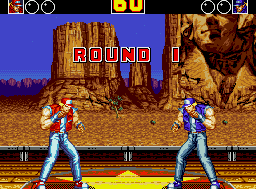

> Original: https://sites.google.com/view/fightladder/home
> Authors: Wenzhe Li; Zihan Ding; Seth Karten; Chi Jin
> Webpage publication date: unknown

> Archive limitation (user-approved): all webpage text and captions are preserved, but 23 of 24 original content images returned HTTP 403 and are replaced with linked placeholders. One original animated image is available locally. Fourteen embedded Google Drive videos remain online links. The Google Sites layout is adapted to a static single-column reading/printing layout. A third-party Elfsight widget is not preserved. The webpage publication date is not stated.

# FightLadder

A Benchmark for Competitive Multi-Agent Reinforcement Learning

  

Wenzhe Li    Zihan Ding    Seth Karten    Chi Jin

Princeton University

[[Paper](http://arxiv.org/abs/2406.02081)]       [[Code](https://github.com/wenzhe-li/FightLadder)]

## Abstract

Recent advances in reinforcement learning (RL) heavily rely on a variety of well-designed benchmarks, which provide environmental platforms and consistent criteria to evaluate existing and novel algorithms. Specifically, in multi-agent RL (MARL), a plethora of benchmarks based on cooperative games have spurred the development of algorithms that improve the scalability of cooperative multi-agent systems. However, for the competitive setting, a lightweight and open-sourced benchmark with challenging gaming dynamics and visual inputs has not yet been established. In this work, we present FightLadder, a real-time fighting game platform, to empower competitive MARL research. Along with the platform, we provide implementations of state-of-the-art MARL algorithms for competitive games, as well as a set of evaluation metrics to characterize the performance and exploitability of agents. We demonstrate the feasibility of this platform by training a general agent that consistently defeats 12 built-in characters in single-player mode, and expose the difficulty of training a non-exploitable agent without human knowledge and demonstrations in two-player mode. FightLadder offers meticulously crafted environments to tackle essential challenges in competitive MARL research, heralding a new era of discovery and advancement.

[Supported Games](#h.4ty298eb84c)

[Single-Agent RL Experiments](#h.f9a1h7cb9x09)

[Multi-Agent RL Experiments](#h.1x5yngwcvm3r)

[RL Exploitation](#h.ff2bdy10mbfn)

[Human Exploitation](#h.y4qnyoybm93f)

[Head-to-Head Evaluation](#h.84trih4qfvlu)

[Elo Rating](#h.etkdmz1lr1l0)

[Citation](#h.owl414u5xh3s)

## Supported Games

[Archive limitation: original image 1 could not be downloaded (HTTP 403). [Original image link](https://sites.google.com/sitesv-images-rt/AMxu72sZdtXIGCJh2I0gLQNow-eY8ga5RRb2jsGKxcIfNdBw5wcZph3l_CxD2DJ6gia5wQkv_F5gOYUquSAiaDKRLkrqt0IdKLsIMNTjlkOC4yx17TTH4xAxA9_LLyBfbGElNf5VmZYTyODMSmxf_EleJEPPk6wQ5juajln1UG3z-QXuTzLocf06lNSKeze7mfouPlVEx7__6FYShcFkTmhUSrU-SzoS3zxbe6_PNh9Cs5s=w1280)]

Mortal Kombat (Genesis)

Fatal Fury 2 (Genesis)

[Archive limitation: original image 2 could not be downloaded (HTTP 403). [Original image link](https://sites.google.com/sitesv-images-rt/AMxu72u-OPpsktjPHtKM-_0WgY3FgocNNBe20eBug6UbKFI34K5160lE-hHDwql_L4VsJj-BqZtG1ra6ZeYbboeu6sxr0nhI9ANmaeMQWTiftu-DrSLDw94E-562MWUSGH_pM7In9tSR_1DYRg_pIDypHr-Xyi8CPnuMYblJ82pUIIOKJKWhtxqRuq7ZSlATW8ClAYb_YfwwEYDtmLRe11gkia1aVLilztSiAzKWy6-Yp8M=w1280)]

The King of Fighters '97 (Neo Geo)

[Archive limitation: original image 3 could not be downloaded (HTTP 403). [Original image link](https://sites.google.com/sitesv-images-rt/AMxu72uwWIczRbgvR70rdyaZ1JZAMy2tHDDy-llQ96qmJY7D8hbNW67m6Kn9mqo5mHSvUXMMwCC8FHj2g8O1kP3tVdLjnPUM-YzTbEePjSp6Nk9-YYj3sV4zUWjYSLJw9gRjbC4ydi1euivXnV8DlZxG2faM-gFeGPr99AXr8ogWRFiIqqpfFkphugYKTREbsA3w85fzSBiZHDUibrz6BpAbFR8wttk9lyCF9of4Y8Qf=w1280)]

Street Fighter II (Genesis)

[Archive limitation: original image 4 could not be downloaded (HTTP 403). [Original image link](https://sites.google.com/sitesv-images-rt/AMxu72t_TszBeEGOq9y3tCtgruflD3bSA0joaQ0DIjbcnX-7Y1mHrjxgKubZSk0EYjcTLEWGoEcxtlYLkqBxkU_91pdJuxBFS2YCpmI9o9wDmdPkcVYtDZ8YSnhE5fgFtb5zlVWAvKE9k8kD6LonW1iXdSvwZ-2QZe9WERi9ZyNI2ZFHZ-_lOlzqZnR4Xk7S36pprhpfJUVLnC_Yzp06mwu99Yr9vwv6Kv3FNh6ELIQH=w1280)]

Street Fighter III (Arcade)

## Single-Agent RL Experiments

In the single-player setting, we proposed a learning scheme based on curriculum learning. It trains a general RL agent (Proximal Policy Optimization, PPO in our experiments) that can consistently beat built-in computer players (CPUs) across different characters. For game Street Fighter II, the training process of the agent over 25 epochs is shown below. Each epoch involves 10M training steps competing with opponents sampled from the curriculum scheduler in parallel.

[Archive limitation: original image 5 could not be downloaded (HTTP 403). [Original image link](https://sites.google.com/sitesv-images-rt/AMxu72s5gVUsfqQtPFq67B_5vcZTQ8SYBxIB-3sGlBoI6dD_568i5riomYtXMLI5Ft5MYdCx7pFvqy0AXC3o1kTHP_n-3M5uCnnThLmPpeDyGDP0IYct1BHW0TpfqQiYM92i5ign0Tp3xoz2SFHR_GoVaK-q-h3DUUphNVQIxt7GaoFE3V2PQXVIPzITftbNNfDOrART3KUyJuxBR6wBWUNRKH8AviiYbfwTzNSjYEna=w1280)]

The following video shows the learned single-agent PPO (left, Ryu, in grey) is capable of passing through all 15 levels of the Street Fighter II game.

[Archive limitation: embedded video not saved offline: target_16_episode_1_done_16.mp4. [Watch original video online](https://drive.google.com/file/d/1GANP1MdBBGFEDqlFnqXZxZOdcjtPcUWC/preview)]

## Multi-Agent RL Experiments

For the two-player setting (controlling both sides), we adopt five MARL algorithms for agent training, including three population-based methods and two decentralized methods: 

- League Training (e.g., AlphaStar)
- Policy Space Response Oracle (PSRO)
- Fictitious Self-Play (FSP)
- Independent Proximal Policy Optimization (IPPO)
- Two-Timescale IPPO.

For three population-based methods (league training, PSRO, and FSP), the dynamics of payoff matrices within each learning population during training are shown as follows. The name of each row indicates the agent information as Character_Side_Checkpoint. Checkpoint=h_xM represents a previous version of the agent saved at x million steps. The value indicates the win rate of the left (row) player against the right (column) player. Please refer to more details in our paper.

[Archive limitation: original image 6 could not be downloaded (HTTP 403). [Original image link](https://sites.google.com/sitesv-images-rt/AMxu72slLURYGGegkQzhLRySN-WaLXCJd5NnvwlBzvlAQmXRiZY6CxJVJo8boKH-ZiMCovMror5N3l4DA4LMLrfD7KtMOINTOFkTM2AIouBu4f6IJs0nOpPNQgq1DaMaxJmSNv7fTtd3i0pAN7-nlwVXYicZnOX840jmvnMO2_HbZSeAYe9prX-IpcypoUOuXrOcZAFwZzV1EEXMI4I5dwZ2AM1U8RezhlT2MxZQtbVY=w1280)]

League Training

[Archive limitation: original image 7 could not be downloaded (HTTP 403). [Original image link](https://sites.google.com/sitesv-images-rt/AMxu72sJc0uS3m1x5I6qjgcVhDDdN7PPj7i30p6CxmZrfNzwwiPmTPwok895aPgS9SEkNfpMWn3ajRhRcDCeYV0pUPRTtrRAIB9G1inzaTPG-3a8kYT7k65XCiJhX49sqMbsj4hKUNZJMmEH_ectW52BZhACVEXbC_se0I6YYkrzbaL41uGJWzGMTfHB-cLSyfjJMrF8UVVIB9UDwvhdbHx1rA8f63qcVJcqPe6Y4Pv3hlQ=w1280)]

PSRO

[Archive limitation: original image 8 could not be downloaded (HTTP 403). [Original image link](https://sites.google.com/sitesv-images-rt/AMxu72sLb-PS6RPVqsI0J1qUYL561klSQZwdvONvUGDLpR9c90lZzKPv_2nV-9vCGuCCorFg_GLqitPKpuwB5MKPNST9zOx3UrH2px7K_YjoORQsKyVhfwdExCLXdovyRHFKVsoN3UxmiNVrDLEtV9-IPhvfamLqDRPLTrkjncBrJIs9kGWUCohDc5c-UGRcAL-MIa2MxWilwzuCYxAC6dG3kcesyGp9p7djnT6F7jnHrTA=w1280)]

FSP

### RL Exploitation

To examine the exploitability of learned agents with the above MARL algorithms, we use a single-agent RL algorithm (PPO) to train the exploiter model against the fixed best agent from each multi-agent algorithm. Videos of learned agents (left, Ryu, in grey) versus RL exploiters (right, Ryu, in white) are shown below.  

In general, after sufficient time of training, the exploiter can eventually beat learned agents consistently, while agents from different algorithms reveal various weaknesses.

[Archive limitation: embedded video not saved offline: exploit_ppo_left.mp4. [Watch original video online](https://drive.google.com/file/d/1RFoNYNzhIN4H3-EoUwp1XAhm-0cbyXvG/preview)]

PPO (Single-Agent Baseline) vs PPO Exploiter

[Archive limitation: embedded video not saved offline: exploit_ippo_left.mp4. [Watch original video online](https://drive.google.com/file/d/1RMEA6QuziJHYINXIOA6PvVTdyKWCH90n/preview)]

IPPO vs PPO Exploiter

[Archive limitation: embedded video not saved offline: exploit_2timescale_left.mp4. [Watch original video online](https://drive.google.com/file/d/1yea_nbVOqtNnpe2V5uh-tMYX63F-rw7P/preview)]

Two-timescale IPPO vs PPO Exploiter

[Archive limitation: embedded video not saved offline: exploit_league_left.mp4. [Watch original video online](https://drive.google.com/file/d/1Qt_owfWWtkSYNfwWNK2_VLtXPL1bJGAK/preview)]

League Training vs PPO Exploiter

[Archive limitation: embedded video not saved offline: exploit_psro_left.mp4. [Watch original video online](https://drive.google.com/file/d/1JwpgG_RKCsHEko3zqamqXTZnG7TB9vm6/preview)]

PSRO vs PPO Exploiter

[Archive limitation: embedded video not saved offline: exploit_fsp_left.mp4. [Watch original video online](https://drive.google.com/file/d/1FLQF7QtmpxSjI6VGaNdIRmRHD2Ofouh7/preview)]

FSP vs PPO Exploiter

### Human Exploitation

In addition to exploiting the learned agents with RL algorithms, we also attempt to exploit them with human players under the same control frequency. Videos of learned agents (left, Ryu, in gray) versus humans (right, Ryu, in white) are shown below.  

In general, our human players choose a defensive counterattack strategy instead of a fully aggressive one, which is found effective in exploiting the learned agents across methods.

Nevertheless, we still find that the learned agents reveal some robustness to human players (e.g., defend when a human player attacks) during human evaluations, but some simple strategies (e.g., defensive posture combined with low kicks at proper timing) could still defeat them rather consistently.

[Archive limitation: embedded video not saved offline: ppo.mp4. [Watch original video online](https://drive.google.com/file/d/15XlnqkK8Yh_wRPYScFiatpHhvanrrEF1/preview)]

PPO (Single-Agent Baseline) vs Human

[Archive limitation: embedded video not saved offline: ippo.mp4. [Watch original video online](https://drive.google.com/file/d/1Da656vAdfpCP7vK6xf-cyNdNKBwRCG7H/preview)]

IPPO vs Human

[Archive limitation: embedded video not saved offline: 2timescale.mp4. [Watch original video online](https://drive.google.com/file/d/1j57dvNOvNK7ohy6Ax2waet-baDjInMmG/preview)]

Two-timescale IPPO vs Human

[Archive limitation: embedded video not saved offline: league.mp4. [Watch original video online](https://drive.google.com/file/d/1YzE5s9axgLwa7_tfzq9rnR6MbCD8ZXzx/preview)]

League Training vs Human

[Archive limitation: embedded video not saved offline: psro.mp4. [Watch original video online](https://drive.google.com/file/d/1quEUA6T0gxl7LSdrZLuEPeJnoSjRtPzt/preview)]

PSRO vs Human

[Archive limitation: embedded video not saved offline: fsp.mp4. [Watch original video online](https://drive.google.com/file/d/1BmaY99YGQy2C57LCBrNOTRspHbxH18sd/preview)]

FSP vs Human

### Head-to-Head Evaluation

We further evaluate the trained MARL agents with head-to-head battles among each other, as well as against CPUs (built-in game players).  The recorded videos are shown below, with Ryu as characters for both sides.

[Archive limitation: original image 9 could not be downloaded (HTTP 403). [Original image link](https://sites.google.com/sitesv-images-rt/AMxu72vY_kQCXgS_TwWiiTya8sB5EiDHZMAhyzsvMYxEwMA-PNbg6_L1VVCgGympVvgzr6q7ip1fFqBbjPqoUX0b_H91ealpdvp-GeXqb1gmIMYTwJPAgKzNZl-rKXXgbcLpIeLBsKJvDm_FNy7xulqggfKZbs6gbV8voqfDfAItw5xQGqjfa0183ltN2GhzxoAPD_Ib24vCPRq3Q5Hhl6dRvu-4iM2IOg_jgfcLxA09=w1280)]

IPPO vs CPU

[Archive limitation: original image 10 could not be downloaded (HTTP 403). [Original image link](https://sites.google.com/sitesv-images-rt/AMxu72udA9AGUAnpED2_MJ02nY5AzNIgjHNw_R4_ThLmK8zZqWRuBaysfcV96k6R8wdEotez1pHdWfEP4T_Z9QtIzyfKVkBJVM5srNofBGhe8p45in8VMArI-8LaqdiB9Nlc1DQgzDrL-lBf1Tl79EDpvLVY-l-KkihBTKw5nXo7-PQj_7mPfhLPXWy4r9-APWQSUBKUMO3uDXbR_D1J-TVVRO8Nu9LIaiRoVdy2gyycvM8=w1280)]

Two-timescale IPPO vs CPU

[Archive limitation: original image 11 could not be downloaded (HTTP 403). [Original image link](https://sites.google.com/sitesv-images-rt/AMxu72uhnG-YCysq72aUBDktkpFMXLAm-lU8FcwBU4IJOLDVSDBqDLb_Lg4OoRaUMMxQbvS5v38zhKYUDMoDuE8N-mln_I58oOdXDOzQZ42Z2s7nfP2DzdCtS1gxShmyJ5zl5n1IciCpIdLnJWoWQSshRzi88-z0wghxzfItVO7FJ9qPDMq-hFHMjMgI69k4E7YBQrD96OHDk1VdDMc9P8itiMr-6_neStTHkLZ9iH8jngI=w1280)]

League Training vs CPU

[Archive limitation: original image 12 could not be downloaded (HTTP 403). [Original image link](https://sites.google.com/sitesv-images-rt/AMxu72vMf15WXvp1Iq_4UNsXpaeev2WoVWWlqweeDN7LdC88xaumNRuAvCXSSlgQksEv79jBGkeg-Q2BnBg5yBFJ_dLrdRFINZTXEz45c_gzi6Y8C3zNS8W_a0qWmsNFqSUxeKfJJ0-vXYA7tGI4U_0BtSTFTspNP8i63hYIexkGPeonWLhUcTTdKLW23xHocbsG2GPtPcIU4qZx6Cf6cFMTUK1JiH51V7tUxaX0SIBNKeA=w1280)]

PSRO vs CPU

[Archive limitation: original image 13 could not be downloaded (HTTP 403). [Original image link](https://sites.google.com/sitesv-images-rt/AMxu72vjj2K__gIHUJ6uylw5fvQXB-5xyXfAibFlbQwqd_b9d3M-XBhR4JkxGYWwsCrJLfK0WeOB8CfnDGtJdMlK7dppJQKwxvUKq1VJ2iaXab5Fg7lyF2Cxr9GSG3BsZtV1d81A15--cW6Dkr1ovIdnKQ4cdVUP3HLlmL28O5olXEdJfnRPU20l2Y9WljrPIrbN_6Ea08uY1g9-GpH7dvq94BvSbRkBhYlsylwjTaiNcRU=w1280)]

FSP vs CPU

[Archive limitation: original image 14 could not be downloaded (HTTP 403). [Original image link](https://sites.google.com/sitesv-images-rt/AMxu72tFpuvbkBJTJfgcceI74tN3FbnncqWpzJ5EsbSTt6NmGJnod7LsENNgmszopZPs8eQ9Ms-SrylcXnbVcA1ynSU9NGzjt6hIXUAI7ochB3b2bt30SbW9ZJdFb30QZI-JCzyy1VGZgFH3b933w3B2N5qP8lJ1PqYr5ucnHjTKcgSfbaT2YbXhPIS6Y34zp41WJO1gyUF7XKYRfJYAfS4ineVNGY70EM7eotkSH3u4=w1280)]

PSRO vs IPPO

[Archive limitation: original image 15 could not be downloaded (HTTP 403). [Original image link](https://sites.google.com/sitesv-images-rt/AMxu72uKgYzBbjK3gQJzZ_egrie0Ez5vhSuMM2F3UOxRB7RyltRcx6-WFueALI4Wt5Pebu2mMsimhAX-h00t1zvQY2eX8T0FqrrpTJcKZ1vczlUULeehkjNbdPTBZyKONaNQJFJeyGMRJYyfNDkkGOnQV8WUdmB-ljg4oz7jGBaLmrQL0736eZeTuS7ZCyMDZRLY09eEq1IxViA0qTNOZIHwM1F3QnJNohoznaAS4U3fX7o=w1280)]

League Training vs PSRO

[Archive limitation: original image 16 could not be downloaded (HTTP 403). [Original image link](https://sites.google.com/sitesv-images-rt/AMxu72sZzqhbzIoaoWS_R_Swyeo80C1sisEK26TZFhmOA8EUjZfMwUiB-gpMsltdM0oZAid4_WHi2LzI8qrOQgRlv_AWI02MxVa8dme0XFqdPfhN_AB55wwYjhlH0fDUFmsPE7DHMR6FQ0IXGoN7EzxoCDarsTHOWd57iq-smx8Aoy0k2UQJuOvcMbbT99u6ifLkHi4InYn1KCn_J87ugZ0Optp82CdpRD92lRJ-c1YQ=w1280)]

Two-timescale IPPO vs PSRO

[Archive limitation: original image 17 could not be downloaded (HTTP 403). [Original image link](https://sites.google.com/sitesv-images-rt/AMxu72v1aRfmDJSGWQawCFz5HxRNHW55s70gP0VVo7MBbgzisGs87hNAIc8nVlpvHXa1AGbWEdtlaC8cjc1WA1DtlJBU89E7U8nzDZQOz4A7dgRLqGkkko-Ozk-GsfD5yKQ49vWmLEuFiJGv4iJ71kWVKdGJNfBKkRwN_oZWMkPzf9kSjnxtGg9DTgotDWN3EmRLmtfjJjVLouXgdwCIIAX8-ucXC_4JfMXVoCNCilFUB90=w1280)]

FSP vs League Training

### Elo Rating

[Archive limitation: original image 18 could not be downloaded (HTTP 403). [Original image link](https://sites.google.com/sitesv-images-rt/AMxu72vlhzmYEn5Vok7OPDCN5V9b1QQSmSFRwlTcEKMfVYrEbIWVXVMyLgj9LUs1KBKHcZyiRHGHo7_KsC12XfV3wN6bWbk4AOAh5G_A5R_vU60YfvvhqtK-6WCEURfjngQHZXkXCn8IhQEcUnX3nZClcY6_NLwo12qCnLf4ZB2pKBVSBcjoJqpac0o3wtow6tk=w1280)]

Elo rating is commonly used as a ranking system for multi-player games. We assess Elo ratings for trained agents in our experiments to evaluate the learning process and agent performances, over five algorithms league training, PSRO, FSP, IPPO, and two-timescale IPPO.  

  
  
  

The overall Elo ratings with a mixed population of agents (top 5%) from five algorithms are shown on the left. The horizontal axis is  the Elo score, and the vertical axis is the number of agents with certain Elo for each algorithm. League training achieves higher Elo ratings on average, especially for left-side agents. However, we also noticed that two sides of agents reveal asymmetric strengths in terms of Elos.

The Elo ratings within each algorithm population are shown below.

For each algorithm, the left figure shows the Elo rating versus the winning rate of each policy in evaluation, the middle figure shows the learning progress with each point indicating a policy with the corresponding Elo, and the right figure depicts the Elo distribution for each type of agent.

  

The Elo rating for the population of agents trained with the league training algorithm:

[Archive limitation: original image 19 could not be downloaded (HTTP 403). [Original image link](https://sites.google.com/sitesv-images-rt/AMxu72vHzsuChu4QfJfqkYa8Ak-FaXm56hm6x5sIwdsmdvLGnxJL0qjaSfEsnF4h7bZ8Ic_qQ5UkIeO7M1C5-jfv0jrp3AFKPaJdu3lIxz1MW2V0ih6L08t4pY6CnfsZU3emP6ReD1LgZhdj1XZXrRImqs811ieK81gQEez4epJTjRenQMcDIcS9lRhZRoZ8BIg=w1280)]

The Elo rating for the population of agents trained with PSRO algorithm:

[Archive limitation: original image 20 could not be downloaded (HTTP 403). [Original image link](https://sites.google.com/sitesv-images-rt/AMxu72sF8s34O11VhrEZM2RZ7JUkrx7dY6XPDAf5EP81mWJsgZ7j3gcvYMdwmygw7og8oBx2Km0VcW8jvHIko7DLiKhAqLjvN94HR4I67Ma-BdZlgALYlfhApRp2ZnulrWbZOPBo74USXAiKqhy4uBN3CZjyDIiqw9tYwGMUos_U01_HrLuTIXnwf_Yirkmm7Eg=w1280)]

The Elo rating for the population of agents trained with FSP algorithm:

[Archive limitation: original image 21 could not be downloaded (HTTP 403). [Original image link](https://sites.google.com/sitesv-images-rt/AMxu72vXo6wrbfbrtQlFVTAhoF13urJzvfiC7C0im_R-vvFy7D-DwIfr1sI5-wLkbLo1R4lVz2S1r1mwvud5EHve45xi9UhIg8FR2STsUHFZNJKoGtnIIzQa0c0wCB28klScprnzf1cyntp4ZpH0wQi07QcmLu0RHu5s6K1YU86DSHCKYh-kozqLuHnGVxEOYvE=w1280)]

The Elo rating for the population of agents trained with IPPO algorithm:

[Archive limitation: original image 22 could not be downloaded (HTTP 403). [Original image link](https://sites.google.com/sitesv-images-rt/AMxu72ssna1KvBO3rF2TRmELv9TnuvBfjOK6v7uFb6J5wb5tIJA1bNo4n5hMgMC90m72HXFmeT4wHW9oC0_XSz50Eo-18-7Z-E6c3AV75NRnDmqtLSROfHxNZFlrIZCMJea8wDD58W3A71K6mC98c4fk9S2Ee3AIkBNBOI_kvLYAvSemq7eCzUyekqMOy5xh=w1280)]

The Elo rating for the population of agents trained with two-timescale IPPO algorithm:

[Archive limitation: original image 23 could not be downloaded (HTTP 403). [Original image link](https://sites.google.com/sitesv-images-rt/AMxu72v2iWMVVtp63gaz66N56PVsTiDInPBainiwNSuyUMOlrkJWEW6ea3mkegsQJh0HuSh97YL2CW4JotGaS4VchMGjH6rIwsJdZJrMWTbVfypWT_mX-a9ztuSAWGxi6O08pGW2KepzR25B8sLP2vwyppjCYNVghH_o6o7O-_Eps6tk7kj3QeT3Pj6mE2vk2mI=w1280)]

[Archive limitation: embedded video not saved offline: fsp_(left)_vs_fsp_.mp4. [Watch original video online](https://drive.google.com/file/d/1oLv2Arg1eAvec4AEq0k57Qn4ALE_S4sK/preview)]

FSP vs FSP

An interesting observation from above Elo rating during entire training process is that, the agents learned on left and right sides can be asymmetric in their performances. This is further verified in our experiments with head-to-head test for agents on two sides but with the same MARL algorithm, for example, video of two FSP agents.

## Citation

@misc{li2024fightladder,

      title={FightLadder: A Benchmark for Competitive Multi-Agent Reinforcement Learning}, 

      author={Wenzhe Li and Zihan Ding and Seth Karten and Chi Jin},

      year={2024},

      eprint={2406.02081},

      archivePrefix={arXiv},

      primaryClass={cs.MA}

}