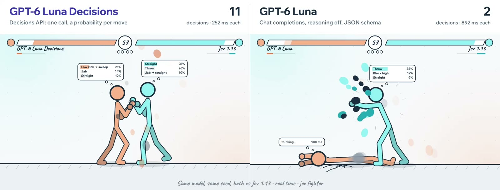

> Original: https://opper.ai/blog/luna-decisions-vs-luna
> Author: Jose Sabater · Published: 2026-10-15

# GPT-6 Luna vs. GPT-6 Luna Decisions: four times faster

By Jose Sabater - 10/15/2026

[Original video — local MP4](assets/6889d83fbf71-luna-sbs.mp4)

*Archive note: video playback is available in the offline HTML; PDF contains the poster only.*

*Left: GPT-6 Luna through the Decisions API. Right: GPT-6 Luna as a chat model. Both fight Jev 1.13 on the same seed, in real time. The number in each corner counts Luna's decisions.*

Five seconds in, Luna on the left has made 11 decisions. Luna on the right has made 2, and is lying on the floor with a "thinking..." bubble while Jev keeps hitting it.

Same model. The only difference is how we ask it.

**What we found, in short:**

- **Real time: 10 wins against 1.** Against Jev 1.13, Luna Decisions won all 10 matches. Luna as a chat model won 1.
- **Four times faster.** Luna Decisions took a median of 208 ms per decision, the chat version 866 ms. That is twice as many decisions per match (88 against 44).
- **Not a worse fighter, a slower one.** When the game waits for every answer, the chat version wins just as often, and sometimes more.

## The game

[Jev Fighter](https://opper.ai/decision-benchmarks/fighter/) is a 2D stick-figure fighting game where each fighter is controlled by a model. Every time a fighter can act, the game asks one question: here is the situation, here are the legal moves, pick one. The engine is deterministic, so every match is an exact replay and every decision is logged with its latency.

In **real time** the clock keeps running while the model thinks. A fighter still waiting for its answer can't start a new move, and the opponent doesn't wait. On the **raw** track each option is just the move itself (`sweep: low, 9 dmg, startup 11f, recovery 22f, reach 1.3`), so the model has to work out what each move does in the situation.

We played GPT-6 Luna two ways, both through Opper:

- **GPT-6 Luna Decisions** (`openai/gpt-6-luna-decisions`), through OpenAI's Decisions API: one call returns a probability for every legal move, with no output tokens.
- **GPT-6 Luna** (`openai/gpt-6-luna`), through chat completions with reasoning off, forced into `{ move, probabilities }` with a JSON schema.

Each played 10 matches against Jev 1.13 in real time on the raw track: seeds 1000 to 1004, each from both sides.

## Results

| Real time, raw track, vs Jev 1.13 | Luna Decisions | Luna (chat) |
| --- | --- | --- |
| **Matches won** | **10 of 10** | 1 of 10 |
| Median decision time | **208 ms** | 866 ms |
| Decisions per match | **88** | 44 |
| Damage dealt / taken per match | **212 / 109** | 177 / 237 |
| Cost per 1,000 decisions | **$0.065** | $0.093 |

The Decisions API answered about four times faster, got twice as many decisions in per match, and turned a 1-9 loss into a 10-0 win. It was also about 30% cheaper per decision.

## Is the chat version just a worse fighter?

No. In **paused** mode the fight waits for every answer, so only the quality of the decision counts. There the two are level, and the chat version is sometimes the stronger one:

| Paused, vs Jev 1.13 (10 matches each) | Luna Decisions | Luna (chat) |
| --- | --- | --- |
| Raw track | 10 of 10 | 10 of 10 |
| Assisted track (options show payoffs) | 5 of 10 | 9 of 10 |

So the chat version picks good moves. It just picks them too late. In a fight, a good move 900 ms late is a bad move: by the time it starts, the opponent has moved, or you are already on the floor.

## What we take from it

When a model has to act inside a running system (a game, a support queue, a trading loop, a robot), latency is part of the answer. Asking the question as a typed decision instead of a text generation keeps the model's judgement and removes most of the waiting.

Both versions are on Opper behind one key. Switching between them is a model string.

## Caveats

- 10 matches per setting. The real-time result (10-0 against 1-9) is far outside noise; the paused assisted result (5-5 against 9-1) is suggestive, not conclusive.
- Latency was measured from Stockholm through Opper, on 10 October 2026.
- Jev 1.13 answered in about 255 ms in every setting, so it was the same opponent for both versions.

## Play it yourself

Think you can beat a model that decides in 200 ms? [Jev Fighter](https://opper.ai/decision-benchmarks/fighter/) lets you take the keyboard against GPT-6 Luna Decisions, Jev or any other fighter, or put the two Lunas against each other and watch. Baselines are free to play, no key needed. The game is open source at [github.com/Jose-Sabater/jev-fighter](https://github.com/Jose-Sabater/jev-fighter).

Jev Fighter is one of the games on our [decision benchmarks](https://opper.ai/decision-benchmarks), each with its own leaderboard of decision models:

- **[JevMan](https://opper.ai/decision-benchmarks/jevman/)**: Pac-Man, where a decision model picks the way at every junction.
- **[Snake](https://opper.ai/decision-benchmarks/snake/)**: race a model for apples, both boards on one clock.
- **[Jev Fighter](https://opper.ai/decision-benchmarks/fighter/)**: the fighting game from this post.

$/$